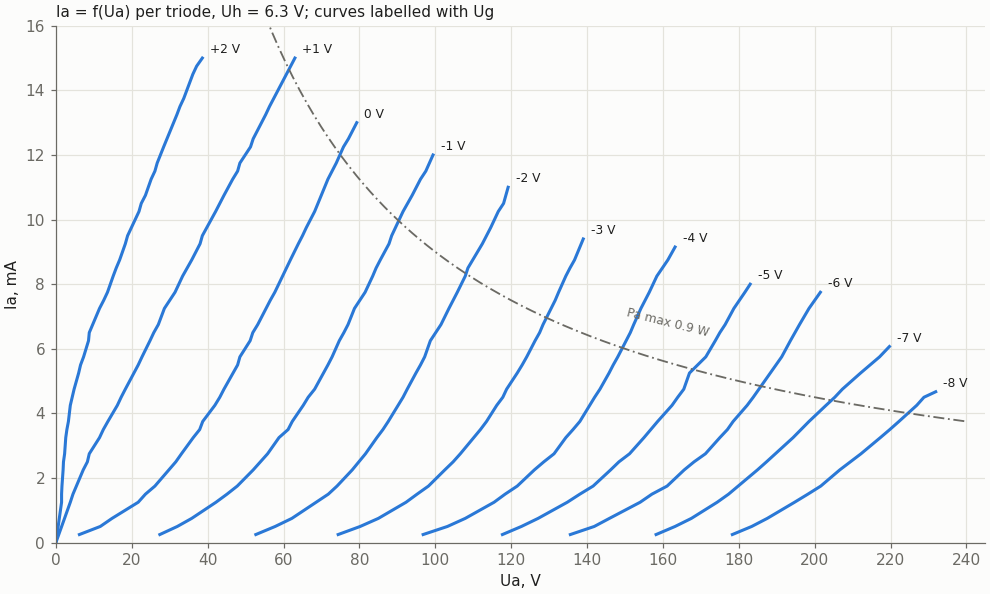
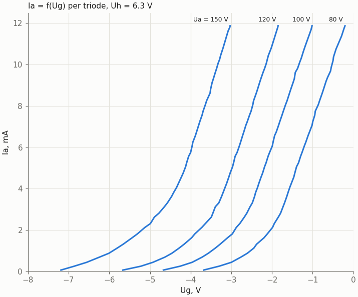
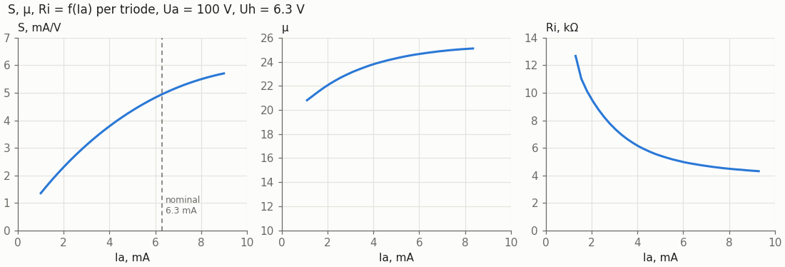
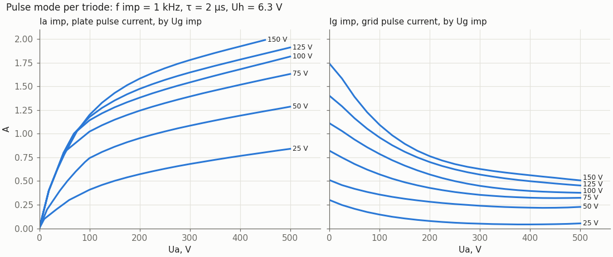
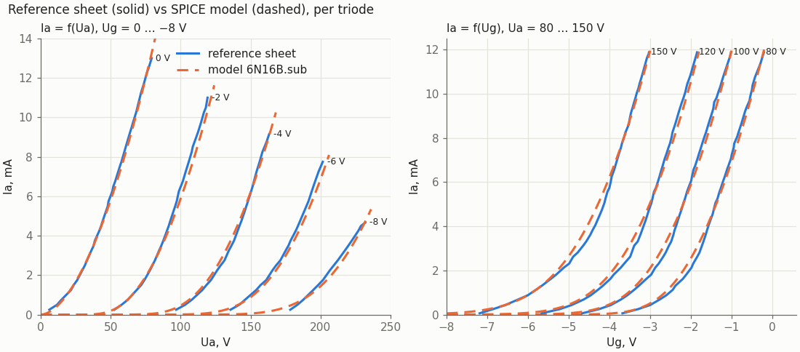

# 6N16B (6Н16Б) double triode: reference sheet

This page redraws the Soviet reference sheet for the 6N16B (pages 48–50) as Markdown. The original scan is at https://frank.pocnet.net/sheets/113/6/6N16B.pdf.

The tables are transcribed from the sheet. The curves were digitized from the scan; the data are in `doc/data/6n16b_datasheet.json`, and the plots are drawn by `tools/spice/datasheet_6n16b_plots.py`. The last section compares the sheet with the SPICE model `sch/libs/6N16B.sub`. Cells built on this tube: `doc/nor2_n16_6n16b.md`.

## Description

The 6N16B is a double triode intended for low-frequency voltage amplification and for generating high-frequency currents.

- **Construction:** a subminiature glass bulb with eight flexible leads and an indirectly heated oxide cathode.
- **Environment:** works from −70 to +100 °C and at 95–98 % relative humidity at +50 °C. It withstands:
  - linear acceleration up to 100 g;
  - vibration up to 10 g;
  - repeated shocks up to 10 g;
  - single shocks up to 500 g.
- **Weight:** 4 g at most.
- **Guaranteed service life:** 750 h.

## Electrical characteristics

| Quantity | Value | Note |
|---|---|---|
| Heater voltage Uh | 6.3 V | |
| Heater current Ih | 400 ± 40 mA | |
| Plate voltage Ua | 100 V | measurement conditions |
| Cathode resistor Rk | 325 Ω | for self-bias |
| Plate current Ia | 6.3 ± 1.9 mA | each triode |
| Transconductance S | 5.0 ± 1.25 mA/V | each triode |
| Amplification factor μ | 25 ± 5 | each triode |
| Input resistance Rg1k | 32 kΩ | at f = 50 MHz |
| Vibration noise U~eff | ≤ 15 mV | |

## Interelectrode capacitances

| Between | Value |
|---|---|
| grid – cathode, Cg1k | 2.7 ± 0.7 pF |
| plate – cathode, Cak | 1.65 ± 0.55 pF |
| grid – plate, Cg1a | 1.5 ± 0.5 pF |
| plate 1 – plate 2, Ca1a2 | 0.5 ± 0.15 pF |
| cathode – heater, Ckh | ≤ 7.0 pF |

## Maximum and minimum ratings

| Quantity | Max | Min | Note |
|---|---|---|---|
| Heater voltage Uh | 6.9 V | 5.7 V | |
| Plate voltage Ua | 200 V | | |
| Plate voltage Ua, tube cut off | 350 V | | with Ia ≤ 5 µA |
| Grid voltage UgT | −50 V | | most negative grid voltage |
| Plate dissipation Pa | 0.9 W | | each triode |
| Grid dissipation PgT | 0.1 W | | each triode |
| Cathode current Ik | 14 mA | | |
| Cathode – heater voltage Ukh | 150 V | | |
| Grid circuit resistance RgT | 1 MΩ | | 2 MΩ is allowed at Pa ≤ 0.6 W with self-bias |
| Bulb temperature | 170 °C | | |

## Pinout and dimensions

Pinout, viewed from the lead end:

| Pin | Electrode | KiCad symbol `vacuum_tube:6Н16Б` |
|---|---|---|
| 1 | plate, triode 2 (a T2) | unit A, A |
| 2 | cathode, triode 1 (k T1) | unit B, K |
| 3 | grid, triode 1 (g T1) | unit B, G |
| 4 | heater (h) | unit A, F1 |
| 5 | plate, triode 1 (a T1) | unit B, A |
| 6 | cathode, triode 2 (k T2) | unit A, K |
| 7 | grid, triode 2 (g T2) | unit A, G |
| 8 | heater (h) | unit A, F1 |

Unit A of the KiCad symbol is triode 2 and unit B is triode 1. The SPICE pin map is `Sim.Pins "1=Pa 7=Ga 6=Ka 5=Pb 3=Gb 2=Kb"`; the heater is not modelled. The drawing marks the key "A" on the bulb between leads 1 and 8.

Dimensions, in mm:

| Feature | Value |
|---|---|
| Bulb diameter | 10.2 max |
| Bulb length | 36 max |
| Lead length | 30 min |
| Lead diameter | 0.38–0.5 |
| Dimension "5 max" | measured from the bulb along the leads (as dimensioned on the drawing) |

## Curves

All curves are per triode, at Uh = 6.3 V. Each figure keeps the axes and ranges of the sheet.

### Ia = f(Ua)

- Grid voltage runs from +2 V to −8 V in 1 V steps.
- The dash-dot hyperbola is Pa max = 0.9 W.
- The curves start at 0.25 mA, the first row of the scan that can be read above the axis.

### Ia = f(Ug)

Plate voltages are 80, 100, 120 and 150 V. The current falls to zero at:

| Ua | Ug at Ia = 0 |
|---|---|
| 80 V | −3.7 V |
| 100 V | −4.7 V |
| 120 V | −5.7 V |
| 150 V | −7.2 V |

The two families on the sheet do not agree exactly. Ia = f(Ua) gives 0.04–0.46 mA (up to 7 %) more than Ia = f(Ug) at the same (Ug, Ua):

| Ug, Ua | Ia from Ia = f(Ua) | Ia from Ia = f(Ug) |
|---|---|---|
| −2 V, 100 V | 6.48 mA | 6.02 mA |
| −5 V, 150 V | 2.64 mA | 2.29 mA |
| −3 V, 120 V | 4.96 mA | 4.90 mA |

This is in the original drawings, not in the digitizing.

At Ua = 100 V the nominal 6.3 mA flows at Ug = −1.97 V. This matches the nominal self-bias point: 6.3 mA × 325 Ω = 2.05 V.

### S, μ, Ri = f(Ia), Ua = 100 V

The sheet draws the three curves on one plot with three scales. Here each gets its own panel.

At Ia = 6.3 mA the digitized curves give:

| Parameter | Value |
|---|---|
| S | 4.95 mA/V |
| μ | 24.7 |
| Ri | 4.87 kΩ |

The product S·Ri = 24.1 ≈ μ, so the three digitized curves agree with each other and with the table (5.0 mA/V, μ 25).

### Pulse mode: Ia imp, Ig imp = f(Ua)

- Pulses at f = 1 kHz with τ = 2 µs.
- Positive grid pulses Ug imp of 25 to 150 V.
- Plate pulse current (left) and grid pulse current (right).
- Up to about 0.8 A the plate curves for 75–150 V coincide.

## Sheet vs SPICE model

`sch/libs/6N16B.sub` is a Koren model (MU 25.96, EX 1.79, KG1 557.56, KP 137.33, KVB 391.9). Against the digitized curves:

| Ug | Ua | Sheet | Model | Difference |
|---|---|---|---|---|
| 0 V | 40 V | 3.95 mA | 3.89 mA | −2 % |
| 0 V | 60 V | 8.31 mA | 8.05 mA | −3 % |
| −2 V | 100 V | 6.48 mA | 5.89 mA | −9 % |
| −2 V | 115 V | 9.85 mA | 9.26 mA | −6 % |
| −4 V | 140 V | 4.12 mA | 4.42 mA | +7 % |
| −4 V | 160 V | 8.53 mA | 8.33 mA | −2 % |
| −6 V | 180 V | 3.95 mA | 3.62 mA | −8 % |
| −6 V | 200 V | 7.50 mA | 6.88 mA | −8 % |

The model is within 10 % of the sheet over the drawn range, well inside the ±30 % spread of Ia in the table (6.3 ± 1.9 mA).

- **Where the model is low:** it gives 6–9 % less current at Ug = −2 V and −6 V; at −4 V it is within +7…−2 %.
- **Near cut-off:** its foot is softer. On the Ia = f(Ug) curves the model still conducts a few tens of µA where the sheet shows zero.

The model is not fitted to these curves. A refit would be the place to use `doc/data/6n16b_datasheet.json`, but real tubes still have to be measured (REQ-MOD-004).

## Digitization

The scan was rendered at 300 dpi. For each plot:

1. The grid was calibrated from its lines.
2. Curve pixels were separated from the grid by line thickness: curves are about 5 px wide, grid lines 2–3 px.
3. Points were assigned to curves, by order along each row or along a guided band.
4. The result was checked by drawing the points over the scan.

The Ia = f(Ua) and Ia = f(Ug) points are the digitized pixels themselves; S, μ, Ri and the pulse curves are smooth fits through them. Accuracy is about one line width:

| Plot | Accuracy |
|---|---|
| Ia = f(Ua) | ±0.5 V, ±0.03 mA |
| Ia = f(Ug) | ±0.03 V |
| S | ±0.05 mA/V |
| μ | ±0.2 |
| Ri | ±0.2 kΩ |
| Pulse curves | ±0.01 A |

The curve ends are the ends of the drawn lines.

Two exceptions:
- the pulse plate curves below 100 V, where the lines run together;
- the grid-current curves at Ua = 0.

These were read by hand off a 3× zoom of the scan.

To redraw the figures: `tools/spice/datasheet_6n16b_plots.py [OUT_DIR]` (default `doc/img`). It also prints the comparison table above.
