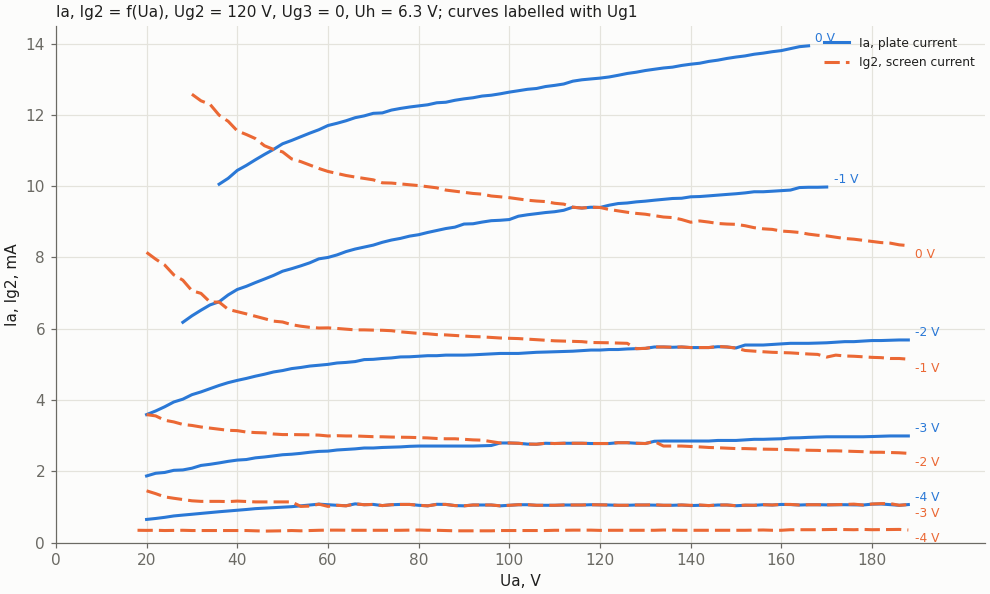
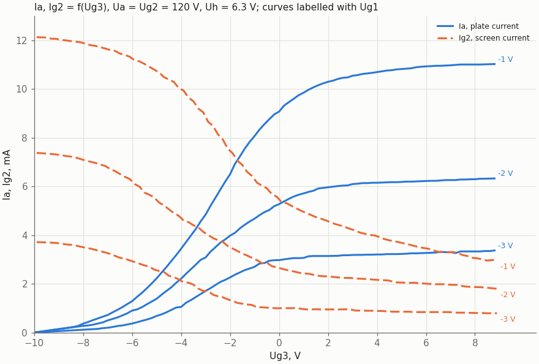
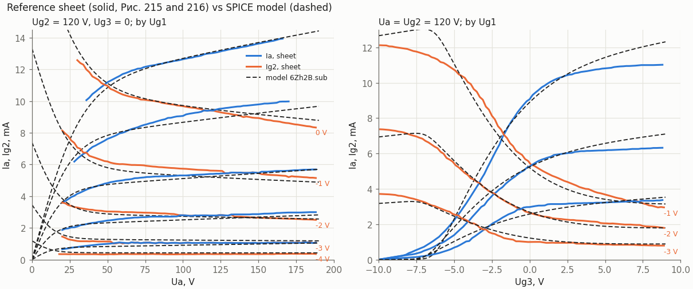

# 6Zh2B (6Ж2Б) pentode: reference sheet

This page redraws two Soviet sheets for the 6Zh2B as Markdown:

- **The handbook page** (Рис. 214–216). It cites Анисимов В., «Миниатюрные радиолампы», «Радио», 1954, № 3. Copy: `doc/data/6zh2b_sheet_p1.gif`.
- **The label sheet** of the 6Ж2Б-В, «частные технические условия 3.300.020 ТУ1» (printed 1981, Зак. 1685—81). Copy: `doc/data/6zh2b_sheet_p2.gif`.

Both scans were supplied by the owner; neither has a URL. The tables are transcribed from the sheets. The curves were digitized from the handbook page following `doc/digitizing_reference_sheets.md`. The data are in `doc/data/6zh2b_datasheet.json`, and the plots are drawn by `tools/spice/datasheet_6zh2b_plots.py`.

On the 6Ж2Б-В sheet, the "-В" means increased reliability. Its limits differ from the handbook's in places, and **its lead numbering is different** (see [Pinout](#pinout-and-dimensions)).

This repo already has a KiCad symbol `vacuum_tube:6Ж2Б` and liberty cells `BUF_6J2B`, `NAND2_J2` (`sch/logic/vtube_cells.lib`). The SPICE model is `sch/libs/6Zh2B.sub`, fitted to the curves on this page by `tools/spice/fit_6zh2b.py`; the comparison is in [Model](#model).

## Description

The 6Zh2B is a high-frequency pentode with a short (sharp cut-off) characteristic. It is intended for pulse-forming circuits and is used in pulse circuits and VHF equipment. Its third grid is brought out to its own lead, so the third grid can act as a second control grid (the 6Ж2Б-В sheet calls the tube a "pentode with dual control").

- **Construction:** a miniature glass bulb with an indirectly heated oxide cathode.
  - Wire leads: 7 of them, flexible.
  - Lead diameter: 0.4 mm.
  - Untinned part of a lead: at most 5 mm from the bulb.
- **Position:** works in any position.
- **Service life:**
  - Handbook: at least 500 h.
  - 6Ж2Б-В: minimum operating life 5000 h, storage life 15 years.

## Electrical characteristics

Nominal conditions and data from the handbook, with the 6Ж2Б-В values next to them:

| Quantity | 6Ж2Б (handbook) | 6Ж2Б-В (ТУ) |
|---|---|---|
| Heater voltage Uh | 6.3 V | 6.3 V |
| Plate voltage Ua | 120 V | 120 V |
| Grid 3 voltage Ug3 | 0 V | — |
| Grid 2 voltage Ug2 | 120 V | 120 V |
| Grid 1 voltage Ug1 | — | self-bias |
| Cathode resistor Rk for self-bias | 200 Ω | 200 Ω |
| Heater current Ih | 200 ± 20 mA | 180–220 mA |
| Plate current Ia | 5.5 ± 2 mA | 3.5–7.5 mA |
| Grid 2 current Ig2 | ≤ 6 mA | ≤ 5.5 mA |
| Transconductance S | 3.2 ± 1.3 mA/V | 2.8–4.7 mA/V |
| S at Uh = 5.7 V | ≥ 2.2 mA/V | — |
| Grid 1 reverse current | — | ≤ 0.15 µA |
| Cathode–heater leakage | ≤ 20 µA (ratings table) | ≤ 20 µA |

End-of-life criteria for the 6Ж2Б-В:
- S ≥ 2.3 mA/V;
- grid 1 reverse current ≤ 0.5 µA;
- change of S within +30 / −40 %.

## Interelectrode capacitances

| Between | 6Ж2Б | 6Ж2Б-В |
|---|---|---|
| input | 4.9 ± 0.85 pF | 4.05–5.75 pF |
| output | 4.1 ± 1.0 pF | 3.1–5.1 pF |
| grid 1 – plate (transfer) | ≤ 0.03 pF | ≤ 0.03 pF |
| grid 3 – plate | not given | not given; **1.8 pF measured** by the owner on one 6Ж2Б-В, 2026-10-24 (cold tube) |
| cathode – heater | ≤ 7 pF | ≤ 7 pF |

## Maximum and minimum ratings

| Quantity | 6Ж2Б | 6Ж2Б-В | Note |
|---|---|---|---|
| Heater voltage Uh | 5.7–6.9 V | 5.7–6.9 V | |
| Plate voltage Ua | 150 V | 150 V | |
| Plate voltage, tube cut off | — | 250 V | with Ia ≤ 5 µA |
| Grid 1 voltage Ug1 | — | −50 V | |
| Grid 2 voltage Ug2 | 125 V | 125 V | |
| Grid 2 voltage, tube cut off | — | 250 V | with Ia ≤ 5 µA |
| Plate dissipation Pa | 0.9 W | 0.9 W | |
| Grid 2 dissipation Pg2 | **0.6 W** | **0.7 W** | sheets differ |
| Cathode current Ik | 14 mA | 14 mA | |
| Cathode – heater voltage Ukh | **100 V** DC | **±150 V** | sheets differ |
| Grid 1 circuit resistance Rg1 | 1.0 MΩ | 1 MΩ | |
| Bulb temperature | — | 170 °C | at normal ambient temperature |

## Pinout and dimensions

The two sheets number the leads differently. **Check which sheet applies to the tube in hand before wiring a socket.**

| Electrode | 6Ж2Б, handbook (Рис. 214) | 6Ж2Б-В, ТУ | KiCad `vacuum_tube:6Ж2Б` |
|---|---|---|---|
| anode | 1 | 5 | 1 (A) |
| grid 3 | 2 | 3 | 2 (G3) |
| grid 2 (screen) | 3 | 6 | 3 (G) |
| heater | 4, 5 | 1, 7 | 4, 5 (F1) |
| cathode | 6 | 4 | 6 (K) |
| grid 1 (control) | 7 | 2 | 7 (G1) |
| — | | 8: cut off or missing | |

- **Handbook:** the base is viewed from the lead side. The seven leads are in one row, 1 to 7, and a colour mark (ЦМ) is at the pin-1 end.
- **6Ж2Б-В:**
  - the leads are drawn as 8 positions on a circle, counted clockwise from the cut-off or missing lead 8;
  - the sheet does not say from which side the drawing is viewed;
  - do not bend a lead closer than 3 mm to the glass of the stem.
- **KiCad:** the symbol follows the handbook numbering.

Dimensions, in mm:

| Feature | 6Ж2Б | 6Ж2Б-В |
|---|---|---|
| Bulb diameter | 10.2 (drawing) | ≤ 10.2 |
| Bulb length without leads | 36 (drawing) | ≤ 36 |
| Lead length | ≥ 35 | ≥ 40 |
| Lead diameter | 0.4 | 0.4 |

## Curves

The handbook gives averaged characteristics at Uh = 6.3 V. Both figures draw the plate current Ia as solid lines and the screen current Ig2 as dashed lines, for Ug1 = 0 … −4 V. Each redrawn figure keeps the axes of the sheet.

### Ia, Ig2 = f(Ua), Ug2 = 120 V, Ug3 = 0 (Рис. 215)

- **Where the lines run together:** Ia at Ug1 = −4 V and Ig2 at Ug1 = −3 V are one line on the sheet from Ua ≈ 55 V to 190 V, at about 1.08 mA. Both curves carry the points of that line there.
- **Where the lines touch:** Ia at −3 V touches Ig2 at −2 V at 100–130 V (2.78–2.83 mA).
- **Range:** the curves run to 190 V, past the 150 V limit on Ua.
- **Ratings:** many points are beyond the ratings: Ua·Ia up to 2.3 W (Pa max 0.9 W), Ia + Ig2 up to about 22 mA (Ik max 14 mA). A tester must not hold the tube at those points for long.

### Ia, Ig2 = f(Ug3), Ua = Ug2 = 120 V (Рис. 216)

Grid 3 acts as a second control grid. At Ug3 = −10 V the plate current is cut off for all three Ug1 values, while the screen current is at its largest: Ig2 = 12.1, 7.4 and 3.7 mA. As Ug3 rises, current moves from the screen to the plate.

Below Ug3 ≈ −8 V the three Ia lines run together into the corner (−10 V, 0). The data give only that end point, with no points in between.

### Operating point

At the nominal point the self-bias is Ug1 = −(Ia + Ig2)·Rk with Rk = 200 Ω. On Рис. 215 at Ua = 120 V this gives the following values, all inside the table limits:

| | Curves | Table |
|---|---|---|
| Ug1 | −1.85 V | self-bias |
| Ia | 6.0 mA | 5.5 ± 2 mA |
| Ig2 | 3.2 mA | ≤ 6 mA |
| S | 3.5 mA/V | 3.2 ± 1.3 mA/V |

The two figures meet at Ug3 = 0, Ua = 120 V, and agree there within 0.33 mA (at most 7 %):

| Ug1 | Ia, Рис. 216 | Ia, Рис. 215 | Ig2, Рис. 216 | Ig2, Рис. 215 |
|---|---|---|---|---|
| −1 V | 9.07 mA | 9.40 mA | 5.47 mA | 5.61 mA |
| −2 V | 5.27 mA | 5.40 mA | 2.65 mA | 2.78 mA |
| −3 V | 2.97 mA | 2.78 mA | 0.99 mA | 1.06 mA |

## Digitization

The scans are low-resolution GIFs, with 21 px per grid step: 10 V or 1 mA on Рис. 215, and 1 V or 1 mA on Рис. 216. Each figure went through these steps:

1. Cropped and sheared straight with `digitize.py deskew`. Before that, the grid lines tilted by up to 4.4 px across Рис. 215, about 0.2 mA.
2. Upscaled 3× so that line thickness could separate curves from the grid. Grid lines are 1–5 px wide there, curves 5–7 px, and a curve lying on a grid line makes a run of 8 px or more.
3. Points collected with `band` along guides, separately for the solid and the dashed curves.
4. Resampled as the median of the points in bins (`fit --basis median`): 2 V on Рис. 215, 0.2 V on Рис. 216. Gaps in the dashed curves are the gaps between dashes.
5. Checked by overlay on the deskewed crop: `doc/data/6zh2b_ia_ic2_ua_overlay.png`, `doc/data/6zh2b_ia_ic2_ug3_overlay.png`.

Accuracy is about one line width:

| Figure | Accuracy |
|---|---|
| Рис. 215 | ±0.5 V, ±0.05 mA |
| Рис. 216 | ±0.05 V, ±0.05 mA |

Read by hand:
- the corner point (−10 V, 0) of the Ia curves on Рис. 216;
- Ia at Ug1 = −1 V, Ug3 = 7.4–8.2 V, which lies on the 11 mA grid line;
- Ig2 at Ug1 = −3 V, Ug3 = 0.3–0.7 V, which lies on the 1 mA grid line.

Across the curves, the largest step against the expected direction is 0.055 mA, about one line width.

To redraw the figures: `tools/spice/datasheet_6zh2b_plots.py [OUT_DIR]` (default `doc/img`).

## Model

`sch/libs/6Zh2B.sub` is a behavioural model fitted to Рис. 215 and 216 by `tools/spice/fit_6zh2b.py`, which also writes the file. Its equations and assumptions are in `sch/logic/NAND2_J2/README.md`, section Model.

| Point | Sheet | Model |
|---|---|---|
| Ia, Ug1 = 0, Ua = 50 V | 11.19 mA | 10.85 mA (−3 %) |
| Ig2, Ug1 = 0, Ua = 50 V | 10.96 mA | 11.12 mA (+1 %) |
| Ia, Ug1 = −2 V, Ua = 120 V | 5.40 mA | 5.24 mA (−3 %) |
| Ia, Ug1 = −4 V, Ua = 120 V | 1.06 mA | 0.94 mA (−12 %) |
| Ia / Ig2, Ug1 = −1 V, Ug3 = −5 V | 2.22 / 10.73 mA | 2.30 / 11.07 mA |
| Ia, Ug1 = −1 V, Ug3 = 0 | 9.07 mA | 8.90 mA (−2 %) |
| Ig2, Ug1 = −1 V, Ug3 = −9.9 V | 12.12 mA | 12.67 mA (+5 %) |
| Self-bias point, Rk = 200 Ω: Ia, Ig2 at Ug1 = −1.85 V | 6.0, 3.2 mA (table 5.5 ± 2, ≤ 6) | 5.73, 2.98 mA |
| S at that point | 3.5 mA/V (table 3.2 ± 1.3) | 3.34 mA/V |

The table is printed by `tools/spice/datasheet_6zh2b_plots.py`, which draws the figure through ngspice.
