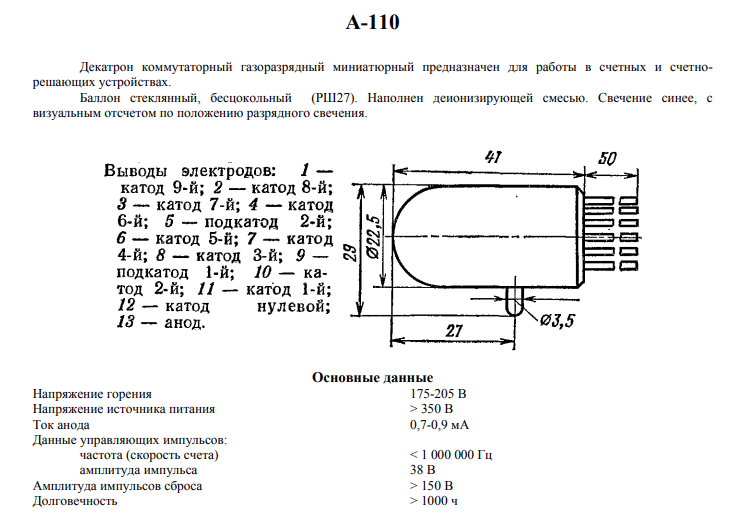

# A110 (А-110) dekatron: reference sheet

This page transcribes the one-page Soviet reference sheet for the A110 dekatron as Markdown. The owner supplied the sheet as an image on 2026-11-01. No URL is known, so the image is kept at `doc/data/a110_sheet.png`. The data are also in `doc/data/a110_datasheet.json`. The tube physics from the Lipkin and Yablonsky books and the SPICE model `sch/libs/A110.sub` are in `doc/dekatron_physics.md` (Russian); neither book covers the A110.

The sheet is short. It has no curves, no ratings table, no capacitances and no tolerances. Section "What the sheet does not give" lists what is missing; those values still have to be measured (OPEN-013, OPEN-014).

## Description

The A-110 is a miniature gas-discharge switching dekatron, intended for counting and counting-decision devices.

- **Construction:** a glass bulb with no base (РШ27). There are 13 flexible leads, and every main cathode has its own lead.
- **Gas:** filled with a deionizing mixture.
- **Readout:** blue glow. The value is read by eye from the position of the discharge.

"Switching" (коммутаторный) means each of the ten cathodes has its own lead, so the position can be read electrically. The machine needs this to read the counters (REQ-DEK-016).

What "РШ27" means is not written on the sheet. It is printed as given.

## Main data

| Quantity | Value |
|---|---|
| Burning voltage | 175–205 V |
| Supply voltage | > 350 V |
| Anode current | 0.7–0.9 mA |
| Control pulses: frequency (counting rate) | < 1 000 000 Hz |
| Control pulses: amplitude | 38 V |
| Reset pulse amplitude | > 150 V |
| Service life | > 1000 h |

## Pinout

| Pin | Electrode | KiCad symbol `vacuum_tube:А110` |
|---|---|---|
| 1 | cathode 9 | 9 |
| 2 | cathode 8 | 8 |
| 3 | cathode 7 | 7 |
| 4 | cathode 6 | 6 |
| 5 | guide (sub-cathode) 2 | п2 |
| 6 | cathode 5 | 5 |
| 7 | cathode 4 | 4 |
| 8 | cathode 3 | 3 |
| 9 | guide (sub-cathode) 1 | п1 |
| 10 | cathode 2 | 2 |
| 11 | cathode 1 | 1 |
| 12 | cathode 0 | 0 |
| 13 | anode | Анод |

The KiCad symbol in `sch/libs/vacuum_tube.kicad_sym` matches the sheet on all 13 pins.

The sheet has no lead-end view. It does not show how the leads are placed or where the key is.

## Dimensions

All dimensions are in mm. The sheet gives no max/min marks.

| Feature | Value |
|---|---|
| Bulb diameter | 22.5 |
| Bulb length, from the dome to the lead end | 41 |
| Lead length, from the bulb end | 50 |
| Height over the bulb and the glass pip below it | 29 |
| Dome to the pip | 27 |
| Pip diameter | 3.5 |

The pip is a short glass stub on the side of the bulb, about 6.5 mm long (29 − 22.5). The drawing does not make clear whether the 27 mm dimension ends at the pip's axis or at its far edge.

## What the sheet does not give

None of these values is on the sheet:

- tolerances and a ratings table (maximum/minimum values);
- control pulse width, polarity and shape, and guide bias;
- the cathode load resistor and the read-out voltage across it;
- the minimum time on each guide, the time to fall from a guide to a main cathode, and the minimum write/reset time (the project's estimates are `DEKATRON_GUIDE_STEP_NS` 200, `DEKATRON_FALL_STEP_NS` 300, `DEKATRON_WRITE_MIN_NS`/`DEKATRON_RESET_MIN_NS` 5000 in `rtl/parameters.sv`, OPEN-013);
- which electrode the reset pulse goes to, and its polarity and width;
- the striking voltage and the anode resistor;
- capacitances and curves.

## Comparison with the project

- **Counting rate.** The sheet's ceiling is < 1 MHz. The machine runs at 100 kHz (REQ-CLK-001), with guide phases of 600 ns each plus a 300 ns fall in the tube build. This is far below the ceiling. Whether 1 MHz is reachable on a real tube is still OPEN-014. The sheet gives only the upper limit; it is not proof that a step fits in 1 µs.
- **Supply.** The supply must be > 350 V and the anode current 0.7–0.9 mA at 175–205 V burning. This gives an anode resistor of about (350 − 205) / 0.9 mA ≈ 161 kΩ to (350 − 175) / 0.7 mA ≈ 250 kΩ at a 350 V supply. This range is derived here; it is not on the sheet. The stand's 300–500 V dekatron supply module (`doc/stand_psu_schematic_review.md`) covers 350 V.
- **Guide pulses: 38 V.** Logic levels are +150/+50 V high-voltage and +10/−20 V low-voltage (REQ-MOD-012). A 38 V guide swing therefore needs its own driver. The polarity is not on the sheet: it is negative-going on dekatrons in general, but unconfirmed for the A110.
- **Reset: > 150 V.** The model resets by isolating every main cathode except the target (REQ-MOD-007). The sheet's figure fits the other approach, a pulse on the cathodes. A 150 V amplitude gives the size of what an isolating switch must withstand or a reset driver must swing. REQ-MOD-007 stays open until the experiment is done.
- **Service life: > 1000 h.** This is the guaranteed minimum for each tube. It matters for planning spares.
