# Бонч-Бруевич, «Применение электронных ламп в экспериментальной физике»: что полезно для DekatronPC

Источник: А. М. Бонч-Бруевич, «Применение электронных ламп в экспериментальной физике»,
скан doc/lampi_experimentalnaya_fizika.djvu (490 страниц, текстового слоя нет, читался как
изображения).

Рисунки в doc/img/bonch_bruevich/ вырезаны из скана и приводятся как цитаты
с указанием номера рисунка и страницы книги.

**Ссылки на страницы** ниже даны по печатным номерам книги («с. 153»). В djvu-файле номер
страницы на единицу больше (с. 153 книги = страница 154 djvu). Оглавление: с. 3–6.

Большая часть книги про аналоговую технику: линейные усилители, генераторы, электрометры,
питание. Для отчёта прочитаны: гл. II §3 (входная проводимость), гл. IV §1–§3 (импульсные
усилители, коррекция, катодный повторитель), гл. VI §2–§3 (триггеры, пересчётные схемы,
декады), гл. VIII §2 и §5 (скорость счёта, схемы совпадений). Цель: скорость переключения
лампового каскада (REQ-MOD-\*, OPEN-014). Почти всё подтверждает то, что уже найдено
моделированием в doc/cell_design_method.md. Новое: формулы для оценки «на бумаге» и правило
выбора корректирующей индуктивности (§2).

## 0. Входная ёмкость (гл. II §3, с. 77–78)

- `Cвх = Cgk + Cag·(1 + k)` для каскада с активной анодной нагрузкой (ф. 122, с. 78,
  рис. 86). Отсюда ≈ 30 пФ эффекта Миллера в таблице §2 методики.

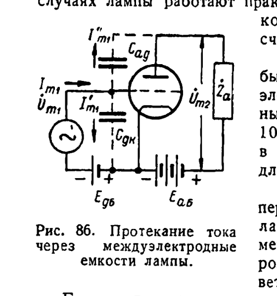

*Рис. 86. Протекание тока через междуэлектродные ёмкости лампы. Бонч-Бруевич, с. 78.*

## 1. Время фронта каскада на сопротивлениях (гл. IV §1, с. 149–155)

- Эквивалентные схемы со всеми паразитными ёмкостями: рис. 157–158 (с. 150).
- Анодный узел — это RC-цепь: полное установление `t ≈ 5τa` (ф. 203, с. 153), время
  нарастания при линейной аппроксимации `tф ≈ τa = Ra·C2` (ф. 204, рис. 162, с. 153).
  C2 = ёмкость анода + монтажа + входа следующего каскада.
- Усиление `k = S·Ra` (ф. 205, с. 154), поэтому при заданном фронте свободен только
  параметр **S / C2**: уменьшение Ra ускоряет фронт ровно во столько же раз, во сколько
  снижает усиление. Пример (с. 154): импульс 2 мкс, фронт 10 %, C2 = 30 пФ → Ra ≤ 1,3 кОм,
  k ≈ 1,3–2 у пентода с S = 1–1,5 мА/В. Выход по книге — лампы с большой крутизной:
  6Ж4 / 6АС7, 9–12 мА/В (с. 154). У нас 6Н16Б — 5 мА/В, 6Ж2Б — 3,2 мА/В
  (doc/6n16b_datasheet.md, doc/6zh2b_datasheet.md), то есть по меркам книги ни одна
  из них не «быстрая».
- Форма импульсов 2/10/40 мкс после каскада на 6Ж7Б: рис. 160 (с. 152).
- Разделительный конденсатор: τg = Rg·Cg должна быть ≫ самого длинного импульса, иначе
  вершина проседает (ф. 206, с. 154). Наши ячейки связаны через делители по постоянному
  току, так что это касается только импульсных цепей (PhaseGen, импульсы подкатодов).

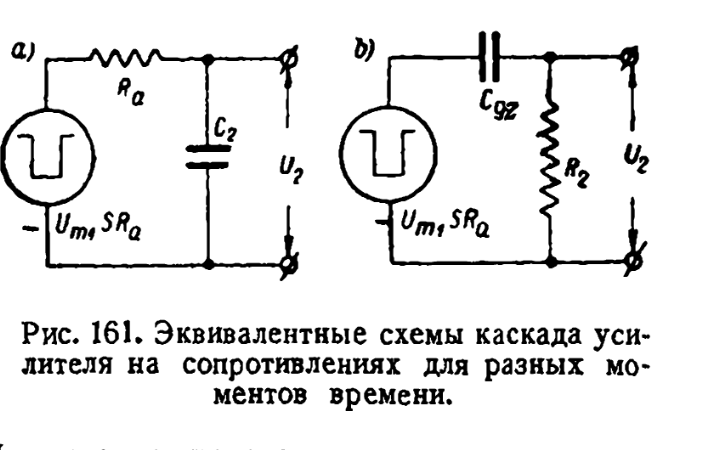

*Рис. 161. Эквивалентные схемы каскада усилителя на сопротивлениях для разных моментов времени. Бонч-Бруевич, с. 153.*

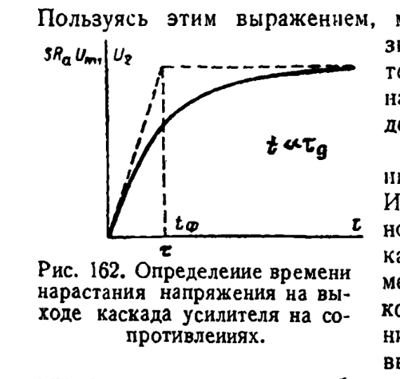

*Рис. 162. Определение времени нарастания напряжения на выходе каскада усилителя на сопротивлениях. Бонч-Бруевич, с. 153.*

## 2. Коррекция индуктивностью в аноде (гл. IV §2, с. 162–167): самое полезное

Индуктивность La последовательно с Ra (рис. 167–168, с. 163). Параметр
`p = La / (C2·Ra²)` (ф. 222, с. 163):

| p | эффект | страница |
|---|---|---|
| 0,32 | линейная ФЧХ (импульс без фазовых искажений) | с. 165 |
| **0,35** | рекомендуемое: выброса на ступеньке почти нет, полоса ≈ ×2 | с. 165, рис. 171 на с. 166 |
| 0,41 | максимально плоская АЧХ, полоса ×2,5 | с. 164, рис. 169 |
| ≥ 0,5 | заметный выброс; при p = 1 пик ≈ 1,35 | рис. 171, с. 166 |

Расчёт: `La = p·Ra²·C2` (с. 166). Пример (с. 165–166): 6АС7, C2 = 25 пФ, фронт 0,05 мкс →
без коррекции Ra = 2 кОм (k = 20), с коррекцией Ra = 4 кОм и La = 0,14 мГн при p = 0,35
(k = 40): вдвое больше усиление при том же фронте; в общем случае ×2–2,5 (с. 166).

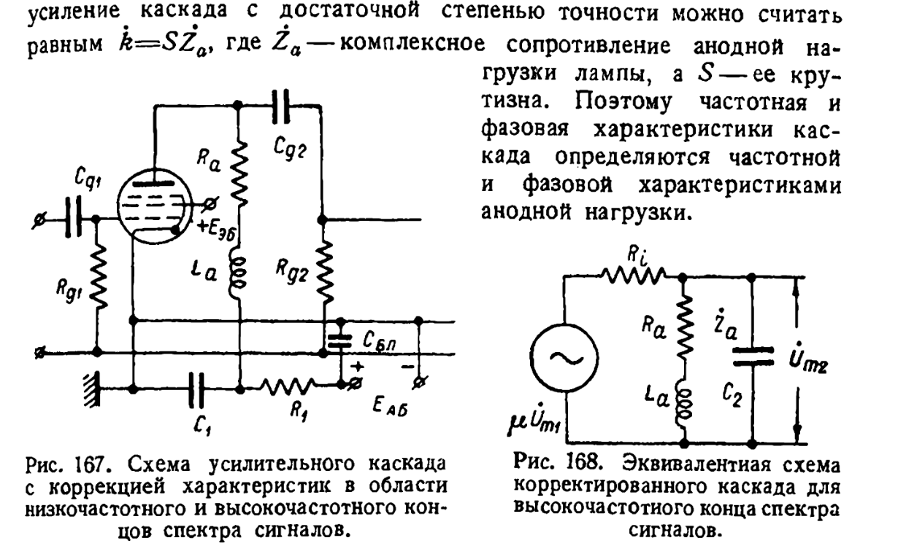

*Рис. 167. Схема усилительного каскада с коррекцией характеристик; рис. 168. Эквивалентная схема корректированного каскада для высокочастотного конца спектра. Бонч-Бруевич, с. 163.*

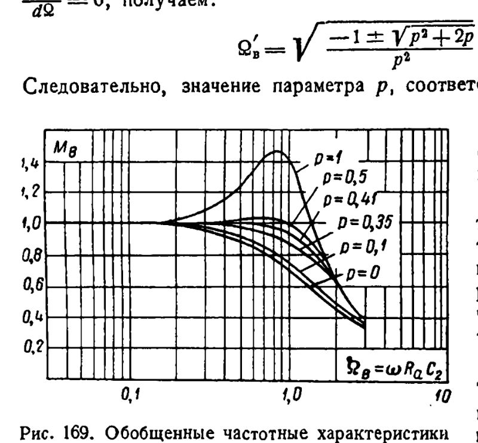

*Рис. 169. Обобщённые частотные характеристики корректированного каскада в области высокочастотного конца спектра. Бонч-Бруевич, с. 164.*

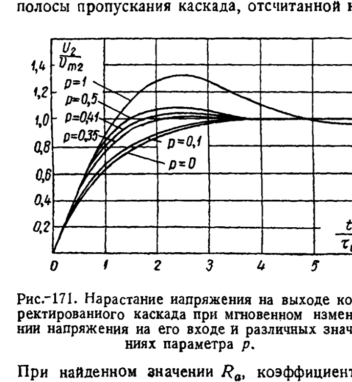

*Рис. 171. Нарастание напряжения на выходе корректированного каскада при мгновенном изменении напряжения на его входе и различных значениях параметра p. Бонч-Бруевич, с. 166.*

**Почему наша прежняя попытка звенела** (методика §4: 1 мГн → −56 В). Первоначальная
гипотеза — сильно меняющаяся ёмкость узла из-за Миллера — **не подтвердилась**: анод видит
сетки нагрузки через C1 последовательно, и ёмкость узла меняется мало. Настоящая причина —
C1 = 6,8 пФ на сетку (перекомпенсация делителя): с ней сетка уходит до −72 В и без катушки.
Результаты проверки — в §8.

## 3. Катодный повторитель (гл. IV §3, с. 185–191)

- `Cвх = Cag + (1 − k)·Cgk` (ф. 239, рис. 190, с. 188): при k → 1 остаётся только Cag.
  Совпадает с нашими ≈ 2 пФ у BUF_N16/OR2_N16.
- При ёмкостной нагрузке входное сопротивление может стать отрицательным, и каскад
  самовозбуждается на десятках МГц (с. 188–189). Обычное средство — антипаразитный резистор
  в сетке 100–300 Ом (общая практика, в книге этого нет).
- `Rвых ≈ 1/S` (ф. 240, с. 189): 200 Ом для 6Н16Б, справедливо до нескольких МГц.
- Полоса как у каскада на сопротивлениях с Ra = 1/S: десятки МГц при десятках пФ
  (ф. 241–243, с. 190).
- В книге нет, но стоит напомнить: повторитель быстр только при нарастании. На спаде лампа
  запирается, и узел разряжается только через Rк (скорость ≈ ΔU / (Rк·C)).

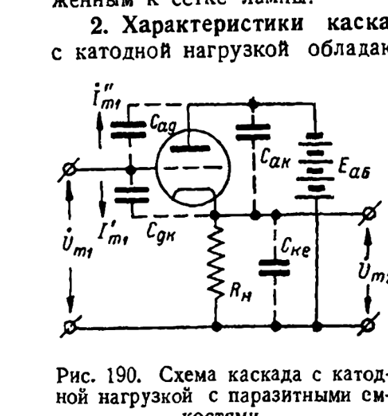

*Рис. 190. Схема каскада с катодной нагрузкой с паразитными ёмкостями. Бонч-Бруевич, с. 188.*

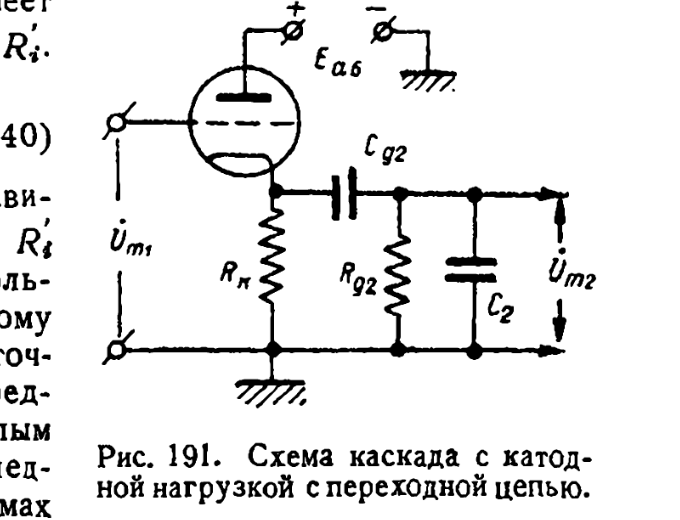

*Рис. 191. Схема каскада с катодной нагрузкой с переходной цепью. Бонч-Бруевич, с. 189.*

## 4. Триггеры (гл. VI §2, с. 272–282)

- Реостатный триггер: рис. 258 (с. 273). Условие регенерации
  `μ·Ra/(Ra+Ri) · R2/(R1+R2) > 1` (ф. 295, с. 273).
- Время опрокидывания `tпер ≈ 2·C2·Ra` (ф. 296, с. 274). Статический расчёт: ф. 297–300
  (с. 275–276). Пример (с. 276): 6Н8, Ra = 10 кОм, C2 = 25 пФ → 5 мкс. При Ra = 1 кОм
  и перепаде 10 В → 0,5 мкс, а если нужен большой перепад, ставят выходной усилитель (с. 277).
- Запускающий импульс может быть в несколько раз короче tпер, достаточно толчка (с. 277).
- Триггер чувствительнее к отрицательному импульсу (тянет вниз сетку открытой лампы), чем
  к положительному: сетка открытой лампы сидит на малом rg (с. 277–278).
- Подача запуска на обе сетки через RC-цепи: рис. 261 (с. 278). Импульс на сетках должен
  быть короче tпер, иначе возможно несколько опрокидываний (с. 278).
- Ускоряющие конденсаторы C1 параллельно R1 нужны для устойчивого опрокидывания:
  «несколько десятков пФ», 100–200 пФ лишь в редких случаях, потому что большая C1
  удлиняет установление после переброса, то есть ухудшает разрешающее время (с. 279).
  У нас компенсированные делители 2,7–3,9 пФ (методика §2); значения книги относятся
  к 6Н7/6Н8 при 250 В и делителям 0,1–1 МОм.
- На вход следует подавать сигнал **с одним** крутым фронтом: импульс с двумя крутыми
  фронтами может дать два опрокидывания (с. 279).
- Рис. 262 (с. 280): запуск на обе сетки через общий R3; схема реагирует только на одну
  полярность (положительную), после дифференцирования — на фронт (с. 280–281).
- Тиратронный триггер: рис. 263 (с. 281). Время деионизации ≈ 10⁻⁴ с (у водородных
  меньше), поэтому медленный (с. 282); тиратронная пересчётная схема — не более нескольких
  тысяч регулярных импульсов в секунду (с. 296). Для логики на 100 кГц непригоден.
- Ждущий мультивибратор: рис. 264 (с. 282), время восстановления — ф. 313–314 (с. 293).

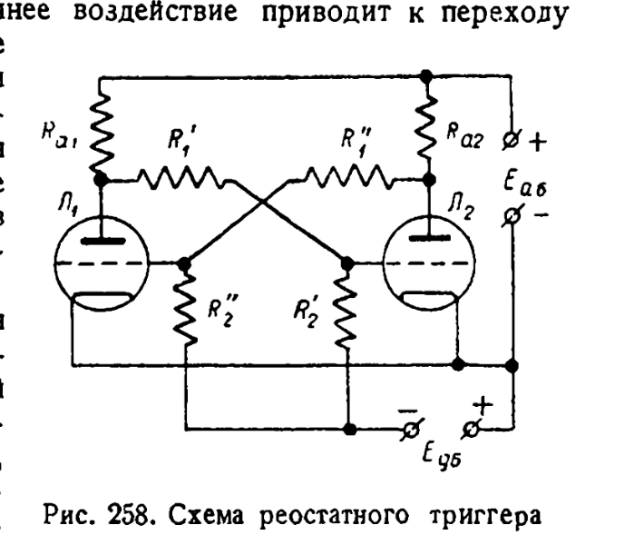

*Рис. 258. Схема реостатного триггера. Бонч-Бруевич, с. 273.*

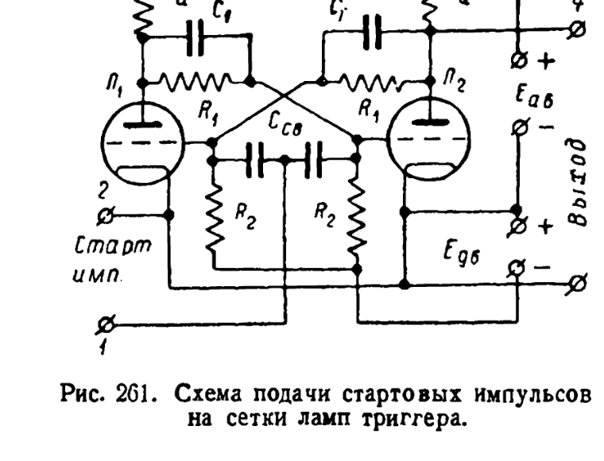

*Рис. 261. Схема подачи стартовых импульсов на сетки ламп триггера. Бонч-Бруевич, с. 278.*

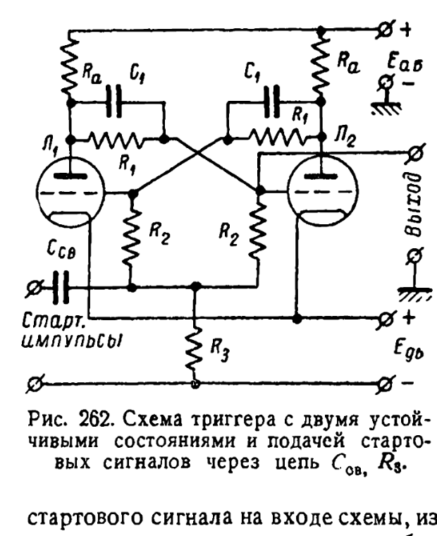

*Рис. 262. Схема триггера с двумя устойчивыми состояниями и подачей стартовых сигналов через цепь Cсв, R3. Бонч-Бруевич, с. 280.*

## 5. Пересчётные схемы и декады (гл. VI §3, с. 293–311)

- Бинарная схема на тиратронах: рис. 272–273 (с. 294–295). На вакуумных лампах установление
  — микросекунды, тысячи и десятки тысяч импульсов в секунду (с. 296).
- Декада = кольцо на 5 + бинарная ячейка (с. 305); кольцо из 5 бинарных ячеек на 6Н7
  (рис. 280–282, с. 306–307); 4 триггера с обратными связями (рис. 283–284, с. 308–310).
  Книга сама отмечает, что декадам нужно больше ламп, чем бинарным схемам (с. 310).
  Декатрон намного дешевле — это подтверждает выбор проекта.
- **Неонка как бесплатное «И» на 2 входа** (рис. 281, с. 306–307): лампочка между анодами
  двух триодов зажигается только когда оба открыты. Десять неонок дешифрируют состояние
  кольца без ламп. Неонки допустимы по REQ-AUTH-\*; годится для индикации состояния, но не
  как логика (нет нагрузочной способности; см. ловушку неонового сдвига уровня в методике §4).
- Входные импульсы должны иметь определённую амплитуду и форму: слишком малые теряются,
  слишком большие или длинные сбивают ячейки, крутой задний фронт может дать лишний отсчёт
  (с. 310). То же правило для импульсов подкатодов декатрона (REQ-PULSE-\*).
- Скорость счёта и просчёты при стандартизации импульса ждущим мультивибратором:
  с. 379–381 (рис. 330–332).

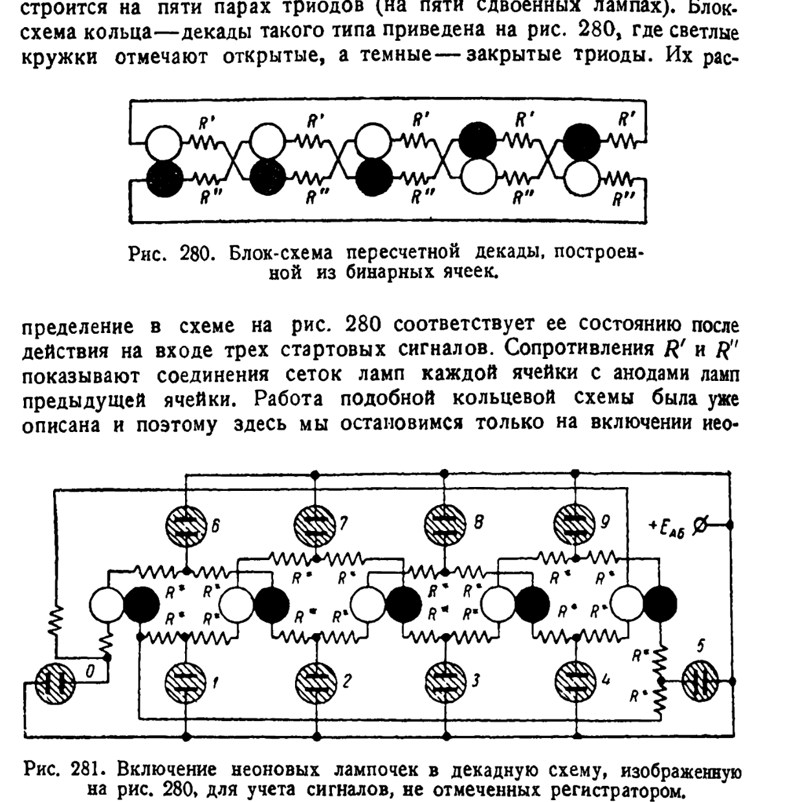

*Рис. 280. Блок-схема пересчётной декады, построенной из бинарных ячеек; рис. 281. Включение неоновых лампочек в декадную схему. Бонч-Бруевич, с. 306.*

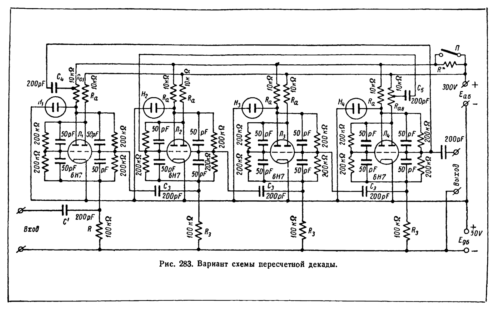

*Рис. 283. Вариант схемы пересчётной декады (4 триггера на 6Н7 с обратными связями). Бонч-Бруевич, с. 308.*

## 6. Схема совпадений = монтажное ИЛИ-НЕ по анодам (гл. VIII §5, с. 418–420)

Схема Росси (рис. 368, с. 419): N ламп с общим анодным Ra; узел поднимается только когда
заперты все лампы. Условие `Rp ≪ Ra ≪ Rp*` (с. 419, рис. 369). На триодах (6С5Б) узел
сдвигается лишь на 50–60 В из 300 В, пока часть ламп открыта (рис. 370, с. 420). На пентодах
Ra выбирают так, чтобы нагрузочная прямая пересекала пологие участки характеристик, и
уровень «0» почти не зависит от числа открытых ламп (с. 420, рис. 371). Тот же довод в пользу
пентодных (6Ж2Б) многовходовых ячеек ИЛИ-НЕ/И перед параллельными триодами при росте числа
входов (ячейки NOR3/NOR4).

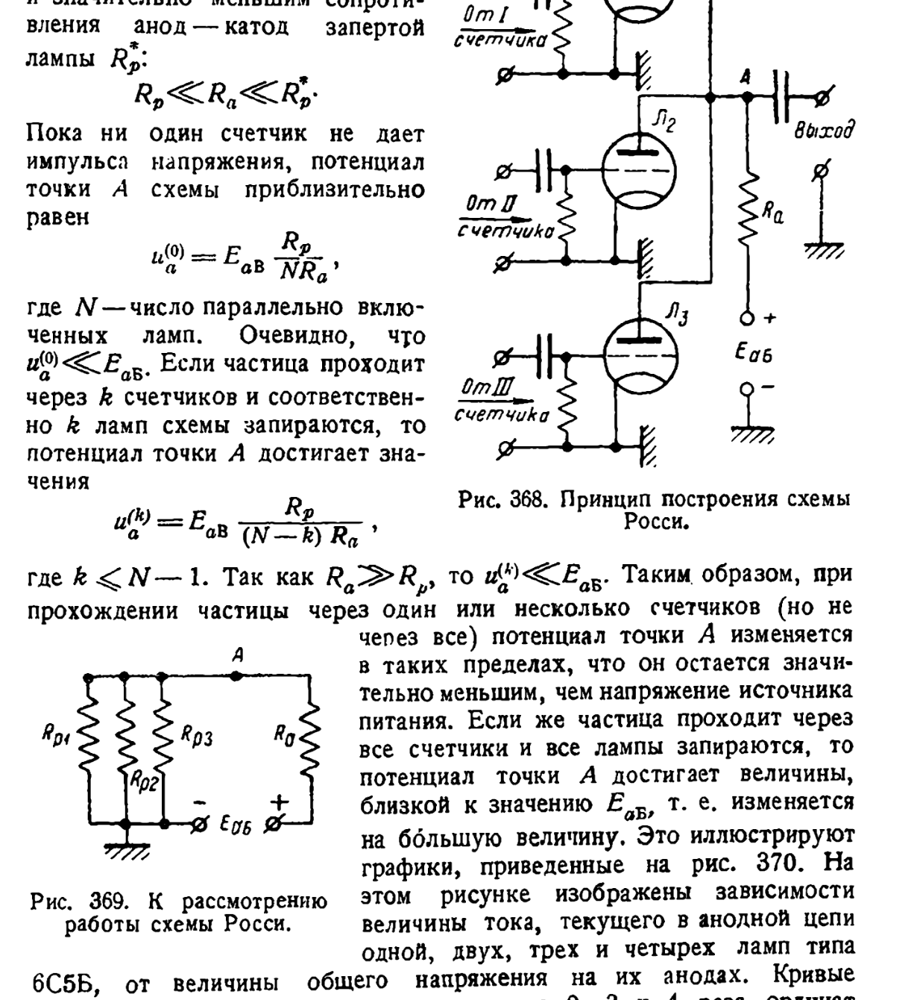

*Рис. 368. Принцип построения схемы Росси; рис. 369. К рассмотрению работы схемы Росси (с текстом страницы). Бонч-Бруевич, с. 419.*

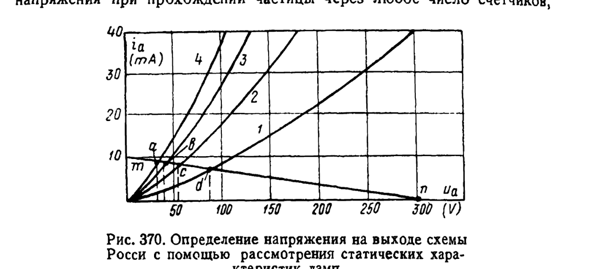

*Рис. 370. Определение напряжения на выходе схемы Росси с помощью рассмотрения статических характеристик ламп. Бонч-Бруевич, с. 420.*

## 7. Итог: как ускорить переключение каскада

| № | Правило | Страницы |
|---|---|---|
| 1 | Фронт = Ra·C узла: сначала уменьшать C (монтаж, нагрузка, Миллер нагрузок), потом Ra | 78, 153–154 |
| 2 | Добротность лампы для импульсов — S/C; быстрее та, у которой больше S при той же C | 154 |
| 3 | Вход — на сетку без Миллера (g1 пентода, сетка повторителя) | 78, 188 |
| 4 | Коррекция индуктивностью: анод ≈ ×2, до следующей сетки −15…−25 %; обязательно демпфировать (§8) | 162–166 |
| 5 | Большую нагрузку вести катодным повторителем (Rвых ≈ 1/S), помня о медленном спаде | 188–190 |
| 6 | Триггер: t ≈ 2·Ra·C; ускоряющая ёмкость — не больше необходимой, иначе растёт время восстановления | 274, 277, 279 |
| 7 | Запускающие импульсы: один крутой фронт, короче времени опрокидывания | 278–279, 310 |
| 8 | Многовходовое монтажное ИЛИ-НЕ: пентоды на пологом участке держат уровень «0» | 419–420 |

## 8. Проверка: коррекция индуктивностью на NOR2_N16 (2026-11-01)

NOR2_N16 — самая массовая ячейка (189 шт. в последнем логе синтеза rtl/run/synth_run.log).
Свип: tools/spice/nor2_peaking.py (ngspice, модель 6N16B, та же цепочка, что в
nor2_sweep.py: идеальный HV-импульс → делитель → драйвер → делитель → DUT → делитель →
N сеток). Ra = 10 кОм, C1 = 3,9 пФ на сетку. L подбиралась по формуле книги
La = p·Ra²·C при p ≈ 0,35 (с. 166) и уточнялась по задержке LV → LV. У драйверов
(нагрузка — одна сетка) L = 0,5 мГн. Полная таблица — в sch/logic/NOR2_N16/README.md,
раздел «Peaking inductor, re-check».

| Сеток | L | tpLH, нс | фронт анода 10–90 %, нс | LV → LV спад / нарастание, нс | мин. сетки |
|---|---|---|---|---|---|
| 2 | — | 105 | 268 | 60 / 84 | −38,6 В |
| 2 | 0,5 мГн | 82 | 145 | 26 / 66 | −41,3 В |
| 6 | — | 199 | 553 | 70 / 163 | −38,8 В |
| 6 | 1,5 мГн | 145 | 256 | 31 / 125 | −40,6 В |
| 10 | — | 290 | 836 | 75 / 247 | −38,8 В |
| 10 | 1,5 мГн | 220 | 463 | 39 / 185 | −40,1 В |

Выводы:

- **На аноде книга подтверждается:** фронт быстрее примерно вдвое (836 → 463 нс при 10 сетках).
- **На сетке следующей ячейки выигрыш скромнее:** нарастание LV → LV быстрее на 21–25 %.
  Остаток задержки — делитель и ограничение сеточным током, на которые L не действует.
  Спад ускоряется заметнее (75 → 39 нс), но это выигрыш драйвера, у которого тоже стоит L.
  На цепочке ячеек период «спад + нарастание» сокращается примерно на 30 % (322 → 224 нс
  при 10 сетках).
- **Безопасность:** самая низкая сетка −42,4 В даже при L во всех ячейках (предел −50 В).
  Прежние −56 В давала C1 = 6,8 пФ.
- **L подбирается под нагрузку, как C1:** 0,5 мГн на 2 сетки, 1,5 мГн на 6–10. Катушка 1 мГн
  на 2 сетки даёт выброс анода до 168 В. При L больше ≈ 2 мГн (6 сеток) или 3 мГн (10)
  LV «1» уходит ниже 0 В, и задержка снова растёт.
- **Демпфирующий резистор** 30–47 кОм параллельно L только замедляет фронт; при этих L
  он не нужен.
- **Большее Ra с катушкой не окупается:** Ra 15 кОм + 3,4 мГн даёт 302 нс против 247 нс
  у обычных 10 кОм (10 сеток), а VOL съезжает к 45 В.
- **Цена:** ламп не добавляется, нужен дроссель 0,5–1,5 мГн на каждую нагруженную цепь.
  Не проверены: собственная ёмкость и добротность дросселя, разброс номиналов, другие
  ячейки, STA и синтез с новыми задержками.

### 8.1. Внесено в NOR2_N16 (владелец, 2026-11-01)

Один номинал на любую нагрузку: **La = 0,68 мГн ‖ Rd = 10 кОм** последовательно с Ra 10 кОм.
Подбор под каждую цепь не нужен: при одинаковой L во всех ячейках 0,5–1 мГн работают
на fanout 2–10, сетки не ниже −44 В.

Демпфирующий резистор обязателен. Если без него NOR2 ведёт лёгкую нагрузку (один вход g1
пентода защёлки: делитель 2,7 пФ, Миллера нет), то LV «1» звенит на ±1,6 В. Ток пентода
проседает, и дуга S→QN защёлки при fanout 10 растёт с 392 до 470 нс. С Rd = 10 кОм она
становится 364 нс. Цена демпфирования — около 20 % выигрыша самой NOR2.

| Сеток | tpLH без L / с La ‖ Rd | нарастание LV → LV без L / с La ‖ Rd |
|---|---|---|
| 2 | 105 / 88 нс | 84 / 71 нс |
| 6 | 199 / 169 нс | 163 / 141 нс |
| 10 | 290 / 254 нс | 247 / 221 нс |

Тайминг для liberty (fanout 6, до порогов 118/92 В): [фронт, спад] = [259, 65] нс вместо
[327, 99]. Подробности — sch/logic/NOR2_N16/README.md, раздел «Peaking inductor».

### 8.2. Защёлка RSLATCH_J2N16 (исследование, в ячейку не внесено)

tools/spice/latch_peaking.py. Самая медленная дуга при большом fanout — S→QN: при E = 1
пентод S один разряжает QN вместе с внешней нагрузкой, пока не откликнется перекрёстный
триод. Это спад током (слю), и анодная катушка его не ускоряет — ускоряет больший ток
пентода. Поэтому лучший вариант сочетает две меры: **La 1 мГн в каждом аноде + Rg2 12 кОм
вместо 15 кОм**. Худшая дуга 118 / 197 / 277 нс против 195 / 286 / 392 нс у нынешней
ячейки (fanout 2 / 6 / 10). Экранная сетка 0,47 Вт (предел 0,6), ток катода 12,0 мА
статически (предел 14). Последовательная катушка между анодом и выходом (вторая идея:
скрыть внешнюю нагрузку от петли регенерации) немного лучше при fanout 10 (268 нс), но хуже
при малом fanout и требует ещё двух дросселей. Таблица и допуски —
sch/logic/RSLATCH_J2N16/README.md, раздел «Speed-up options».

Статус требований не меняется. Вносить ли изменения в защёлки и триггеры — решение
владельца (OPEN-014, REQ-MOD-004).
