# Физика декатрона по Липкину и Яблонскому, сравнение с RTL и SPICE-модель А110

Отчёт по двум книгам из `doc/`:

- **[Л]** Липкин В. М. *Декатроны и их применение.* Изд. 2-е, перераб. и доп. М.: Энергия, 1967. 64 с. (Массовая радиобиблиотека). Файл `doc/Lipkin.djvu`, страница файла = страница книги + 1.
- **[Я]** Яблонский Ф. М., Янкин Г. М. *Декатроны.* М.: Энергия, 1967. 192 с. Файл `doc/Яблонский_декатроны.pdf`, страница файла = страница книги + 1.

Ниже ссылки вида [Л с. 17] и [Я с. 56] — это номера страниц книги, а не файла.

Обе книги распознаны tesseract (rus+eng), таблицы и рисунки прочитаны по изображениям страниц. Рисунки вырезаны из сканов (`doc/img/books/`), цитаты сверены с изображениями страниц; в подписях — номер страницы книги. **Про А110 в книгах нет ни слова.** Самые новые советские типы в них — А101…А105, ОГ3, ОГ4, ОГ7, ОГ8 [Л с. 12–13, табл. 1]; [Я с. 70, табл. 2-2]. Данные А110 есть только в его справочном листке (`doc/a110_datasheet.md`). Ближе всего к А110 по таблицам:

- **А103/А104** — двухимпульсные, коммутаторные, все катоды выведены, синее свечение;
- **ОГ8** — 100 кГц, но это декатрон с направленным катодом [Л с. 10–11].

## 1. Что происходит в декатроне

### 1.1 Разряд и его перенос

- **Декатрон — это набор диодных газоразрядных промежутков «анод — электрод»** [Я с. 28]. Анодный резистор ограничивает ток так, что нормальный тлеющий разряд горит только в одном промежутке. Напряжение горения почти не зависит от тока: с ростом тока растёт площадь свечения, а не плотность [Л с. 5–6, 14]; [Я с. 47].
- **Уровни напряжений: U_п < U_г < U_з** [Я с. 35].
  - U_з — напряжение зажигания;
  - U_г — напряжение горения;
  - U_п — напряжение потухания.
- **Перенос разряда держится на подготовке.** Горящий промежуток насыщает соседей ионами и электронами, и напряжение зажигания соседнего электрода падает почти до напряжения горения [Л с. 6, 8].
  - **Как это работает.** Часть тока горящего разряда (зондовый ток) уходит на соседний электрод. Зажигание наступает, когда ток промежутка доходит до критического, так что малый начальный ток и большое напряжение дают тот же итог, что большой ток и малое напряжение [Я с. 33–35]. Напряжение зажигания падает примерно как логарифм тока вспомогательного разряда [Я с. 34, формула (8)].
  - **Напряжение переноса.** Разность «зажигание − горение» называют напряжением переноса. На соседний электрод оно составляет U_п1, это всего несколько вольт. На электрод через один U_п2 гораздо больше. Правильная работа требует U_п2 > U_п1 [Л с. 15, рис. 11]; [Я с. 48–49, рис. 2-3].
- **Время запаздывания зажигания состоит из двух частей** [Я с. 30–33]:
  - статистическое — ожидание «удачного» электрона;
  - формирование разряда.

  Рядом с горящим промежутком статистическое запаздывание пропадает, и остаётся только время формирования. На подготовленный промежуток идёт подготовительный ток около 10 % от основного. Время формирования уменьшается с ростом перенапряжения. Ещё быстрее разряд формируется в смесях с водородом: около 75 % вторичных электронов там фотоэлектронные [Я с. 32–33].
- **Деионизация.** После того как ток снят, промежуток восстанавливает прочность за конечное время [Я с. 35–37]:
  - с остаточным напряжением на электродах оно сначала уменьшается, а затем снова растёт [Я с. 36, рис. 1-5];
  - водород разрушает метастабильные атомы, и деионизация резко ускоряется [Я с. 37]. Поэтому быстрые декатроны наполняют гелий-водородной смесью и светят фиолетово-синим, медленные — неон-гелием, оранжево-красным [Л с. 14]; [Я с. 64–65]. А110 светит синим (листок), значит, это водородная смесь и быстрая лампа.

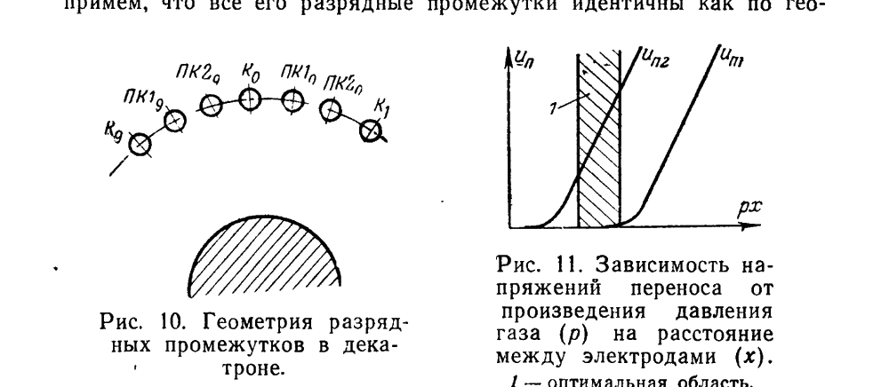

*Липкин, с. 15, рис. 10 и 11: геометрия промежутков и напряжения переноса u_п1, u_п2*

> «Как уже отмечалось, основой механизма направленного переноса разряда является понижение напряжения зажигания для электрода, соседнего с горящим. Практически оно превышает напряжение горения всего на несколько вольт. Разность напряжений зажигания и горения в этом случае называется напряжением переноса (u_п1).» — [Л с. 15]

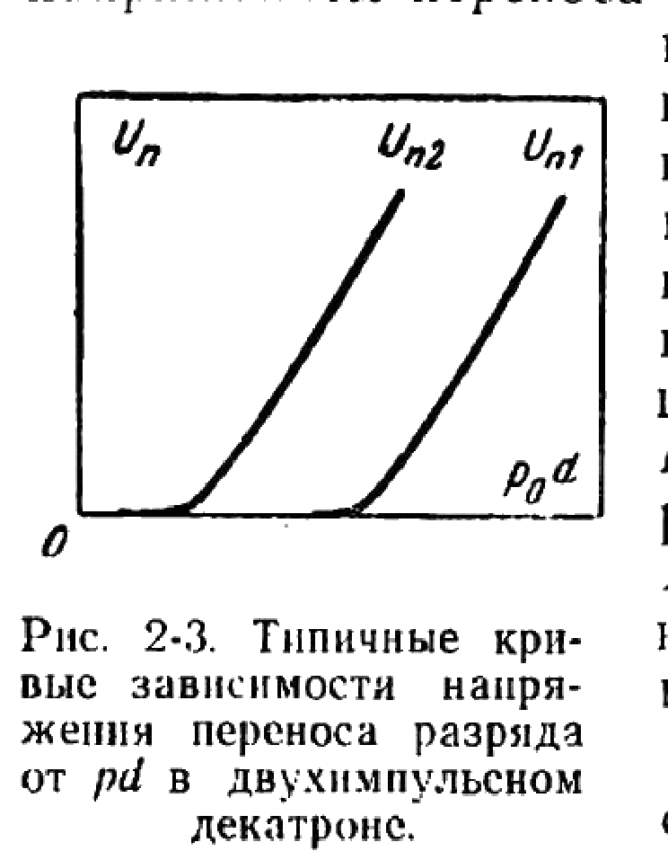

*Яблонский, с. 48, рис. 2-3: напряжения переноса U_п1, U_п2 от p₀d*

> «Под напряжением переноса U_п мы будем понимать разность между напряжением зажигания и напряжением горения.» — [Я с. 48]

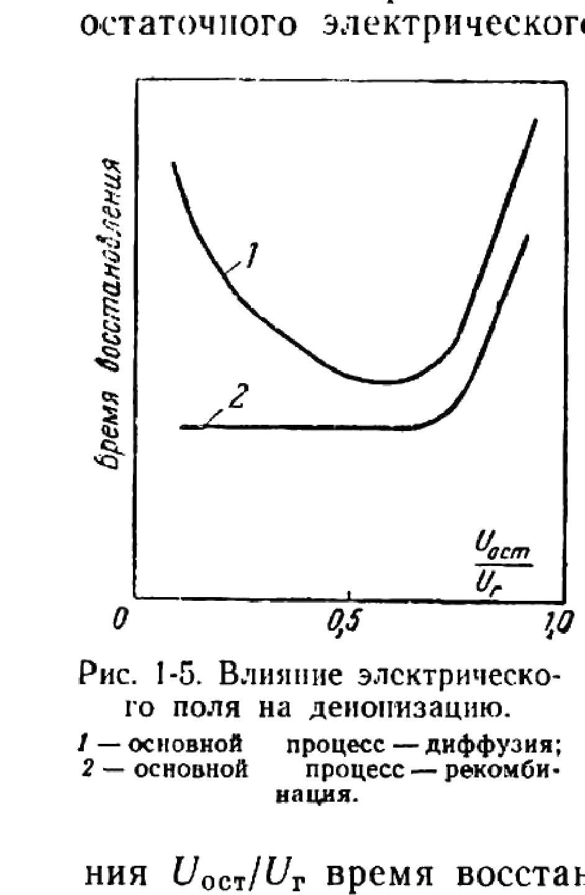

*Яблонский, с. 36, рис. 1-5: время восстановления прочности от остаточного напряжения*

> «Деионизация разрядного промежутка зависит от остаточного напряжения U_ост на электродах.» — [Я с. 36]

> «Поэтому добавка водорода к инертному газу позволяет получить газовую смесь с весьма малым временем деионизации.» — [Я с. 37]

### 1.2 Шаг двухимпульсного декатрона

Шаг проходит в три этапа: катод → первый подкатод (ПК1) → второй подкатод (ПК2) → следующий катод [Л с. 7–8]; [Я с. 49–50].

1. **Импульс на ПК1.** Отрицательный импульс на кольце ПК1 зажигает соседний с горящим катодом ПК1. Анод падает на амплитуду импульса, и катод гаснет.
2. **Конец импульса на ПК1.** Потенциал ПК1 поднимается, за ним анод. ПК2 к этому времени уже под импульсом, и разряд переходит на соседний ПК2. ПК1 гаснет: на нём снова положительное смещение.
3. **Конец импульса на ПК2.** Анод растёт, и зажигается ближайший к ПК2 индикаторный катод. На всех подкатодах положительное смещение (обычно ≥ 30 В [Я с. 46]), поэтому без импульса **разряд на подкатоде не удерживается**.
4. **Направление.** Если поменять порядок импульсов (сначала ПК2, затем ПК1), разряд пойдёт назад [Я с. 51].
5. **Импульсы должны перекрываться: срез первого с фронтом второго** [Я с. 46–47, 49]. В идеале второй начинается сразу по окончании первого [Л с. 7].
6. **Анод во время шага.** Напряжение на аноде — две ступеньки вниз с пиками при каждом переходе [Л с. 8, рис. 5]; [Я с. 51–53, рис. 2-5, табл. 2-1].

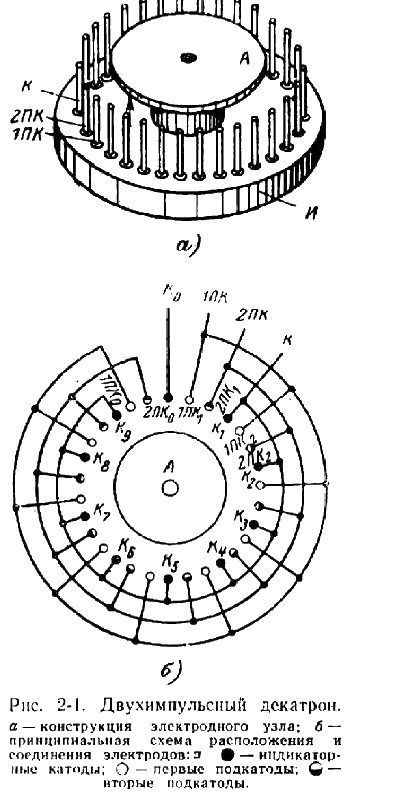

*Яблонский, с. 45, рис. 2-1: двухимпульсный декатрон — электродный узел и кольцо катодов*

> «Электродная система состоит из 30 катодов, коаксиально расположенных вокруг общего дискового анода А.» — [Я с. 44]

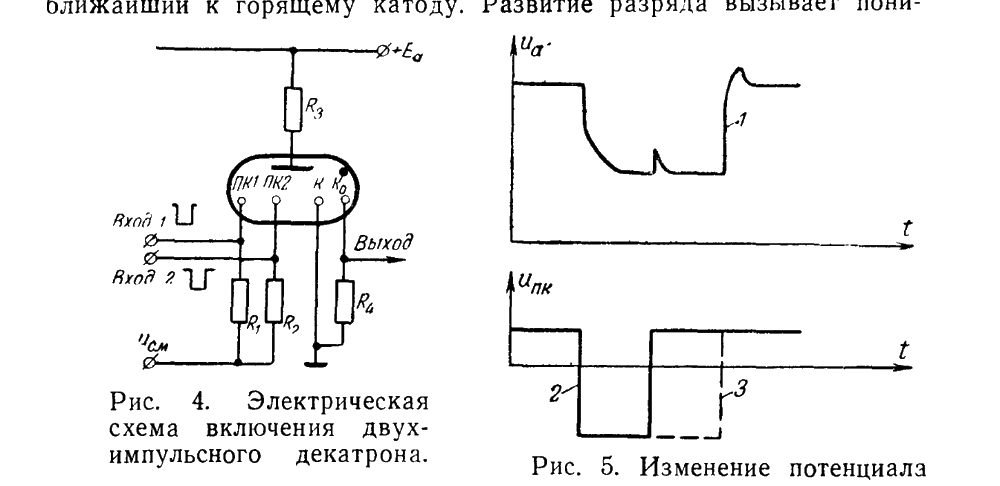

*Липкин, с. 8, рис. 4 и 5: схема включения и потенциал анода при шаге*

> «Второй отрицательный импульс, подводимый к кольцу вторых подкатодов, после окончания первого вызывает возникновение разряда на втором подкатоде, ближайшем к горевшему первому подкатоду. После окончания второго импульса на подкатодах восстанавливается напряжение смещения и напряжение на аноде соответственно возрастает. При этом возникает разряд на индикаторном катоде, ближайшем к перемещенной ионизированной зоне.» — [Л с. 8]

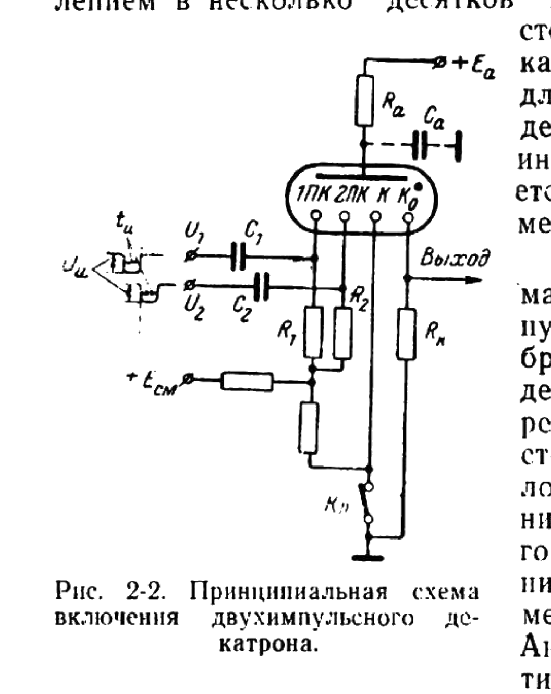

*Яблонский, с. 46, рис. 2-2: схема включения с положительным смещением подкатодов*

> «Подкатоды декатрона через резисторы R₁ и R₂ соединены с источником положительного смещения (E_см), которое обычно берется не меньше 30 в. На подкатоды подаются два отрицательных управляющих импульса U₁ и U₂ с амплитудой U_и порядка 100 в. Управляющие импульсы формируются таким образом, чтобы срез первого импульса и фронт второго — перекрывались.» — [Я с. 46–47]

> «Зажиганию разряда на подкатоды препятствует положительное смещение.» — [Я с. 47]

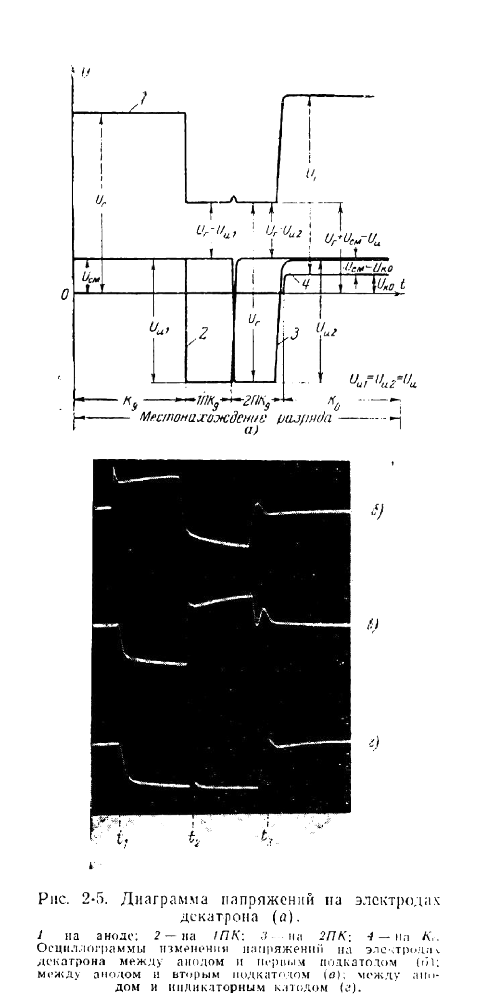

*Яблонский, с. 52, рис. 2-5: напряжения на электродах при шаге и осциллограммы*

> «В момент окончания второго по времени управляющего импульса в результате повышения напряжения на «горящем» втором подкатоде потенциал анода возрастает. Когда рост потенциала анода приведет к тому, что напряжение между анодом и индикаторными катодами превысит напряжение зажигания, происходит зажигание разряда на ближайший к подкатоду 2ПК₁ индикаторный катод К₁.» — [Я с. 50]

### 1.3 Сбои и предельная скорость

- **Сбой обратного переноса.** При малом времени пребывания разряда на n-м электроде разряд перескакивает назад, на (n−2)-й. Причина — деионизация (n−2)-го ещё не закончилась, а подготовка (n+1)-го недостаточна. Вероятность растёт со слишком большой амплитудой импульса [Л с. 16–17, рис. 12, а]; [Я с. 56–59, рис. 2-7, а].
- **Дискриминационный сбой.** Разряд возвращается на (n−1)-й, если разность смещений «катод — ПК1» (напряжение дискриминации) мала, а разряд на ПК2 горел недолго [Л с. 17–18, рис. 12, б]; [Я с. 59–60, рис. 2-7, б].
- **Правила достаточности** [Л с. 18]:
  1. амплитуда не выше допустимой, которая зависит от времени пребывания на n-м электроде;
  2. напряжение дискриминации не меньше минимума, зависящего от времени горения на ПК2;
  3. напряжение между любыми двумя катодами меньше напряжения горения, иначе катод работает как анод.
- **Предельная частота.** Каждый этап требует сформировать новый разряд, погасить старый и деионизовать электрод позади [Я с. 56]. Отсюда **f_макс ≈ 1/(3·t_и.мин)** [Я с. 69], где t_и.мин — минимальная длительность управляющего импульса: на шаг приходятся три такие доли, ровно как у нас (фаза A, фаза B, пауза на сваливание, `DekatronPhaseGen`).
- **Ёмкость анода.** Анодный резистор большой, и с ёмкостью монтажа анод поднимается медленно. Если к моменту зажигания подготовка у ПК2 уже рассосалась, разряд садится на катод с наименьшим статическим напряжением зажигания: по хорде, на случайный катод [Л с. 20]; [Я с. 53–55, рис. 2-6].
  - Меры: анодный резистор паять прямо на панель (ёмкость монтажа 30–50 пФ, собственная ёмкость лампы около 10 пФ [Л с. 20]); быстрые декатроны делать на больший ток [Я с. 55, 142–143].
  - В водородных быстрых лампах этот эффект сильнее, потому что деионизация короче [Я с. 55].

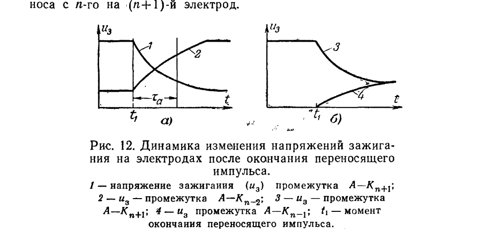

*Липкин, с. 17, рис. 12: напряжения зажигания соседних электродов после переносящего импульса*

> «Практика подтверждает этот факт. При уменьшении времени пребывания разряда на n-м электроде вероятность переноса разряда в обратном направлении увеличивается при повышенной амплитуде импульса, предназначенного для переноса разряда с n-го электрода на (n+1)-й.» — [Л с. 17]

> «3. Напряжение между любыми двумя катодами не должно превышать определенного максимума, несколько меньшего напряжения горения. Это не позволяет любому из них работать в качестве анода.» — [Л с. 18]

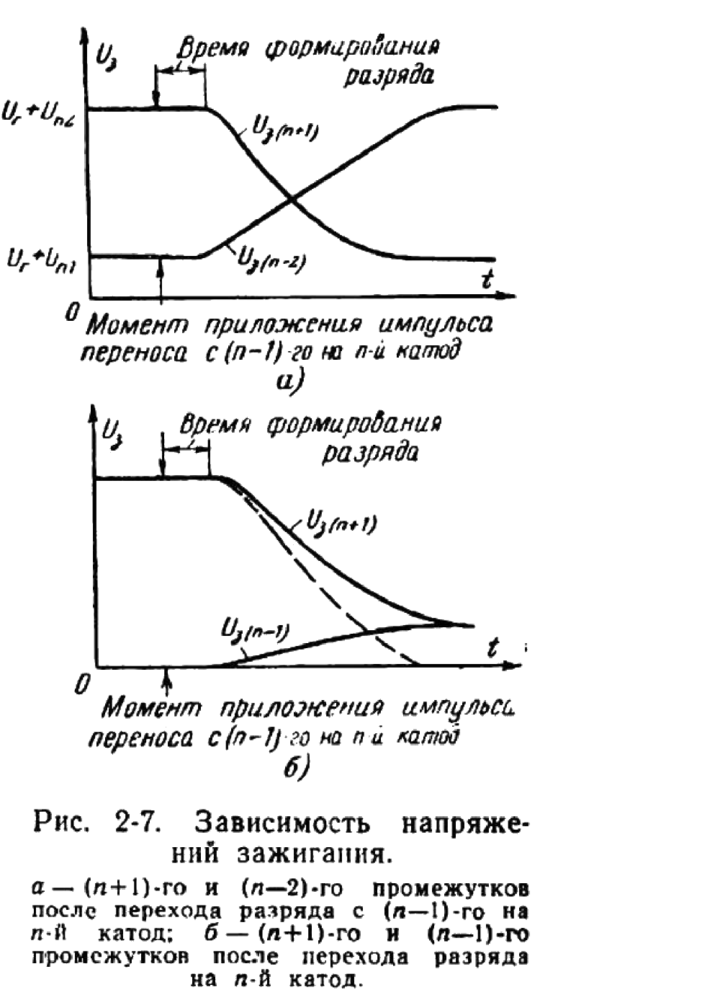

*Яблонский, с. 57, рис. 2-7: напряжения зажигания (n+1)-го, (n−2)-го и (n−1)-го промежутков*

> «При повышении амплитуды управляющего импульса время формирования разряда уменьшается. В этом случае для исключения обратного переноса газового разряда приходится импульс на подкатод подавать позже, т. е. увеличивать время пребывания разряда на n-м катоде.» — [Я с. 58]

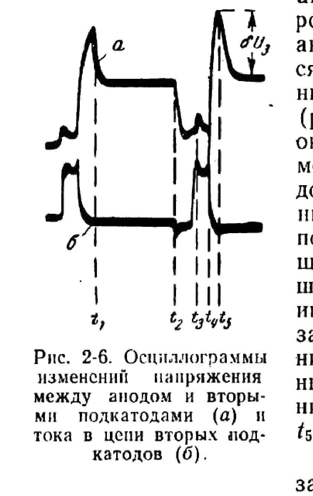

*Яблонский, с. 54, рис. 2-6: напряжение анод — вторые подкатоды и ток вторых подкатодов*

> «Визуально этот режим работы можно опознать по следующему признаку: свечение в декатроне занимает не всю окружность, а только ее часть и, начиная с определенного второго подкатода, разряд перескакивает по хорде на какой-либо удаленный индикаторный катод.» — [Я с. 55]

> «1) чтобы уменьшить τ_а, анодный резистор необходимо монтировать в непосредственной близости от панели декатрона;» — [Я с. 55]

> «Из § 2-2,б можно сделать вывод, что для двухимпульсного декатрона f_макс связано с t_и.мин соотношением f_макс ≈ 1/3 t_и.мин.» — [Я с. 69]

> «Восстановление анодного напряжения после промежутка времени, определяемого постоянной времени анодной цепи, заставляет разряд зажечься на случайном индикаторном катоде.» — [Л с. 20]

### 1.4 Старение и режим «стояния»

- **Отравление соседних электродов.** Если разряд долго стоит на одном катоде, соседние подкатоды загрязняются, и напряжение горения у них меняется:
  - в инертном газе растёт до +25 В;
  - в смесях с водородом падает.

  Последние каскады многоразрядных счётчиков после долгого стояния перестают считать: первые девять импульсов проходят, а десятый нет [Л с. 18–19]; [Я с. 60–63, рис. 2-8].
- **Загрязнение обратимо.** Его снимает прохождение разряда [Я с. 60–61].
- **Меры** [Л с. 19]; [Я с. 63, 66, 68]:
  - больше амплитуда и длительность импульсов;
  - периодическая тренировка на повышенной частоте;
  - перестановка ламп между первыми и последними каскадами;
  - малый ток;
  - умеренное смещение.
- **Долговечность.** Она падает в режиме стояния и при большом токе [Я с. 63–64, 67–68]. В листках новых типов указывают допустимое время стояния [Я с. 71].

### 1.5 Статический режим и цепи

- **Ток анода и ток катода.** 10–20 % анодного тока уходит зондовым током на соседние подкатоды, поэтому ток катода меньше анодного [Я с. 68, 100–101]: I_пк = k·I_к, k ≈ 0,095 для ОГ4 при U_см.эфф = 25 В [Я с. 105]. Расчёт анодной и катодной цепей — [Я с. 100–106]. Пример для ОГ4: R_к = 33 кОм, R_а = 720 кОм, E_а = 450 В.
- **Выходное напряжение на катодной нагрузке ограничено.** В таблицах это 15 В [Л с. 12–13]. Должно выполняться U_вых < U_см: чем выше поднят горящий катод, тем легче разряд уходит на соседей или возвращается на прежний катод [Л с. 20–21]; [Я с. 66–67, рис. 2-9].
  - Полезный приём: отрицательное смещение 20 В на выходной катод даёт размах 40 В при разнице с остальными катодами не больше 20 В [Л с. 20, 22].
  - На высокой частоте выходной импульс меньше установившегося: ёмкость катодной цепи не успевает зарядиться [Я с. 142–143, рис. 3-30].
- **Источник смещения подкатодов.** Если у него большое сопротивление по постоянному току, ток подкатодов поднимает смещение, и импульсы перестают переносить разряд. Лечится диодами, восстанавливающими постоянную составляющую [Л с. 22]; расчёт цепи смещения — [Я с. 106–114].

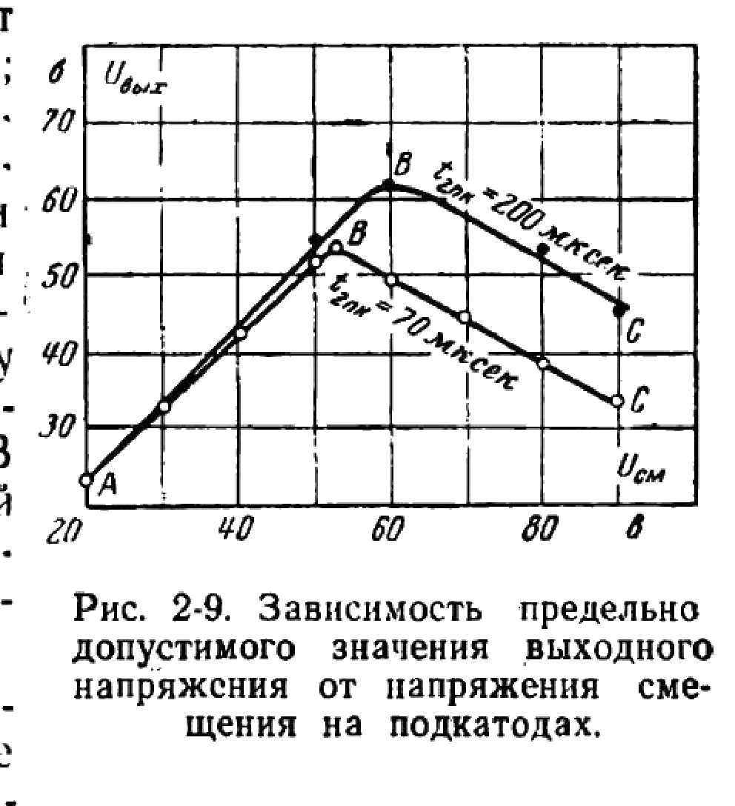

*Яблонский, с. 67, рис. 2-9: предельное выходное напряжение катода от смещения подкатодов (Z504S)*

> «Величина сопротивления нагрузочного резистора в цепи выходного катода ограничивается тем, что амплитуда выходного напряжения, снимаемого с этого резистора, должна быть ниже напряжения положительного смещения.» — [Я с. 66–67]

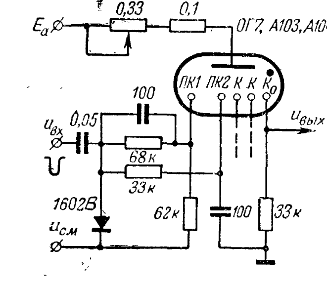

*Липкин, с. 21, рис. 14 (фрагмент): типовая формирующая цепь для ОГ7, А103, А104*

> «Однако, если это не вызывается особыми соображениями по улучшению работы конкретных декатронных устройств, необходимо пользоваться типовыми схемами (рис. 14), рекомендованными в ЧТУ на декатроны.» — [Л с. 20]

### 1.6 Сброс

**Сброс — это зажигание выбранного катода без подготовки.** Есть три способа [Я с. 114–117]; [Л с. 30–32, рис. 20]:

1. поднять все остальные катоды и подкатоды до +100…150 В;
2. отключить все остальные катоды от общей шины;
3. подать на выбранный катод отрицательный импульс.

- **Амплитуда.** Уверенный перевод разряда с любого катода на выбранный получается, если опустить выбранный катод на 100–150 В [Л с. 31]. При первом способе меньше 100 В ненадёжно, а больше 150 В может зажечь разряд между подкатодом и катодом [Я с. 115–116].
- **Длительность.** Импульс сброса делают длиннее управляющих, потому что без подготовки растёт время запаздывания зажигания [Я с. 117].
- **Табл. 3-1 [Я с. 116]: экспоненциальный импульс сброса 150 В** с постоянной времени:

| Типы | Постоянная времени |
|---|---|
| А101, ОГ4 | 10 мс |
| А102 | 0,5 мс |
| А103, ОГ7 | 20 мс |
| ОГ8 | 0,01 мс = 10 мкс |

- **Сброс на любой катод.** Сбросить можно на любой индикаторный катод с отдельным выводом [Я с. 114]. Для коммутаторного декатрона это и есть **запись числа**.

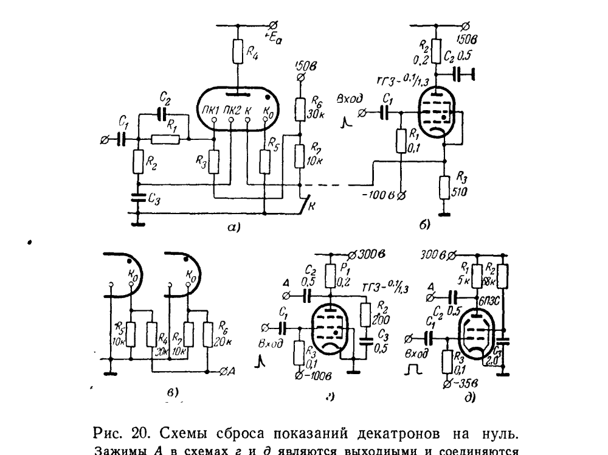

*Липкин, с. 31, рис. 20: схемы сброса на нуль*

> «В других схемах сброса (рис. 20,в, г и д) разряд переводится на тот из индикаторных катодов декатрона, который получает отрицательный потенциал по сравнению с остальными. Уверенный сброс разряда с любого катода на выбранный получается при снижении его потенциала на 100—150 в.» — [Л с. 31]

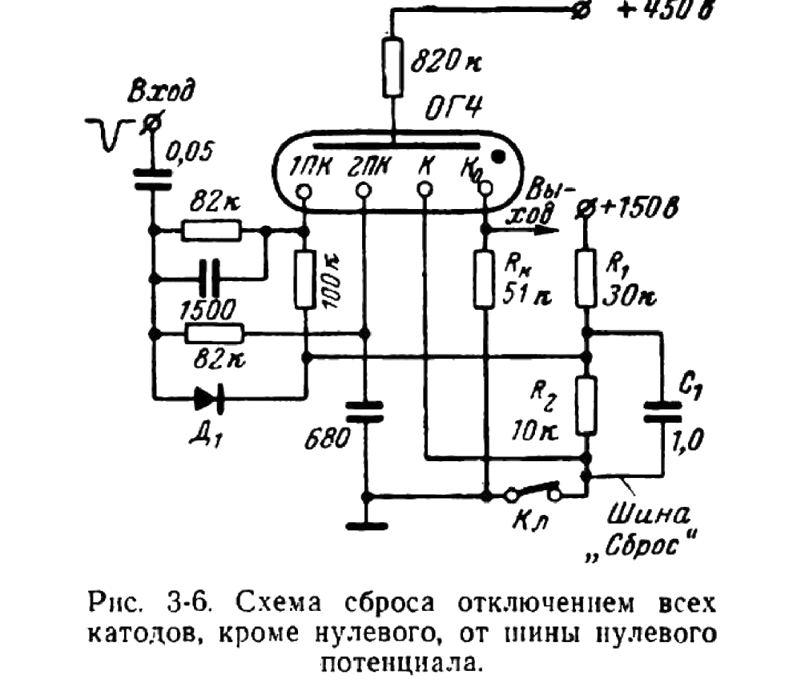

*Яблонский, с. 115, рис. 3-6: сброс отключением всех катодов, кроме нулевого (ОГ4)*

> «Понизить потенциал того индикаторного катода, на который производится сброс, относительно остальных индикаторных катодов можно одним из трех способов: 1) путем повышения потенциала всех остальных катодов (обычно до величины порядка 150 в); 2) путем отключения всех остальных катодов от шины нулевого потенциала; 3) путем подачи на выбранный индикаторный катод отрицательного импульса соответствующей амплитуды.» — [Я с. 114–115]

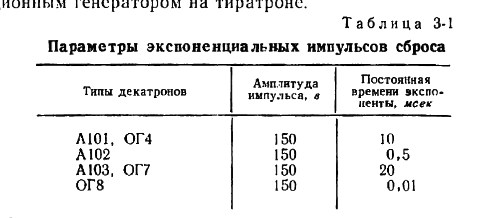

*Яблонский, с. 116, табл. 3-1: параметры экспоненциальных импульсов сброса (постоянная времени в мсек)*

> «Чтобы обеспечить надежный перевод газового разряда на выбранный катод, длительность отрицательного импульса сброса обычно устанавливают большей, чем длительность управляющих импульсов, так как при сбросе зажигание нового разряда происходит в отсутствие разрядного тока в соседнем промежутке, в результате чего время запаздывания зажигания разряда воз[растает]…» — [Я с. 117]

### 1.7 Перенос между декадами и реверс

**Почти все схемы переноса в книгах — для пересчётных декатронов.** У них катоды одного назначения соединены внутри баллона, и отдельно выведен только нулевой катод (иногда ещё несколько, у ОГ8 — 0, 3, 5, 9 [Л с. 12–13]). Перенос тогда можно снять только с нулевого катода, а направление перехода 9↔0 не видно. **А110 — коммутаторный декатрон: все десять катодов выведены** (листок, `doc/a110_datasheet.md`). Для него книжные ограничения не действуют: положение разряда читается целиком, и перенос можно считать логикой.

> «Катоды одинакового назначения соединены внутри баллона декатрона перемычками в катодные кольца, имеющие вывод на цоколь. Исключением является один из индикаторных катодов (нулевой), который имеет отдельный вывод на цоколь.» — [Л с. 6]

> «В коммутаторных декатронах отдельные выводы имеют все индикаторные катоды.» — [Л с. 12]

- **Каскадное включение пересчётных декатронов.** Выходной импульс нулевого катода запускает следующую декаду. Задержка цепочки из n декад — n·τ, где τ — суммарная длительность управляющих импульсов [Л с. 32–33]. Задержку сокращают, если фиксировать уход разряда с девятого катода (у коммутаторного он выведен) [Л с. 33–34, рис. 21].
- **Реверсивный счёт на пересчётных декатронах.** Следующей декаде нужно знать направление перехода 9↔0. Для этого делали реверсивные декатроны с отдельными выводами ПК1 и ПК2 между 9 и 0: порядок импульсов на них даёт направление [Л с. 34–35, рис. 22]; [Я с. 161–162, рис. 4-7]. У А110 таких выводов нет, и они ему не нужны.
- **Реверсивный счёт на коммутаторных декатронах** [Я с. 162–165]. Дискриминатор направления берёт сигналы прямо с индикаторных катодов (рис. 4-8). Ещё проще схема, где направление заранее задаёт триггер (рис. 4-9). Это ближе всего к нашему счётчику: направление известно из команды до шага, а перенос в декаду разрешает логика по показанию катодов (REQ-DEK-007).
- **Одновременные импульсы.** Если импульсы «сложения» и «вычитания» приходят одновременно, разряд может разделиться между подкатодами, а затем вернуться [Я с. 157].

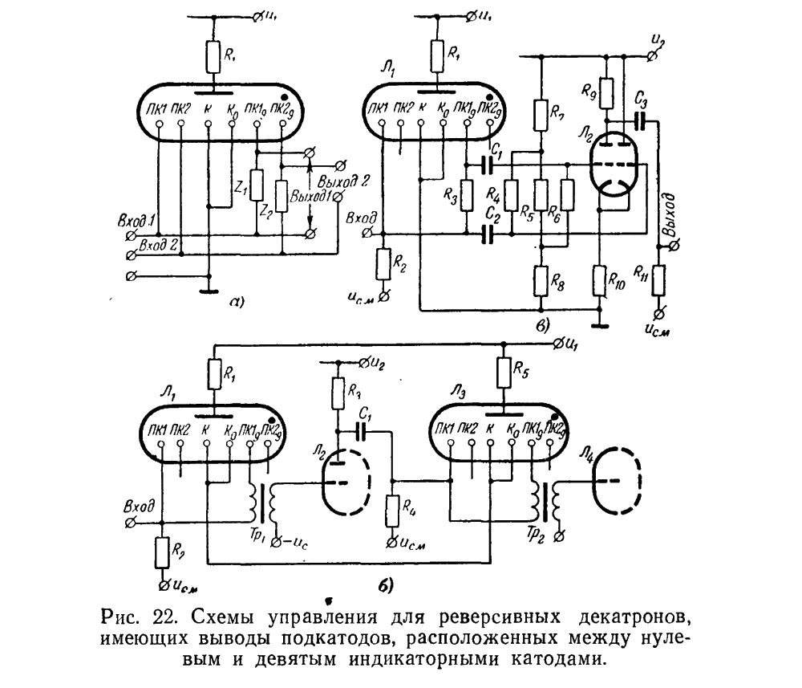

*Липкин, с. 35, рис. 22: управление реверсивными декатронами с выводами подкатодов между 0 и 9*

> «Управляющие схемы, чувствительные к направлению движения разряда между нулевым и девятым катодами декатрона, довольно сложны, поэтому в настоящее время для получения многокаскадных реверсивных схем используются декатроны с индивидуальными выводами на цоколь штырей первого и второго подкатодов, расположенных между нулевым и девятым катодами.» — [Л с. 34]

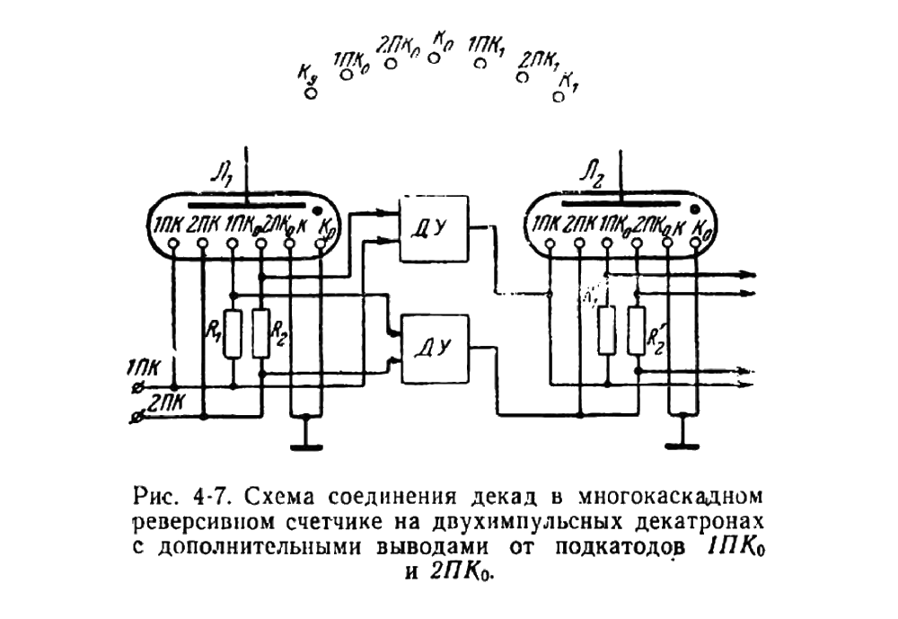

*Яблонский, с. 162, рис. 4-7: соединение декад реверсивного счётчика через выводы 1ПК₀ и 2ПК₀*

> «В тех случаях, когда нет декатронов с дополнительными выводами от подкатодов, реверсивные счетчики можно строить и на обычных коммутаторных или счетных декатронах. Однако при этом схемы дискриминации направления получаются более сложными.» — [Я с. 162]

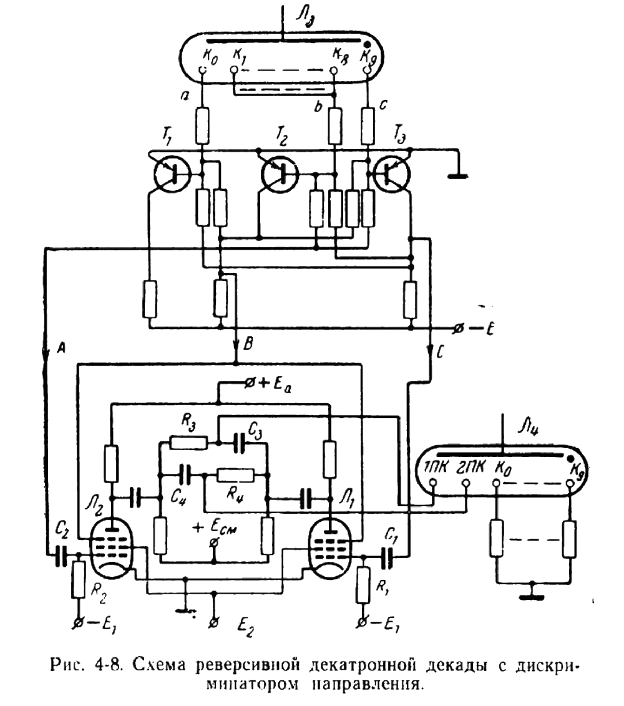

*Яблонский, с. 163, рис. 4-8: реверсивная декада с дискриминатором направления по катодам коммутаторного декатрона*

> «Схема дискриминатора направления, изображенная на рис. 4-8, имеет три входа a, b и c, соединенные с индикаторными катодами коммутаторного декатрона, и три выхода A, B и C, подаваемые на схемы совпадений (схемы «Вычитания» и «Сложения»).» — [Я с. 162]

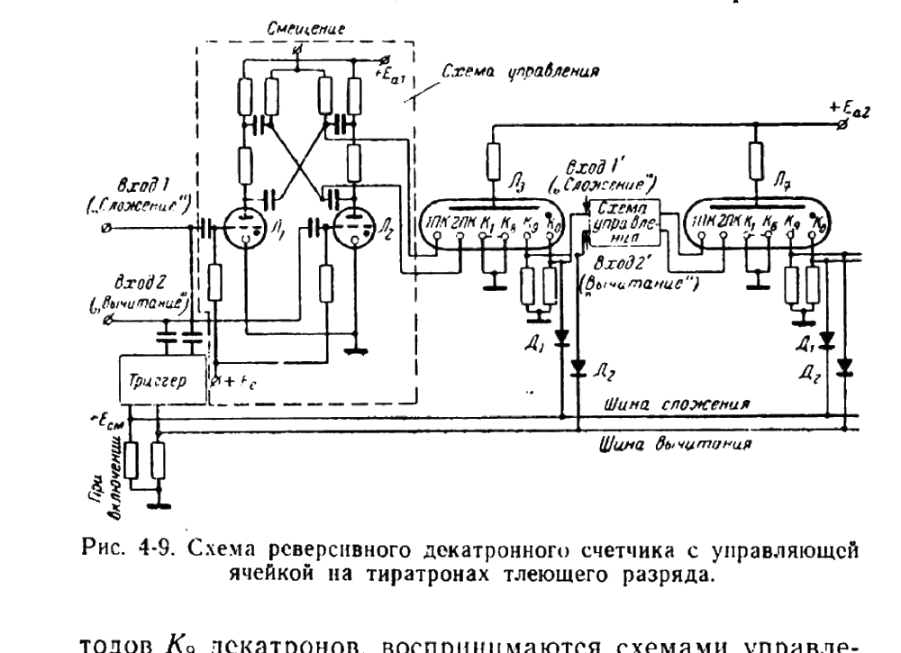

*Яблонский, с. 165, рис. 4-9: реверсивный счётчик, где направление задаёт триггер*

> «Схема реверсивного счетчика заметно упрощается, когда сигналы сложения и вычитания, подаваемые на раздельные входы, приходят с временными интервалами, превышающими общее время, необходимое для переноса единиц из старших декад в младшие (или наоборот).» — [Я с. 164]

## 2. Сравнение с RTL-моделью (`DekatronTubeV2`, `DekatronTubeDelay`, `DekatronCounter`)

| Правило RTL | Книги | Вывод |
|---|---|---|
| Кольцо 30 электродов: катод, A, B; A затем B = +1, B затем A = −1 | [Л с. 6–8]; [Я с. 44–51] | Совпадает. A — это ПК1, B — ПК2. |
| На подкатоде разряд не удерживается: с A падает назад, с B вперёд (REQ-DEK-015) | [Я с. 46–47, 50]: так происходит благодаря **положительному смещению** подкатодов | Совпадает при условии, что ключи подкатодов (`GUIDE_EN_J2`) в покое держат подкатоды выше катодов. **[v0.31]** Записано в TRS: REQ-PULSE-010. |
| Перекрытие фаз допустимо, зазор опасен (REQ-PULSE-008) | [Я с. 46–47, 49]: импульсы обязаны перекрываться | Совпадает. |
| Одиночная фаза возвращает разряд на исходный катод | следует из [Я с. 50] | Совпадает. |
| Время шага `GUIDE_STEP`/`FALL_STEP` фиксировано и не зависит от истории | [Л с. 16–18]; [Я с. 56–60]: минимальная фаза зависит от времени пребывания на предыдущем электроде, амплитуды и деионизации; бывают сбои обратного переноса и дискриминационные | В RTL этого нет. При 100 кГц разряд стоит на катоде ≥ 8 мкс, сбоев не будет. Важно, только если когда-нибудь пойдём к 1 МГц (OPEN-014). |
| Пауза на сваливание — третья часть такта | f_макс ≈ 1/(3·t_и.мин) [Я с. 69] | Совпадает. |
| Запись = разряд на целевой катод, `WRITE_MIN` 5 мкс, в один такт (REQ-CNT-V2-009) | Сброс на выбранный катод опусканием на 100–150 В [Л с. 31]; [Я с. 115–117]; импульс длиннее управляющих [Я с. 117]; постоянная времени от 10 мкс (ОГ8) до 20 мс (А103) [Я с. 116] | Способ совпадает. **5 мкс — смелая оценка.** Из книг она не следует, у медленных типов на порядки больше. Главный риск для записи в один такт (OPEN-013). |
| Во время записи подкатоды не трогать (незаконное воздействие) | [Я с. 115]: при сбросе первым способом поднимают и подкатоды | Совпадает. |
| Случайный катод при включении (REQ-DEK-017) | Разряд зажигается на катоде с наименьшим напряжением зажигания [Л с. 20]; [Я с. 55] | Совпадает. Положение не совсем случайное: у каждой лампы «любимый» катод. Модель DEKATRON_RANDOM_INIT это покрывает. |
| Линии катодов читаются всегда, верны только на фронте Clk (REQ-DEK-016) | Напряжение на катодной нагрузке ≤ 15 В и < U_см [Л с. 12–13, 20–21]; [Я с. 66–67]; часть тока уходит на подкатоды [Я с. 68]; на высокой частоте выходной импульс меньше [Я с. 142–143] | Совпадает, и SPICE подтверждает (§3.3): после шага старый катод ещё около 1 мкс ведёт до 0,26 мА, а на фронтах подкатодов бывают выбросы ±0,2 мА. Порог чтения и момент выборки надо выбирать с этим запасом. |
| Перенос между декадами — логика по показанию катодов, параллельно, в окне команды (REQ-DEK-007) | Каскадный перенос через нулевой катод даёт задержку n·τ [Л с. 32–33]; для реверса нужны отдельные выводы ПК1₀/ПК2₀ или сложные дискриминаторы направления [Л с. 34–35]; [Я с. 161–162] | Книжные каскадные схемы — для пересчётных декатронов, где выведен только нулевой катод. А110 коммутаторный, все катоды выведены, поэтому перенос по показанию катодов для него естественный; так же строят реверсивные счётчики на коммутаторных декатронах [Я с. 162–165, рис. 4-8, 4-9]. Наш вариант к тому же параллельный, без задержки n·τ. |
| Инкремент и декремент одновременно не подаются | [Я с. 157]: при совпадении разряд делится | Совпадает: MachineCtrl так не делает. |
| — | Режим «стояния» отравляет соседние подкатоды; старшие декады перестают считать [Л с. 18–19]; [Я с. 60–64] | В RTL не моделируется. **[v0.31]** Владелец: отдельный тест на стенде не нужен, проверка — на реальной машине. |
| — | Ёмкость анодной цепи срывает перенос [Л с. 20]; [Я с. 53–55] | **[v0.31]** Анодный резистор стоит на плате модуля рядом с декатроном, там же схемы пересчёта и катодные вентили (REQ-PR-020). SPICE это подтверждает (§3.3). |

## 3. SPICE-модель А110

Файлы:

- генератор `tools/spice/gen_a110.py`;
- модель `sch/libs/A110.sub` (порождена генератором, руками не править);
- тестбенч `tools/spice/a110_tb.py`;
- рисунок `doc/img/a110_spice_step.png`.

Запуск — через libngspice (`tools/spice/ngrun.py`), как у ячеек.

### 3.1 Устройство

Подсхема `A110 A K0 … K9 G1 G2`: анод, 10 катодов, кольца первых и вторых подкатодов, как на выводах лампы (листок: A 13, K0 12 … K9 1, ПК1 9, ПК2 5). Порядок кольца тот же, что в `DekatronTubeV2`: 3k — катод, 3k+1 — A (ПК1), 3k+2 — B (ПК2).

У каждого из 30 промежутков есть состояние ионизации x ∈ 0…1 (узел с конденсатором 1 Ф):

- **Напряжение зажигания.** Это наименьшее из трёх:
  - собственное: VZ0 − (VZ0 − VB)·x — гистерезис горящего промежутка;
  - от соседа на ±1: VB + UT1 + (VZ0 − VB − UT1)·L(p);
  - от соседа на ±2: VB + UT2 + (…)·L(q).

  Здесь L(p) = ln(max(p, PMIN))/ln(PMIN) — логарифмическая подготовка по [Я с. 34], а U_п1 и U_п2 взяты по [Л с. 15]; [Я с. 48].
- **Цель ионизации:** max(признак зажигания, I/IN). Разряд, который уже загорелся, держится собственным током. IN больше половины рабочего тока, поэтому разряд, поделённый между двумя промежутками, неустойчив и остаётся один.
- **Формирование:** за TF рядом с разрядом или за TF + TF0 без подготовки. Последнее — включение, запись, сброс [Я с. 30–33, 117]. Время укорачивается с перенапряжением [Я с. 33].
- **Деионизация** с постоянной TD [Я с. 35–37].
- **Ток:** x·max(0, v − VB − VEX·(1 − x))/RD. Слабо сформированный разряд горит на VEX выше, и это даёт конкуренцию двух промежутков.
- **Ёмкости:** анод — каждый катод 0,5 пФ, анод — каждое кольцо подкатодов 2,5 пФ, всего около 10 пФ [Л с. 20].
- **Разброс:** напряжение зажигания каждого промежутка ±3 В, по зерну генератора (тот самый «любимый» катод при включении).

Параметры. Из листка взяты только VB и рабочий ток, всё остальное — оценки (OPEN-013):

| Параметр | Номинал | Откуда |
|---|---|---|
| VB | 190 В | листок 175–205 В |
| VZ0 | 330 В | оценка: < 350 В питания, ≈ VB + 150 В сброса из листка |
| UT1 / UT2 | 5 / 60 В | оценка; [Л с. 15]: U_п1 — единицы вольт |
| PMIN | 10⁻³ | оценка |
| VEX, RD, IN | 20 В, 2 кОм, 0,6 мА | оценка, численная устойчивость |
| TF / TF0 | 50 нс / 1 мкс | оценка для водородного 1 МГц класса |
| TD | 1 мкс | оценка; при 300 нс шаг не проходит, см. §3.3 |

Схема тестбенча:

- анод — 180 кОм от +350 В (листок: > 350 В, 0,7–0,9 мА) и 3 пФ монтажа (резистор на панели);
- каждый катод — 15 кОм на линию чтения (12 В на горящем, ≤ 15 В по [Л с. 12–13]);
- подкатоды — смещение +19 В через 1 кОм, импульс 38 В (листок) до −19 В;
- запись — выбранный катод через свои 15 кОм опускается на −150 В.

Почему смещение 19 В. При 38 В размаха смещение должно быть больше UT1, иначе разряд не свалится с подкатода, и при этом 38 − смещение должно быть больше UT1, иначе разряд не перейдёт на подкатод. 19 В даёт запас поровну в обе стороны. Настоящее смещение для А110 неизвестно.

### 3.2 Сравнение с RTL: последовательность

Команда `python3 tools/spice/a110_tb.py seq`. Одна операция на такт 10 мкс; фазы по 600 нс, B начинается за 50 нс до конца A — как в ламповой сборке. Итог: **14/14 совпадений с кольцевой моделью RTL.**

- включение: загорелся K1;
- запись 0;
- +1 ×3 → 3;
- −1 → 2;
- только A → 2;
- только B → 2;
- nop;
- запись 7;
- +1 ×3 с переходом 9 → 0;
- −1 ×2 → 8.

Ток горящего катода 0,81 мА.

### 3.3 Пороги и времена (номинальные оценки)

`a110_tb.py sweep {pw,gap,rate,write}` и уточняющие прогоны:

| Что | Модель | RTL / ламповая сборка |
|---|---|---|
| Минимальная фаза подкатода для шага | ≈ 500 нс (450 нс — разряд возвращается) | фазы 600 нс — запас 100 нс |
| Зазор A → B, при котором шаг ещё проходит | ≤ 500 нс; с 600 нс разряд сваливается назад | RTL: зазор длиннее `FALL_STEP` → возврат; **[v0.31]** `FALL_STEP` = 1000 нс |
| Катод → подкатод A (катод погас) | 21–62 нс (TF 20–150 нс) | `GUIDE_STEP` 200 нс — с запасом |
| Конец B → ток следующего катода 0,4 мА | **0,47 мкс**; 0,31 мкс без монтажа, 0,93 мкс при 10 пФ монтажа | было 300 нс; **[v0.31]** `DEKATRON_FALL_STEP_NS` = 1000 нс |
| Надёжный счёт 9 шагов подряд, период | ≥ 2,4 мкс (≈ 400 кГц); 2,1 мкс — потеря шагов | машина: шаг раз в 10 мкс |
| Минимальная длительность записи | 0,8 мкс | `WRITE_MIN` 5 мкс; модель здесь лишь повторяет оценку TF0 |

Как эти числа зависят от неизвестных параметров:

- **TD = 300 нс (быстрая деионизация): шаг не проходит ни при какой ёмкости монтажа.** Подготовка от A рассасывается раньше, чем анод через R_а·C (180 кОм × ~13 пФ ≈ 2,3 мкс) поднимется до зажигания B. Это и есть механизм [Я с. 53–55]. Не помогает даже R_а 90 кОм при фазах 600 нс.
- **UT1 = 8 В:** шаг проходит только при монтаже ≤ 1 пФ и TD = 1 мкс.
- **Минимальная фаза задаётся деионизацией старого катода.** При короткой фазе катод ещё ионизован и забирает разряд назад — это дискриминационный сбой [Я с. 59]. При TF = 150 нс не проходят и 600 нс.

Форма сигналов одного шага (+1 и −1):

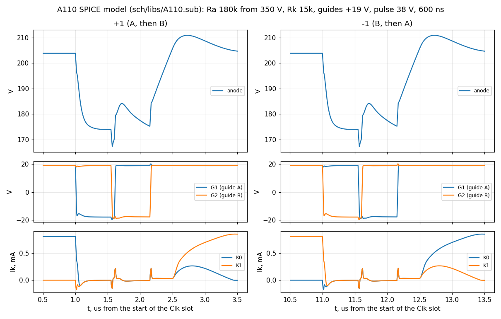

Что видно на рисунке:

1. **Анод** идёт двумя ступеньками вниз на ~30 В и затем медленно поднимается, как на [Л с. 8, рис. 5].
2. **После конца B** горят оба катода: новый (K1) и старый (K0, до 0,26 мА) — около 1 мкс, пока старый не погаснет. Это остаточная ионизация старого катода, тот самый дискриминационный механизм на грани сбоя. **Для чтения это значит:** показание катодов стабильно примерно через 1,5 мкс после конца фазы B, а на фронтах подкатодов в линиях катодов бывают выбросы ±0,2 мА. При такте 10 мкс и чтении на фронте Clk (REQ-DEK-016) запас есть.

### 3.4 Ограничения модели

- Нет зондового тока на соседние подкатоды: 10–20 % [Я с. 68] не моделируются, ток катода равен анодному.
- Кольцо симметрично: геометрическая асимметрия электродов не учтена. Направление задаёт только порядок фаз и смещение.
- Нет загрязнения и стояния (§1.4), нет статистического разброса времени запаздывания.
- Все времена и напряжения, кроме VB и тока, — оценки. Модель годится для качественных выводов и для подгонки, когда снимем характеристики на стенде (OPEN-013/014). Подгонять нужно: UT1, UT2, TF, TF0, TD, VZ0.
- Драйвер подкатодов идеальный (источник через 1 кОм). С ячейкой `GUIDE_EN_J2` модель ещё не соединена.

## 4. Выводы и решения владельца

1. **RTL-модель кольца подтверждается книгами** по всем правилам шага, перекрытия фаз, возврата, записи на любой катод и случайного включения. SPICE-модель с правдоподобными параметрами даёт те же 14 из 14 операций.
2. **Сваливание.** По модели 0,3–0,9 мкс в зависимости от ёмкости анода. **Решение владельца (v0.31):** `DEKATRON_FALL_STEP_NS` поднят с 300 до 1000 нс (`rtl/parameters.sv`). Тактовая модель уже считала 1 hs = 1 мкс.

   Проверка после изменения (2026-11-01): `run_tests.sh -t` и `-d` проходят; `run_tests.sh -s` — 1110,5 ламп на seed по умолчанию (параметр относится к чёрному ящику декатрона и нетлист не меняет; среднее по четырём seed остаётся 1105,3); `synth_sim.sh` 7/7; `synth_sim.sh -t` 4/4, 0 нарушений setup/hold; cocotb 34/34. STA (`vtube_sta.sh`): минимальный период **8,88 мкс (113 кГц)** вместо 8,18 мкс — сваливание целиком лежит на критическом пути (+0,70 мкс); 100 кГц проходят с запасом 1,12 мкс.
3. **Запись за 5 мкс (REQ-CNT-V2-009) из книг не следует.** Для сброса без подготовки у советских типов постоянная времени импульса от 10 мкс (ОГ8) до 20 мс (А103) [Я с. 116]. Это первое, что надо измерить у А110 на стенде. Если запись окажется длиннее ~6 мкс, вернётся двухтактная запись (REQ-DEK-006).
4. **Смещение подкатодов.** **Решение владельца (v0.31):** положительное смещение обязательно, без него разряд не свалится с подкатода на главный катод (REQ-PULSE-010). У старых типов 30–60 В; для А110 при импульсе 38 В оценка 15–25 В.
5. **Монтаж.** **Решение владельца (v0.31):** анодный резистор стоит на плате модуля рядом с декатроном, там же схемы пересчёта и катодные вентили (REQ-PR-020).
6. **Режим стояния.** **Решение владельца (v0.31):** отдельный тест на стенде не нужен, проверка — на реальной машине.
7. **Чтение катодов.** Нагрузка ≤ 15 В на горящем катоде. Показание стабильно примерно через 1,5 мкс после фазы B. Порог чтения — с учётом остаточного тока старого катода (до ~0,3 мА в течение ~1 мкс) и выбросов на фронтах подкатодов.
8. **Сброс (REQ-MOD-007).** Книги описывают три способа (§1.6), все рабочие. Для записи любого числа в коммутаторный декатрон подходит отрицательный импульс 100–150 В на выбранный катод или отключение остальных. Выбор остаётся экспериментальным.
9. **Перенос.** Книжные каскадные и реверсивные схемы рассчитаны на пересчётные декатроны. А110 коммутаторный, и наш перенос по показанию катодов соответствует книжной схеме для коммутаторных декатронов [Я с. 162–165] (§1.7).
