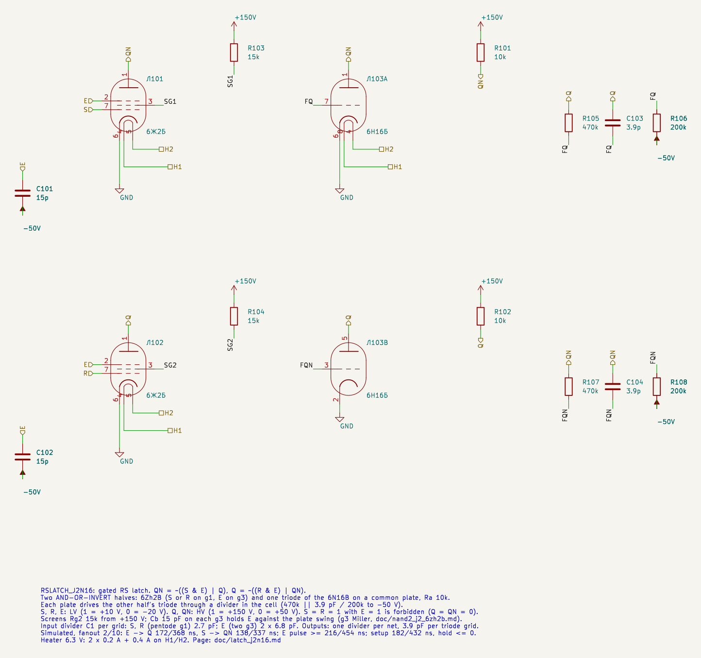
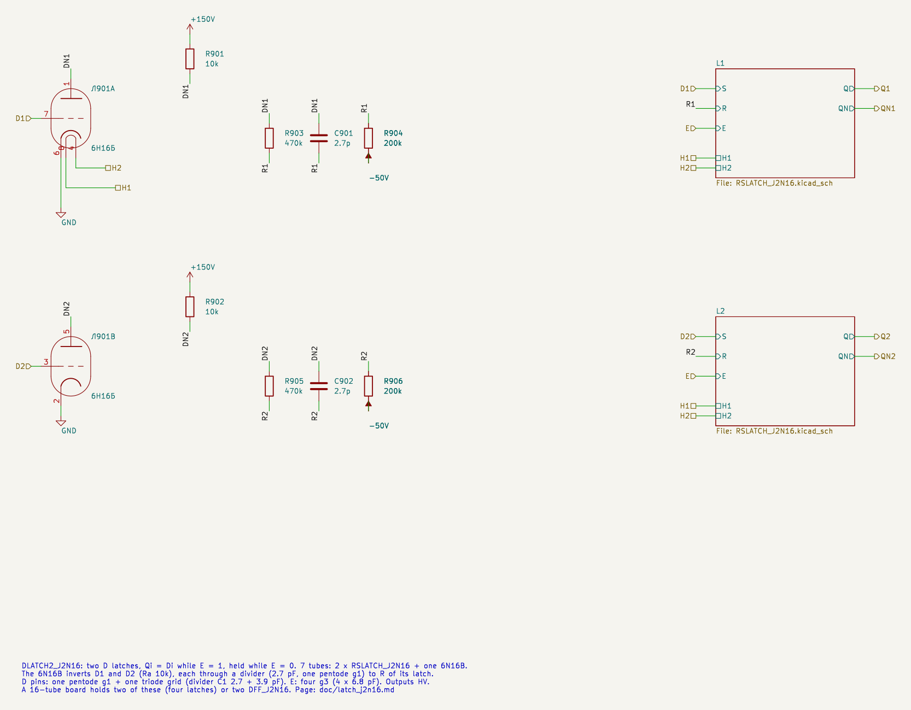
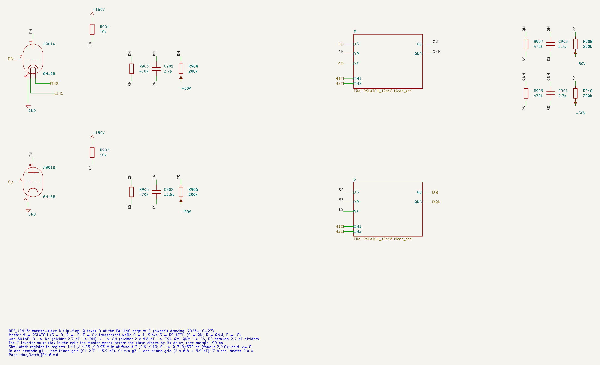
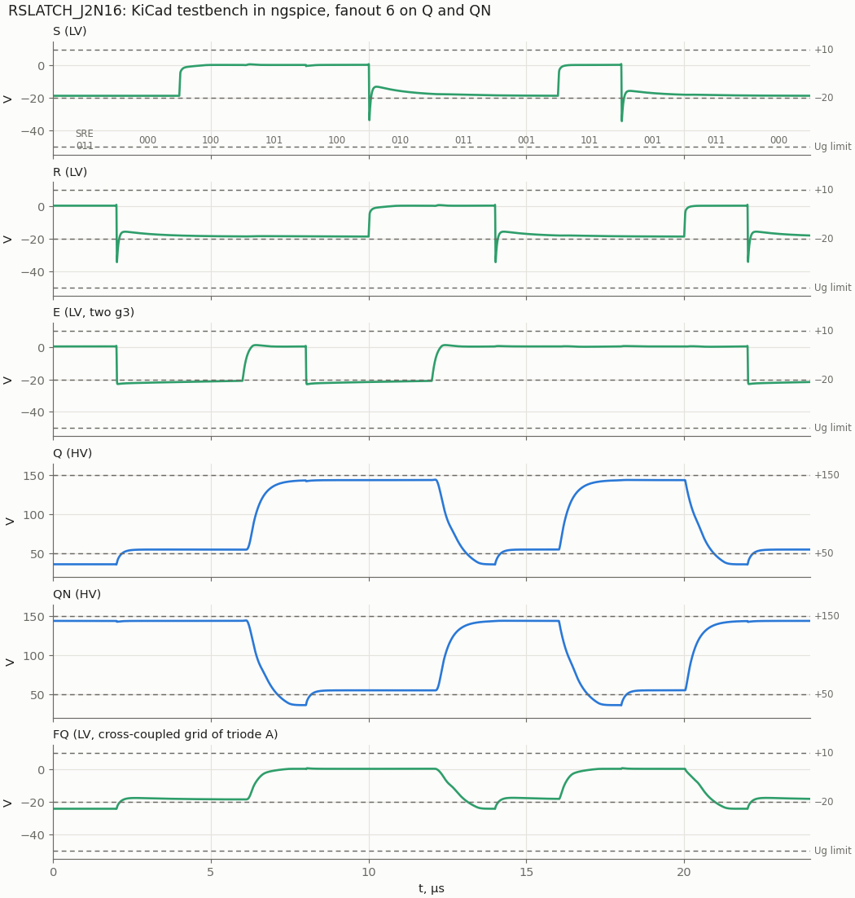
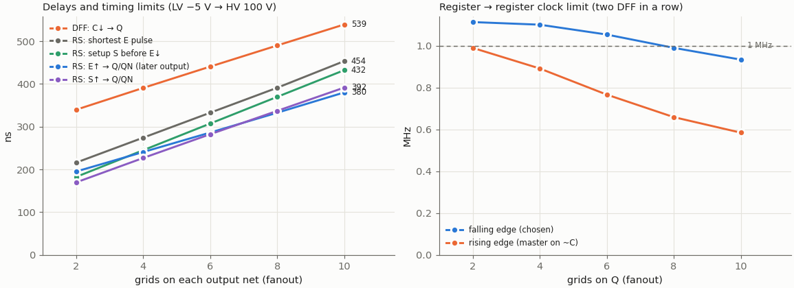
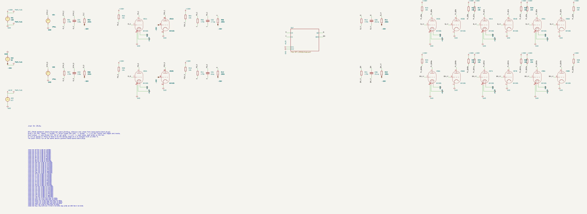
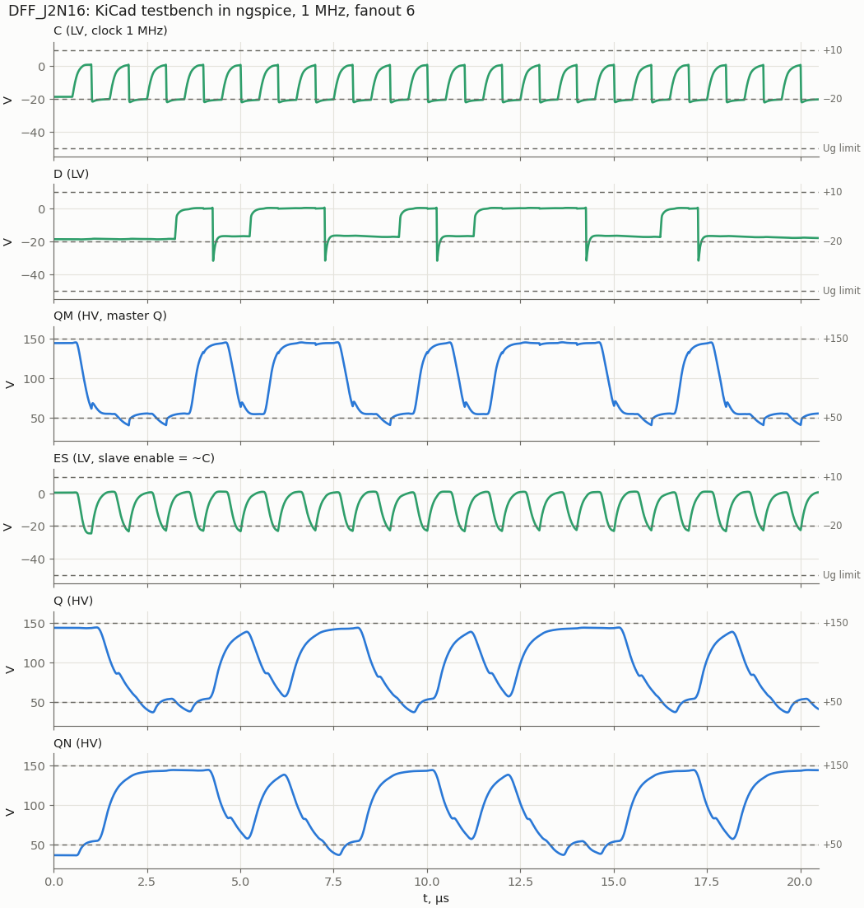

# RSLATCH_J2N16, DLATCH2_J2N16, DFF_J2N16: latches and the D flip-flop on 6Zh2B + 6N16B

Cell page for three cells: the gated RS latch, then two D latches built from it, then the master-slave D flip-flop. All three are to become base cells of the liberty file (owner, 2026-10-27). The liberty entries are only proposed below, not yet applied.

- Requirements: REQ-MOD-005 (D flip-flop board), REQ-MOD-012 (logic levels), REQ-MOD-004 (delays, fan-out, power; simulated, not measured), REQ-MOD-008 (`RsLatch`/`DFF` → tube cells).
- Method: `doc/cell_design_method.md`.
- Source: the owner's drawing of 2026-10-27. Each RS latch is two AND gates (6Zh2B) into two cross-coupled NOR gates (6N16B), and the flip-flop is two such latches plus inverters for D and the clock. The cells keep that drawing, with component values found here.

| | RSLATCH_J2N16 | DLATCH2_J2N16 | DFF_J2N16 |
|---|---|---|---|
| Function | QN = ~((S·E) \| Q), Q = ~((R·E) \| QN); S = R = 1 with E = 1 is forbidden | two latches: Qi = Di while E = 1, held while E = 0 | Q ← D at the **falling** edge of C |
| Tubes | 2 × 6Zh2B + 1 × 6N16B | 2 × RSLATCH + 1 × 6N16B (both D inverters) = 7 | 2 × RSLATCH + 1 × 6N16B (D and C inverters) = 7 |
| Inputs (LV) | S, R (pentode g1), E (two g3) | D1, D2 (g1 + triode grid), E (four g3) | D (g1 + triode grid), C (two g3 + triode grid) |
| Outputs (HV) | Q, QN | Q1, QN1, Q2, QN2 | Q, QN |
| Heater 6.3 V | 0.8 A (5.0 W) | 2.0 A (12.6 W) | 2.0 A (12.6 W) |
| Output levels | 1: 141.8…143.9 V; 0: 36…55 V | same | same |
| Speed, fanout 2 / 6 / 10 | E→Q 195 / 286 / 380 ns; S→Q 170 / 282 / 392 ns | as RSLATCH, D falling +inverter | C↓→Q 340 / 441 / 539 ns; register to register 1.11 / 1.05 / 0.93 MHz |
| Timing limits, fanout 2 / 6 / 10 | E pulse ≥ 216 / 333 / 454 ns; setup 182 / 307 / 432 ns; hold ≤ 0 | same | hold ≤ 0; race margin ≈ 90 ns at C↑ |
| Lowest grid | −34.5 V (S/R g1), −23 V (E) | −31.6 V (D) | −31.9 V (D) |

A 16-tube board takes two DLATCH2_J2N16 (four latches) or two DFF_J2N16, with two tubes spare (owner, 2026-10-27).

## Logic levels and structure

The levels are those of `doc/nor2_n16_6n16b.md` (REQ-MOD-012):

- HV on plates: 1 = +150 V, 0 = +50 V.
- LV on grids: 1 = +10 V, 0 = −20 V.
- HV → LV is the divider 470k ‖ C1 / 200k to −50 V.

Each half of the latch is an AND-OR-INVERT gate on one plate:

```
            +150 V                       +150 V
              │ Ra 10k                     │ Ra 10k
   QN ────────┼──────────┐      Q ─────────┼──────────┐
       6Zh2B plate   6N16B plate A     6Zh2B plate   6N16B plate B
       g1 = S, g3 = E   grid = FQ      g1 = R, g3 = E   grid = FQN
                          ▲                               ▲
       Q ── 470k‖3.9p ── FQ ── 200k ── −50 V    QN ── 470k‖3.9p ── FQN ── 200k ── −50 V
```

- The pentode conducts to the plate only when g1 and g3 are both high (AND); `doc/nand2_j2_6zh2b.md` explains the g3 current split. The triode on the same plate is the OR, so the plate is NOR(AND(S, E), Q).
- Each plate drives the other half's triode through a divider **inside the cell**. The output pins stay ordinary HV pins, and the net outside gets its own divider like any other cell.
- Every state in which a pentode conducts to its plate also has the triode on the same plate on, so the pentode never pulls the plate alone except during an edge.

## Schematics

RSLATCH_J2N16 (`sch/logic/RSLATCH_J2N16.kicad_sch`):



| Pin | Level | Connection |
|---|---|---|
| S | LV in | g1 (lead 7) of 6Zh2B Л1, plate QN |
| R | LV in | g1 of 6Zh2B Л2, plate Q |
| E | LV in | g3 (lead 2) of both 6Zh2B, Cb 15 pF to −50 V on each |
| Q, QN | HV out | plates; Ra 10k each to +150 V |
| H1, H2 | heater | all three tubes in parallel |

Parts: Ra 10k ×2, Rg2 15k ×2 (screens from +150 V, as in NAND2_J2), Cb 15 pF ×2, and two feedback dividers (470k, 3.9 pF, 200k).

DLATCH2_J2N16 (`sch/logic/DLATCH2_J2N16.kicad_sch`). The 6N16B inverts D1 and D2 with Ra 10k each, and each inverter feeds R of its latch through a 2.7 pF divider:



DFF_J2N16 (`sch/logic/DFF_J2N16.kicad_sch`). Master M: S = D, R = ~D, E = C. Slave S: S = QM, R = QNM, E = ~C. The master outputs reach the slave inputs through their own 2.7 pF dividers:



The master outputs go through separate dividers instead of reusing the feedback dividers, because KiCad keeps one value per sheet file for all instances (`doc/cell_design_method.md` §4): the master and the slave must be the same RSLATCH sheet.

## How the values were found

`tools/spice/latch_sweep.py` runs the sweep, with drivers and loads as the method requires:

- each input comes from an ideal HV pulse through a divider, a 6N16B triode driver with Ra 10k (the fastest driver in the library, so the worst kick) and a divider;
- each output drives a divider and load triodes.

The 12-state sequence covers set and reset by E, by S and by R, input changes while closed, and holds.

### E on g3 or on g1

At fanout 4 / 10 (Ra 10k, C1 2.7 pF on pentode g1):

| E on | E→Q (rise / fall of Q) | S→Q | Lowest grid |
|---|---|---|---|
| **g3** (S, R on g1) | **222 / 241, 368 / 380 ns** | 187 / 227, 337 / 392 ns | S −34 V, E −23 V |
| g1 (S, R on g3) | 251 / 404, 426 / 629 ns | 202 / 208, 335 / 336 ns | E −33 V |

E on g3 is faster on the enable arcs, and the 15 pF Cb keeps the E grids at −23 V. E on g1 puts the higher-fanout enable on the cheaper grid (C1 2.7 pF against 6.8 pF), but the E → output arc is 40–65 % slower. Chosen: **E on g3**. With E = 0, a pentode whose g1 is high sends its current to the screen (5.4 mA, Pg2 0.37 W); this is the same state as AB = 10 of NAND2_J2.

### Ra

| Ra | VOL (both on / triode only) | E→Q fanout 4 | E→Q fanout 10 |
|---|---|---|---|
| **10k** | **36 / 55 V** | **222 / 241 ns** | **368 / 380 ns** |
| 12k | 31 / 50 V | 259 / 223 ns | 437 / 349 ns |
| 15k | 26 / 45 V | 326 / 207 ns | 556 / 320 ns |

10k balances the rising and falling arcs and gives VOL = 55 V with one triode on, as in NOT_N16. The pentode is never alone on the plate in a static state, so the Ik limit that pushed NAND2_J2 to 15k does not apply here (worst Ik is 12.2 mA, see Limits).

### Divider C1 on the pentode g1 inputs: the Miller trap again

A pentode g1 has almost no Miller capacitance (Cg1a 0.03 pF), so its node is only about 5 pF. The NOR rule of 3.9 pF per grid over-compensates it: on the falling edge of a fast triode driver, S was kicked to −43 V (fanout 4, Ra 15k). This is now in `doc/cell_design_method.md` §2, "Miller capacitance and divider C1".

| C1 per pentode g1 | Lowest S grid | Same with C1 +10 % (and MU2 +20 %) | S→Q fanout 10 |
|---|---|---|---|
| 3.9 pF | −43.4 V | — | 305 / 321 ns |
| 3.3 pF | −39.2 V | −47.7 V | 314 / 345 ns |
| **2.7 pF** | **−34.3 V** | **−42.0 V (−42.7 V)** | **337 / 392 ns** |

Chosen: 2.7 pF. The nominal value keeps the 10 V margin, and the C1 tolerance still stays above −50 V. The g3 grids keep the NAND2_J2 rule of 6.8 pF per grid and Cb 15 pF.

### Feedback divider inside the cell or on the net

| Feedback | VOH | E→Q fanout 2 / 6 / 10 |
|---|---|---|
| **in the cell, 3.9 pF** | **143.9 V** | **172…195 / 271…286 / 367…380 ns** |
| in the cell, 5.6 pF | 143.9 V | 158…176 / 251…273 / 341…368 ns (feedback grid kicked to −37 V) |
| the output net's divider also feeds the cross triode | 146.9 V | 179…206 / 284…307 / 384…409 ns |

The internal divider is slightly faster and keeps the cell boundary clean (HV out, as every cell). It costs 3 V of VOH, because the plate carries two dividers.

## Results

### RSLATCH_J2N16 testbench



`sch/logic/RSLATCH_J2N16_tb.kicad_sch` has fanout 6 on Q and QN. The stimulus, loads and `.meas` lines come from `tools/spice/latch_tb.py`, and the plain-SPICE run of the same bench agrees with the KiCad netlist to better than 0.01 % on all 57 values.

| .meas (fanout 6) | Value |
|---|---|
| E↑ → Q↑ / QN↓ (set) | 271 / 286 ns |
| E↑ → Q↓ / QN↑ (reset) | 286 / 271 ns |
| S↑ → Q↑ / QN↓ (E high) | 237 / 282 ns |
| R↑ → Q↓ / QN↑ (E high) | 283 / 237 ns |
| Q, QN high / low, settled | 143.9 V / 36.2 V (pentode and triode on), 55.1 V (triode only) |
| Outputs in the states where nothing changes (S or R toggled with E low) | low output stays below 55.1 V, high above 142.7 V |
| Lowest S / R / E / feedback grid / output LV net | −34.3 / −34.5 / −22.9 / −24.4 / −24.6 V |

### Delay and timing limits against fanout



| Grids on each output | E→Q | S→Q | Shortest E pulse | Setup (S before E↓) | Hold | DFF C↓→Q | DFF reg→reg |
|---|---|---|---|---|---|---|---|
| 2 | 172…195 ns | 138…170 ns | 216 ns | 182 ns | ≤ 0 | 340 ns | 1.11 MHz |
| 4 | 222…241 ns | 187…227 ns | 274 ns | 245 ns | ≤ 0 | 391 ns | 1.10 MHz |
| 6 | 271…286 ns | 237…282 ns | 333 ns | 307 ns | ≤ 0 | 441 ns | 1.05 MHz |
| 8 | 319…333 ns | 287…337 ns | 391 ns | 370 ns | ≤ 0 | 490 ns | 0.99 MHz |
| 10 | 367…380 ns | 337…392 ns | 454 ns | 432 ns | ≤ 0 | 539 ns | 0.93 MHz |

- Delays run from the input crossing −5 V (LV) to the output crossing 100 V (HV). The two numbers are the two outputs; the later one is the time the latch is settled.
- The shortest E pulse, setup and hold come from `tools/spice/latch_timing.py`, by bisection. Hold ≤ 0 means that S may fall even before E falls: a reset requested later than 225…483 ns before E falls does not get through. Between that point and the setup time, the result is not defined, as in any latch.
- Register to register (`dff_sweep.py shift`): two DFFs in a row on one clock, D of the first changing a quarter period after the edge. A sampled level passes only if it is valid for the next stage ("1" > 118 V, "0" < 92 V).

### Input thresholds

Slow ramps (400 µs) of one input from −20 to +10 V, from a 140 kΩ Thevenin source (the divider), with the latch reset first:

| Input (other input high) | LV level where the latch flips | Same on the HV net feeding it | Margin to HV "0" (55 V) / "1" (144 V) |
|---|---|---|---|
| S (g1) | −2.6 V | 109 V | 54 V / 35 V |
| E (g3) | −2.6 V | 109 V | 54 V / 35 V |

The thresholds are within 1 V of NAND2_J2 (switching point −3.2 / −3.5 V), so the latch takes the same nets as the other cells. A latch has no single transfer curve, because its output also depends on the state, so this table replaces the VTC chart of the gate pages.

### DFF_J2N16 testbench (1 MHz, fanout 6)





`sch/logic/DFF_J2N16_tb.kicad_sch` runs a 16-bit pattern at 1 MHz, with D changing 0.25 µs after each falling edge of C. Every sampled bit is correct. The worst sampled levels, 30 ns before the next edge, are "1" ≥ 132 V and "0" ≤ 70 V, which leaves 22 V to the next stage's VIL. C↓→Q is 460 ns. KiCad and plain SPICE agree on all 45 values.

The waveforms show:

- the master following D while C is high;
- ES (= ~C after the inverter and its divider) opening the slave after C falls;
- Q settling within the period.

### DLATCH2_J2N16 testbench

`sch/logic/DLATCH2_J2N16_tb.kicad_sch` has one E for both latches, a 2 µs period, D2 = ~D1, fanout 6 on Q1/QN1 and 2 on Q2/QN2. All 19 sampled states of both latches are correct; levels 143.1…143.9 V / 54.6…55.1 V. E↑→Q1 is 321 ns. KiCad and plain SPICE agree on all 82 values.

## The flip-flop: which edge

The owner's drawing puts the master on C and the slave on the inverted C, so Q changes at the falling edge of C. The liberty `DFF` cell says `clocked_on: C` (rising edge). Both variants were simulated (`dff_sweep.py --edge neg|pos`). They use the same parts; only the clock wires to the two latches swap.

| | Falling edge (drawing) | Rising edge (master on ~C) |
|---|---|---|
| Register to register, fanout 2 / 6 / 10 | **1.11 / 1.05 / 0.93 MHz** | 0.99 / 0.77 / 0.58 MHz |
| C→Q, fanout 2 / 10 | 340 / 539 ns | 192 / 400 ns |
| Hold (D changing at the capturing edge) | **≤ 0** (passes with D switching together with C) | > 0: fails at 0 ns, passes at 40 ns |
| Overlap of the two latches | at the non-capturing edge C↑: the master opens at once, the slave closes after the inverter | at the capturing edge C↑: the slave opens at once, the master closes after the inverter |

Why the falling edge is faster:

- The slave has to latch the external load while its enable is open, and needs an E pulse of 333 ns at fanout 6.
- A direct C net is high for less than half a period, because the LV net rises slowly (the driver's plate charges through Ra) and falls fast.
- The slave behind the inverter gets a wider window.
- With the master on ~C, the same narrowing hits the slave on the direct C, and it runs out of window first.

**Owner's decision (2026-10-27): falling edge, as drawn.** For the RTL's rising-edge flip-flops, invert the clock once at the generator.

### Race margin at C↑

When C rises, the master opens immediately while the slave closes only after the inverter:

- ES crosses −5 V 64 ns after C crosses −5 V;
- the master's output reaches the slave grids (−5 V crossing) after 153 ns.

The margin is about 90 ns. An extra 200 pF on the inverter plate (`dff_sweep.py --cskew 200`) makes the new D race through to Q. **The C inverter must stay inside the cell and lightly loaded.** A shared inverter in the clock tree would add exactly this skew.

## Datasheet limits and power

From `tools/spice/latch_static.py`, every state of the sweep sequence at fanout 10, nominal model and MU2 ± 20 %:

| Quantity | Limit | Worst in the cell |
|---|---|---|
| 6Zh2B Ik | 14 mA | 12.2 mA (set/reset with E high, MU2 −20 %) |
| 6Zh2B Pa | 0.9 W | 0.24 W |
| 6Zh2B Pg2 | 0.6 W | 0.37 W (E low, its g1 high: all current to the screen) |
| 6Zh2B Ug2 | 125 V conducting; 150 V cut off (6Ж2Б-В: 250 V) | 94 V conducting; 150 V cut off, as in NAND2_J2 |
| 6N16B Ik, Pa | 14 mA, 0.9 W | 9.2 mA, 0.51 W |
| Grid | ≥ −50 V | −34.5 V nominal; −42.7 V with C1 +10 % and MU2 +20 % |
| Ra 10k | — | 0.9 W with the plate low: a 2 W resistor, as in NOT_N16 |

Supply current per RSLATCH from +150 V: about 10 mA in a hold state (one plate low, 9.2 mA, plus one screen at 5.4 mA when E is low and S or R is high), and 16 mA with E high and set or reset (pentode 6.3 + screen 4.5 + triode 5.0 mA).

## Sensitivity

E→Q and S→Q at fanout 2 / 10 (rise…fall of the later output), C1p 2.7 pF:

| Model | VOL | E→Q | S→Q | Lowest grid |
|---|---|---|---|---|
| **nominal** | **36…55 V** | **172…195, 367…380 ns** | **138…170, 337…392 ns** | **−34.5 V** |
| Cg3a 1.6 pF | 36…55 V | 170…193, 365…377 ns | 136…168, 336…391 ns | −34.5 V |
| Cg3a 2.5 pF | 36…55 V | 178…202, 375…390 ns | 143…174, 343…396 ns | −34.4 V |
| 6Zh2B MU2 −20 % | 35…55 V | 164…174, 325…355 ns | 127…150, 320…356 ns | −33.7 V |
| 6Zh2B MU2 +20 % | 38…55 V | 184…224, 390…462 ns | 145…186, 354…463 ns | −35.2 V |
| 6N16B MU −20 % | 32…47 V | 197…198, 381…419 ns | 161…169, 390…394 ns | −34.4 V |
| all C1 +10 % | 36…55 V | 169…193, 368…389 ns | 136…155, 328…387 ns | −42.0 V |
| all C1 −10 % | 36…55 V | 178…199, 364…375 ns | 151…193, 364…424 ns | −28.0 V |

Cg3a matters much less than in NAND2_J2 (+8 ns at 2.5 pF against +100 ns there). The g3 grid moves together with E, and in the static states the triode holds the plate. The spread of MU2 (screen) is the largest effect, at up to +80 ns at fanout 10.

## Options evaluated

| Option | Result | Verdict |
|---|---|---|
| E on g1, S/R on g3 | E arcs 40–65 % slower, E grid −33 V | rejected |
| Ra 12k / 15k | VOL lower, but E→Q up to 556 ns at fanout 10 | rejected |
| C1 3.9 / 3.3 pF on the pentode g1 | S grid −43 / −39 V; with C1 +10 % −48 V | rejected |
| Cross-coupling through the output net divider | 3–8 % slower, cell pin would have to be LV | rejected |
| Rising-edge DFF (master on ~C) | 0.58–0.99 MHz, hold > 0 | rejected (owner chose the falling edge) |
| Clock inverter shared by many flip-flops (6.5 tubes per bit) | eats the 90 ns race margin at C↑ | rejected |
| D latch without the D inverter: R input from QN | with E high and D low both halves only see ~each other: the latch holds instead of resetting | does not work |
| D latch from four NAND2_J2 (no inverter) | 4 tubes against 3.5, and every arc is a slow NAND (166…396 ns per gate) | rejected |
| One pentode for both halves (plate to QN, screen to Q) | the screen takes 40 % of the current even with g3 high, so Q would also be pulled low when set; the screen would swing 100 V | not pursued |
| Dual-rail D (D and ~D from the driving cell, 6 tubes per DFF) | saves the D inverter, but the liberty function cannot ask synthesis for a complement | left for later (see Open points) |

On iverilog: the failure that decided the flip-flop design is analog. The clock window shrinks on a slow LV rise, and the race margin depends on how far a grid sits below its clamp. A logic simulator with delays does not see either, while a plain-SPICE run of the whole flip-flop takes a few seconds. iverilog becomes useful once the cells are in the liberty file: the cell models in `rtl/vtube/vtube_cells.v` and the SDF delays from `vtube_timing.json` can then check setup, hold and the 1 MHz budget on synthesized netlists (`synth_sim.sh -t`).

## Proposed liberty entries (not applied)

Waiting for the owner's review (owner, 2026-10-27: proposal only). Here "fanout_load" is in units of a triode grid (C1 3.9 pF): pentode g1 0.7, g3 1.75.

```
cell(RSLATCH_J2N16) {          /* gated RS latch, S = R = 1 with E = 1 forbidden */
  area: 3; heat_current: 800; tubes(names) { J2B: 2; N16B: 1; }
  latch(IQ, IQN) { enable: "E"; data_in: "S"; clear: "R*E"; preset: "S*E";
                   clear_preset_var1: L; clear_preset_var2: L; }
  pin(S) { direction: input; fanout_load: 0.7; }
  pin(R) { direction: input; fanout_load: 0.7; }
  pin(E) { direction: input; fanout_load: 3.5; clock: true; }
  pin(Q)  { direction: output; max_fanout: 6; function: "IQ"; }
  pin(QN) { direction: output; max_fanout: 6; function: "IQN"; }
}
cell(LATCH)  -> rename LATCH_J2N16: area 3.5, J2B 2 + N16B 1.5 (half of the DLATCH2 inverter tube), heat 1000;
                D fanout_load 1.7 (g1 + triode grid), C fanout_load 3.5, max_fanout 6.
cell(DFF)    -> rename DFF_J2N16: ff clocked_on: "C'" (falling edge), area 7, J2B 4 + N16B 3, heat 2000;
                D fanout_load 1.7, C fanout_load 4.5 (two g3 + triode grid), max_fanout 6.
```

Proposed `vtube_timing.json` values (fanout 6, simulated): LATCH D→Q 0.29 µs, E→Q 0.29 µs, setup 0.31 µs, hold 0; DFF C↓→Q 0.44 µs, setup 0.31 µs (the master's setup before C falls), hold 0. With `max_fanout` 6 the flip-flop meets 1 MHz register to register without logic between the flops. Any logic between them needs a slower clock, or it has to be counted against the 1 µs period.

Changing DFF to the falling edge in the liberty also needs one clock inverter in the RTL flow (at the generator), and `rtl/vtube/vtube_cells.v` must change to match (AGENTS §6).

## Files and how to run

| File | What |
|---|---|
| `sch/logic/RSLATCH_J2N16.kicad_sch` | cell sheet, also used as the sub-sheet of the two below |
| `sch/logic/DLATCH2_J2N16.kicad_sch`, `sch/logic/DFF_J2N16.kicad_sch` | cells |
| `sch/logic/*_J2N16_tb.kicad_sch/.kicad_pro` | testbenches |
| `tools/kicad/gen_latch_j2n16.py` | generator of all six sheets (net labels at pin stubs; RSLATCH carries the instances of all three projects) |
| `tools/spice/latch_sweep.py` | RS latch sweep (cell netlist `rslatch()`, options eg/fb/C1) |
| `tools/spice/latch_static.py` | currents and dissipation per state |
| `tools/spice/latch_timing.py` | shortest E pulse, setup, hold |
| `tools/spice/dff_sweep.py` | DLATCH / DFF / shift register, `--edge`, `--period`, `--cskew` |
| `tools/spice/latch_tb.py` | testbench definitions shared with KiCad, plain-SPICE reference |
| `tools/spice/latch_plots.py` | every figure on this page, and the numbers of the tables |

```
python3 tools/spice/latch_sweep.py                      # RS latch, fanout 2..10
python3 tools/spice/dff_sweep.py shift --edge neg --period 1.0 2 6 10
tools/spice/sim_kicad.sh sch/logic/DFF_J2N16_tb.kicad_sch
python3 tools/spice/latch_tb.py dff                     # the same bench in plain SPICE
python3 tools/spice/latch_plots.py                      # figures into doc/img
```

To embed a cell: the inputs come from HV nets through the usual divider. C1 = 2.7 pF per pentode g1 (S, R), 6.8 pF per g3 (E, C), and 3.9 pF per triode grid. The D pin of DLATCH2 and DFF is a pentode g1 plus a triode grid (6.6 pF); the C pin of DFF is two g3 plus a triode grid (17.5 pF).

## Open points

- **Liberty update** after the owner's review (above), including `fanout_load` per grid type for all cells and the falling-edge DFF with one clock inverter at the generator.
- **Measure on hardware**: E→Q, the shortest E pulse and the race margin at C↑ (REQ-MOD-004). The margin depends on the inverter and the 6Zh2B g3 cut-off, neither of which is calibrated.
- **Dual-rail data**: a DFF variant taking D and ~D (6 tubes) where the source is another flip-flop. This needs a synthesis-side rule; it is not in the liberty yet.
- **Reset/preset** (liberty `DFFSR`): not designed. A third input on each NOR (another triode on the plate) would set or clear the slave and the master; ask before adding tubes.
- The cells inherit the screen-at-150 V-while-cut-off question of NAND2_J2 for the 6Zh2B without "-В" (TRS §22 item 13).
