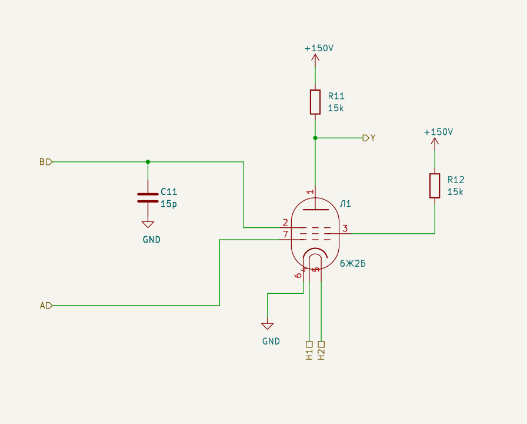
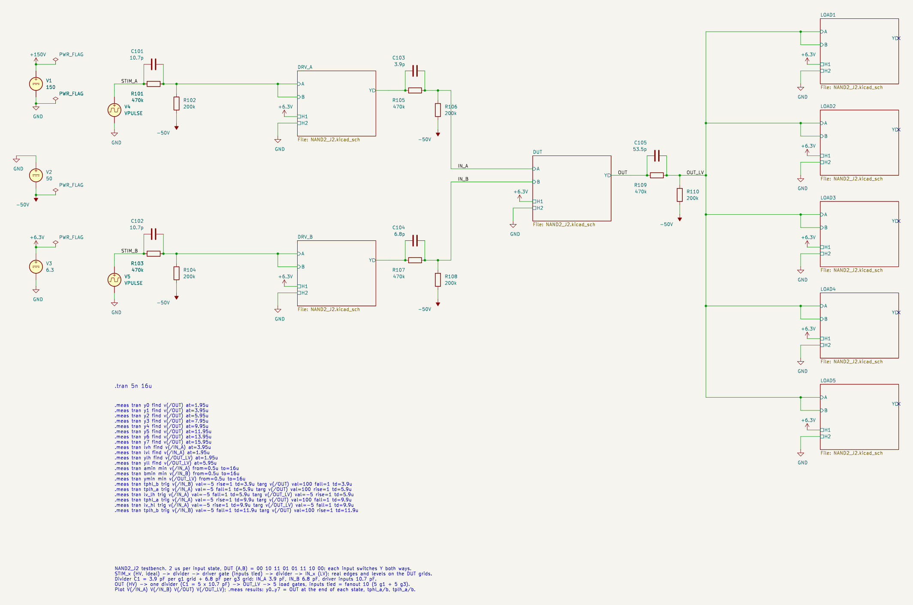
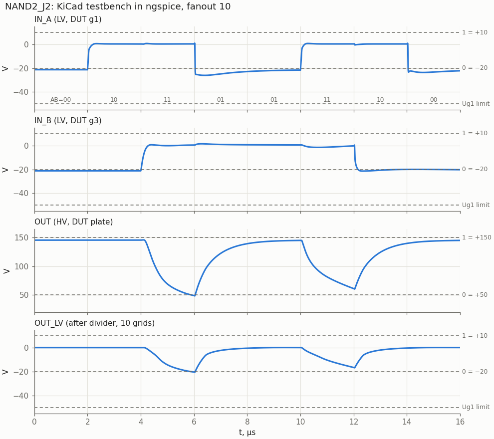
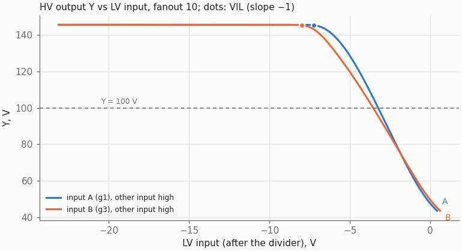
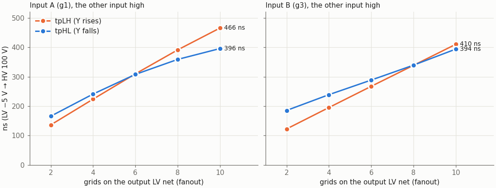

# NAND2_J2: two-input NAND on one 6Zh2B

Cell page. REQ-MOD-005 (2И-НЕ board), REQ-MOD-012 (logic levels), REQ-MOD-004 (delays, fan-out, power; simulated, not yet measured). Method: `doc/cell_design_method.md`. Liberty cell: `NAND2_J2` (`rtl/vtube/vtube_cells.lib`, one J2B).

| | |
|---|---|
| Function | Y = ~(A · B) |
| Tubes | one 6Zh2B (6Ж2Б), the pentode with two control grids |
| Input A | LV level, grid 1 |
| Input B | LV level, grid 3 (suppressor), with Cb 15 pF to GND in the cell |
| Output Y | HV level, plate |
| Supplies | +150 V (plate through Ra, screen through Rg2); −50 V (dividers only); heater 6.3 V, 0.2 A |
| Parts | Ra 15 kΩ, Rg2 15 kΩ, Cb 15 pF; per driven LV net a divider 470 kΩ ‖ C1 / 200 kΩ, C1 = 3.9 pF per g1 grid + 6.8 pF per g3 grid |
| Output levels | Y = 145 V (1); 44 V (0), 38…52 V over MU2 ± 20 % |
| Delay, fanout 2 … 10 | tpHL 166 … 396 ns, tpLH 122 … 466 ns (both inputs, see Fanout) |
| Grid, worst transient | −26.0 V (limit −50 V) |
| Cg3a | 1.8 pF, measured by the owner on a 6Ж2Б-В |
| Ik, Pa, Pg2, worst static | 12.6 mA, 0.33 W, 0.37 W (limits 14 mA, 0.9 W, 0.6 W) |

The owner confirmed on 2026-10-24: A on g1, B on g3, both LV (+10 / −20 V), output HV (+150 / +50 V), one 6Zh2B, supplies +150 / −50 V, the screen fed through a dropping resistor Rg2 from +150 V (no new rail); and, after the first sweep, passive compensation of the g3 Miller effect (Cb in the cell, larger C1 for g3 grids) instead of a cathode follower. The owner then measured Cg3a = 1.8 pF on a 6Ж2Б-В (2026-10-24); all figures on this page use that value.

## Logic levels

The level families are those of `doc/nor2_n16_6n16b.md` (REQ-MOD-012): HV on plates 1 = +150 V, 0 = +50 V; LV on grids 1 = +10 V, 0 = −20 V. HV → LV is the divider 470k ‖ C1 / 200k to −50 V (ratio 0.3), LV → HV is a tube stage, here this cell.

How the pentode makes a NAND:

| A (g1) | B (g3) | Tube | Y |
|---|---|---|---|
| 0 (−20 V) | any | cut off by g1 (cut-off at about −6 V for Ug2 = 120 V) | 145 V |
| 1 (clamped ≈ +0.4 V) | 0 (−20 V) | conducts, but g3 turns the whole current back to the screen (Ia = 0 below Ug3 ≈ −10 V, Рис. 216) | 145 V |
| 1 | 1 (clamped ≈ +0.6 V) | plate current 7 mA | 44 V |

The LV "1" of +10 V is the open-circuit level of the divider; a driven g1 or g3 clamps it near +0.5 V with grid current.

## Schematic



| Pin | Level | Connection |
|---|---|---|
| A | LV in | g1 (lead 7) |
| B | LV in | g3 (lead 2), Cb 15 pF to GND |
| Y | HV out | plate (lead 1), Ra 15k to +150 V |
| H1, H2 | heater | leads 4, 5; the module wires the heater chain |

The screen (lead 3) goes through Rg2 15k to +150 V, the cathode (lead 6) to GND. Lead numbers follow the handbook (Рис. 214) and the KiCad symbol; the 6Ж2Б-В sheet numbers the leads differently (`doc/6zh2b_datasheet.md`, Pinout).

### Screen resistor

There is no screen rail (owner's choice), so Rg2 from +150 V sets the screen voltage, and it also limits the screen dissipation in state AB = 10, where g3 sends the whole cathode current to the screen. Without Rg2, g1 at 0 V and Ug2 = 120 V would give Ik ≈ 22 mA (Рис. 215: 12.8 + 9.3 mA) and Pg2 ≈ 1.4 W, far above Ik ≤ 14 mA and Pg2 ≤ 0.6 W. With 15k the screen regulates itself: more current, lower Ug2, less current.

The screen is not bypassed: its voltage follows the input state within a few tens of ns, so the levels do not depend on the history of the inputs.

| State | Ug2 | Ia | Ig2 | Ik | Pa | Pg2 |
|---|---|---|---|---|---|---|
| A = 0 | 150 V (cut off) | 0 | 0 | 0 | 0 | 0 |
| AB = 10 | 68 V | 0 | 5.4 mA | 5.4 mA | 0 | 0.37 W |
| AB = 11 | 85 V | 7.0 mA | 4.4 mA | 11.3 mA | 0.30 W | 0.37 W |
| AB = 11, MU2 −20 % | 71 V | 7.4 mA | 5.3 mA | 12.6 mA | 0.28 W | 0.37 W |
| AB = 11, MU2 +20 % | 96 V | 6.4 mA | 3.6 mA | 10.0 mA | 0.33 W | 0.35 W |

`tools/spice/nand2_static.py` prints this table (fanout 10 on the output). Rg2 = 12k is about 50 ns faster on the slowest arc but gives Ik = 14.1 mA at MU2 −20 %, at the limit, so 15k was chosen.

### Why Ra is 15k and not 10k as in NOR2_N16

VOL ≈ 50 V needs Ia ≈ 100 V / Ra. With Ra = 10k that is 10 mA of plate current at Ua = 50 V, in the knee of the pentode, where the plate takes only about half of the cathode current: Ik would be about 20 mA, above the 14 mA limit. Ra = 15k needs 7 mA and Ik = 11.3 mA. The price is the rise time: Ra charges the output net 1.5 times slower than in the NOR.

### The g3 Miller effect and Cb

This is the trap specific to an AND-type cell. In NOR2_N16, an input held at "1" means the output is already low, so no other input can make a large plate swing while a grid sits clamped at "1". In this NAND it is the normal case: B holds g3 at "1", and A switches the tube on. The plate falls by 95 V and pulls g3 down through Cg3a. The divider (140 kΩ) can supply only about 0.07 mA to restore g3, and g3 out of its clamp cuts the plate current, so the plate falls as a Miller integrator at about 0.07 mA / Cg3a ≈ 40 V/µs.

Without compensation (C1 = 3.9 pF per grid on every net, no Cb) the A↑ → Y↓ arc takes 577 ns at fanout 2 and 670 ns at fanout 10 with the measured Cg3a = 1.8 pF (890 ns with 2.5 pF): it hardly depends on the fanout. g1 has no such problem: Cg1a ≤ 0.03 pF.

The fix holds g3 with capacitance:

- **Cb 15 pF from g3 to GND inside the cell** takes most of the charge the plate pulls through Cg3a.
- **C1 = 6.8 pF per g3 grid** on the divider that drives it, instead of 3.9 pF. It compensates the divider for the larger g3 node (Cb + Cg3k), so B's own edges stay fast.

Bounds at fanout 4 (`tools/spice/nand2_sweep.py`; VOL is the worst value 2 µs after an edge):

| C1 per g3 grid (Cb 15 pF) | Lowest grid | VOL after 2 µs | tpHL A / B | tpLH A / B | Verdict |
|---|---|---|---|---|---|
| 3.9 pF | −23.3 V | 90 V | 219 / 1087 ns | 57 / 164 ns | under-compensated, B crawls |
| 4.7 pF | −23.7 V | 76 V | 224 / 670 ns | 116 / 173 ns | under-compensated |
| 5.6 pF | −24.5 V | 60 V | 232 / 344 ns | 172 / 183 ns | B still slow |
| **6.8 pF** | **−25.9 V** | **58 V** | **241 / 239 ns** | **224 / 195 ns** | **chosen**: arcs balanced |
| 8.2 pF | −28.4 V | 58 V | 250 / 200 ns | 240 / 208 ns | slower rise |
| 10 pF | −31.9 V | 58 V | 259 / 182 ns | 258 / 225 ns | slower rise |
| 12 pF | −36.0 V | 57 V | 268 / 174 ns | 278 / 243 ns | slower rise, deeper kick |

| Cb (C1 6.8 pF per g3 grid) | Lowest grid | VOL after 2 µs | tpHL A / B | tpLH A / B | Verdict |
|---|---|---|---|---|---|
| none | −57.4 V | 60 V | 513 / 98 ns | 175 / 152 ns | g3 below −50 V; slow A arc |
| 6.8 pF | −33.7 V | 59 V | 329 / 144 ns | 204 / 177 ns | — |
| 10 pF | −28.8 V | 59 V | 281 / 171 ns | 214 / 185 ns | — |
| **15 pF** | **−25.9 V** | **58 V** | **241 / 239 ns** | **224 / 195 ns** | **chosen**: arcs balanced |
| 18 pF | −25.1 V | 58 V | 228 / 307 ns | 205 / 201 ns | B slower |
| 22 pF | −24.0 V | 71 V | 216 / 481 ns | 153 / 206 ns | over-loads g3, B slow |

| C1 per g1 grid | Lowest grid | tpHL A / B | tpLH A / B |
|---|---|---|---|
| 2.7 pF | −21.3 V | 300 / 230 ns | 211 / 184 ns |
| 3.3 pF | −22.3 V | 258 / 234 ns | 217 / 190 ns |
| **3.9 pF** (as in NOR2_N16) | **−25.9 V** | **241 / 239 ns** | **224 / 195 ns** |
| 4.7 pF | −31.7 V | 231 / 244 ns | 231 / 201 ns |

The g1 grid keeps the NOR rule of 3.9 pF per grid, so a net that drives NOR and NAND g1 inputs uses one rule. A larger search over Ra (12–18k), Rg2 (10–18k), C1 and Cb (192 combinations, fanout 4 and 6, Cg3a 1.6 and 2.5 pF, before the measurement) found nothing more than about 15 % faster within the limits; with the measured 1.8 pF the chosen pair is again the best of C1 5.6–8.2 pF × Cb 10–22 pF at fanout 4 and 10.

### The HV → LV divider

As in NOR2_N16, the divider belongs to the net, one per HV net that drives grids, not to the cell:

```
 HV net ──┬── R1 470k ──┬── LV net ── grids: n1 on g1, n3 on g3
          └── C1 ───────┤
                       R2 200k
                        │
                      −50 V
C1 = 3.9 pF × n1 + 6.8 pF × n3
```

A g3 input therefore costs 1.7 times the divider capacitance of a g1 input. For the synthesis flow this means `fanout_load` 1.0 on A and about 1.7 on B (not yet in the liberty).

## Results

### KiCad testbench



- **Stimulus:** two ideal HV pulses, each through a divider into a driver gate (the same cell, inputs tied), then through a divider to a DUT input. Sequence (A,B) = 00 10 11 01 01 11 10 00, 2 µs per state: each input switches Y both ways, once with the other input high.
- **Load:** OUT drives one divider (C1 = 5 × 10.7 pF) and five load gates with g1 and g3 tied, so fanout 10 (5 g1 + 5 g3).
- **.meas:** the lines on the sheet come from `nand2_sweep.meas_lines`, the same function the plain-SPICE sweep uses.

| .meas | KiCad | Plain SPICE (`nand2_sweep.py --kicad`) |
|---|---|---|
| Y, states 00 / 10 | 145.4 / 145.4 V | 145.4 / 145.4 V |
| Y, state 11 after B↑ (y2) | 49.5 V | 49.5 V |
| Y, state 11 after A↑ (y5), 2 µs after the edge | 61.9 V | 61.9 V |
| Y, state 01 after A↓ (y3) | 138.8 V | 138.9 V |
| tphl_b (B↑, A high) | 394 ns | 394 ns |
| tplh_a (A↓, B high) | 467 ns | 466 ns |
| tphl_a (A↑, B high) | 456 ns | 456 ns |
| tplh_b (B↓, A high) | 396 ns | 393 ns |
| lowest IN_A / IN_B / OUT_LV | −26.0 / −21.4 / −20.5 V | −26.0 / −21.5 / −20.4 V |

The KiCad netlist and the sweep agree to 1 %.



What the waveforms show:

- **At 10 µs (01 → 11, A rises while B is high):** IN_B dips by about 1.5 V as the plate falls (the Miller kick that Cb absorbs), and OUT falls fast to about 90 V and then slowly. It crosses 100 V after 456 ns but is still at 62 V after 2 µs. The next stage sees it as a solid "0" once it is below its VIL of 91 V.
- **At 4 µs (10 → 11, B rises):** the fall is faster; g3 is the moving grid and C1 of its divider supplies the charge.
- **Rising edges** are RC edges of Ra and the output net: 0.47 µs to 100 V at fanout 10.
- **Grids** stay above −27 V on every edge.

### Static transfer



| | Input A (g1), B high | Input B (g3), A high |
|---|---|---|
| VIL (slope −1), LV | −7.2 V | −8.0 V |
| same on the HV net feeding the input | 93 V | 91 V |
| Switching point (Y = 100 V), LV | −3.2 V | −3.5 V |
| same on the HV net | 107 V | 106 V |
| Full on (grid clamped ≈ +0.5 V), HV net | ≈ 118 V | ≈ 118 V |

Noise margins:

| Signal | Level | Threshold | Margin |
|---|---|---|---|
| HV "0" | 44 V (52 V worst static) | 91 V | 47 V (39 V) |
| HV "1" | 145 V | 118 V (full on) | 27 V |
| LV "0" | −20 V | −8.0 V | 12 V |

These are within 1–2 V of NOR2_N16 (VIL −7.6 V, 92 V), so the two cells can drive each other on the same nets.

### Fanout



| Grids on the output LV net | VOH | tpHL A / B | tpLH A / B | LV → LV, gate + divider (fall / rise, via A) |
|---|---|---|---|---|
| 2 | 145.3 V | 166 / 185 ns | 136 / 122 ns | 124 / 133 ns |
| 4 | 145.0 V | 241 / 239 ns | 224 / 195 ns | 197 / 225 ns |
| 6 | 143.9 V | 308 / 289 ns | 310 / 267 ns | 273 / 319 ns |
| 8 | 141.7 V | 359 / 339 ns | 391 / 339 ns | 320 / 408 ns |
| 10 | 138.9 V | 396 / 394 ns | 466 / 410 ns | 348 / 491 ns |

Half the load grids are g3 inputs (load gates with g1 and g3 tied); a net with only g1 loads is faster, one with only g3 loads slower. VOH at fanout 8–10 is read 2 µs after the rising edge and has not quite settled.

- **Clock budget:** at the nominal 1 MHz of the RTL, one gate plus divider comes to 310–320 ns at fanout 6, close to a third of the period (333 ns), and exceeds it from fanout 8, so **max_fanout 4 grids** (6 at most) for such paths; NOR2_N16 reaches the same delay at about fanout 6. At the owner's target of 250 kHz (4 µs, OPEN-014 [v0.11]) the third of the period is 1.33 µs, and the cell meets it at fanout 10 even with Cg3a = 2.5 pF.
- **Hazard 10 → 01** (A falls while B rises, in the sweep sequence): Y stays above 139.8 V at every fanout, no glitch.

### Sensitivity

Fanout 4 / 10, the chosen cell:

| Model | VOL (worst after 2 µs) | tpHL A / B | tpLH A / B | Lowest grid |
|---|---|---|---|---|
| **nominal (Cg3a 1.8 pF, measured)** | 58 / 60 V | 241 / 239, 396 / 394 ns | 224 / 195, 466 / 410 ns | −26.0 V |
| Cg3a 1.6 pF | 54 / 56 V | 220 / 223, 374 / 377 ns | 222 / 203, 467 / 427 ns | −26.5 V |
| Cg3a 2.0 pF | 62 / 63 V | 266 / 256, 420 / 411 ns | 222 / 188, 459 / 394 ns | −25.5 V |
| Cg3a 2.5 pF | 70 / 70 V | 349 / 307, 494 / 470 ns | 200 / 169, 411 / 355 ns | −24.4 V |
| MU2 −20 % | 53 / 54 V | 208 / 225, 336 / 355 ns | 244 / 217, 520 / 463 ns | −26.2 V |
| MU2 +20 % | 64 / 66 V | 276 / 253, 465 / 442 ns | 198 / 173, 403 / 356 ns | −26.0 V |

Cg3a matters most: each 0.1 pF adds about 10 ns to the A↑ arc. At 2.5 pF the slow tail after A↑ leaves Y at 70 V after 2 µs, still 21 V below VIL. The rows at 1.6–2.5 pF cover the spread to expect between tubes until more of them are measured.

## Datasheet limits

Sources: `doc/6zh2b_datasheet.md` (handbook page and 6Ж2Б-В sheet).

| Quantity | Limit | Worst case in the cell |
|---|---|---|
| Ua | 150 V (6Ж2Б-В: 250 V cut off) | 145 V (cut off) |
| Ug2 | 125 V (6Ж2Б-В: 250 V cut off) | 96 V conducting; **150 V while cut off** (A = 0) |
| Pa | 0.9 W | 0.33 W |
| Pg2 | 0.6 W (6Ж2Б-В: 0.7 W) | 0.37 W |
| Ik | 14 mA | 12.6 mA (MU2 −20 %), 11.3 mA nominal |
| Ug1 | ≥ −50 V | −26.0 V transient, −21 V static |
| Ug3 | not given | −24 V transient, −21 V static |
| Grid-circuit resistance | 1 MΩ | 140 kΩ (470k ‖ 200k) |

The screen sits at 150 V while A = 0. The 6Ж2Б-В sheet allows 250 V on the screen with the tube cut off; the handbook gives only 125 V without a cut-off rating (open point below).

Power per gate:
- **+150 V:** 11.3 mA in state 11 (1.7 W), 5.4 mA in state 10 (0.8 W), nothing while A = 0.
- **Divider:** 0.15–0.3 mA per net.
- **Heater:** 6.3 V × 0.2 A = 1.26 W, half of the 6N16B.

## Options that were evaluated

| Option | Result | Decision |
|---|---|---|
| Ra 10k (as in NOR2_N16) | needs Ik ≈ 20 mA for VOL ≈ 50 V | rejected: Ik limit |
| Ra 12k / Rg2 12k | static search: Ik and Pg2 at the limits at MU2 −20 % | rejected |
| Ra 18k / Rg2 18k | VOL 38–49 V, about 30 % slower rise | rejected: slow |
| Rg2 12k (Ra 15k) | worst arc ~50 ns faster, Ik 14.1 mA at MU2 −20 % | rejected: Ik |
| Cathode resistor Rk 220 / 470 Ω (no compensation, fanout 4) | A↑ → Y↓ 612 → 826 → 1138 ns, VOL after 2 µs 61 → 73 → 85 V: the cathode rises with the current and takes g3 further below its clamp | rejected |
| No compensation (C1 3.9 pF everywhere, no Cb) | A↑ → Y↓ 577–670 ns at fanout 2–10 (Cg3a 1.8 pF) | rejected: too slow for 1 MHz unless B is static |
| Cb only, C1 unchanged | B input under-compensated: B↑ → Y↓ 0.3–3 µs | rejected |
| Cathode follower (half 6N16B) driving g3 nets | fast, +0.5 tube per driven net | owner chose the passive fix (REQ-MOD-009) |

## Files and how to use

| File | |
|---|---|
| `sch/logic/NAND2_J2.kicad_sch` | the cell; embed it as a hierarchical sheet |
| `sch/logic/NAND2_J2_tb.kicad_pro`, `NAND2_J2_tb.kicad_sch` | testbench project |
| `sch/libs/6Zh2B.sub` | model (generated by `tools/spice/fit_6zh2b.py --sub`) |
| `tools/kicad/gen_nand2_j2.py` | generator of the cell sheet and testbench (new UUIDs on every run) |
| `tools/spice/nand2_sweep.py` | fanout sweep; Ra, Rg2, C1 per g1 / g3 grid, Cb, Rk and model overrides as parameters; `--kicad` runs the testbench sequence |
| `tools/spice/nand2_static.py` | operating points per state (MU2 ± 20 %) and transfer thresholds |
| `tools/spice/nand2_plots.py` | rebuilds every figure on this page into `doc/img` |
| `tools/spice/fit_6zh2b.py` | fits the model to `doc/data/6zh2b_datasheet.json` |

- **KiCad simulator:** open `NAND2_J2_tb.kicad_pro`, Inspect → Simulator. The sheet holds `.tran 5n 16u` and the `.meas` lines. Plot `V(/IN_A)`, `V(/IN_B)`, `V(/OUT)`, `V(/OUT_LV)`.
- **Command line:** `tools/spice/sim_kicad.sh sch/logic/NAND2_J2_tb.kicad_sch`.
- **Embedding in a module:**
  - Add a hierarchical sheet with file `NAND2_J2.kicad_sch` and connect A, B, Y, H1 and H2.
  - Draw one divider per HV net that drives grids, with C1 = 3.9 pF per g1 grid + 6.8 pF per g3 grid on that net.
  - Tie an unused input to the other input (the cell is then an inverter; its net counts one g1 and one g3).
  - The model path is `${KIPRJMOD}/../libs/6Zh2B.sub`, so the project must sit one directory below `sch/`.
  - Check the lead numbering of the tube in hand: the 6Ж2Б-В sheet numbers the leads differently from the handbook and the symbol.

## Model

`sch/libs/6Zh2B.sub` is a behavioural model. `tools/spice/fit_6zh2b.py` fits it by least squares to all digitized points of Рис. 215 and 216 (`doc/data/6zh2b_datasheet.json`), weighting each point by 0.05 mA + 3 %, and writes the file (`--sub`). The comparison with the sheet is in `doc/6zh2b_datasheet.md`, section Model.

The pin order is `A G3 G2 K G1`, so the KiCad symbol `vacuum_tube:6Ж2Б` (handbook numbering) maps as `Sim.Pins "1=A 2=G3 3=G2 6=K 7=G1"`; the heater (4, 5) is not modelled.

Equations, with sp(x) = max(x, 0) + s·ln(1 + e^(−|x|/s)) a smooth max(x, 0):

- **Space current:** Ik = K · sp(Ug1 + Ug2/MU2 + Ug3/MU3 + Ua/MUA)^EX.
- **Plate share:** F = FM · tanh(sp(Ug3 + Ua/D − U0 − U1·Ik) / W3) · tanh(max(Ua, 0) / (VA0 + VA1·Ik)), Ik in mA. The first factor is the control by g3, the second the knee at low plate voltage; both depend on the current through space charge.
- **Currents:** Ia = Ik · F, Ig2 = Ik · (1 − F).

| Parameter | Value | Meaning |
|---|---|---|
| K, EX | 1.93e-4, 2.63 | power law of the space current |
| MU2 | 20.0 | g1–g2 amplification factor |
| MU3 | 49.3 | effect of g3 on the space current |
| MUA | 1104 | effect of the plate on the space current |
| FM | 0.806 | largest plate share |
| D, U0, U1, W3 | 95.8, −6.35 V, 0.100 V/mA, 5.88 V | current division by g3 |
| VA0, VA1 | 12.0 V, 0.85 V/mA | knee at low Ua |

Fit residuals: rms 0.1–0.45 mA on Рис. 215 and 0.2–0.6 mA on Рис. 216. The largest errors are 1.4 mA at Ug1 = −1 V on Рис. 216: there the sheet shows a dip of the total current at Ug3 = −4…−6 V (a virtual cathode in front of g3) that the model does not reproduce. The two figures of the sheet disagree with each other by up to 7 % at the point where they meet.

**Assumptions** (not on the sheets; to be measured, REQ-MOD-004):

- **Ug2 dependence.** The sheets give only Ug2 = 120 V. MU2 comes from the cut-off through the power law, with no contact potential. The cell feeds the screen through Rg2, so its operating point depends on this, and the cell is checked with MU2 ± 20 %.
- **Grid currents.** g1 and g3 conduct through a diode (IS = 1 nA) behind RG1 = 2 kΩ and RG3 = 5 kΩ, like the 6N16B model. The grid current is not taken from the space current.
- **Capacitances.** The sheet gives Cin = 4.9 pF, Cout = 4.1 pF and Cg1a ≤ 0.03 pF. The split is assumed: Cg1k 3.0, Cg1g2 1.9, Cg1a 0.03 pF; Cak 2.5 pF; Cg2k 2.0 pF (screen node). **Cg3a = 1.8 pF** was measured by the owner on a 6Ж2Б-В (2026-10-24); the 6Zh2B sheets do not give any g3 capacitance. Before the measurement the model used 1.6 pF, the RCA handbook value for the 6AS6, the US dual-control pentode of the same class ([RCA Tube Handbook, receiving tubes, part 2](https://worldradiohistory.com/BOOKSHELF-ARH/Technology/RCA-Books/RCA-Tube-Handbook-Receiving-Tube-Section-Part-2.pdf)). Cg3k 3.0 pF stays assumed. Cg3a sets the slowest arc of the cell, so the cell is also checked at 1.6, 2.0 and 2.5 pF (see Sensitivity).

## Open points

- **Cg3a spread.** 1.8 pF is one tube (6Ж2Б-В), measured cold. Measure a few more, plain 6Ж2Б too; if the spread goes past 2.5 pF, re-run `nand2_sweep.py` with `M="CG3A=…"` and re-check Cb and C1 per g3 grid.
- **Screen at 150 V while cut off.** Allowed by the 6Ж2Б-В sheet (250 V cut off), not stated by the handbook (125 V). If the tubes in hand are plain 6Ж2Б, either accept it or split Rg2 into a divider (e.g. 15k to +150 V and 75k to GND, Thevenin 125 V / 12.5k: about 0.25 W more per gate). Owner's decision.
- **Ug2 dependence of the model** is extrapolated (MU2); measure Ia, Ig2 at Ug2 = 70–100 V.
- **g3 grid current** is modelled as a diode to the cathode; on a real suppressor it is interception of the passing current. It sets the clamp level of g3 and with it the Miller margin.
- **Liberty and timing.** `NAND2_J2` keeps `max_fanout: 10`, `fanout_load` 1.0 on both pins and no timing. Proposed, pending the owner: `max_fanout` 4, `fanout_load` 1.0 on A and 1.7 on B, and the fanout table above as the first input for `vtube_timing.json` (REQ-MOD-004, OPEN-014).
- **Dividers in the synthesis flow:** C1 now depends on which grids a net drives, not only on how many.
