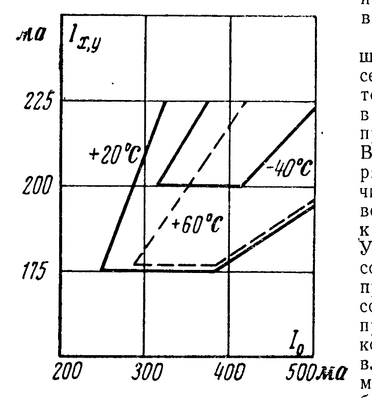
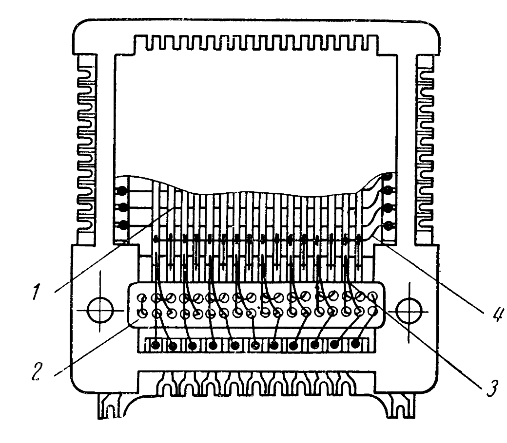
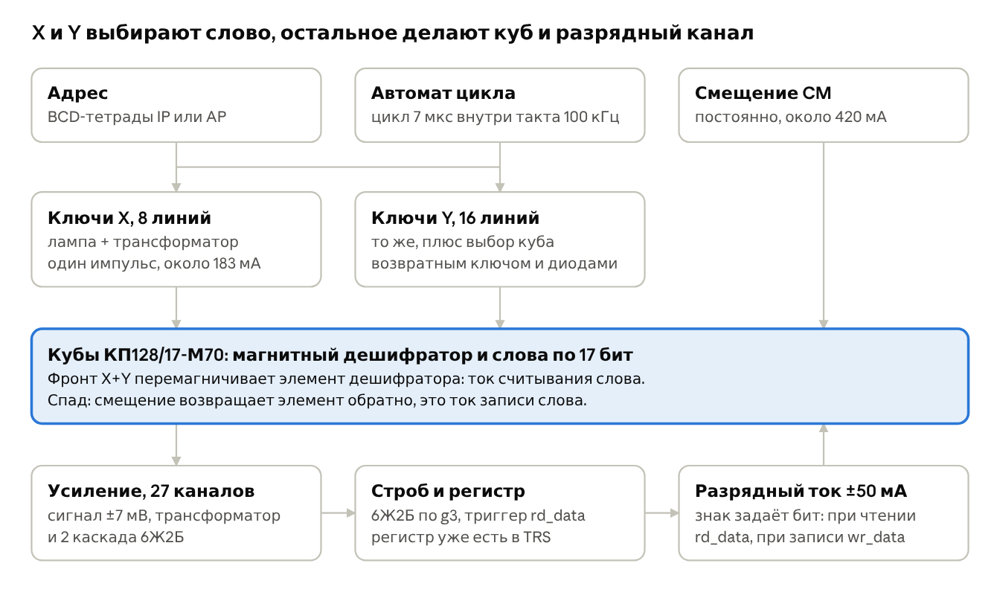
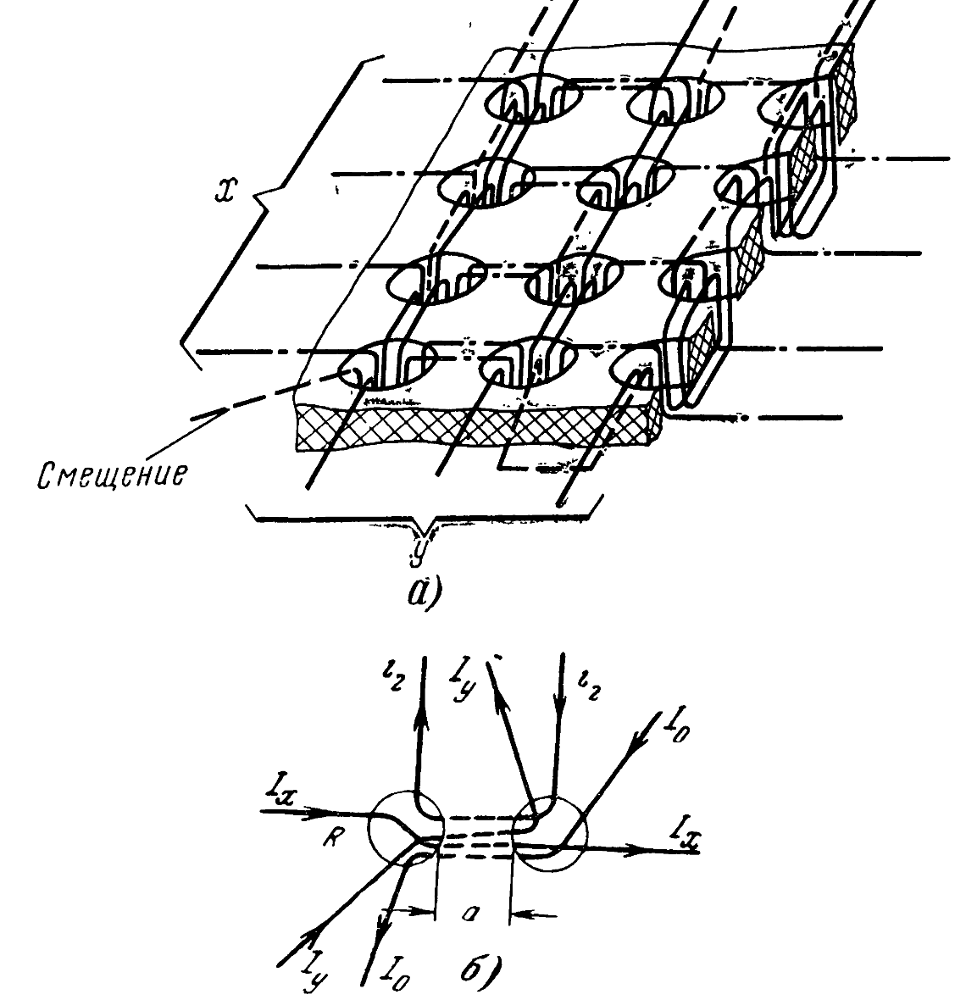
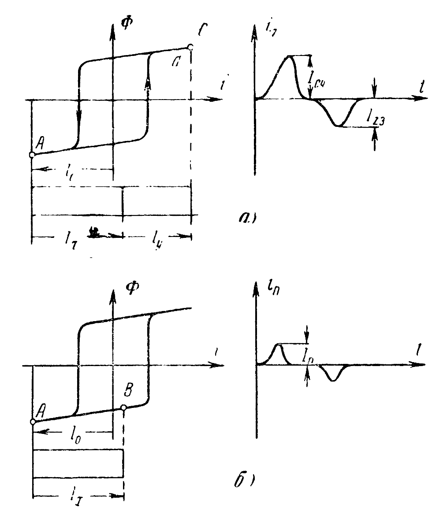
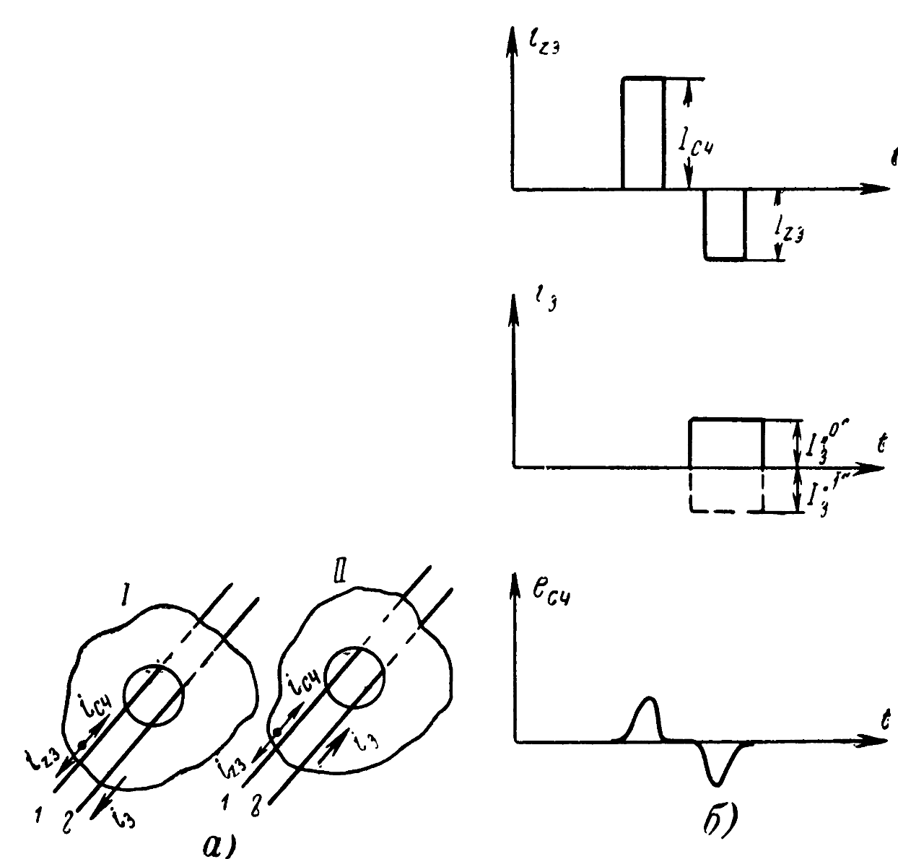
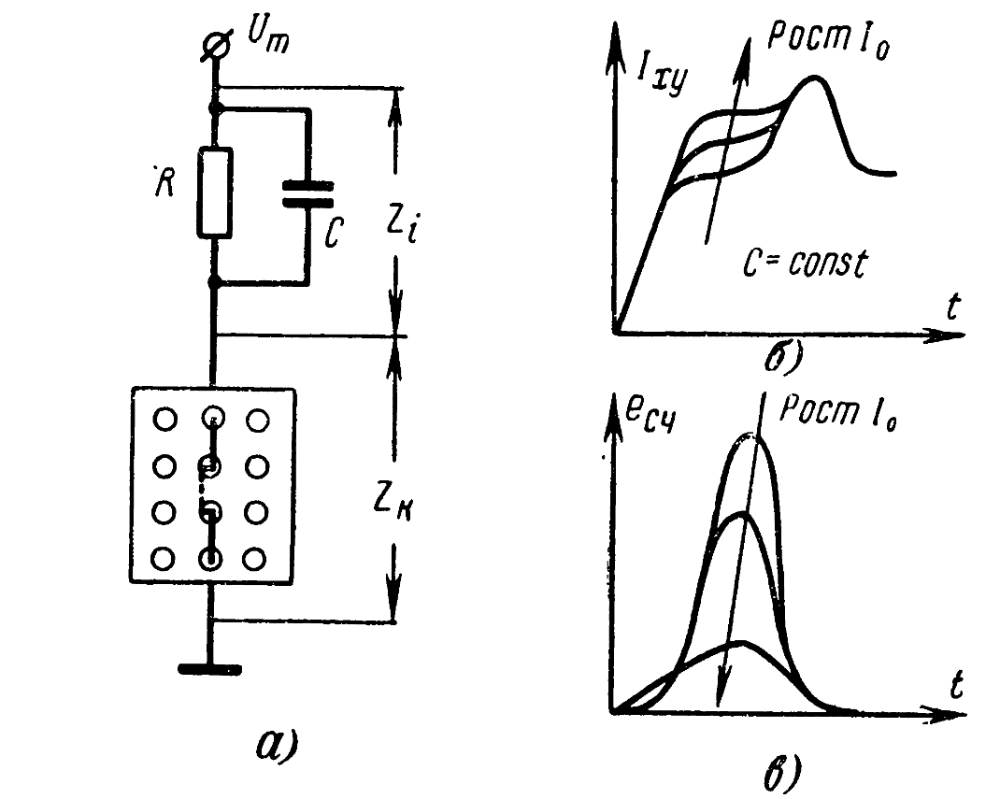
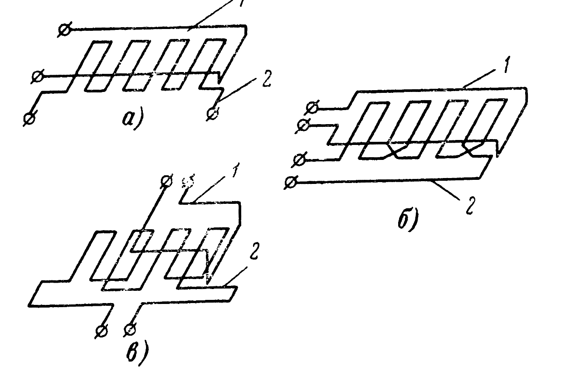
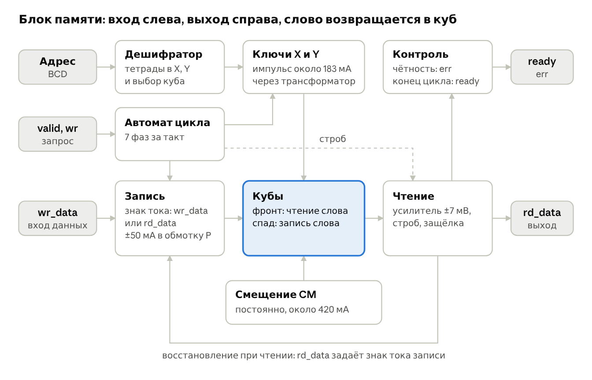
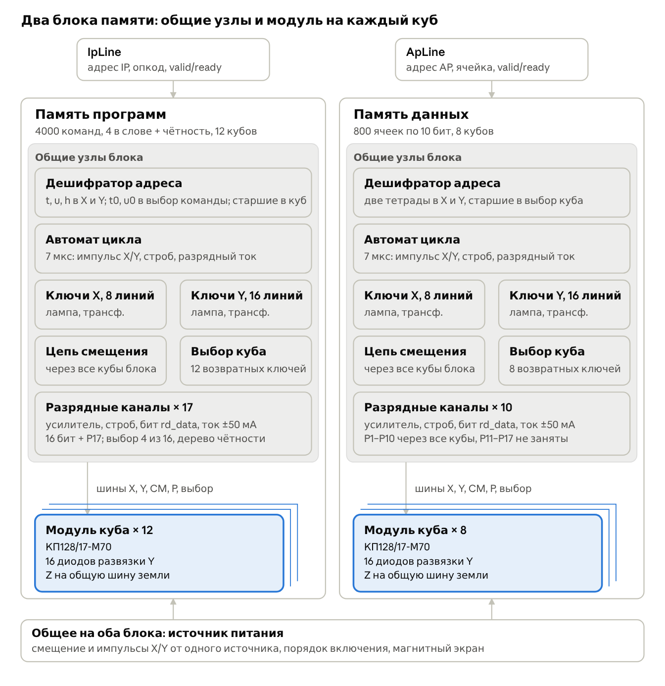

# Куб памяти КП128/17-М70: паспорт и управление

Куб — по всем признакам память с магнитным дешифратором: импульсы X и Y однополярные, а токи чтения и записи слова он формирует сам. Это сильно упрощает ламповое управление. При 12 кубах программы и 8 данных получается 4000 команд и 800 ячеек.

- **Организация:** X1–X8 × Y1–Y16 = 128 слов, 17 разрядных обмоток, постоянное смещение CM.
- **Цикл один на всё:** фронт импульса читает, спад записывает. Чтение и запись занимают одинаковое время, не меньше 6,7 мкс, и при такте 100 кГц (10 мкс) укладываются в один такт.
- **Разрядный ток двуполярный:** ±50 мА, сигналы 1 и 0 тоже разной полярности.
- **Главная трудность:** импульс X или Y около 180 мА при примерно 6 мА номинала у 6Н16Б. Нужны импульсные трансформаторы.
- **Опасность для конструкции:** многоотверстные пластины чувствительны к внешним полям, а рядом тороиды и накалы.

Разделяю три уровня: паспорт — данные; книга Лашевского, Тамарченко и Хавкина (1969) — принцип и похожий куб, но не КП128/17-М70 по имени; ламповая часть и тайминги — моя оценка до опыта.

Данные паспорта и все выводы в машиночитаемом виде: [KP128_17_M70.json](KP128_17_M70.json). Сканы: [memory_cube_pasp.pdf](source/memory_cube_pasp.pdf), [kp128_17_m70_pasp_v2.pdf](source/kp128_17_m70_pasp_v2.pdf), [справочный листок](source/reference_sheet.png), [плата снизу](source/board_bottom.png), [плата сверху](source/board_top.png).

## Паспорт

Оцифровано три источника: справочный листок, паспорт Г63.061.021 ПС выпуска 1977 (№ читается как 3636) и паспорт выпуска 27.IX.1973 (№ 3893). Они расходятся только там, где отмечено.

| № | Характеристика | Номинал | Допуск |
| --- | --- | --- | --- |
| 1 | Сопротивление обмоток X1–X8, Ом | 2,3 | ±0,5 |
| 2 | Сопротивление обмоток Y1–Y16, Ом | 1,1 | ±0,3 |
| 3 | Сопротивление разрядных обмоток 1–17, Ом | 1,7 | ±0,4 |
| 4 | Сопротивление обмотки смещения, Ом | 2,3 | ±0,5 |
| 5а | Изоляция между одноимёнными обмотками, кОм | 100 | не менее |
| 5б | Изоляция между разноимёнными обмотками, кОм | 200 (1977), 300 (1973) | не менее |
| 6 | Электропрочность изоляции, В эфф. | 100 | не менее |
| 7 | Частота обращения, кГц | 150 | не более |
| 8 | Рабочая температура, °C | −5…+50 | |
| 9 | Амплитуда сигнала считывания, мВ | 7 | не менее |
| 10 | Масса, г | 75 | не более |

Сигнал 7 мВ обеспечен на активной нагрузке не менее 95 Ом при питании формирователей X и Y 10 ± 2 В, токе записи 50 ± 10 мА и токах из таблицы ниже.

| Температура, °C | Ток смещения, мА | Координатный ток, не более, мА | Координатный ток, не менее, мА |
| --- | --- | --- | --- |
| +50 | 320 | 141 | 165 |
| +50 | 520 | 187 | 215 |
| −5 | 370 | 165 | 193 |
| −5 | 550 | 209 | 237 |

В обоих паспортах «не более» стоит над меньшим числом. С учётом рис. 45 книги это читается как гарантия области работоспособности: нижняя граница не выше первого числа, верхняя не ниже второго. То есть при +50 °C и 320 мА куб обязан работать при 141–165 мА.

Рис. 45 из книги снят на похожем кубе: 128 чисел по 19 разрядов. Масштаб токов тот же, что в паспорте.

**Из таблицы следует (мой расчёт).** Окно сдвигается примерно на 0,25 мА на каждый мА смещения. Так и должно быть при обмотках дешифратора из книги: 4 витка X, 4 витка Y, 2 витка смещения, 2/(4+4) = 0,25. Рабочая точка для всего диапазона −5…+50 °C: смещение 420 мА, X и Y по 183 мА; окно 177–190 мА, то есть около ±3,5 %.

**Эксплуатация:**

- Перед применением расконсервировать контакты спиртом ректификованным, ГОСТ 5962-67.
- Паять припоем ПОС-61, не выше 240 °C, не дольше 3 с. Это условие листка 1977; второе слово про время частично скрыто печатью.
- Для увеличения объёма допускается последовательное включение координатных, разрядных обмоток и обмотки смещения кубов.
- Допускается работа от −40 до +70 °C при смещении до 700 мА и более высокой частоте обращения. Строка закрыта печатью частично, сверьте по оригиналу.
- Срок службы 10 000 ч, сохраняемость 12 лет. К концу срока изоляция может упасть на 20 %, сигнал — до 6 мВ.

**Прочее:** габариты 62,2 × 54,2 × 16 мм, 106 контактов (102 Ø0,8 и 4 Ø1,1) с шагом 1,2 мм. ТУ: в листке 25-01-155-69, в паспорте 1973 — 25-01-155-71. Цена по листку 1040 руб., завод МВМ, Смоленск. Исполнение герметическое.

## Распиновка

Счёт сходится: 106 контактов без пропусков. Нижний ряд на обоих сканах читается плохо, поэтому его штрихи ″ выведены по симметрии с верхним — прозвоните перед пайкой.

| Контакты | Цепь | Конец | Сторона | Уверенность |
| --- | --- | --- | --- | --- |
| 1, 3, 5 … 15 | Y16, Y14, Y12, Y10, Y8, Y6, Y4, Y2 | К | левая | высокая |
| 2, 4, 6 … 16 | Y15, Y13, Y11, Y9, Y7, Y5, Y3, Y1 | Н | левая | высокая |
| 17 | Z1 | Ø1,1 | угол | средняя |
| 18 | CM | Н″ | нижняя | средняя |
| 19, 21, 23, 25 | X1, X2, X3, X4 | Н″ | нижняя | средняя |
| 20, 22, 24, 26 | X1, X2, X3, X4 | К″ | нижняя | средняя |
| 27–35 | P2, 4, 6, 8, 10, 12, 14, 16, 17 | Н | нижняя | средняя |
| 36–43 | P15, 13, 11, 9, 7, 5, 3, 1 | Н | нижняя | средняя |
| 44, 46, 48, 50 | X5, X6, X7, X8 | Н″ | нижняя | средняя |
| 45, 47, 49, 51 | X5, X6, X7, X8 | К″ | нижняя | средняя |
| 52 | CM | К″ | нижняя | средняя |
| 53 | Z2 | Ø1,1 | угол | средняя |
| 54, 56, 58 … 68 | Y1, Y3, Y5, Y7, Y9, Y11, Y13, Y15 | К | правая | высокая |
| 55, 57, 59 … 69 | Y2, Y4, Y6, Y8, Y10, Y12, Y14, Y16 | Н | правая | высокая |
| 70 | Z3 | Ø1,1 | угол | высокая |
| 71 | CM | Н′ | верхняя | высокая |
| 72, 74, 76, 78 | X8, X7, X6, X5 | Н′ | верхняя | высокая |
| 73, 75, 77, 79 | X8, X7, X6, X5 | К′ | верхняя | высокая |
| 80–88 | P1, 3, 5, 7, 9, 11, 13, 15, 17 | К | верхняя | высокая |
| 89–96 | P16, 14, 12, 10, 8, 6, 4, 2 | К | верхняя | высокая |
| 97, 99, 101, 103 | X4, X3, X2, X1 | Н′ | верхняя | высокая |
| 98, 100, 102, 104 | X4, X3, X2, X1 | К′ | верхняя | высокая |
| 105 | CM | К′ | верхняя | высокая |
| 106 | Z4 | Ø1,1 | угол | средняя |

Паспорт не объясняет две вещи, но книга подсказывает ответ. Оба вывода — мои гипотезы, проверяются прозвонкой.

- **Z1–Z4:** вероятно, земля числовых проводов. В книге они соединены и заземлены, а шину модуля ведут короткими перемычками. Выводы Ø1,1 мм толще остальных, что сходится с большим общим током.
- **Секции ′ и ″:** вероятно, две пластины дешифратора по двум сторонам пакета. Книга описывает такой вариант: нечётные пластины выведены на одну сторону, чётные на другую. Тогда 8×8 + 8×8 = 128 слов: две половины X и CM включаются последовательно снаружи куба, а линии Y делятся между ними.

Рис. 41: кассета с числовыми пластинами, 16 чисел по 19 разрядов. Судя по книге, КП128/17 собран похоже.

## Управление

Нужны ключи без переключения полярности и разрядные каналы с двуполярным током. Схема ниже показывает один разрядный канал и цепи одного слова; разбивка на блоки дальше.

Выбор слова: постоянное смещение держит элемент дешифратора в исходном состоянии, и импульс одной только X или Y его не переключает. Переключает их совпадение. Сигнал снимается с той же обмотки P, через которую потом идёт запись, поэтому усилитель надо защитить от импульса записи.

Рис. 31: пластина дешифратора. Смещение, X и Y проходят сквозь элементы, числовой провод идёт дальше в пакет памяти.

Рис. 32: при выборке (а) совпавшие X и Y дают полный импульс в обе стороны; при полувыборке (б) остаётся только помеха.

Рис. 7: числовые токи чтения и записи, разрядный ток с двумя знаками и сигнал считывания.

**Цикл куба внутри такта 100 кГц (предложение, длительности уточнит опыт).** Семь фаз по 1 мкс занимают 7 мкс из 10 мкс такта, и паспортные 150 кГц не нарушены. Фазы нужно задавать отдельно от такта машины: своим генератором 1 МГц или цепочкой ждущих формирователей. Порядок разрядного тока и спада взят с рис. 7: ток начинается раньше записи слова и кончается позже.

| Фаза, мкс | X и Y | Разрядный ток | Что происходит |
| --- | --- | --- | --- |
| 1 | нет | нет | Адрес установлен, регистр сброшен |
| 2 | импульс | нет | Фронт: считывание, сигнал ±7 мВ |
| 3 | импульс | нет | Строб, бит защёлкнут в rd_data |
| 4 | импульс | включён | Знак тока задан данными |
| 5 | спад | включён | Смещение формирует ток записи слова |
| 6 | нет | выключен | Спад разрядного тока |
| 7 | нет | нет | Восстановление, помехи затухают |

**Следствие для RTL.** Запись идёт тем же циклом, что и чтение: фронт всё равно стирает слово, отличается только источник знака тока. Для этих кубов довод REQ-MEMV2-002, что чтение длиннее записи, неверен. При 100 кГц цикл куба входит в один такт, поэтому `READ_CYCLES` = `WRITE_CYCLES` = 1 подходят, а обращение остаётся двухтактным (REQ-MEMV2-002a). Сквозная запись и удержание rd_data (REQ-MEMV2-001a) ложатся на такой цикл без изменений.

**Ключи X и Y.** Пульсовый режим 6Н16Б снят при 1 кГц, поэтому главное ограничение — средняя мощность. Худший случай: обращение в каждый такт к одной линии, импульс 2 мкс из 10 мкс, скважность 0,2. Прямо от лампы 183 мА с падением около 50 В дают 1,8 Вт при лимите 0,9 Вт. С трансформатором 5:1 в аноде будет около 37 мА и 0,4 Вт. При обращении раз в два такта прямая схема выходит ровно на лимит, поэтому трансформатор нужен. Цифры падения оценочные.

**Источник тока.** Книга советует не чистый источник тока: сначала источник напряжения, чтобы положение сигнала не плавало, потом ограничение R. Это RC-цепь из рис. 47; там допуски по токам выросли в несколько раз. Смещение и импульсы питают от одного источника, тогда они уходят вместе и окно шире.

Рис. 47: RC-цепочка в ветви тока полувыборки. При изменении смещения положение сигнала почти не меняется.

**Выбор куба.** Паспорт разрешает последовательное включение обмоток. Вариант: X, смещение и P идут через все кубы блока, ключи Y общие, а куб выбирает возвратный ключ с развязкой линий Y диодами. Предел книги: помеха полувыборки ограничивает ёмкость 1024–2048 словами. Блоки на 1200 и 800 слов в него укладываются. Цепочка добавляет индуктивность: паспортные 10 ± 2 В относятся к одному кубу, поэтому длину цепочки определит опыт.

**Монтаж важнее обычного.** Книга приводит помехи на один-два порядка выше сигнала и отношение сигнал/помеха не лучше 4:1 после всех мер. Что сделать:

- Вести провода X/Y парами в жгуте, разрядные провода — плоским шлейфом к усилителю, подключать шины кратчайшим путём.
- Вывести обмотку P на вход с симметричным трансформатором: средней точки у неё в паспорте нет.
- Соединить Z одной толстой шиной и завести на землю рядом с усилителями.
- Отнести кубы от тороидов и накала, поставить магнитный экран.

Рис. 48: адресный контур (1) и разрядный (2): без компенсации, с перекрёстным включением разрядных обмоток соседних кассет и с монтажными проводами к середине шины.

**Смещение по питанию.** При 420 мА один куб рассеивает около 0,4 Вт в обмотке 2,3 Ом; цепочка из 20 кубов — около 8 Вт при 19 В. Считаю, что 2,3 Ом — вся обмотка CM, а не секция.

## Структура блока памяти

Два блока одной схемы различаются числом кубов и разрядных каналов; с 17-битным словом программы на оба примерно 360 ламп, около 24 % от расчётных 1500 (грубая оценка, до макета). Без упаковки было бы около 200: упаковка стоит порядка 160 ламп.

Схема одна для обоих блоков, разница только в разрядности и чётности: в памяти программ слово 17 бит с чётностью, в памяти данных 10 бит без неё. При записи знак тока задаёт wr_data, при чтении — только что считанный rd_data.

Все лампы стоят в общих узлах, а модуль куба содержит только куб, диоды и подключение к шинам. Поэтому блок можно собирать постепенно: добавлять кубы без новых ламп.

| Узел | Память программ, ламп | Память данных, ламп |
| --- | --- | --- |
| Ключи X и Y, 24 линии по 1 лампе | 24 | 24 |
| Возвратные ключи кубов, по 1 лампе | 12 | 8 |
| Разрядные каналы: 4 лампы и защёлка 3,5 лампы на бит | 128 (17 бит) | 75 (10 бит) |
| Выбор 4 бит из 16 | 16 | — |
| Чётность: 15 XOR по 3 лампы (оценка) | 45 | — |
| Дешифратор и автомат цикла | 15 | 15 |
| **Итого** | **240** | **122** |

В таблице учтена защёлка rd_data: у `RSLATCH_J2N16` она стоит 3 лампы, с инвертором D 3,5. Защёлка нужна на каждый из 17 бит: чтение стирает всё слово, и его надо восстановить.

Чётность проверяется при каждой выборке слова. Что делать при ошибке (HALT или индикатор), пока не решено. Для данных она тоже возможна: 11 канал и 9 XOR, это ещё около 35 ламп.

Кроме ламп нужны импульсные трансформаторы на линии X и Y и германиевые диоды: по 16 на модуль, всего 320. Открыто, хватит ли одной лампы на линию и на возвратный ключ; таблицу уточнит макет.

## Что поместится в 20 кубов

При 4 командах в слове и чётности куб программы даёт 400 команд, а 12/8 — 4000 команд и 800 ячеек; влезает 67 программ из 93 конечных в Brainfuck-100 против 50 при одной команде в слове. Подсчёт по `metrics.json`; 7 бесконечных программ и 4 с уходом ленты влево я не засчитывал.

**Слово программы:** 16 бит команд и P17 как чётность. Младшие биты десятков и единиц (t0, u0) выбирают одну из 4 команд, остальные биты адреса выбирают слово:

- цифра A = {t3 t2 t1, h1} и цифра B = {u3 u2 u1, h0} дают 100 слов на куб при сотнях 0–3;
- 100 слов ложатся на линии X/Y так: при A = 0–7 X = A и Y = B, при A = 8–9 X = младшие 3 бита B и Y = 10 + A0 + 2·B3. Я проверил перебором: все 400 адресов различны;
- сотни 8–9 занимают только половину третьего куба, поэтому на тысячу команд идёт 3 куба.

**Ячейка данных** занимает одно слово: 100 ячеек на куб по той же карте X/Y.

**Оговорка про «сразу 4 команды».** Единицы десятичные и на 4 не делятся, поэтому подряд идущие адреса попадают в одно слово только парами: без нового обращения идёт примерно каждая вторая команда. Вторая пара того же слова лежит на 10 адресов дальше. Такую же экономию даёт и слово на 2 команды; 4 команды выигрывают только в ёмкости.

| Кубов программа / данные | Команд | Ячеек | Программ влезает из 93 |
| --- | --- | --- | --- |
| 6 / 14 | 2000 | 1400 | 59 |
| 10 / 10 | 3400 | 1000 | 65 |
| **12 / 8** | **4000** | **800** | **67** |
| 14 / 6 | 4800 | 600 | 65 |
| 16 / 4 | 5400 | 400 | 66 |

Принято деление 12/8: это максимум среди всех делений. Hello.b занимает 1 куб программы и 1 данных, `pi.bfk` (618 команд) — 2 и 1, то есть теперь и Pi поместится на вашу плату на 4 куба.

**Остальная память.** Адреса вне кубов может обслуживать ПЛИС-эмулятор, пока он есть, или обращение поднимает `err`, как уже сделано для A..F. Загрузчик 99900–99999 в кубы не кладите: ему нужна запись только при изготовлении, это ПЗУ.

## Первый опыт и открытые вопросы

Начать стоит с одного куба на полупроводниковом стенде: он проверит гипотезу о дешифраторе и даст длительности для ламповой схемы.

- [ ] Прозвонить куб: пары Н–К, нижний ряд, связи ′ и ″, выводы Z между собой. Сравнить с 2,3 / 1,1 / 1,7 Ом.
- [ ] Выяснить, какие Y работают с X′, какие с X″: подать смещение и импульсы на пару линий, смотреть сигнал на P1.
- [ ] Снять сигнал с P1 на 100 Ом при 420 мА смещения, 183 мА X/Y от 10 В и ±50 мА записи. Ожидается не менее 7 мВ с разной полярностью для 1 и 0.
- [ ] Измерить момент и длительность сигнала после фронта, форму тока линии и помеху на P от полувыборки.
- [ ] Прогнать шахматку и бегущую единицу, снять окно по X/Y и смещению при температуре внутри блока.
- [ ] Проверить влияние поля тороида и накала: сигнал с магнитным экраном и без него.
- [ ] Проверить включение и выключение питания: сохраняется ли записанное слово. Смещение должно появляться раньше импульсов и пропадать позже.
- [ ] Проверить, можно ли оставить неиспользуемые обмотки P без подключения.

**Решения:**

- [ ] Частота машины: цель 100 кГц, цикл куба 7 мкс входит в один такт. Осталось выбрать задатчик фаз: генератор 1 МГц или ждущие формирователи.
- [ ] Диоды: REQ-AUTH-002 допускает в обвязке только германий, а на родной плате стоят кремниевые. Родная плата снята с БЦВМ. Решение: подбирать германий на импульс около 200 мА, кремний — только если не получится.
- [ ] Деление кубов: 12/8 принято.

## Источники

- Лашевский Р. А., Тамарченко Н. Г., Хавкин В. Е. Запоминающие устройства на многоотверстных ферритовых пластинах. М.: Энергия, 1969 (Библиотека по автоматике, вып. 355): § 6, § 14, § 20–22, рис. 7, 31, 32, 41, 45, 47, 48.
- Сканы в `source/`: справочный листок, два паспорта, фото платы с четырьмя кубами.
- `TRS.md`, `rtl/DekatronPC/RAM.sv`, `doc/6n16b_datasheet.md` в этом репозитории.
- [Brainfuck-100, metrics.json](https://github.com/radiolok/bfutils/tree/master/programs/bf100).
