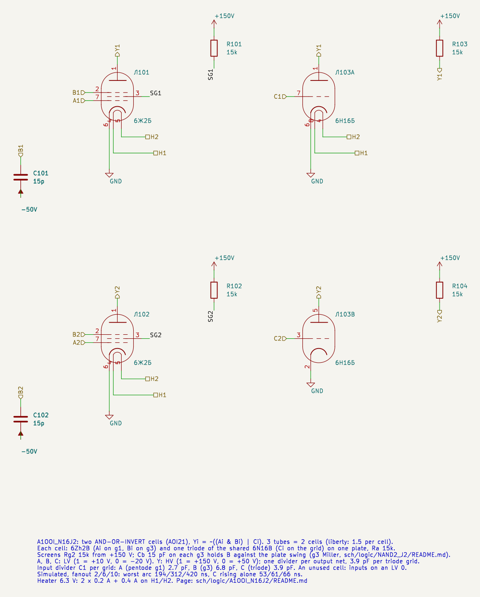
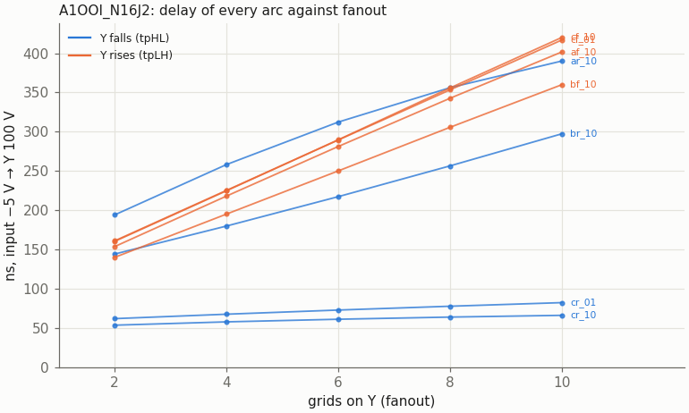
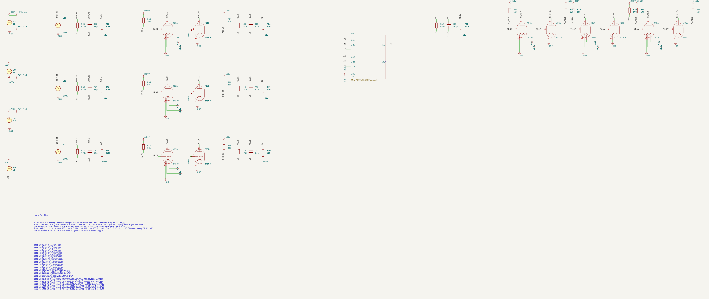
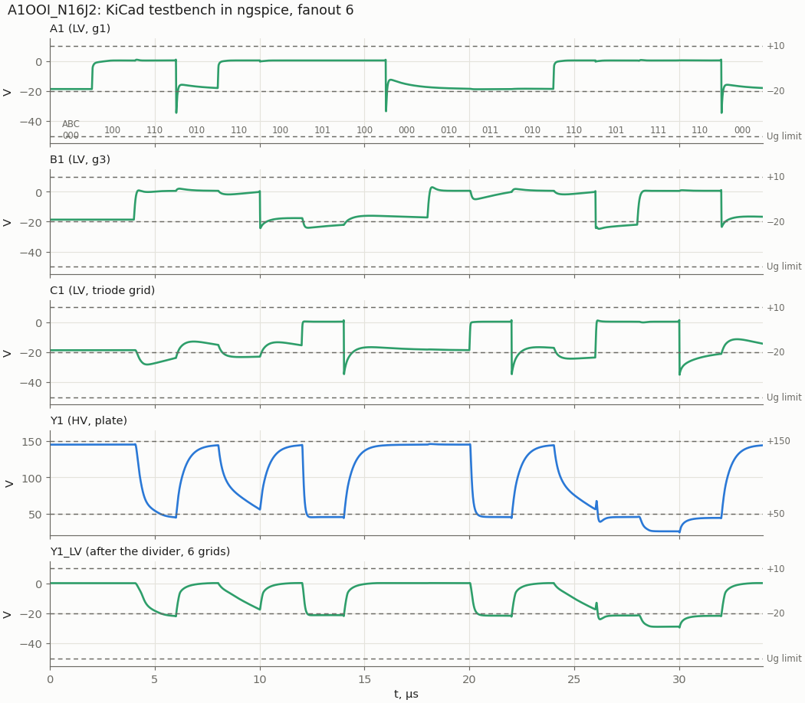
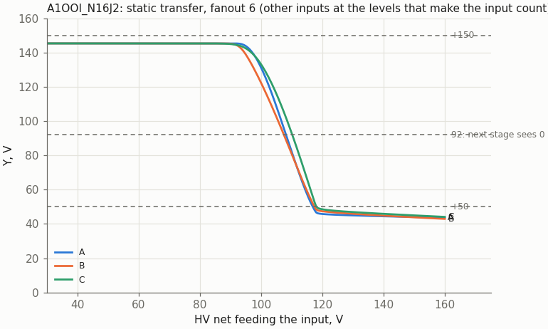

# A1OOI_N16J2: AND-OR-INVERT (AOI21) on 6Zh2B + half a 6N16B

Cell page. REQ-MOD-003 (AOI21_J2N16 in the library), REQ-MOD-005 (boards), REQ-MOD-012 (logic levels), REQ-MOD-004 (delays, fan-out, power; simulated, not measured). Method: `doc/cell_design_method.md`.

**Status (2026-10-29): designed in plain SPICE, drawn in KiCad (sheet with two cells, testbench), the KiCad netlist agrees with plain SPICE; liberty updated.** Not measured on tubes.

| | A1OOI_N16J2 |
|---|---|
| Function | Y = ~((A · B) + C) |
| Tubes | one 6Zh2B + one triode of a 6N16B. The sheet is to hold two cells on one 6N16B, so one cell is 1.5 tubes (liberty: J2B 1, N16B 0.5) |
| Inputs (LV) | A: 6Zh2B g1; B: 6Zh2B g3 (Cb 15 pF to −50 V in the cell); C: triode grid |
| Output (HV) | Y, the common plate, Ra 15k to +150 V |
| Supplies | +150 V (plate; screen through Rg2 15k), −50 V (Cb, dividers), heater 6.3 V: 0.2 A + 0.2 A (half of a 6N16B) |
| Divider C1 per grid on the driving nets | A 2.7 pF, B 6.8 pF, C 3.9 pF |
| Output levels (static) | "1" 141–145 V; "0" 45.4 V (pentode alone), 45.7 V (triode alone), 25.8 V (both) |
| Delay, fanout 2 / 6 / 10, worst arc | to Y = 100 V: 194 / 312 / 420 ns; **A↑ to the next stage's 92 V: 318 / 447 / 537 ns** (C↑ alone: 53 / 61 / 66 ns) |
| Lowest grid | −35.1 V nominal, −42.3 V with all C1 +10 % (limit −50 V) |
| Worst static | 6Zh2B Ik 12.7 mA, Pa 0.35 W, Pg2 0.37 W; triode Ik 7.0 mA, Pa 0.32 W |

The circuit is one half of [RSLATCH_J2N16](../RSLATCH_J2N16/README.md) without the feedback: the pentode is the AND of A and B, the triode on the same plate is the OR with C.

## Circuit and part values

```
                 +150 V
                   │ Ra 15k
   Y ──────────────┼───────────────┐
              6Zh2B plate      6N16B plate (one triode)
         g1 = A, g3 = B         grid = C
         screen: Rg2 15k from +150 V
         g3: Cb 15 pF to −50 V
```

The values follow NAND2_J2 and the latch, with one difference against the latch:

- **Ra 15k, not 10k.** In the latch a pentode is never alone on the plate in a static state, so 10k was fine there. Here A·B = 1 with C = 0 leaves the pentode alone in the knee, and 10k would ask about 20 mA of cathode current (NAND2_J2 page, "Plate current in the knee"). With 15k the worst Ik is 12.7 mA.
- **Rg2 15k and Cb 15 pF**, as in NAND2_J2: the screen regulates itself in the state A = 1, B = 0, where g3 sends the whole current to the screen (Pg2 0.37 W). Cb holds g3 against the plate swing (the g3 Miller integrator, method §4a).
- **C1 per grid type** (method §2): 2.7 pF on g1 (no Miller, fast driver), 6.8 pF on g3, 3.9 pF on the triode grid.

## Schematic

`A1OOI_N16J2.kicad_sch` holds two cells, because KiCad keeps one symbol unit per sheet file (method §4b): cell 1 is Л101 (6Zh2B) with triode A of Л103, cell 2 is Л102 with triode B of Л103.



| Pin | Level | Connection |
|---|---|---|
| A1, A2 | LV in | g1 (lead 7) of 6Zh2B Л101 / Л102 |
| B1, B2 | LV in | g3 (lead 2), Cb 15 pF to −50 V |
| C1, C2 | LV in | grid of triode A (lead 7) / B (lead 3) of 6N16B Л103 |
| Y1, Y2 | HV out | plates, Ra 15k each to +150 V |
| H1, H2 | heater | all three tubes in parallel |

Parts per cell: Ra 15k, Rg2 15k (screen from +150 V), Cb 15 pF. An unused cell: tie its inputs to an LV "0" and leave its output open.

## Results (plain SPICE)

`tools/spice/aoi_sweep.py a1`: each input from an ideal HV pulse → divider → 6N16B triode driver with Ra 10k (the fastest driver, so the worst kick) → the divider of its grid type → the DUT. Y → one divider (C1 = 3.9 pF × grids) → triode loads. 17 states of 2 µs: every arc of every input with the other inputs at the levels that make it count, including B held high while A or C swing the plate, and one hazard.

### Delay against fanout

Input crossing −5 V to Y crossing 100 V. Arc names: input, edge, then the levels of the other inputs (for A: B C; for B: A C; for C: A B).

| Grids on Y | A↑ (B=1, C=0) Y↓ | A↓ Y↑ | B↑ Y↓ | B↓ Y↑ | C↑ Y↓ | C↓ Y↑ (A=1, B=0 / A=0, B=1) |
|---|---|---|---|---|---|---|
| 2 | 194 | 154 | 144 | 140 | 53–62 | 160 / 161 |
| 6 | 312 | 281 | 217 | 250 | 61–73 | 290 / 289 |
| 10 | 390 | 402 | 297 | 360 | 66–82 | 420 / 417 |

- The slowest arcs are the pentode's (A↑ with B held at "1") and every rising Y. The rising Y is Ra 15k charging the output net, as in NAND2_J2.
- C↑ alone is a triode turning on: 53–82 ns.
- VOL 2 µs after A↑ with B held high is 57 V (45 V static). This is the g3 Miller recovery of NAND2_J2; it stays well below the next stage's 92 V.

### The g3 tail: delay to the next stage's threshold

The table above runs to Y = 100 V, the convention of all cell pages. On the A↑ arc with B held high the plate drops fast to about 95 V and then crawls: B (g3) has been pulled out of its clamp through Cg3a and recovers through the 140 kΩ divider, the integrator of NAND2_J2. The next stage sees a "0" only below 92 V:

| Grids on Y | A↑ to 100 V | **A↑ to 92 V** | A↑ to 80 V | B↑ to 92 V | C↑ to 92 V |
|---|---|---|---|---|---|
| 2 | 194 | **318** | 682 | 173 | 64–75 |
| 6 | 312 | **447** | 786 | 264 | 72–87 |
| 10 | 390 | **537** | 862 | 369 | 79–98 |

So the A↑ arc costs about half of a 1 MHz clock at fanout 6. `vtube_timing.json` keeps the 100 V values, as for the other cells; the 92 V numbers are the ones to budget with. Where timing matters, put the late signal on B or C.



### Hazard

B falls while C rises (A = 1): Y should stay "0". It rises to 72 / 68 / 65 V at fanout 2 / 6 / 10 (76 V at MU2 +20 %), under the 92 V threshold of the next stage. Harmless in synchronous logic; do not use such a net as a clock or an enable.

### KiCad testbench



`A1OOI_N16J2_tb.kicad_sch` drives cell 1 with the 17-state sequence of the sweep at fanout 6; cell 2 has its inputs on LV0 (−20 V from a source in the bench) and Y2 open. Stimulus, loads and `.meas` lines come from `tools/spice/aoi_tb.py` (`aoi_sweep.meas_lines`). The KiCad netlist and the plain-SPICE run of the same bench agree on all 30 values: delays and levels to the digit, grid minima to 0.16 %.



### Static transfer



Y against the HV net feeding one input through its divider, the other inputs at the levels that make it count, fanout 6. Y crosses 100 V at 106.5 V (A), 105.5 V (B), 108.5 V (C) on the input net: 51–53 V above a driver's "0" (55 V), 38–41 V below its "1" (146.9 V). That is within 2 V of NAND2_J2.

### Crosstalk between the two cells

Cell 1 static, C2 toggling (Y2 swinging 145 ↔ 45 V), plain SPICE: Y1 moves by −1.8 / +1.3 V when high and by ≤ 1.4 V when low (fanout 2), less at fanout 10. The plate-to-plate capacitance of the 6N16B is 0.5 pF; the coupling is negligible against the margins.

### Static operating points

`tools/spice/aoi_static.py a1`, inputs from HV levels (146.9 / 55 V) through the 470k / 200k divider:

| A B C | Y | 6Zh2B Ik / Ia / Ug2 | Pa / Pg2 | Triode Ik / Pa |
|---|---|---|---|---|
| 0 x 0 | 150 V | 0 | 0 | 0 |
| x x 1, AB ≠ 11 | 45.7 V | 0 (or 5.4 mA to the screen with A = 1) | 0 / 0.37 W | 6.95 mA / 0.32 W |
| 1 0 0 | 150 V | 5.46 / 0 / 68 V | 0 / 0.37 W | 0 |
| 1 1 0 | 45.4 V | 11.3 / 7.0 mA / 85 V | 0.32 / 0.37 W | 0 |
| 1 1 1 | 25.8 V | 10.0 / 5.4 mA / 81 V | 0.14 / 0.37 W | 2.9 mA / 0.08 W |

Over MU2 ± 20 %: 6Zh2B Ik ≤ 12.7 mA (14), Pa ≤ 0.35 W (0.9), Pg2 0.37 W (0.6), Ug2 conducting ≤ 96 V (125); triode Ik ≤ 7.0 mA (14), Pa ≤ 0.32 W (0.9). Ra 15k: 0.73 W with one device on, 1.03 W with both (Y at 25.8 V): a 2 W resistor.

The lowest "0", 25.8 V, puts the next stage's grid at −29 V statically (divider ratio 0.3).

### Model spread

Worst arc at fanout 2 / 10:

| Case | VOL (2 µs after the edge) | Hazard | Lowest grid | Worst arc |
|---|---|---|---|---|
| nominal | 25.5 … 57.4 V | 72 V | −35.1 V | 194 / 420 ns |
| 6Zh2B MU2 −20 % | 24.2 … 52.4 V | 69 V | −35.1 V | 170 / 432 ns |
| 6Zh2B MU2 +20 % | 27.0 … 63.4 V | 76 V | −35.3 V | 214 / 445 ns |
| Cg3a 2.5 pF | 25.5 … 68.4 V | 80 V | −35.1 V | 302 / 479 ns |
| 6N16B MU −20 % | 23.2 … 57.4 V | 71 V | −35.1 V | 194 / 452 ns |
| all C1 +10 % | 25.5 … 57.1 V | 71 V | −42.3 V | 178 / 436 ns |
| all C1 −10 % | 25.5 … 57.9 V | 74 V | −28.6 V | 217 / 418 ns |

Cg3a is the largest effect, as in NAND2_J2 (measured 1.8 pF on one tube; more tubes to measure).

## Liberty

`A1OOI_N16J2` in `sch/logic/vtube_cells.lib` (2026-10-29):
- area 1.5, J2B 1 + N16B 0.5, heat 400 mA;
- `vtube_grid` / `vtube_c1`: A pentode_g1 2.7 pF, B pentode_g3 6.8 pF, C triode 3.9 pF;
- `fanout_load` 1.0 on all pins, as for NAND2_J2. The per-grid-type values (g1 0.7, g3 1.75) wait for the owner's decision for all cells.

Before the fix the liberty had N16B 1 and `J2: 1` (the tube name was wrong, so its 6Zh2B was missing from the per-type total).

`vtube_timing.json`, fanout 6, [Y rise, Y fall]: A→Y [281, 312], B→Y [250, 217], C→Y [290, 73] ns.

Synthesis (`run_tests.sh -s`, 2026-10-29): 63 cells, 94.5 tubes.

## Files and how to run

| File | What |
|---|---|
| `A1OOI_N16J2.kicad_sch` | the sheet, two cells; embed it as a hierarchical sheet |
| `A1OOI_N16J2_tb.kicad_pro/.kicad_sch` | testbench project |
| `tools/kicad/gen_aoi.py` | generated the sheets of both AOI cells (the first time only; edit the drawn sheets in KiCad). Shared parts in `tools/kicad/kicad_sheet.py` |
| `tools/spice/aoi_sweep.py` | transient sweep of both AOI cells (`a1`, `a22`), fanout and model cases; `meas_lines` is shared with the testbench |
| `tools/spice/aoi_static.py` | operating point of every input state, MU2 ± 20 % |
| `tools/spice/aoi_tb.py` | the testbench definitions, and the same bench in plain SPICE |
| `tools/spice/aoi_plots.py` | every figure of both AOI pages, into their `img/` |

```
python3 tools/spice/aoi_sweep.py a1                        # fanout 2..10
python3 tools/spice/aoi_sweep.py a1 --grids 2,10 cases.py  # CASES = [(name, {param: value}), ...]
python3 tools/spice/aoi_static.py a1
tools/spice/sim_kicad.sh sch/logic/A1OOI_N16J2/A1OOI_N16J2_tb.kicad_sch
python3 tools/spice/aoi_tb.py a1                           # the same bench in plain SPICE
python3 tools/spice/aoi_plots.py
```

To embed the cell: the inputs come from HV nets through the usual divider, with C1 = 2.7 pF per g1 (A), 6.8 pF per g3 (B) and 3.9 pF per triode grid (C). The project must sit two directories below `sch/`.

## Open points

- **The g3 tail** (A↑ to 92 V up to 537 ns at fanout 10): the liberty delays use 100 V for every cell; a threshold-based value for all AND-type arcs is the owner's call (REQ-MOD-004, OPEN-014).
- **Measure on hardware** (REQ-MOD-004), Cg3a of more tubes first.
- The screen sits at 150 V while the pentode is cut off, as in NAND2_J2 (allowed for 6Ж2Б-В, to be decided for 6Ж2Б, TRS §22 item 13).
