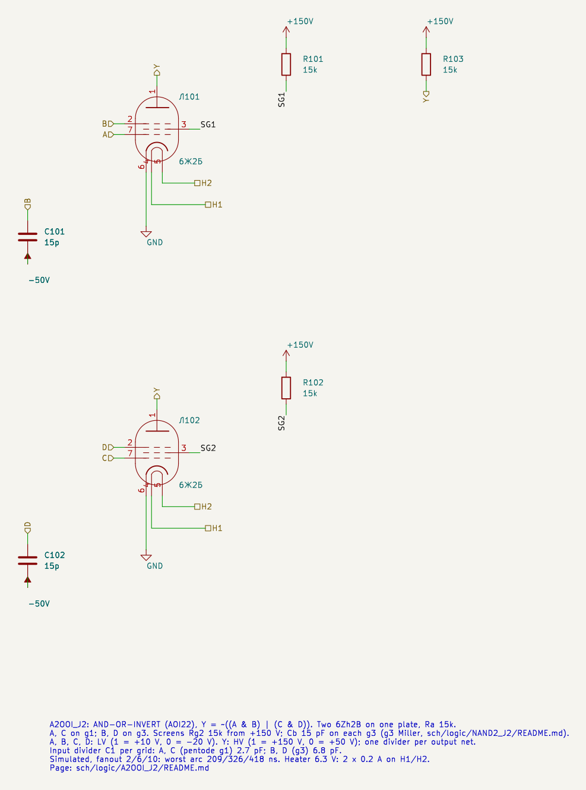
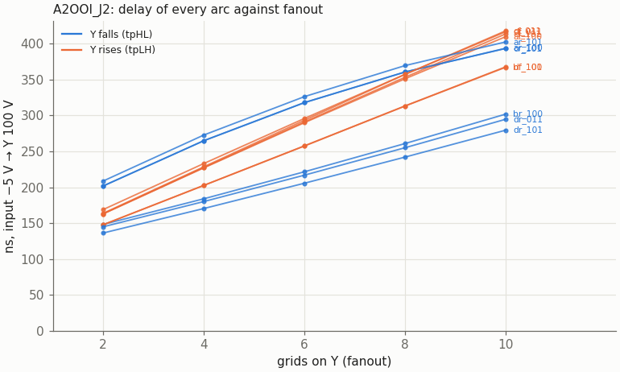
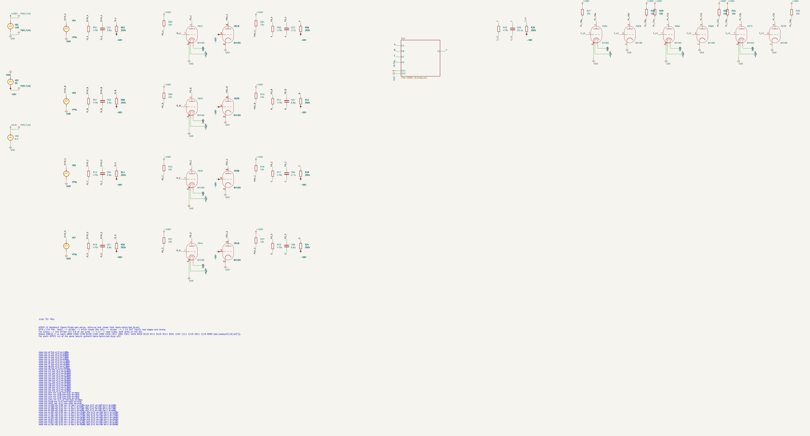
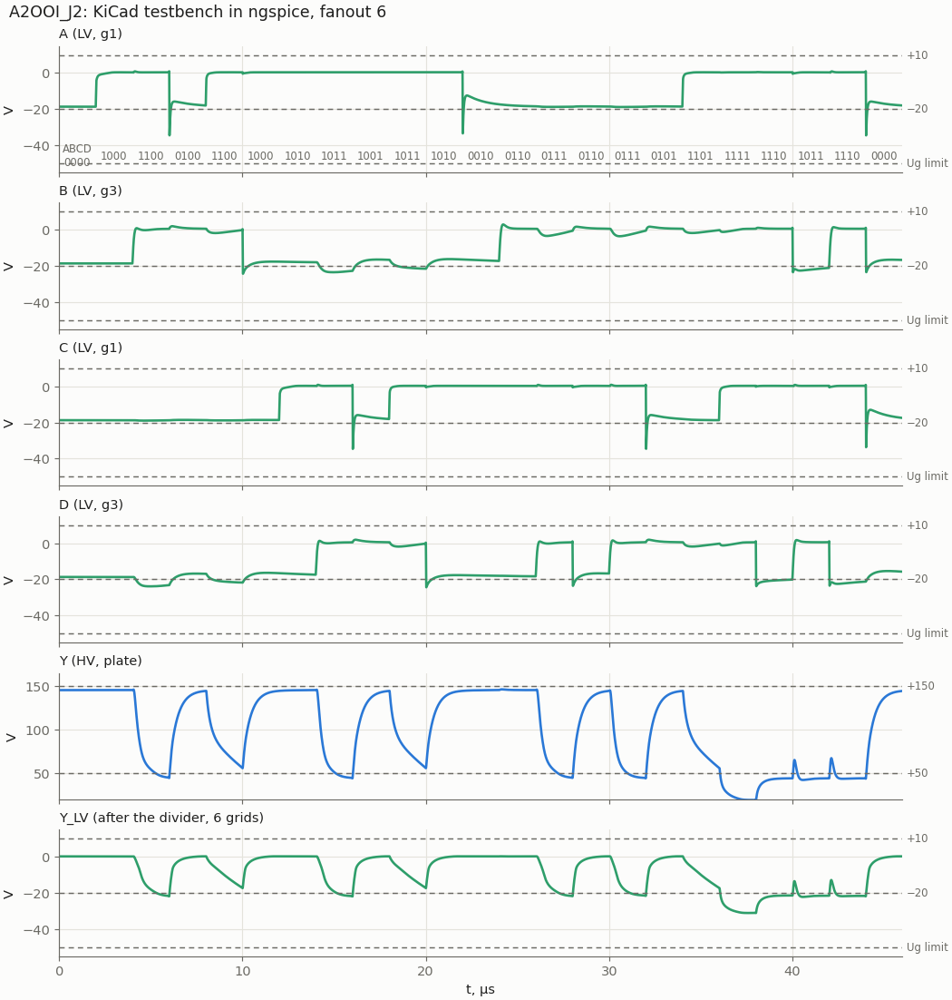
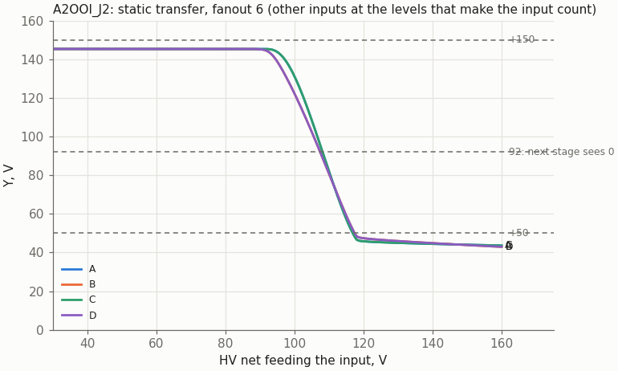

# A2OOI_J2: AND-OR-INVERT (AOI22) on two 6Zh2B

Cell page. REQ-MOD-003 (AOI22_J2 in the library), REQ-MOD-005 (boards), REQ-MOD-012 (logic levels), REQ-MOD-004 (delays, fan-out, power; simulated, not measured). Method: `doc/cell_design_method.md`.

**Status (2026-10-29): designed in plain SPICE, drawn in KiCad (sheet, testbench), the KiCad netlist agrees with plain SPICE; liberty updated.** Not measured on tubes.

| | A2OOI_J2 |
|---|---|
| Function | Y = ~((A · B) + (C · D)) |
| Tubes | two 6Zh2B on one plate (liberty: J2B 2) |
| Inputs (LV) | A, C: g1 of pentode 1 / 2; B, D: g3 of pentode 1 / 2 (Cb 15 pF to −50 V on each g3) |
| Output (HV) | Y, the common plate, Ra 15k to +150 V |
| Supplies | +150 V (plate; each screen through its own Rg2 15k), −50 V (Cb, dividers), heater 6.3 V 2 × 0.2 A |
| Divider C1 per grid on the driving nets | A, C 2.7 pF; B, D 6.8 pF |
| Output levels (static) | "1" 141–145 V; "0" 45.4 V (one pentode), 19.4 V (both) |
| Delay, fanout 2 / 6 / 10, worst arc | to Y = 100 V: 209 / 326 / 418 ns; **A↑ or C↑ to the next stage's 92 V: 338 / 465 / 551 ns** |
| Lowest grid | −34.6 V nominal, −42.2 V with all C1 +10 % (limit −50 V) |
| Worst static | Ik 12.7 mA, Pa 0.35 W, Pg2 0.37 W per 6Zh2B |

The owner confirmed (2026-10-29) that this is AOI22. The old liberty function ((A·B)+C+D)' was a mistake: two pentodes on one plate give two AND terms, nothing else. Each pentode is a NAND2_J2 stage, and the two share the plate and Ra.

## Circuit and part values

```
                 +150 V
                   │ Ra 15k
   Y ──────────────┼───────────────┐
            6Zh2B #1 plate     6Zh2B #2 plate
          g1 = A, g3 = B      g1 = C, g3 = D
          Rg2 15k, Cb 15 pF   Rg2 15k, Cb 15 pF
```

- **Ra 15k**: one pentode alone on the plate must stay under Ik 14 mA (NAND2_J2 page). With both on, each takes less: 9.2 mA.
- **Rg2 15k per screen and Cb 15 pF per g3**, as in NAND2_J2.
- **C1 per grid type** (method §2): 2.7 pF per g1, 6.8 pF per g3.

## Schematic



| Pin | Level | Connection |
|---|---|---|
| A, C | LV in | g1 (lead 7) of 6Zh2B Л101 / Л102 |
| B, D | LV in | g3 (lead 2) of Л101 / Л102, Cb 15 pF to −50 V each |
| Y | HV out | both plates, Ra 15k to +150 V |
| H1, H2 | heater | both tubes in parallel |

Parts: Ra 15k, Rg2 15k per screen, Cb 15 pF per g3.

## Results (plain SPICE)

`tools/spice/aoi_sweep.py a22`, drivers and loads as on the A1OOI_N16J2 page. 23 states of 2 µs: every arc of every input with the other three at the levels that make it count, B held high on the idle pentode while D swings the plate, and one hazard.

### Delay against fanout

Input crossing −5 V to Y crossing 100 V. Arc names: input, edge, then the levels of the other three inputs in the order A B C D.

| Grids on Y | A↑ Y↓ | A↓ Y↑ | B↑ Y↓ | B↓ Y↑ | C↑ Y↓ | C↓ Y↑ | D↑ Y↓ | D↓ Y↑ |
|---|---|---|---|---|---|---|---|---|
| 2 | 202–209 | 163 | 148 | 148 | 202 | 163–164 | 136–145 | 148–169 |
| 6 | 318–326 | 290 | 222 | 258 | 318 | 291–293 | 206–217 | 257–296 |
| 10 | 394–403 | 410 | 302 | 367 | 394 | 414–418 | 280–295 | 368–417 |

The g1 arcs (A, C rising) and every rising Y are the slow ones, as in NAND2_J2. VOL 2 µs after a g1 edge with its g3 held high is 57 V (45 V static): the g3 Miller recovery.

### The g3 tail: delay to the next stage's threshold

As in A1OOI_N16J2 and NAND2_J2, a g1 arc with its g3 held high reaches 100 V fast and then crawls. The next stage sees a "0" only below 92 V:

| Grids on Y | A↑ / C↑ to 100 V | **A↑ / C↑ to 92 V** | to 80 V | B↑ / D↑ to 92 V |
|---|---|---|---|---|
| 2 | 202–209 | **326–338** | 689–697 | 162–178 |
| 6 | 318–326 | **454–465** | 792–798 | 249–270 |
| 10 | 394–403 | **542–551** | 866–874 | 347–375 |

`vtube_timing.json` now uses the thresholds (92 V falling, 118 V rising). Put the late signal on B or D.



### Hazard

B falls while D rises (A = C = 1): Y should stay "0". It rises to 77 / 67 / 62 V at fanout 2 / 6 / 10, and to 83 V at MU2 +20 % with fanout 2. The margin to the next stage's 92 V is only 9 V there. Harmless in synchronous logic; do not use such a net as a clock or an enable.

### KiCad testbench



`A2OOI_J2_tb.kicad_sch` runs the 23-state sequence of the sweep at fanout 6, stimulus, loads and `.meas` from `tools/spice/aoi_tb.py`. KiCad and plain SPICE agree on all 42 values (grid minima to 0.04 %).



### Static transfer



Y crosses 100 V at 106.5 V (A, C) and 105.5 V (B, D) on the input net, as in A1OOI_N16J2 and NAND2_J2.

### Static operating points

`tools/spice/aoi_static.py a22`:

| State | Y | Each conducting 6Zh2B |
|---|---|---|
| no AND term true | 150 V | 0, or 5.46 mA to the screen (g1 high, g3 low; Pg2 0.37 W) |
| one AND term true | 45.4 V | Ik 11.3 mA, Ia 7.0 mA, Ug2 85 V, Pa 0.32 W |
| both true | 19.4 V | Ik 9.2 mA, Ia 4.4 mA, Ug2 78 V, Pa 0.08 W |

Over MU2 ± 20 %: Ik ≤ 12.7 mA (14), Pa ≤ 0.35 W (0.9), Pg2 0.37 W (0.6), Ug2 conducting ≤ 96 V (125). Ra 15k: 0.73 W with one pentode on, 1.14 W with both (Y at 19.4 V): a 2 W resistor.

The "0" with both terms true, 19.4 V, puts the next stage's grid at −29 V statically. This is lower than any other cell's "0", but still 21 V above the −50 V limit.

### Model spread

Worst arc at fanout 2 / 10:

| Case | VOL (2 µs after the edge) | Hazard | Lowest grid | Worst arc |
|---|---|---|---|---|
| nominal | 19.2 … 57.5 V | 77 V | −34.6 V | 209 / 418 ns |
| 6Zh2B MU2 −20 % | 17.6 … 52.4 V | 72 V | −33.8 V | 187 / 450 ns |
| 6Zh2B MU2 +20 % | 21.2 … 63.5 V | 83 V | −35.3 V | 224 / 450 ns |
| Cg3a 2.5 pF | 21.2 … 68.4 V | 74 V | −34.6 V | 326 / 491 ns |
| all C1 +10 % | 19.2 … 57.1 V | 77 V | −42.2 V | 187 / 432 ns |
| all C1 −10 % | 19.2 … 58.0 V | 76 V | −27.5 V | 241 / 440 ns |

## Liberty

`A2OOI_J2` in `sch/logic/vtube_cells.lib` (2026-10-29):
- function `((A*B)+(C*D))'`, area 2, J2B 2 (was `J2: 2`, missing from the per-type total), heat 400 mA;
- `vtube_grid` / `vtube_c1`: A, C pentode_g1 2.7 pF; B, D pentode_g3 6.8 pF;
- `fanout_load` 1.0 on all pins, as for NAND2_J2.

`vtube_timing.json`, fanout 6, to the next stage's thresholds (falling output to 92 V, rising to 118 V; owner, 2026-10-29; `tools/spice/threshold_delays.py`), [Y rise, Y fall]: A→Y [506, 465], B→Y [473, 270], C→Y [511, 454], D→Y [512, 264] ns.

Synthesis (`run_tests.sh -s`, 2026-10-29): 10 cells, 20 tubes. With the old, impossible function ABC used 31.

## Files and how to run

| File | What |
|---|---|
| `A2OOI_J2.kicad_sch` | the cell; embed it as a hierarchical sheet |
| `A2OOI_J2_tb.kicad_pro/.kicad_sch` | testbench project |
| `tools/kicad/gen_aoi.py`, `tools/spice/aoi_sweep.py`, `aoi_static.py`, `aoi_tb.py`, `aoi_plots.py` | shared with A1OOI_N16J2 (see its page) |

```
python3 tools/spice/aoi_sweep.py a22
python3 tools/spice/aoi_static.py a22
tools/spice/sim_kicad.sh sch/logic/A2OOI_J2/A2OOI_J2_tb.kicad_sch
python3 tools/spice/aoi_tb.py a22
```

To embed the cell: the inputs come from HV nets through the usual divider, with C1 = 2.7 pF per g1 (A, C) and 6.8 pF per g3 (B, D). The project must sit two directories below `sch/`.

## Open points

- **Measure on hardware** (REQ-MOD-004), Cg3a of more tubes first.
- The screens at 150 V while cut off, as in NAND2_J2 (TRS §22 item 13).
