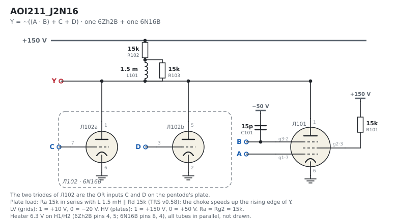
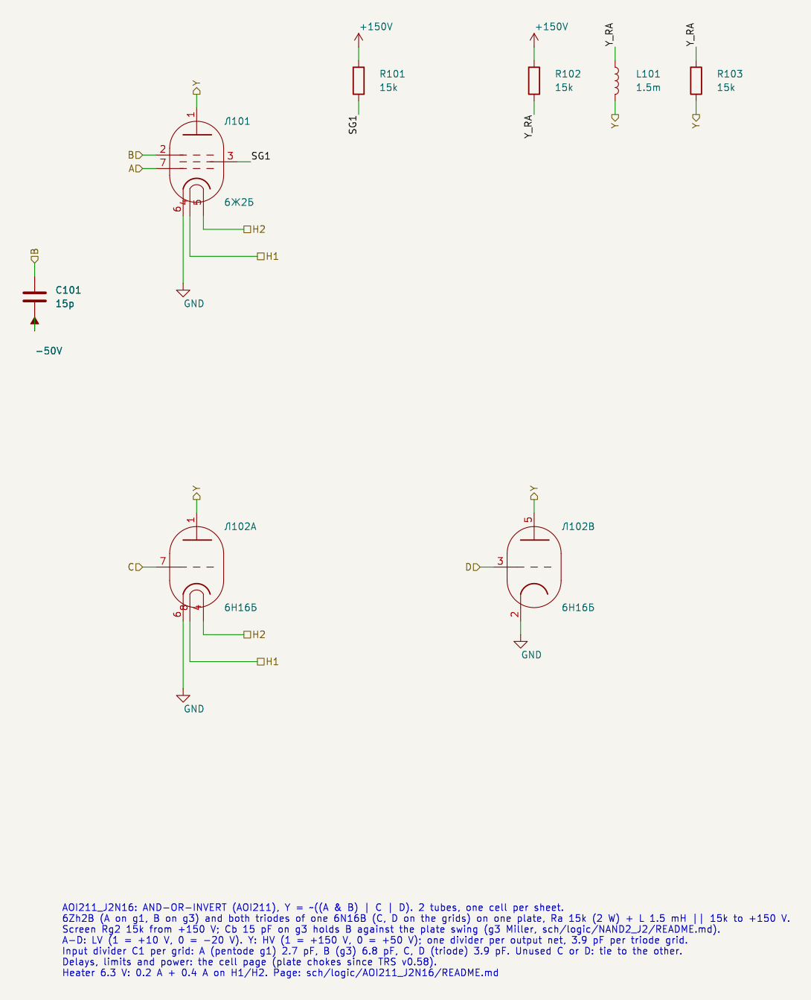
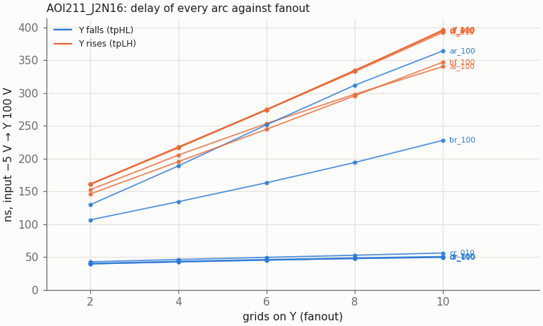
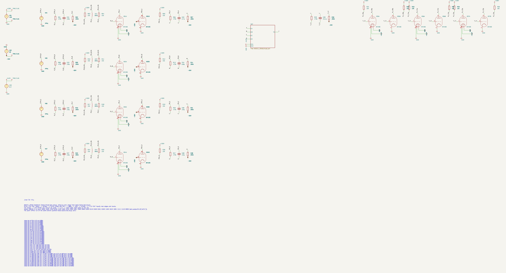
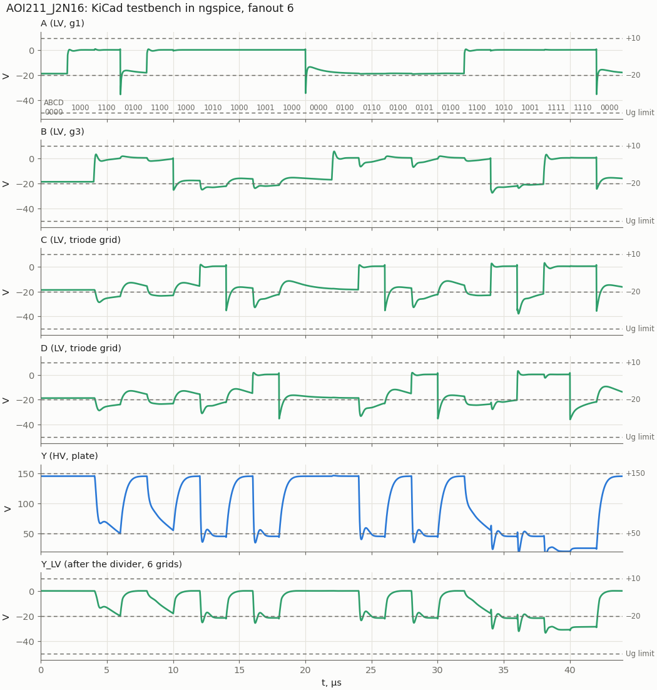
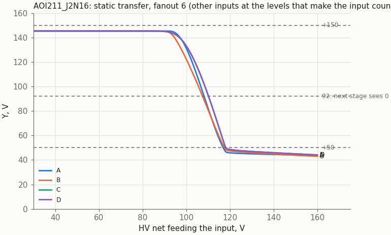

# AOI211_J2N16: AND-OR-INVERT (AOI211) on 6Zh2B + 6N16B

Cell page. REQ-MOD-003 (AOI211_J2N16 in the library), REQ-MOD-005 (boards), REQ-MOD-012 (logic levels), REQ-MOD-004 (delays, fan-out, power; simulated, not measured), REQ-MOD-009 (tube count: `doc/tube_count_1000.md` TC-O2). Method: `doc/cell_design_method.md`.

[A1OOI_N16J2](../A1OOI_N16J2/README.md) with the second triode of the 6N16B as a fourth input. In A1OOI_N16J2 that triode belongs to the other cell of the sheet; here both triodes are inputs of one cell, so a cell is exactly two tubes and the sheet holds one cell (as [A2OOI_J2](../A2OOI_J2/README.md)). Without this cell, synthesis built ((A·B)+C+D)' from an AOI21 and a NOR, or from a NAND2 and a NOR3. Part values, levels, the g3 Cb and the 6Zh2B model are those of A1OOI_N16J2 and NAND2_J2.

| | AOI211_J2N16 |
|---|---|
| Function | Y = ~((A · B) + C + D) |
| Tubes | one 6Zh2B + one 6N16B (liberty: J2B 1, N16B 1); one cell per sheet |
| Inputs (LV) | A: 6Zh2B g1; B: 6Zh2B g3 (Cb 15 pF to −50 V in the cell); C, D: triode grids |
| Output (HV) | Y, the common plate, Ra 15k + L 1.5 mH ‖ 15k to +150 V (TRS v0.58) |
| Supplies | +150 V (plate; screen through Rg2 15k), −50 V (Cb, dividers), heater 6.3 V: 0.2 A + 0.4 A |
| Divider C1 per grid on the driving nets | A 2.7 pF, B 6.8 pF, C and D 3.9 pF |
| Output levels (static) | "1" 139.8–145.2 V (fanout 10 … 2); "0" 45.4 V (pentode alone), 45.7 V (one triode), 31.5 V (both triodes), 20.4 V (all) |
| Delay to Y = 100 V, fanout 2 / 6 / 10, worst arc | 161 / 275 / 396 ns with the plate choke (was 217 / 328 / 450 ns); C↑ or D↑ alone 53 … 83 ns |
| Delay to the thresholds (92 V falling, 118 V rising), fanout 6 | A↑ 406 ns, B↑ 194 ns, C↑/D↑ 52 … 57 ns; Y rises 417 … 443 ns (was 466 / 282 / 71…88 / 502…549 ns) |
| Lowest grid | −35.1 V nominal, −42.2 V with all C1 +10 % (limit −50 V) |
| Worst static | 6Zh2B Ik 12.7 mA, Pa 0.35 W, Pg2 0.37 W; triode Ik 7.4 mA, Pa 0.32 W; Ra 1.12 W (2 W resistor) |

## Plate choke (TRS v0.58)

Owner, 2026-11-08: a plate choke in every cell. Ra is 15k, so the choke is the `NAND2_J2` one: **1.5 mH damped by 15k** (0.68 mH × (15/10)², the shunt-peaking rule). Parts: Ra R102, L101, Rd R103; the Rg2 references moved to R101 (R102). The bench drivers (6N16B triodes) carry the `NOR2_N16` choke, 0.68 mH ‖ 10k.

| | fanout 2 | fanout 6 | fanout 10 |
|---|---|---|---|
| worst arc to Y = 100 V, with the choke | 161 ns | 275 ns | 396 ns |
| the same before | 217 ns | 328 ns | 450 ns |
| worst fall (92 V) / rise (118 V), with the choke | 202 / 243 ns | **406 / 443 ns** | 547 / 660 ns |

At fanout 6 to the thresholds: before A↑ 466, rise 549 ns, now A↑ 406, rise 443 ns (`vtube_timing.json`). The rising edge gains about 20 %, the falling one through the pentode 13–17 % (a current slew; the gain comes from the faster driver edges). Levels do not move. Lowest grid −38.3 V. The KiCad bench agrees with plain SPICE within 0.6 %.

Tools: `tools/spice/chokes.py` (the values), `tools/spice/threshold_delays.py --fanout N` (to the thresholds), the `*_plots.py` of this cell (to 100 V, the figures), `tools/spice/kicad_parity.py` (KiCad bench against plain SPICE). Investigation: `doc/dinv_trigger_board.md`.

## Circuit and part values

```
                 +150 V
                   │ Ra 15k (2 W)
   Y ──────────────┼────────────────┬───────────────┐
              6Zh2B plate     6N16B triode A    6N16B triode B
         g1 = A, g3 = B         grid = C          grid = D
         screen: Rg2 15k from +150 V
         g3: Cb 15 pF to −50 V
```

All values are those of A1OOI_N16J2, and the reasons are the same:

- **Ra 15k.** The state A·B = 1 with C = D = 0 leaves the pentode alone in the knee; 10k would ask about 20 mA of cathode current (NAND2_J2 page). With 15k the worst Ik is 12.7 mA. The second triode adds about 2 pF of plate capacitance and makes the rising Y 20–30 ns slower than in A1OOI_N16J2; a smaller Ra is not open for the same knee reason.
- **Rg2 15k and Cb 15 pF**, as in NAND2_J2: the screen regulates itself in the state A = 1, B = 0 (Pg2 0.37 W), and Cb holds g3 against the plate swing (g3 Miller integrator, method §4a).
- **C1 per grid type** (method §2): 2.7 pF on g1 (no Miller), 6.8 pF on g3, 3.9 pF on each triode grid. The cell adds no new grid type.

## Schematic

Overview schematic: the same netlist redrawn as one picture (generated by `tools/cellschem/build.py`; edit the drawing function there, not the SVG).



The KiCad sheet below has the same parts spread out and joined by net labels:



| Pin | Level | Connection |
|---|---|---|
| A | LV in | g1 (lead 7) of 6Zh2B Л101 |
| B | LV in | g3 (lead 2), Cb 15 pF (C101) to −50 V |
| C | LV in | grid of triode A (lead 7) of 6N16B Л102 |
| D | LV in | grid of triode B (lead 3) of Л102 |
| Y | HV out | the three plates, Ra 15k (R102) to +150 V |
| H1, H2 | heater | both tubes |

Parts: Ra 15k 2 W, Rg2 15k (R101, screen from +150 V), Cb 15 pF. C and D are interchangeable; an unused one goes to the other.

## Results (plain SPICE)

> **Plate choke (TRS v0.58).** The tables of this section were simulated before the cell got its plate choke and stay as the record of the design; the figures of this page are redrawn with the choke. Current numbers: section *Plate choke* above and `sch/logic/vtube_timing.json`.

`tools/spice/aoi_sweep.py a211`: each input from an ideal HV pulse → divider → 6N16B triode driver with Ra 10k (the fastest driver) → the divider of its grid type → the DUT. Y → one divider (C1 = 3.9 pF × grids) → triode loads. 22 states of 2 µs: every arc of every input with the other inputs at the levels that make it count, C and D with B held high (g3 sees the plate swing), and two hazards.

### Delay against fanout

Input crossing −5 V to Y crossing 100 V. Arc names: input, edge, then the levels of the other inputs.

| Grids on Y | A↑ (B=1) Y↓ | A↓ Y↑ | B↑ (A=1) Y↓ | B↓ Y↑ | C↑, D↑ Y↓ | C↓, D↓ Y↑ |
|---|---|---|---|---|---|---|
| 2 | 217 | 182 | 157 | 164 | 53–63 | 189–190 |
| 4 | 278 | 246 | 193 | 219 | 57–69 | 253–254 |
| 6 | 328 | 308 | 231 | 274 | 59–74 | 318–319 |
| 8 | 368 | 369 | 271 | 329 | 62–78 | 382–385 |
| 10 | 399 | 427 | 312 | 383 | 64–83 | 446–450 |

- The pentode arcs (A↑ with B held at "1") and every rising Y are the slow ones, as in A1OOI_N16J2. The rising Y is Ra 15k charging the output net and three plates.
- C↑ or D↑ alone is a triode turning on: 53–83 ns. The slower end is with B held high (g3 Miller).
- Against A1OOI_N16J2 the extra triode plate costs 23–30 ns on the rising Y and on A↑ at fanout 2…10.



### Delay to the next stage's threshold (liberty)

`tools/spice/threshold_delays.py AOI211_J2N16 [--fanout N]`: falling Y to 92 V, rising to 118 V; the A↑ arc has the g3 tail of A1OOI_N16J2 (the plate drops fast to about 95 V, then crawls while g3 recovers through the divider).

| Grids on Y | A↑ Y↓ | B↑ Y↓ | C↑ Y↓ | D↑ Y↓ | Y↑ (worst) |
|---|---|---|---|---|---|
| 2 | 343 | 188 | 65–76 | 63–64 | 316 |
| 6 | 466 | 282 | 73–88 | 70–71 | 549 |
| 10 | 549 | 389 | 80–100 | 76–77 | 780 |

As for A1OOI_N16J2: where timing matters, put the late signal on C or D, then B; A is the slowest input.

### Hazards

Two inputs change together and Y should stay "0":
- B falls while C rises (A = 1): Y rises to 69.8 / 66.2 / 64.2 V at fanout 2 / 6 / 10.
- C falls while D rises (triode against triode): smaller.

The worst case is 77.7 V, with Cg3a 2.5 pF at fanout 2, under the next stage's 92 V. Harmless in synchronous logic; do not use such a net as a clock or an enable.

### KiCad testbench



`AOI211_J2N16_tb.kicad_sch` drives the cell with the 22-state sequence of the sweep at fanout 6. Stimulus, loads and `.meas` lines come from `tools/spice/aoi_tb.py`. The KiCad netlist and the plain-SPICE run of the same bench agree on all 42 values to 0.004 %.



### Static transfer



Y against the HV net feeding one input through its divider, the other inputs at the levels that make it count, fanout 6. Y crosses 100 V at 106.5 V (A), 105.5 V (B), 108.5 V (C, D) on the input net: the same as A1OOI_N16J2, 50–53 V above a driver's "0" (55 V) and 38–41 V below its "1" (146.9 V).

### Static operating points

`tools/spice/aoi_static.py a211`, inputs from HV levels (146.9 / 55 V) through the 470k / 200k divider:

| A B C D | Y | 6Zh2B Ik / Ia / Ug2 | Pa / Pg2 | Each conducting triode Ik / Pa |
|---|---|---|---|---|
| 0 x 0 0 | 150 V | 0 | 0 | – |
| 1 0 0 0 | 150 V | 5.46 / 0 mA / 68 V | 0 / 0.37 W | – |
| x x, one of C D, AB ≠ 11 | 45.7 V | 0 (or 5.4 mA to the screen with A = 1) | 0 / 0.37 W | 6.95 mA / 0.32 W |
| x x 1 1, AB ≠ 11 | 31.5 V | as above | as above | 3.95 mA / 0.12 W |
| 1 1 0 0 | 45.4 V | 11.3 / 7.0 mA / 85 V | 0.32 / 0.37 W | – |
| 1 1, one of C D | 25.8 V | 10.0 / 5.4 mA / 81 V | 0.14 / 0.37 W | 2.9 mA / 0.08 W |
| 1 1 1 1 | 20.4 V | 9.3 / 4.5 mA / 79 V | 0.09 / 0.37 W | 2.05 mA / 0.04 W |

Over MU2 ± 20 %, MU −20 % and KG1 −25 %: 6Zh2B Ik ≤ 12.7 mA (14), Pa ≤ 0.35 W (0.9), Pg2 0.37 W (0.6), Ug2 conducting ≤ 96 V (125); triode Ik ≤ 7.4 mA (14), Pa ≤ 0.32 W (0.9). Ra 15k: 0.73 W with one device on, 1.12 W with all three (Y at 20.4 V): a 2 W resistor.

The lowest "0", 20.4 V, puts the next stage's grid at −29.0 V statically (limit −50 V).

### Model spread

Fanout 2 / 10:

| Case | VOL (2 µs after the edge) | Hazard | Lowest grid | Worst arc to 100 V |
|---|---|---|---|---|
| nominal | 20.2 … 57.5 V | 69.8 V | −35.1 V | 217 / 450 ns |
| 6Zh2B MU2 −20 % | 19.5 … 52.5 V | 66.4 V | −35.1 V | 195 / 460 ns |
| 6Zh2B MU2 +20 % | 21.0 … 63.6 V | 73.9 V | −35.2 V | 239 / 457 ns |
| Cg3a 2.5 pF | 20.3 … 68.3 V | 77.7 V | −35.1 V | 324 / 486 ns |
| 6N16B MU −20 % | 18.1 … 57.5 V | 68.8 V | −35.0 V | 217 / 484 ns |
| 6N16B MU +20 % | 22.0 … 57.6 V | 70.5 V | −35.1 V | 217 / 427 ns |
| 6N16B KG1 −25 % | 18.2 … 57.5 V | 69.3 V | −35.0 V | 217 / 481 ns |
| 6N16B KG1 +25 % | 21.9 … 57.6 V | 70.1 V | −35.1 V | 217 / 427 ns |
| all C1 +10 % | 20.3 … 57.2 V | 68.6 V | −42.2 V | 200 / 468 ns |
| all C1 −10 % | 20.2 … 58.0 V | 71.4 V | −30.2 V | 243 / 430 ns |

Cg3a is the largest effect, as in NAND2_J2 and A1OOI_N16J2.

## Liberty

`AOI211_J2N16` in `sch/logic/vtube_cells.lib`:
- area 2, J2B 1 + N16B 1, heat 600 mA;
- function `((A*B)+C+D)'`, `max_fanout` 10;
- A pentode_g1 2.7 pF (`fanout_load` 0.69), B pentode_g3 6.8 pF (1.74), C and D triode 3.9 pF (1.0).

`vtube_timing.json`, fanout 6, to the thresholds, [Y rise, Y fall]: A→Y [538, 466], B→Y [502, 282], C→Y [547, 88], D→Y [549, 71] ns. The fanout ratios (2 / 6 / 10) are those of the worst arc in the threshold table above: rise 0.576 / 1 / 1.421, fall 0.736 / 1 / 1.178. `vtube_cells.v` and `vtube_cells.sp` have the matching models; `vtube_cells_timing.lib` is regenerated (`rtl/run/vtube_liberty.py`).

Synthesis with the cell (2026-11-01, `doc/tube_count_1000.md` TC-O2): over four seeds the three blocks go from 1111.5 to **1105.3 tubes (−6.2)**, as the scratch-liberty estimate predicted. With the cell, `run_tests.sh -t` / `-d` / `-s`, `synth_sim.sh` (7/7) and the cocotb regression (34/34) pass; STA (`vtube_sta.sh`) gives a minimum period of 8.18 µs (8.0 µs before TC-O1/O2), so 100 kHz meets with 1.8 µs to spare.

## Files and how to run

| File | What |
|---|---|
| `AOI211_J2N16.kicad_sch` | the sheet, one cell |
| `AOI211_J2N16_tb.kicad_pro/.kicad_sch` | testbench project |
| `tools/kicad/gen_aoi.py` | generated the sheets (shared with the other AOI and NOR cells; regenerate into a scratch directory and copy only this cell) |
| `tools/spice/aoi_sweep.py a211`, `aoi_static.py a211`, `aoi_tb.py a211`, `aoi_plots.py a211` | sweep, static points, bench, figures |
| `tools/spice/threshold_delays.py AOI211_J2N16` | the liberty delays |

```
python3 tools/spice/aoi_sweep.py a211
python3 tools/spice/aoi_sweep.py a211 --grids 2,10 cases.py   # CASES = [(name, {param: value}), ...]
python3 tools/spice/aoi_static.py a211
tools/spice/sim_kicad.sh sch/logic/AOI211_J2N16/AOI211_J2N16_tb.kicad_sch
python3 tools/spice/aoi_tb.py a211
python3 tools/spice/aoi_plots.py a211
```

To embed the cell: the inputs come from HV nets through the usual divider, with C1 = 2.7 pF per g1 (A), 6.8 pF per g3 (B) and 3.9 pF per triode grid (C, D). The project must sit two directories below `sch/`.

## Open points

- **Measure on tubes** (REQ-MOD-004), Cg3a first.
- The screen sits at 150 V while the pentode is cut off, as in NAND2_J2 (TRS §22 item 13).
- `AOI221_J2N16` and `AOI222_J2` (TC-O2, another −5.2 by the scratch estimate) are not designed.
