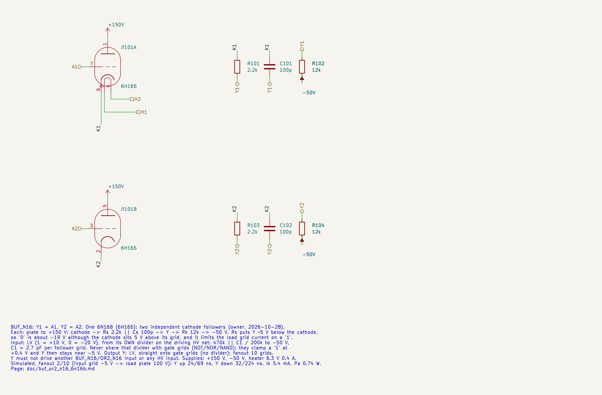
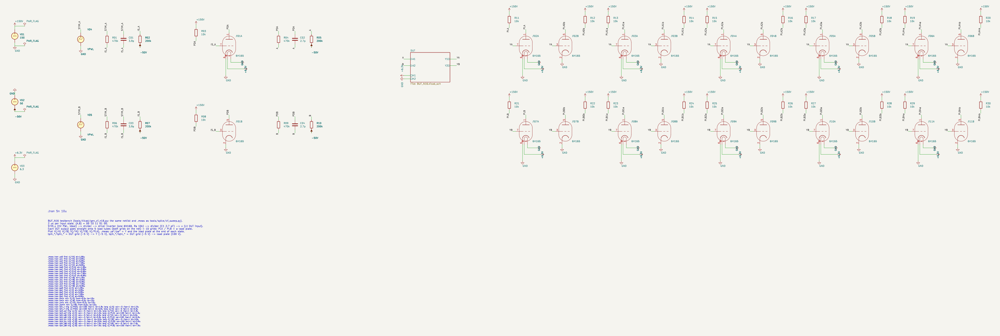
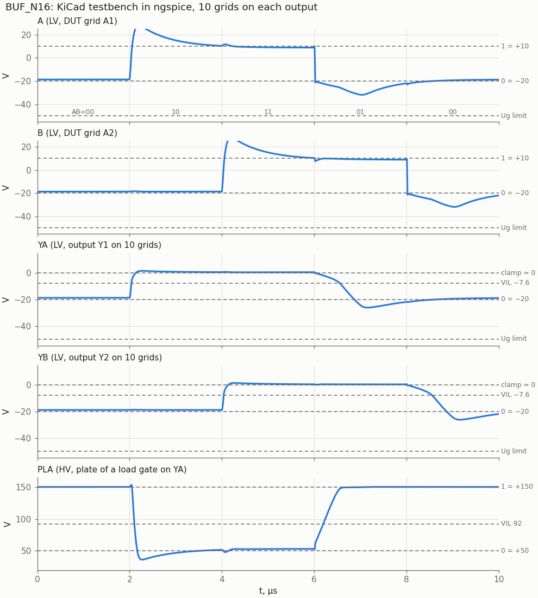
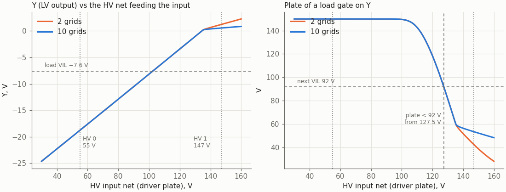
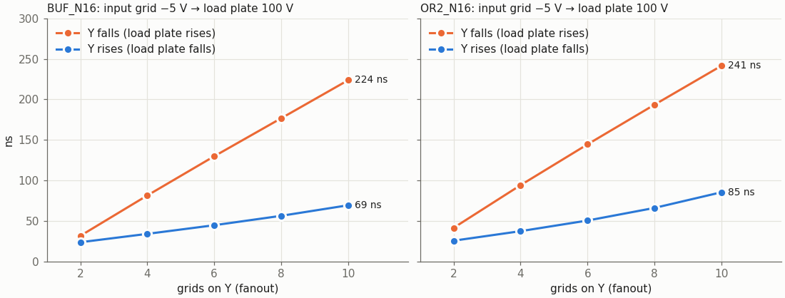

# BUF_N16: two cathode-follower buffers on one 6N16B

Cell page. REQ-MOD-003 (BUF_N16, OR2_N16 in the library), REQ-MOD-005 (boards), REQ-MOD-012 (logic levels), REQ-MOD-004 (delays, fan-out, power; simulated, not yet measured). Designed by `doc/cell_design_method.md`.

BUF_N16 is the base of the cathode-follower family. [OR2_N16](../OR2_N16/README.md) is the same follower with both cathodes tied. The design shared by both cells (how a follower joins the HV/LV scheme, the split cathode resistor, the input divider, the datasheet limits, the options evaluated, the model) is on this page; the OR2 page holds its own results and the hazard.

| | BUF_N16 |
|---|---|
| Function | Y1 = A1, Y2 = A2: two independent buffers |
| Tubes | one 6N16B (6Н16Б) per sheet, half a tube per buffer (liberty `BUF_N16`: N16B 0.5) |
| Circuit | per triode: plate to +150 V, cathode → Rs 2.2k ‖ Cs 100p → Y → Rk 12k → −50 V |
| Inputs | LV, from **their own** HV → LV divider (470k ‖ 2.7 pF / 200k) |
| Output | **LV**, straight onto the load grids, no divider |
| Supplies | +150 V, −50 V, heater 6.3 V 0.4 A |
| Output levels, fanout 2 … 10 | "1" +1.2 … +0.55 V (held by the load grids); "0" −18.8 V |
| Delay, input grid −5 V → load plate 100 V, fanout 2 … 10 | Y up 24 … 69 ns, Y down 32 … 224 ns |
| Ik, Pa (static, worst of the model spread) | 6.2 mA, 0.80 W |
| Grid, worst transient | −38.3 V nominal, −41.6 V at the model extremes (limit −50 V) |

Both follower cells are the owner's choice (2026-10-28): a cathode follower with the plate on +150 V and the cathode returned to −50 V through a resistor; the output is in the LV family. To meet the datasheet limits and the noise margins, the cathode resistor is split, and Y is taken from the tap.

## Logic levels and how the cells join the HV/LV scheme

| Family | Where | 1 | 0 |
|---|---|---|---|
| HV | gate plates | +150 V | +50 V |
| LV | grids | +10 V | −20 V |

The followers are a third kind of net driver. A gate (NOT, NOR, NAND) drives an HV net, and every HV net that feeds grids carries one divider. A follower drives an **LV net directly**. Two rules follow, and both are hard limits of a cathode follower whatever its part values:

1. **The input needs its own divider.** Y follows the input grid about 9 V lower: Y ≈ Vg − 9.3 V while the load grids are not clamping. A gate grid on the same divider clamps a "1" at +0.4 V. The follower's "1" then lands at −1.3 … −7.6 V (static sweep over the part values), which lies between the load's VIL (−7.6 V) and its switching point (−2.2 V). So a follower grid gets a divider of its own on the HV net (470k ‖ C1 / 200k, C1 = 2.7 pF per follower grid; two follower grids on one net share it, with 5.4 pF). The gate grids of that net keep their own divider. Each divider adds 0.15–0.3 mA of load to the driving plate.
2. **The output drives only gate grids.** Y is LV, so it cannot drive an HV input or a divider. It cannot drive another follower either: an unclamped "1" is only +1 … +4 V, and the next follower would put out about −3 V. A chain OR2 → OR2 needs a gate in between (NOR2 → NOT, or a different decomposition).

On the HV net that feeds the input, the follower switches high: the load plate falls below 92 V from 127.5 V on the HV input (nominal model, 10 grids). A NOT driver's "1" is 146.9 V, so the HV "1" margin is 19.4 V; the method's rough rule asks for 25 V (see Open points). The HV "0" margin is 57 V (load plate leaves 150 V above 112 V; a driver's "0" is 55 V).

## Schematic

| Pin | BUF_N16 |
|---|---|
| A1 | triode A grid (pin 7), LV in |
| A2 | triode B grid (pin 3), LV in |
| Y1 | tap of the cathode load of triode A, LV out |
| Y2 | tap of the cathode load of triode B, LV out |
| H1, H2 | heater pins 8, 4 |

The plates (pins 1, 5) go straight to +150 V; in these sheets the plate pins are passive, so ERC accepts them on the supply. Why one sheet holds both BUF halves: KiCad stores one symbol unit per sheet file for all instances (method §4b). An unused BUF half: tie its input to the other input and leave its output open.

### Why the cathode resistor is split

| Part | Value | What it does |
|---|---|---|
| Rs | 2.2 kΩ | Y sits (Vk + 50 V)·Rs/(Rs + Rk) below the cathode: about 5 V at "0". The cathode of a follower stays about 5 V above its grid (Ugk ≈ −Ua/μ near cut-off), so without Rs a "0" input of −18.7 V gives only −13.4 V out. On a "1" the load grids clamp Y near 0 V, and Rs limits the current they draw: 0.1–0.6 mA per grid instead of 4–5 mA. |
| Cs | 100 pF | passes the edges past Rs. It is not a compensated divider: the cathode is a low-impedance source. More than 100 pF stores a history charge that pulls a following "1" down (see Options evaluated). |
| Rk | 12 kΩ | the pull-down. It sets the falling edge (5 mA into the Miller capacitance of the loads) and the "1" headroom. |

### The input divider and its C1

The follower grid has no Miller effect: the cathode follows the grid, and the plate does not move. Its node capacitance is about Cgk·(1 − A) + Cga ≈ 2 pF while it conducts and Cgk + Cga = 4.2 pF while it is cut off. A "1" grid is not clamped (it sits at +10 V, the cathode follows), so there is no clamp surplus on the falling edge. C1 per follower grid (BUF and OR2 together):

| C1 per grid | Lowest DUT grid (fanout 2, nominal / model extremes) | What goes wrong |
|---|---|---|
| 1.2 pF | −27 V | the "1" crawls: OR2 load plate 450 ns at fanout 10 |
| 1.5 pF | −30 V | OR2 load plate 255 ns |
| 2.2 pF | −36 / −39 V | works, but the OR2 hazard takes 0.9–1.9 µs to recover with Rk 10k |
| **2.7 pF** | **−38.3 / −41.6 V** | **chosen**: 0.69 of a gate grid's 3.9 pF; with C1 +10 % −39.7 V nominal |
| 3.3 pF | −41.7 V | under 10 V of margin |
| 3.9 pF | −43.9 V | under 10 V of margin |

So the follower grid is a grid type of its own in the C1 table (method §2): **C1 = 2.7 pF, fanout_load ≈ 0.7**.

## Results

### KiCad testbench

- **Stimulus:** STIM_A and STIM_B are ideal HV PWL sources → divider (3.9 pF) → one driver 6N16B, a NOT per input (Ra 10k) → the follower's own divider (2.7 pF) → the DUT grids.
- **Load:** each output goes straight onto 5 load tubes with both grids on the net (10 grids), each plate through 10k. PLA is the plate of one load gate: it shows what Y means on the next HV net.
- **Sequence,** 2 µs per state: (A, B) = 00 10 11 01 00, every edge of one input while the other is static.
- The `.meas` lines come from `cf_sweep.meas_lines`, the same function the plain-SPICE sweep uses. The KiCad netlist results match the sweep to 0.044 V and 0.04 ns on all 34 measurements.

The input grid overshoots to +25 V on a rising edge: C1 drives the grid while its cathode follows, so Ugk stays small. This is not grid current.

### Static transfer

`tools/spice/cf_static.py`, the HV net that feeds the follower's divider swept 30 … 160 V (BUF and OR2 alike):

| | HV input net | Y | Load plate |
|---|---|---|---|
| Load plate leaves 150 V | 112.0 V | −5.3 V | 140 V |
| Load plate = 100 V | 125.5 V | −2.1 V | 100 V |
| Load plate < 92 V (next stage sees "0") | 127.5 V | −1.7 V | 92 V |
| Y clamped by the load grids | above ≈ 135 V | +0.1 … +0.5 V (10 grids) | 60 … 53 V |

Noise margins (nominal):

| Signal | Level | Threshold | Margin |
|---|---|---|---|
| HV input "0" (NOT/NOR driver) | 55 V | 112 V | 57 V |
| HV input "1" (NOT driver) | 146.9 V | 127.5 V | 19.4 V |
| LV output "0" | −18.8 V (BUF), −18.2 V (OR2) | load VIL −7.6 V | 11.2 / 10.6 V |
| LV output "1" | +0.5 … +1.2 V, clamped | load switching point −2.2 V | 2.7 V, but held by the grid clamp, so a stiff level |

Operating points (fanout 10, nominal; `cf_static.py` prints all fanouts and the model spread):

| State | Y | Cathode | Ik | Pa | Grid current per load |
|---|---|---|---|---|---|
| BUF "1" | +0.54 V | +12.5 V | 5.4 mA | 0.74 W | 0.12 mA (0.44 mA at fanout 2) |
| BUF "0" | −18.8 V | −13.1 V | 2.6 mA | 0.42 W | 0 |

### Fanout

The chart carries both follower cells; the OR2 columns are on its page.

| Grids on Y | Y up / down → load plate | LV → LV up / down | "1" level |
|---|---|---|---|
| 2 | 24 / 32 ns | 7 / 63 ns | +1.23 V |
| 4 | 34 / 81 ns | 11 / 155 ns | +0.86 V |
| 6 | 45 / 130 ns | 15 / 245 ns | +0.70 V |
| 8 | 56 / 177 ns | 20 / 334 ns | +0.61 V |
| 10 | 69 / 224 ns | 25 / 422 ns | +0.55 V |

- "→ load plate" is the useful number: input grid at −5 V to the plate of a load gate at 100 V, so it includes one load gate. "LV → LV" is input grid −5 V to Y −5 V.
- **Y up is fast** (the follower sources the current), **Y down is set by Rk**: 5 mA pulls the Miller capacitance of the loads (≈ 30 pF per active grid) through the active region. At fanout 10 a falling Y plus its load gate takes 0.22–0.24 µs, about a quarter of a 1 MHz clock (OPEN-014).
- **Compared with a gate + divider:** NOT_N16 needs 83 / 211 ns at fanout 10 for its own stage only, and the next gate comes on top. Through a follower the next gate is included. The follower is about 2–3× faster on the rising Y.
- Levels move only by the clamp: "0" does not depend on fanout, and "1" drops from +1.2 to +0.55 V as more grids share the current.

### Model spread

C1 = 2.7 pF per grid; model parameters changed one at a time (cathode follower and loads together):

| Case | Grids | "0" | "1" | Load plate on "1" | Y up / down → load plate | Lowest DUT grid | Peak Ik (edge) |
|---|---|---|---|---|---|---|---|
| nominal | 2 / 10 | −18.8 V | +1.23 / +0.55 V | 41.9 / 53.2 V | 24 / 32, 69 / 224 ns | −38.3 V | 22 / 30 mA |
| KG1 −25 % (S+) | 2 / 10 | −20.2 V | +1.32 / +0.58 V | 33.4 / 45.4 V | 20 / 39, 59 / 260 ns | −41.3 V | 24 / 34 mA |
| KG1 +25 % (S−) | 2 / 10 | −17.6 V | +1.15 / +0.53 V | 49.3 / 59.6 V | 27 / 26, 79 / 194 ns | −35.7 V | 19 / 27 mA |
| MU −20 % | 2 / 10 | −19.5 V | +1.59 / +0.65 V | 31.7 / 43.8 V | 18 / 44, 54 / 284 ns | −41.6 V | 23 / 35 mA |
| MU +20 % | 2 / 10 | −17.9 V | +0.99 / +0.48 V | 51.9 / 61.7 V | 29 / 22, 85 / 174 ns | −35.3 V | 20 / 26 mA |

The worst "0", −17.6 V, leaves 10 V to the nominal load VIL (OR2: −17.0 V, 9.4 V). The worst load plate on a "1", 61.7 V, leaves 30 V to the 92 V threshold.

## Datasheet limits

Source: https://frank.pocnet.net/sheets/113/6/6N16B.pdf (`doc/6n16b_datasheet.md`). BUF and OR2 together:

| Quantity | Limit | Worst case in the cell |
|---|---|---|
| Ua | 200 V | 163 V ("0": plate 150 V, cathode −13 V) |
| Pa per triode | 0.9 W | 0.80 W static ("1", MU −20 %), 0.74 W nominal |
| Ik | 14 mA | 6.2 mA static; 22–38 mA peaks for tens of ns on the edges (C1, Cs and the load capacitance). The pulse rating is far above that: the sheet shows hundreds of mA for 2 µs pulses. |
| Ug | ≥ −50 V | −41.6 V transient at the model extremes, −38.3 V nominal; static grid −18.7 V |
| Ugk | — | −23 V on the low input of an OR2 while the other one is high |
| Grid-circuit resistance | 1 MΩ | 140 kΩ (470k ‖ 200k) |
| Pg | 0.1 W | follower grid: microwatts (the divider limits it); load grid: 0.1–0.6 mA at +0.5 … +1.2 V, under 1 mW |
| Ukh | 150 V | 13 V |

Power per tube:
- **+150 V:** 5.4 mA per follower with Y = 1, 2.6 mA with Y = 0. A BUF tube draws 5–11 mA (0.8–1.6 W), an OR2 2.7–5.7 mA.
- **Rs:** 13 mW. **Rk:** 0.3 W at "1" (0.5 W rating). **−50 V:** 2.6–5.4 mA per follower.
- **Input divider:** 0.15–0.3 mA per follower grid from the driving plate.
- **Heater:** 2.5 W per tube.

## Options evaluated

For both follower cells:

| Option | Result | Why rejected |
|---|---|---|
| **The old sketch: plate to +150 V, one cathode resistor Rk to −50 V** (`sch/logic/legacy/BUF_х2_6Н16Б.kicad_sch`, `sch/logic/legacy/2OR.kicad_sch`), Rk 10k … 100k | Fast (load plate 8–25 ns on Y up). Y "1" = +7 … +12 V, so every load grid draws 3.5–5.5 mA. Ik 16–41 mA static (fanout 2 / 10), Pa 1.6–5.8 W. "0" −12.6 … −14.4 V. Rk ≥ 47k: the falling edge takes 1–4 µs. | Ik over 14 mA and Pa over 0.9 W at any fanout ≥ 2; LV "0" margin 5–7 V |
| Plate resistor Rp, one Rk (Rp 22k, Rk 10k) | Static OK ("0" −16.4 V, Ik 5 mA). But the "1" is current-starved: Y crawls to −1.9 V, load plate 1.3 µs at fanout 10. | too slow; "0" margin 8.8 V |
| Rp bypassed by Cp (1–10 nF) | Fast, but the plate voltage carries history: Y "1" anywhere from +0.5 to +9 V, edge Ik 20–50 mA. After a long "1" the next edge is starved again. Rp 33k fails statically ("1" decays to −9 V). | history-dependent levels |
| Rp 6.8–10k plus the split cathode resistor | Works (Ik ≤ 12 mA). | Rp is not needed: with the plate on +150 V, Pa stays 0.74 W. The owner wants the plate on the supply. |
| Split cathode resistor without Cs | Load plate 233 ns on Y up at fanout 10 (2.2k/10k). | Cs 100 pF gives 91 ns |
| Cs 470 pF … 1 nF | Y up 44–48 ns, but the "1" droops after a long "0": load plate 66–93 V at fanout 10 | history charge on Cs |
| Rs / Rk = 2.2k / 10k | "0" −19.8 V, falling edge 176 ns at fanout 10 | OR2 hazard recovers in 0.9–1.9 µs |
| Rs / Rk = 2.2k / 15k | hazard below 80 V | "0" −16.1 V at MU +20 % (margin 8.5 V), falling edge 318 ns |
| Rs / Rk = 2.7k / 15k, 3.3k / 15k | Pa 0.52–0.62 W | falling edge 270–300 ns at fanout 10 |
| Follower grid on the gate grids' divider | the input "1" is clamped at +0.4 V, so Y "1" = −1.3 … −7.6 V | fails, so rule 1 |
| Inverters (BUF = NOT → NOT, OR2 = NOR2 → NOT, HV output) | needs 1 / 1.5 tubes instead of 0.5 / 1 | not chosen by the owner (2026-10-28) |

## Model

`sch/libs/6N16B.sub`, the Koren model checked against the sheet in `doc/6n16b_datasheet.md` and `sch/logic/NOR2_N16/README.md`. The followers lean on two parts of it that the gates use less:

- **Grid current** (RGI 2 kΩ + diode). It sets how hard the load grids clamp a "1" and so the "1" level. It is not fitted to the sheet's pulse curves. If real grids clamp harder, the "1" level moves closer to 0 V, which is the safe direction.
- **Ugk near cut-off at Ua ≈ 160 V** sets the "0" level, which is the tight margin. The MU spread (±20 %) covers it in the table above.

## Files and how to use

| File | |
|---|---|
| `BUF_N16.kicad_sch` | the cell; embed it as a hierarchical sheet |
| `BUF_N16_tb.kicad_pro/.kicad_sch` | testbench project |
| `tools/kicad/gen_cf_n16.py` | generated the four sheets of BUF_N16 and OR2_N16 (the first time only; edit the drawn cells in KiCad) |
| `tools/spice/cf_sweep.py` | fanout sweep; takes Rs, Cs, Rk, C1g, Rp (rejected option) and model overrides (`M="MU=20.8"`) |
| `tools/spice/cf_static.py` | operating points over the model spread and the DC transfer |
| `tools/spice/cf_plots.py` | rebuilds every figure of the BUF and OR2 pages into their `img/` |

- **KiCad simulator:** open `BUF_N16_tb.kicad_pro`, Inspect → Simulator. Plot `V(/A)`, `V(/B)`, `V(/YA)`, `V(/YB)`, `V(/PLA)`.
- **Command line:** `tools/spice/sim_kicad.sh sch/logic/BUF_N16/BUF_N16_tb.kicad_sch`.
- **Embedding in a module:** add a sheet with the cell file and connect the inputs, outputs, H1 and H2. Give each input its own divider from the driving HV net: 470k ‖ C1 / 200k to −50 V, C1 = 2.7 pF per follower grid. Wire Y straight to gate grids, never to a divider, an HV input or another follower. The project must sit two directories below `sch/` (`sch/logic/<CELL>/`).

## Open points

For both follower cells:

- **The two net rules (own input divider, output only to gate grids) are new for synthesis and P&R.** The liberty now marks the follower inputs (`vtube_grid "follower"`, 2.7 pF) and the LV output, and `rtl/run/div_insert.py` places their separate dividers and reports follower → follower chains (`doc/hv_lv_dividers.md`). The liberty needs a way to express them, for example an LV net type that only a follower drives and only gate grids load, and a separate fanout_load for a follower input (≈ 0.7 of a gate grid, C1 2.7 pF). The owner decides how, and whether `OR2_N16` stays in the synthesis library under these limits. **[2026-10-28]** The levels are now in the liberty (`vtube_level`, `vtube_grid`, `vtube_c1`) and `rtl/run/div_insert.py` places the dividers and flags follower → follower nets. On the 2026-10-11 netlists it found 19 such chains (`doc/hv_lv_dividers.md`).
- **HV "1" margin 19.4 V** against the rough rule of 25 V. The follower's own input divider could use 470k / 220k: the HV "1" margin becomes 30.4 V and the LV "0" margin falls from 11.2 to 9.5 V. That changes the divider ratio of REQ-MOD-012 for this one grid type, so it is the owner's call. It is one value in `gen_cf_n16.py` / `cf_sweep.DEFAULT`.
- **Liberty:** `BUF_N16` (0.5 tube) and `OR2_N16` (1 tube) already have the right tube counts. Add the delays to `vtube_timing.json` once the owner agrees (REQ-MOD-004, OPEN-014).
- **Measure on real tubes:** the "0" level (Ugk near cut-off sets it), the grid clamp level of the loads, the delays and the OR2 hazard.
- **Loads other than 6N16B grids** (6Zh2B g1 and g3) are not simulated. A pentode g1 clamps like a triode grid, so it should work; g3 has its own Miller trap (method §4a).
