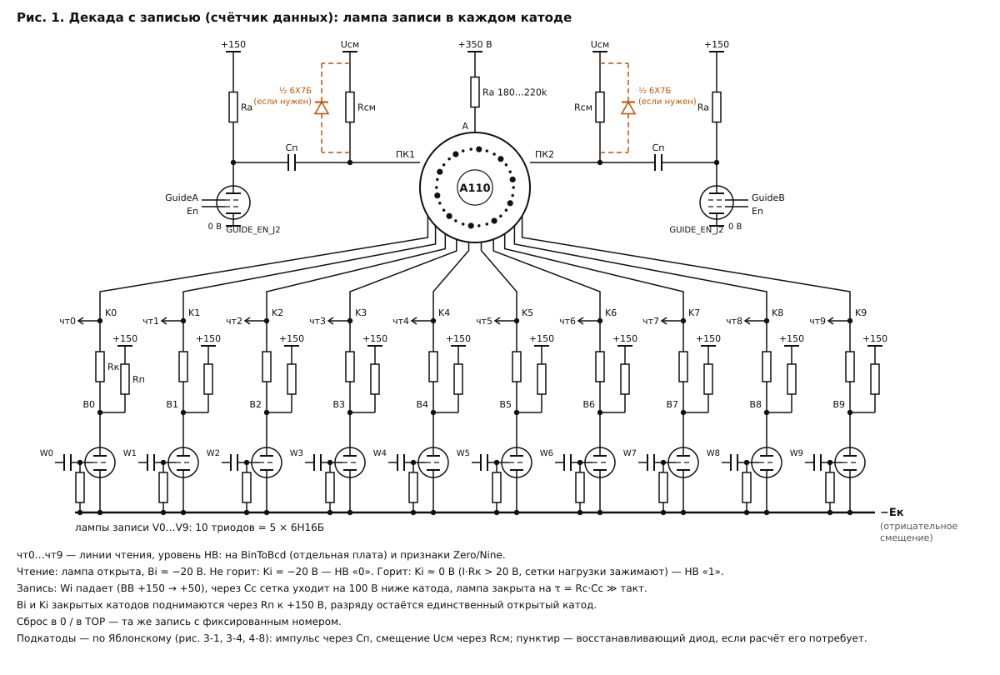
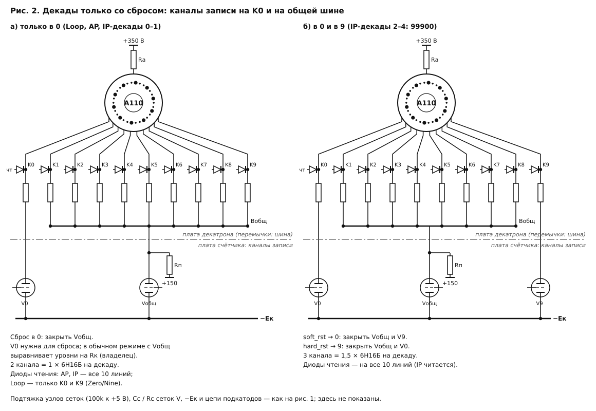
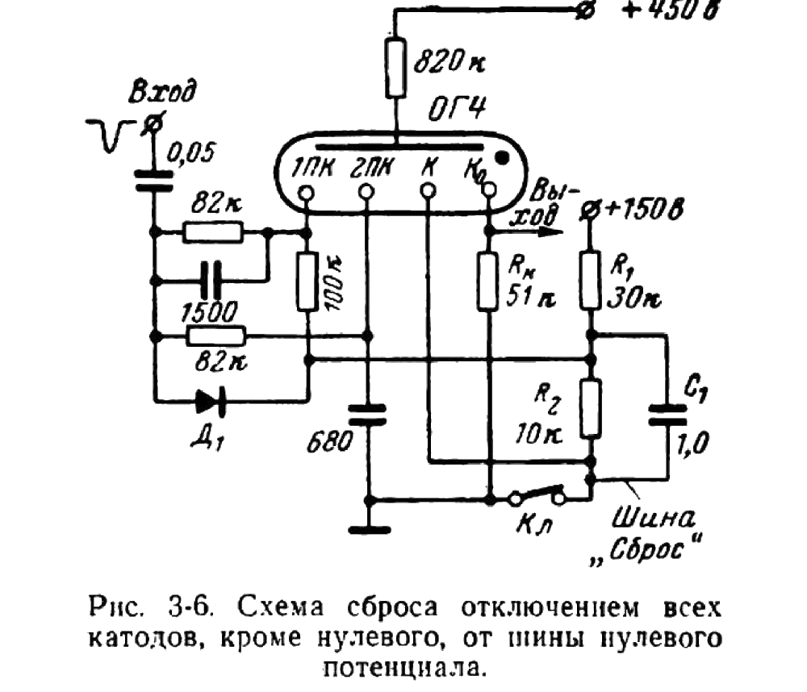
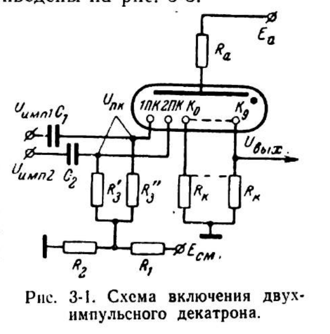
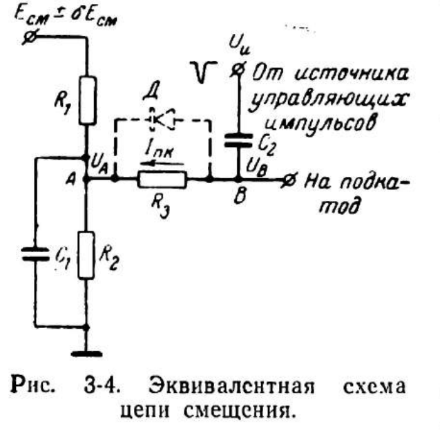
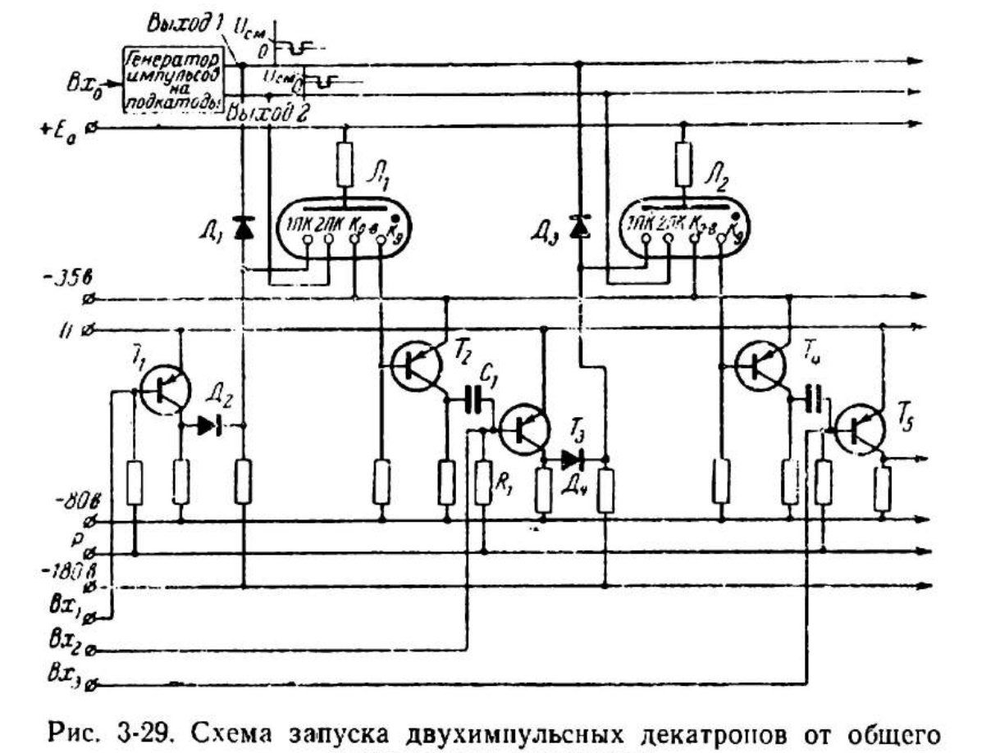
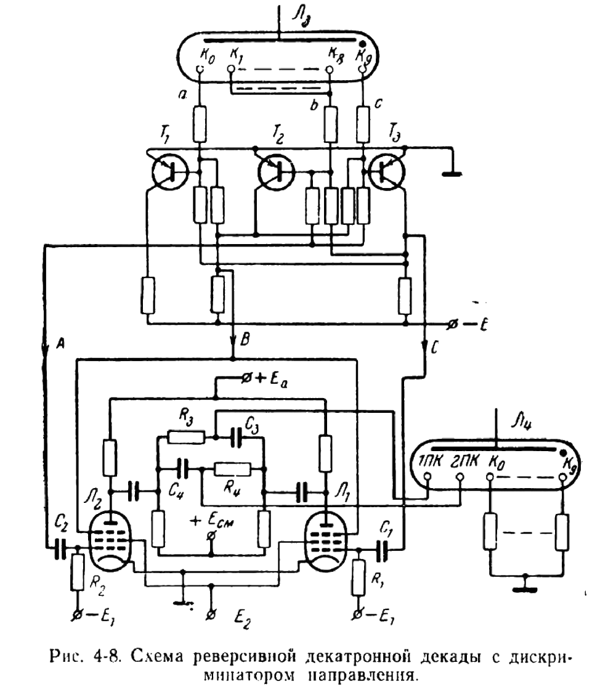
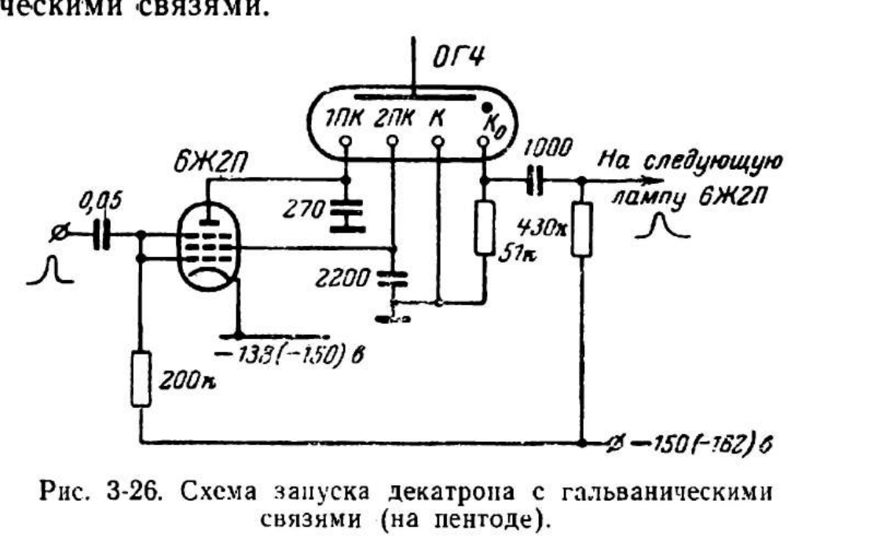
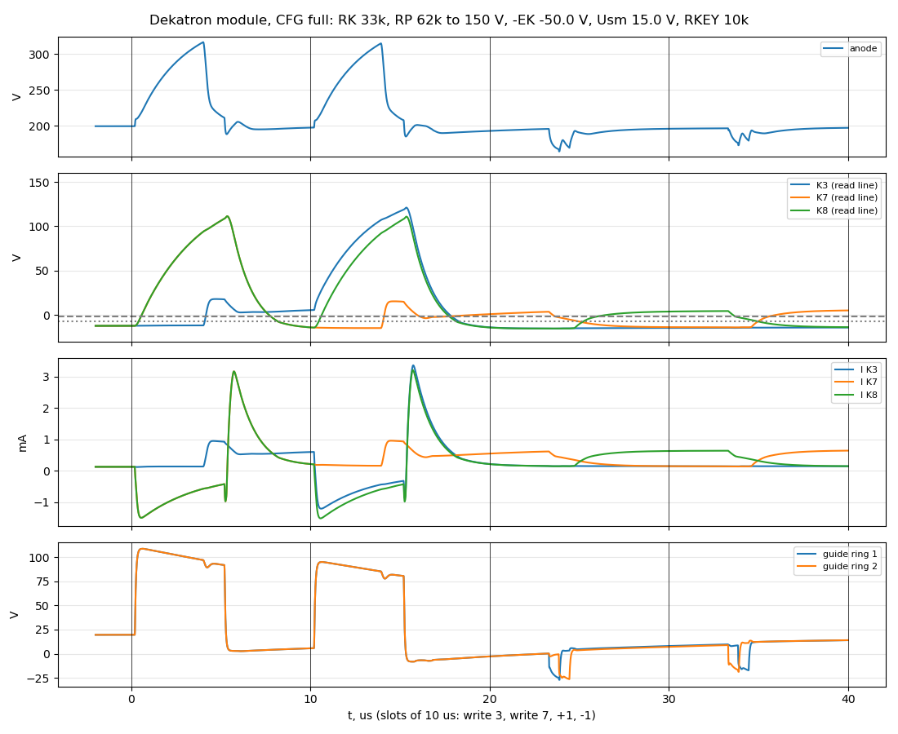

# DEKATRON_A110: декатронный модуль с катодными лампами записи (эскиз)

**Статус: эскиз, принцип согласован с владельцем (2026-11-01); первый SPICE (§9) нашёл две проблемы схемы, решения — за владельцем.** Листа KiCad ещё нет. Требования: REQ-MOD-007 (способ записи и сброса), REQ-PR-020 (что стоит на плате модуля), REQ-PULSE-010 (смещение подкатодов), REQ-DEK-016 (чтение катодов), OPEN-013 (времена декатрона).

Источники: Яблонский [Я] (`doc/Яблонский_декатроны.pdf`, гл. 3 и §4-2), Липкин [Л], `doc/dekatron_physics.md`, листок `doc/a110_datasheet.md`, SPICE-модель `sch/libs/A110.sub`; уровни вентилей — `sch/logic/NOR2_N16/README.md`.

Рисунки строит `python3 tools/sketch/dekatron_a110_svg.py` (пишет в `img/`).

## 1. Принцип

1. **Катодные лампы записи.** В цепь каждого из 10 катодов декатрона ставится триод: катод декатрона Ki → Rк → анод лампы Vi (узел Bi), катод лампы — на отрицательном смещении −Eк. Открытая лампа держит Bi на −20 В.
2. **Чтение** прямо логическим уровнем НВ. Не горит: Ki = Bi = −20 В — НВ «0». Горит: Ki поднимается на I·Rк > 20 В, сетки нагрузки зажимают его около 0 В — НВ «1».
3. **Запись числа.** Закрыть все лампы, кроме выбранной. Цепь остальных катодов разорвана, разряд образуется на единственном подключённом катоде ([Я с. 114–115], второй способ сброса).
4. **Декады только со сбросом.** Лампа на K0 и лампа на общей шине K1…K9 (рис. 2а). Лампа на K0 нужна для сброса; в обычном режиме она вместе с общей лампой выравнивает уровни логики на катодных резисторах (владелец). Старшие три декады IP встают по hard_rst в 9 (99900), им нужна ещё лампа на K9 (рис. 2б).
5. **Плата модуля** — до 16 ламп: декатрон, Rа, все Rк и Rп, лампы записи, ключи и цепи подкатодов. `BinToBcd` и дешифратор записи на плату не помещаются и стоят отдельно.

## 2. Решения владельца (2026-11-01)

| # | Вопрос | Решение |
|---|---|---|
| 1 | Уровни катодных линий | Линии декатрона должны идти прямо на разработанную логику: Bi = −20 В, линия — НВ (§3.1). |
| 2 | Подтяжка Rп к +150 В | Принята на первый взгляд; проверит симуляция (§3.2). |
| 3 | Сетки ламп записи | Закрывающий импульс через конденсатор («хак ламповой логики»), без новой шины (§3.3). |
| 4 | Ключи и цепи подкатодов | Взять из Яблонского (§4). |
| 5 | Лампа на K0 в декадах только со сбросом | Нужна для сброса, в обычном режиме с общей лампой выравнивает уровни. |
| 6 | Кодеки | `BinToBcd` (и дешифратор записи) — отдельно от платы декатрона; на плате до 16 ламп. |
| 7 | Лампа записи | 6Н16Б. 6Ж2Б с двойным управлением здесь не нужна (§3.4). |
| 8 | Плата | Разводится под максимальную комплектацию «все катоды в запись»: одна плата — один декатрон; перемычками — «сброс в 0», «сброс 0/9», «полная запись». |
| 9 | Шины стенда | Три регулируемые: до 200, до 120 и до 80 В. Rп пробуем от +120 В; точные значения — по SPICE. |

## 3. Катодные цепи

### 3.1 Уровни и Rк

| Узел | Уровень |
|---|---|
| Bi, лампа открыта | −20 В |
| Ki не горит | −20 В = НВ «0» (VIL вентиля −7,6 В) |
| Ki горит | −20 + I·Rк, сетки нагрузки зажимают на ≈ 0 В = НВ «1» |
| Ki, лампа закрыта | +150 В через Rп |

- **Rк по Яблонскому** [Я с. 103–104, ф. 3-13, 3-14]: снизу Rк = Uвых.мин / Iк.мин, сверху Rк ≤ Uвых.макс / Iк.макс. У нас Uвых.мин — это 20 В плюс запас при наименьшем токе 0,7 мА, то есть Rк 30…33k. Верхняя граница теряет смысл, пока линию зажимают сетки: выход тогда 20 В при любом токе. Для ОГ4 книга даёт Uвых.макс 15 В, для А110 его нет. Липкин прямо предлагает этот приём: −20 В на выходной катод, разница с остальными не больше 20 В [Л с. 20, 22].
- **Линия без сеток** (Loop с READ = 0, катоды K1…K8) не зажата: при 33k на ней будет до +10 В. Там Rк меньше, или к линии ставится нагрузка.
- **Ёмкость линии.** Rк и ёмкость линии Cк (сетки, провод до платы `BinToBcd`) затягивают фронт чтения [Я с. 142–143, рис. 3-30]: 33k × 30 пФ ≈ 1 мкс при такте 10 мкс.
- **Смещение подкатодов** должно быть больше выхода катода [Я с. 66–67], то есть больше 20 В относительно катодов в покое (REQ-PULSE-010).

### 3.2 Подтяжка Rп

Без Rп у негорящего катода нет тока, и открытый триод стягивает Bi почти до −Eк. С Rп ток лампы задан, и Bi стоит на своём уровне. Rп к земле не годится: через неё продолжает гореть старый катод (≈ 0,7 мА при 10k), и запись не проходит. Поэтому Rп идёт к +150 В.

Книга это подтверждает. В схеме сброса отключением катодов (рис. 3-6) отключённые катоды поднимаются примерно до +150 В, а шина, к которой они подтянуты, должна быть 100…150 В: ниже сброс ненадёжен, выше возможно зажигание между подкатодом и индикаторным катодом и отравление катодов [Я с. 115–116].

У нас закрытые катоды на +150 В, целевой на −20 В: разница 170 В, а между закрытым катодом и подкатодом (≈ −20 + Uсм) 140…150 В — у верхней границы книги. Если SPICE покажет риск, Rп подтягивается к точке +100…+130 В (делитель на плате), а не к самой шине +150 В.

Rп 150…330k: 0,5…1 мА на лампу, 1…2 Вт на декаду. Из того, что 6Н16Б при ~1 мА падает на 20…30 В, −Eк, вероятно, — существующая шина −50 В. Проверить в SPICE.

### 3.3 Сетки ламп записи: импульс через Cс

Сетка висит на катоде лампы через Rс ~1M, лампа открыта. Вентиль с выходом ВВ (открыта_i = ¬W ∨ sel_i) при записи падает на 100 В (+150 → +50), и через Cс ~100 пФ сетка уходит на 100 В ниже катода. Лампа закрыта на τ = Rс·Cс ≈ 100 мкс, на порядок дольше такта. Когда вентиль возвращается, сеточный ток сам восстанавливает уровень. Новой шины не нужно, а без записи все лампы открыты. Долгий сброс от реле времени тоже безопасен: через ~τ лампы откроются, но разряд уже стоит на нужном катоде, а подкатоды без импульсов его не сдвинут.

Cс и Rс стоят на плате модуля у сетки. Линии W0…W9 приходят с дешифратора через разъём.

### 3.4 Почему триод, а не 6Ж2Б

Лампа записи держит Bi, поэтому нужно малое ri: у 6Н16Б оно в разы меньше, чем у пентода. Два управления пентода дали бы И двух условий «открыта», а записи нужно ИЛИ (открыта_i = ¬W ∨ sel_i). Кроме того, g3 тоже пришлось бы вести ниже катода, а развязка по переменному току для уровня не годится. Согласен с владельцем: 6Н16Б, два триода в баллоне.

## 4. Подкатоды по Яблонскому

### 4.1 Что в книге

- **Типовое включение** [Я с. 100–101, рис. 3-1]. Импульсы приходят на группы подкатодов через конденсаторы C1, C2. Смещение подаётся через R3′, R3″ от делителя R1/R2 источника Eсм; узел делителя зашунтирован конденсатором (рис. 3-4). Смещение считается относительно катода: Uсм.эфф = Uпк − Rк·Iк (ф. 3-3).
- **Расчёт цепи смещения** [Я с. 106–114, ф. 3-18…3-39]. Когда разряд проходит по подкатоду, зондовый ток подкатода I_пк копит заряд на разделительном конденсаторе и поднимает смещение. Среднее I_пк растёт со скважностью t_и·f (ф. 3-20). Если t_и·f мала, хватает резистора R3; при большой параллельно R3 ставят диод, который восстанавливает постоянную составляющую. В примере для А101 (R3 = 50k): при t_и·f = 0,02 условие выполнено, при 0,2 — уже нет, нужен диод или R3 = 15k.
- **Общий генератор и ключи в декадах** [Я с. 140–142, рис. 3-29] — это наша архитектура: один формирователь фаз на счётчик, в декаде только ключ, который пропускает импульс. В книге ключ стоит только на 1ПК (REQ-PULSE-007: владелец оставил два ключа для унификации).
- **Ключ — пентод с двумя управлениями** [Я с. 162–164, рис. 4-8]: на g1 импульс, на g3 разрешение (там — направление), анод через RC на подкатоды, смещение +Eсм. Это ровно `GUIDE_EN_J2`.
- **Гальваническая связь** [Я с. 136–138, рис. 3-26]: анод 6Ж2П прямо на 1ПК, экранная сетка на 2ПК, катод лампы на −133…−150 В, сетка от −150 В. Это вариант «катод ключа ниже земли»; ему нужна отрицательная шина около −150 В.
- **Высокочастотные декатроны** [Я с. 142–146]: Rа на панели декатрона (у нас REQ-PR-020), выход катода падает с ростом частоты из-за Rк·Cк.

### 4.2 Что берём (рис. 1)

Схема по рис. 3-1 / 3-4 с ключами по рис. 4-8:

- Ключ `GUIDE_EN_J2` (6Ж2Б): g1 — GuideA/GuideB, g3 — En, катод на земле, анодная нагрузка Ra к +150 В. Ячейка и её НВ-входы не меняются.
- Импульс с анода ключа — через Cп на группу подкатодов. Размах (по листку 38 В) задают Ra, ток ключа и деление Cп на ёмкость подкатодов.
- Смещение — через Rсм от узла Uсм: делитель от +150 В с шунтирующим конденсатором (рис. 3-4). Делитель можно сделать общим на счётчик [Я с. 111]. Для нашего уровня катодов Uсм ≈ −20 + Uсм.эфф, где Uсм.эфф > 20 В.
- Восстанавливающий диод параллельно Rсм — **вакуумный, половина 6Х7Б** (книжные Д2Е/Д226 у нас запрещены, REQ-AUTH-001/002; 6Х7Б уже есть в библиотеке, `DFFRN_J2N16X7`). Он нужен, только если расчёт по ф. 3-18…3-39 его потребует. Наша скважность — 0,6 мкс на каждый подкатод за 10 мкс, t_и·f = 0,06 при счёте каждый такт — между двумя книжными примерами.

Вариант рис. 3-26 (ключ прямо на подкатод, катод ключа ниже земли) не берём: ему нужна шина около −150 В, а En — уровень, который развязкой по переменному току не передать.

Для расчёта смещения у А110 нет данных: k(Uсм.эфф) (доля зондового тока), Uсм.ном и допуск, Uвых.макс. Сначала оценка в SPICE (`A110.sub`: зондового тока на подкатоды в модели пока нет, `doc/dekatron_physics.md` §3.4), потом измерение на стенде (OPEN-013).

## 5. Запись: как проходит и что проверить

Закрыли лампу горящего катода. Его узел поднимается к +150 В, разность анод — катод падает ниже горения, разряд гаснет. Анод через Rа поднимается к +350 В, и между ним и целевым катодом (−20 В) около 370 В — больше напряжения зажигания без подготовки (в модели VZ0 = 330 В; в листке импульс сброса > 150 В). Так это описано и у Яблонского для рис. 3-6 [Я с. 115].

Проверить в SPICE:

- **Время.** Зажигание без подготовки идёт с запаздыванием, поэтому импульс сброса делают длиннее управляющих [Я с. 117]. Укладывается ли запись в 5 мкс — главный открытый вопрос (OPEN-013). Rа·C анода (200k × ~13 пФ ≈ 2,6 мкс) тоже входит в это время.
- **Подкатоды во время записи** стоят на смещении, всего на Uсм.эфф выше целевого катода. Если разряд зажжётся на подкатоде вдали от целевого катода, ему некуда свалиться. На рис. 3-6 так же, и это работает, но запас — тот же Uсм.эфф.
- **Разница закрытый катод — подкатод** 140…150 В при Rп к +150 В — у книжной границы (§3.2).

## 6. Число ламп

Сейчас (`doc/tube_count_1000.md`, 1072,3 лампы, TRS v0.33) запись и сброс — бесплатные входы чёрного ящика декатрона. Добавятся:

| Счётчик | Декад | Лампы записи на декаду | Итого |
|---|---|---|---|
| Data (запись) | 3 | 10 триодов = 5 × 6Н16Б | 15 |
| IP, декады 0–1 (только в 0) | 2 | 1 × 6Н16Б | 2 |
| IP, декады 2–4 (в 0 и в 9) | 3 | 1,5 × 6Н16Б | 4,5 |
| AP (только в 0) | 5 | 1 × 6Н16Б | 5 |
| Loop (только в 0) | 2 | 1 × 6Н16Б | 2 |
| **Всего** | 15 | | **+28,5** |

- Восстанавливающие диоды подкатодов, если понадобятся: + 1 × 6Х7Б на декаду, до +15.
- Ключи подкатодов (2 × 6Ж2Б на декаду, 30) уже посчитаны в `GUIDE_EN_J2`. Cс/Rс, Cп/Rсм, делители смещения — пассивные.
- Дешифратор записи Data: ± несколько ламп из-за смены полярности выхода (открыта_i вместо sel_i) и из-за того, что SetZero/SetTop теперь идут через него.
- Итого **≈ 1100…1116 ламп** против 1072,3. RC-элементы генератора фаз (`OneShot`/`Impulse`) по-прежнему не посчитаны.

На плате модуля (лимит 16 ламп):

| Модуль | Лампы записи | Ключи подкатодов | Диоды смещения | Ламп | + декатрон |
|---|---|---|---|---|---|
| Data (запись) | 5 × 6Н16Б | 2 × 6Ж2Б | 0…1 × 6Х7Б | 7…8 | 1 |
| только в 0 | 1 × 6Н16Б | 2 × 6Ж2Б | 0…1 | 3…4 | 1 |
| в 0 и в 9 (IP 2–4) | 2 × 6Н16Б (одна половина свободна) | 2 × 6Ж2Б | 0…1 | 4…5 | 1 |

Дешифратор записи Data (~22,5 лампы) на плату тоже не помещается: линии W0…W9 идут через разъём. Через разъём HD-68 декады Data идут: 10 линий чтения, 10 линий W, GuideA, GuideB, En и питания — помещается.

## 7. Оставшиеся вопросы

1. **Входит ли сам декатрон в 16 ламп платы?** От этого зависит, можно ли собрать две декады «только в 0» на одной плате.
2. **Uсм и точка подтяжки Rп** (+150 В или +100…+130 В) — решит SPICE, но если на стенде удобнее отдельная шина смещения, скажите.

## 8. Дальше (до SPICE; см. §9)

1. SPICE: `A110.sub` + 6Н16Б + 6Ж2Б. Найти уровни чтения, Rк, Rп, −Eк, время записи; проверить риск с подкатодами (§5); посчитать цепь смещения по ф. 3-18…3-39 и решить, нужен ли диод. Для этого в модель А110 нужно добавить зондовый ток подкатодов.
2. Лист KiCad модуля (`DEKATRON_A110.kicad_sch`) и тестбенч, по `doc/cell_design_method.md`.
3. Liberty и RTL: учесть лампы записи в счёте ламп, обновить TRS (REQ-MOD-007, REQ-PULSE-010, REQ-PR-020).

## 9. SPICE модуля (2026-11-01)

Тестбенч `tools/spice/dek_module_tb.py`: одна декада как на плате — `A110.sub`, Rа, Rк, Rп, лампы записи 6Н16Б с Cс/Rс, на каждой линии чтения по две сетки 6Н16Б (входы вентилей) и 30 пФ монтажа, ключи подкатодов 6Ж2Б с делителями НВ, Cп, Rсм, смещение; перемычки `CFG=full|r0|r09`. Команды: `seq` (операции против кольцевой модели RTL и чтение на фронте Clk в конце такта), `levels`, `count`, `wtime`, `sweep`, `plot`. Такт 10 мкс, задержка фаз 3,3 мкс, фазы 600 нс, запись 5 мкс с фронта Clk. Все параметры А110, кроме VB и тока, — оценки (OPEN-013): измерить декатрон без платы нельзя (владелец).

### 9.1 Что поменялось в модели А110

- **Зондовый ток подкатодов** [Я с. 101–103, ф. 3-4, рис. 3-3]: часть тока горящего катода уходит на два соседних подкатода, k = 0,22·exp(−Uсм.эфф / 38 В) — подогнано к кривой А101 (0,20 при 5 В, 0,13 при 20 В, 0,065 при 47 В). Ток катода в старом тестбенче 0,81 → 0,70 мА.
- **Порог зарождения XS = 0,02.** Промежуток, у которого напряжение между VB + VEX и напряжением зажигания, раньше разгорался из численного нуля (x ≈ 10⁻¹²) за ~20 мкс; так любой катод, стоящий на 20 В ниже горящего, забирал разряд. Физически ниже напряжения зажигания несамостоятельный разряд не нарастает (Таунсенд). Теперь ток поддерживает только промежуток с ионизацией выше XS.
- Регрессия `a110_tb.py seq` — 14/14, минимальная запись 1 мкс (как было).

### 9.2 Проблема 1: нагрузка на катодной линии держит старый разряд

Сетка вентиля, на которую идёт линия, при линии выше 0 В проводит — это диод на землю. При записи закрытая линия зажимается на +0,8…+1,9 В, старый катод продолжает гореть через сеточный ток, анод не поднимается до зажигания цели — **запись не проходит** (`READ=grid`). Условие записи: с закрытой линии в землю уходит не больше ~0,1 мА, иначе анод (E − Rа·I) не дотягивает до зажигания цели.

Проверено и не помогает:

| Вариант | Результат |
|---|---|
| Делитель 1M ‖ 22 пФ / 2,2M (`READ=div`) | Запись проходит, но конденсатор «накачивается» сеточным током: после записи сетки уходят на −40 В и отходят τ ≈ 30 мкс; горящая линия читается как «0». |
| **Rк из двух половин, чтение со средней точки** (идея владельца, `READ=mid`) | Rк1 10k: средняя точка зажата сетками на +1,9 В, запись не проходит. Rк1 100k…1M: сток мал, но горящий катод поднимается на +8…+29 В — выше смещения подкатодов, разряд уходит с катода. Сток через Rк1 в зажатую сетку остаётся при любом делении. |
| Чтение с катода лампы записи (Rs к −50 В, `READ=cath`) | Сетка лампы связана с драйвером через Cс и не успевает за катодом (Rс·Cс = 100 мкс): лампа работает с общей сеткой, ток декатрона поднимает линию до +48 В вместо узла чтения. Нужно Rс·Cс ≈ 2–3 мкс; дальше не доводил. |
| Ёмкость параллельно диоду (ускорение чтения) | Сама становится стоком: при подъёме линии ~50 В/мкс через 22 пФ в сетки идёт ~1 мА — запись снова не проходит. |

**Что работает: развязка вакуумным диодом** (`READ=diode`). Сетка вентиля подтянута к земле резистором 100k, от неё к катодной линии — половина 6Х7Б (анод на сетке). Негорящая линия (−13…−15 В) тянет сетку вниз через диод — «0» (−12,6…−15 В). Горящая (+3…+7 В) запирает диод, сетка идёт к 0 — «1». Закрытая линия (+107 В) отделена запертым диодом. Цена — 5 × 6Х7Б на декаду, где катоды читаются.

### 9.3 Проблема 2: при записи разряд уходит на подкатод

Закрытый старый катод поднимается; как только он выше смещения подкатодов на ~5 В, разряд переходит на соседний подкатод (подготовленный перенос; книжное правило Uвых < Uсм) и остаётся там: рядом ниже ничего нет. После записи он падает на соседа старого катода — все записи кончались на соседе.

Рис. 3-6 Яблонского на самом деле поднимает и подкатоды: их смещение берётся с того же делителя, что и шина сброса, и при размыкании ключа подкатоды идут вверх вместе с катодами.

**Что работает: подъём подкатодов через анодную шину ключей.** Ra ключей подкатодов — не к +150 В, а к шине S счётчика: в покое S = +50 В, при записи +150 В. Через Cп подкатоды подскакивают на ~100 В на время записи и остаются выше закрытых катодов. В модели S — идеальный источник; в машине это один повторитель на счётчик (нагрузка — Cп всех декад, ~2 нФ). Ключ при шине +50 В опускает анод до ≈ +10 В: размах ~40 В при Ra 10k.

### 9.4 Результат с обоими исправлениями

`READ=diode`, Rк 33k, Rп 62k к +150 В, −Eк −50 В, Cс 100 пФ / Rс 1M, Cп 220 пФ, Rсм 100k, Ra ключа 10k, S +50 / +150 В:

| Что | Модель |
|---|---|
| Узел под Rк, лампа открыта | −20 В (2,3 мА через лампу; Rп 62k рассеивает 0,46 Вт при +150 В) |
| Негорящая линия / её сетка | −14,7 / −15,2 В |
| Горящая линия / её сетка | +7 / −0,6…−0,8 В (установившееся) |
| Закрытая линия при записи | +107 В |
| Подкатоды при записи | +110 В (подъём через Cп) |
| Время записи (от начала W до тока цели) | ≈ 4 мкс: анод поднимается через Rа до ~315 В и зажигает цель |
| Ширина записи (`wtime`, переходы 0→1, 0→5, 3→8) | Rп к +150 В: 5 мкс — 3/3, 3 мкс — 2/3, ≤ 2 мкс — 0/3. Rп к +120 В: 0/3 при любой ширине |
| Окно смещения | Uсм 10…20 В при Ra ключа 10…15k (`sweep USM`) |
| Шаги и запись | Разряд идёт как в RTL: +1 ×3, −1, одиночные A/B, запись; один шаг из десяти (−1 из K1) не прошёл |

**Что не готово:**

- **Чтение не успевает к фронту Clk.** Сетка поднимается через 100k и ёмкость двух сеток вентилей (τ ≈ 5 мкс); к концу такта горящая линия на −2,7…−3,1 В при пороге −2,2 В. Варианты: подтяжка к +10 В вместо земли (быстрее, но ток диода поднимает негорящую линию на ~8 В), одна сетка на линию, раньше начинать фазы.
- **Окно узкое:** результат меняется от шага Uсм в 5 В. Это может быть и модель (UT1, TD, VZ0 — оценки).
- **После записи подкатоды проседают** до ≈ +3 В и восстанавливаются с τ = Rсм·Cп ≈ 22 мкс: следующие шаги идут при пониженном смещении.
- **Время записи ≈ 4 мкс** при оценке `WRITE_MIN` 5 мкс — впритык.
- Конфигурации `r0`/`r09` и счёт подряд (`count`) не прогонялись.

### 9.5 Вопросы владельцу

1. **Развязка чтения диодом 6Х7Б** (+5 ламп на каждую декаду, где катоды читаются: IP, AP, Data — +65; Loop +1…2)? Или доводить чтение с катода лампы записи (там нужна полная плата на всех читаемых декадах, около +40 ламп, и схема ещё не работает)?
2. **Подъём подкатодов при записи** через анодную шину ключей S (+50 / +150 В, повторитель на счётчик, +1 лампа на счётчик) — годится? Тогда ключ работает от +50 В.
3. **Rп к +150 В, а не к +120 В.** С +120 В запись в модели не проходит ни при какой ширине: закрытый старый катод упирается в 120 В, и анод не доходит до зажигания цели. Можно ли взять шину стенда «до 200 В», выставленную на ~150 В (или выше — тогда и запись быстрее)?

### 9.6 Решения владельца и второй заход (2026-11-01)

Решения: (1) чтение — через диоды 6Х7Б; на плате 7 ламп записи (5 × 6Н16Б + 2 × 6Ж2Б), 5 × 6Х7Б чтения и декатрон — в 16 мест укладываемся; (2) подкатоды при записи поднимаем; (3) Rп — к +150 В, это основное анодное питание.

Значения по умолчанию в тестбенче теперь такие: `READ=diode`, Rк 33k, Rп 62k к +150 В, Rpu 100k к **+5 В**, Cп 220 пФ, Rсм 100k, Ra ключа 10k, шина ключей 50 / 150 В.

| Прогон | Результат |
|---|---|
| Подтяжка сетки к +5 В вместо земли (`sweep VPU`, шаги, Uсм 15 В) | 0 В: 4/11; **+5 В: 11/11** (горящая −0,7 В, негорящая ≤ −11,1 В); +10 В: 11/11, но запас «0» 2 В; +15 В и выше — ломается |
| Окно Uсм, шаги (`SEQ=steps`) | 10 и 15 В — 11/11; 5 В — 10/11; 20…30 В — ломается |
| Окно Uсм, записи (`SEQ=writes`) | 20…30 В — 11/11; 15 В — 10/11 (w1: цель загорается поздно, линия −3,2 В к концу такта); 10 В и ниже — ломается |
| Ускорить запись при Uсм 15 В | Rп 47k/33k и E 380/400 В (с прежним Rа) сдвигают уровни и ломают шаги |
| Ёмкость перенесена: линия на плате 10 пФ, кабель 30 пФ — на узле сетки за диодом | Записи 7/11 при любом Uсм 15…25 В (чтение −2,7 В к концу такта); шаги при 15 В — 7/11 |

Выводы:

- Окна шагов (10…15 В) и записей (20…30 В) по Uсм в модели не пересекаются; при 15 В не хватает одной записи.
- Схема в модели чувствительнее к паразитным ёмкостям (катодной линии и кабеля на узле сетки), чем к номиналам. Параметры А110 — оценки, поэтому дальнейшая ручная подгонка по модели мало что даёт.
- Ёмкость кабеля до вентилей на узле сетки (за диодом) замедляет чтение: сетку поднимает только Rpu. Вентили чтения должны стоять ближе к модулю, или узел сетки нужно буферизовать.

Не прогонялись: `CFG=r0`/`r09`, `count`.

### 9.7 Разбиение владельца: лампы записи на отдельной плате (2026-11-01)

Предложение владельца: на плате декатрона — декатрон, Rа, Rк, ключи подкатодов, диоды чтения и `BinToBcd`; лампы записи (с Rп, Cс, Rс) — на отдельной плате каналов записи, «под завязку», и разводятся на разные декатроны. Тогда кабель между платами висит на узле B под Rк (его держит открытая лампа записи), а катодная линия, диоды и сетки `BinToBcd` — рядом, без кабеля.

SPICE (линия 10 пФ, узел сетки 5 пФ, кабель 30 пФ на узле B, `CB=30p`):

| Uсм, В | 10 | 11 | 12 | 13 | 14 | 15 | 20 | 25 |
|---|---|---|---|---|---|---|---|---|
| Шаги (`SEQ=steps`) | 11/11 | 11/11 | 11/11 | 11/11 | 11/11 | 10/11 | 4/11 | 4/11 |
| Записи (`SEQ=writes`) | 8/11 | 10/11 | 11/11 | 11/11 | 11/11 | 11/11 | 11/11 | 11/11 |
| Горящая линия на сетке, хуже всего (записи) | | | −2,0 В | −1,6 В | −1,35 В | −1,1 В | −0,6 В | |

**Общее окно — Uсм 12…14 В** (рабочая точка 13…14 В); при 12 В чтение после записи у порога −2,2 В. Окно узкое, параметры А110 — оценки.

Баллоны на плате декатрона: ключи 2 + диоды 5 + декатрон 1 + `BinToBcd`. `BinToBcd` по синтезу — 12 ламп (итого 20), вручную ≈ 9,5 (NOR5 + 2 × NOR4 + NOR2 ≈ 7,5 и 2 лампы инверторов; итого 17,5), с инверсными выходами (TC-O3, шины памяти активным нулём) ≈ 7,5 (итого 15,5). Признаки Zero/Nine уходят с платы с узлов сеток через кабель — их, возможно, придётся буферизовать (½ 6Н16Б на линию).

Плата каналов записи: 16 × 6Н16Б = 32 канала. Каналов нужно: Data 3 × 10, IP 2 × 2 + 3 × 3, AP 5 × 2, Loop 2 × 2 = 57 — две платы (64 канала).

### 9.8 Решения владельца: плата декатрона — только чтение (2026-11-01)

- Декатрон занимает на плате место двух ламп: под обвязку остаётся **14 мест**.
- Ключи подкатодов уходят с платы декатрона на отдельную плату (вместе с повторителем шины ключей).
- На плате декатрона — только схема чтения: Rа, Rк, Cп/Rсм подкатодов, **5 × 6Х7Б и `BinToBcd`**.
- `BinToBcd` делаем **с инверсными выходами** (TC-O3, `doc/tube_count_1000.md`): ≈ 7,5 ламп. Итого 12,5 из 14; ещё ≈ 1 место остаётся под буфер признаков Zero/Nine, если он понадобится.

Итого плат: декатрон (одна на декаду, 15), каналы записи (16 × 6Н16Б = 32 канала; нужно 57 — две платы), ключи подкатодов (30 × 6Ж2Б и 4 повторителя шины ключей — две-три платы).

SPICE с кабелем 30 пФ и на узле B (к плате записи), и на аноде ключа (Cп стоит у декатрона, `CKA=30p`):

| Uсм, В | 10 | 11 | 12 | 13 | 14 | 15 | 16 |
|---|---|---|---|---|---|---|---|
| Шаги | 11/11 | 11/11 | 11/11 | 11/11 | 10/11 | 8/11 | 4/11 |
| Записи | 5/11 | 10/11 | 11/11 | 11/11 | 11/11 | 11/11 | 11/11 |

Общее окно сузилось до **Uсм 12…13 В** (горящая линия после записи −1,5…−1,2 В). Смещение подкатодов придётся подбирать на стенде.

### 9.9 Модуль в счёте ламп синтеза (TRS v0.40)

Синтез считает модуль ячейками `WRCH_N16` (канал записи), `RDD_X7` (диод чтения) и `GLIFT_N16` (повторитель шины ключей), декатроны — отдельной строкой `run_tests.sh -s`. Seed 0…3: **1150,1 лампы** + 15 А110; seed 0 по типам — 6Н16Б 656,5, 6Ж2Б 427, 6Х7Б 67. Каналов записи 57 (Data 30, IP 13, AP 10, Loop 4), диодов 134 (Loop читает только K0/K9), повторителей 4. Задержка диода в STA пока нулевая: время подъёма сетки чтения (§9.6) в STA не внесено.
