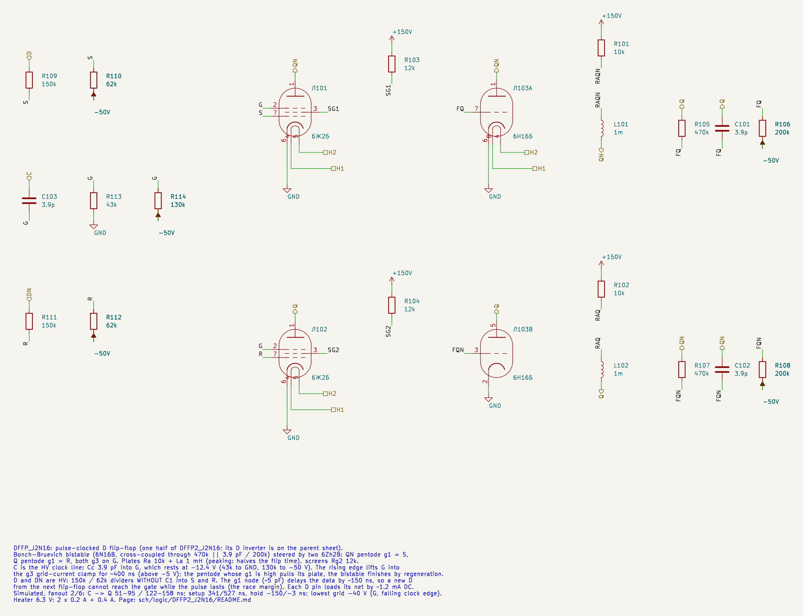
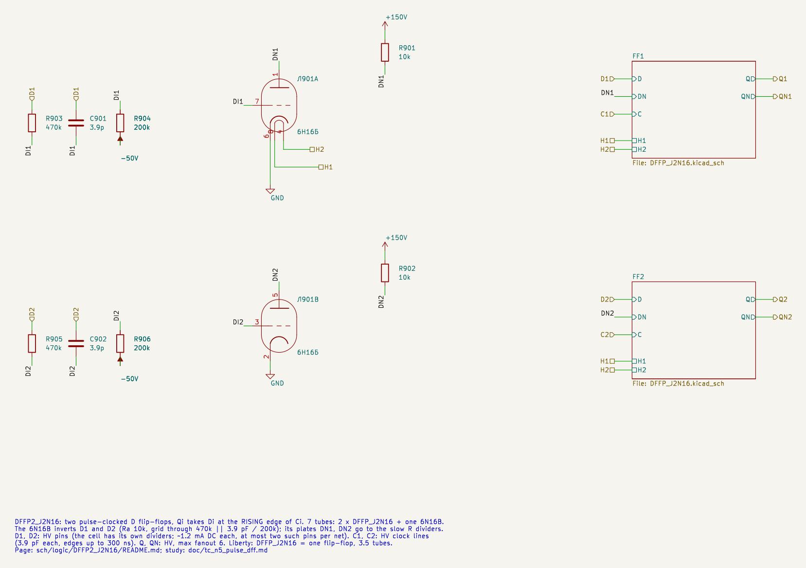
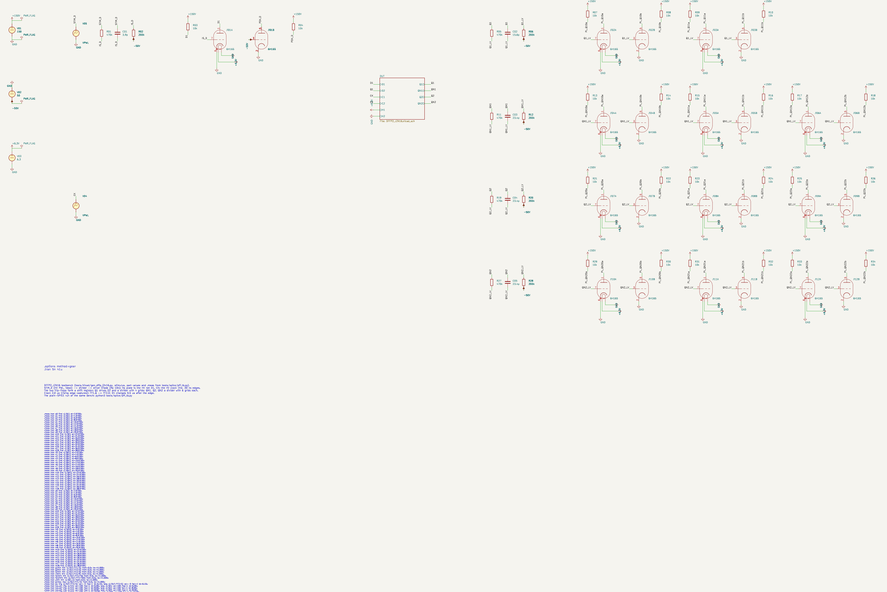
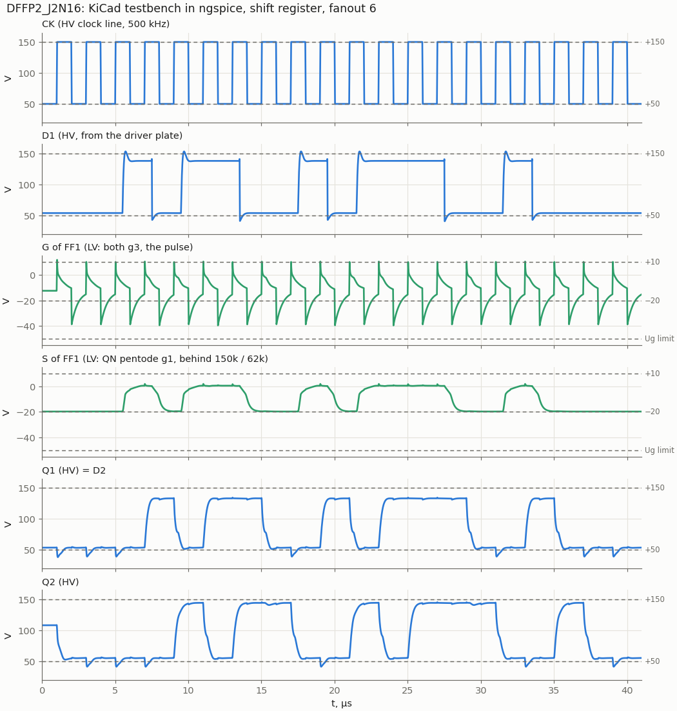
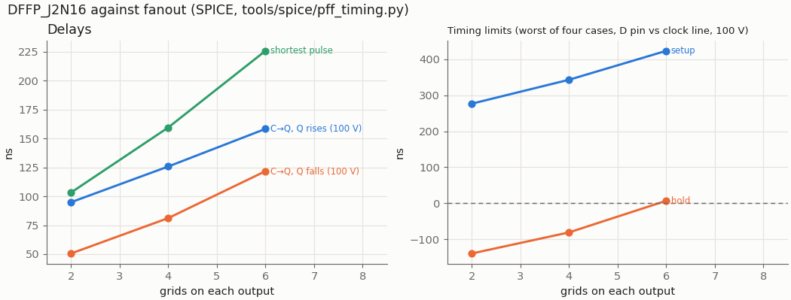

# DFFP2_J2N16: two pulse-clocked D flip-flops on 6Zh2B + 6N16B

Cell page. Two edge-triggered D flip-flops, each one Bonch-Bruevich bistable (a 6N16B with cross-coupled grids) steered by two 6Zh2B gates that open only for a short pulse cut from the rising edge of the clock. One 6N16B inverts D for both. The liberty cell `DFFP_J2N16` is one flip-flop (3.5 tubes), as `LATCH_J2N16` is one latch of `DLATCH2_J2N16`. The design study, with the options that were rejected, is `doc/tc_n5_pulse_dff.md` (TC-N5).

- Requirements: REQ-MOD-005 (D flip-flop board), REQ-MOD-012 (logic levels), REQ-MOD-004 (delays, fan-out, power; simulated, not measured), REQ-AUTH-* (the steering is done by pentodes, not by diodes).
- Source: the owner, 2026-11-03: a new cell on the D-latch base, a Bonch-Bruevich trigger that switches only on the clock edge. 2026-11-04: plate chokes accepted, two flip-flops per sheet (the tube count is odd), use it for the panel-key synchronizers first.
- Method: `doc/cell_design_method.md` (§4e has the traps of this cell).

| | DFFP_J2N16 (one flip-flop) |
|---|---|
| Function | Q ← D at the **rising** edge of C |
| Tubes | 2 × 6Zh2B + 1 × 6N16B + ½ 6N16B (D inverter) = 3.5; DFFP2_J2N16 = 7 |
| Inputs | D: **HV** (the cell has its own dividers); C: **HV clock line** |
| Outputs | Q, QN: HV, max fanout 6 |
| Heater 6.3 V | 1.0 A per flip-flop (2 × 0.2 + 0.4 + 0.2) |
| Output levels | 1: 143.9 V; 0: 55.1 V |
| C→Q to 100 V, fanout 2 / 4 / 6 | 51…95 / 81…126 / 122…158 ns |
| C→Q to the next stage's thresholds (fanout 6) | Q rises to 118 V 261 ns, falls to 92 V 181 ns |
| Setup / hold, fanout 2 / 4 / 6 | 341 / 420 / 527 ns; −150 / −91 / −3 ns |
| Race margin | ≈ 54 ns (fastest C→Q 51 ns − worst hold −3 ns): the clock skew allowed inside one clock net |
| Register to register | 0.83 MHz at fanout 6, ≥ 1 MHz at fanout 2–4 (no logic between) |
| Lowest grid | −40.2 V (g3, on the falling clock edge) |

`DFF_J2N16` (7 tubes, falling edge, LV inputs) stays the default trigger of the synthesis. `DFFP_J2N16` carries `dont_use` and is placed by name in the RTL where its pins fit; the first ones are the seven panel-key synchronizers (TRS v0.52): `halt_key_s`, `step_key_s`, `run_key_s`, `key_insn_loading_start_s`, `key_insn_loading_stop_s`, `rst_busy_s` in `MachineCtrl` and `key_next_s` in `IpLine`, each the only D pin on its input net. The RTL model is `rtl/Logic/DFFP_J2N16.sv` (under `` `ifndef SYNTH ``).

## How it works

The cell is the D latch of `DLATCH2_J2N16` with two changes.

1. **The enable is a pulse.** Both g3 sit on node G, which rests at −12.4 V (43k to GND, 130k to −50 V): both pentodes are cut off from their plates, and a pentode with g1 high sends its current to the screen, as `RSLATCH_J2N16` with E low. The rising edge of the HV clock line (100 V) lifts G through Cc 3.9 pF into the g3 grid-current clamp. G then decays back with τ ≈ 32k × (3.9 + ≈ 10) pF; it stays above −5 V for 370…400 ns. During that time the pentode whose g1 is high pulls its plate down, the bistable passes its point of no return and finishes the transition by regeneration after the pulse. The falling clock edge throws G to −40 V, which only cuts the pentodes harder.
2. **The data is delayed.** The bistable needs 103…226 ns to flip, but the next flip-flop's Q changes 51 ns after the edge: with plain inputs the new D would reach the open gate and race through. So D is an HV pin, and each pentode g1 hangs behind a 150k / 62k divider without a speed-up capacitor. The g1 node (≈ 5 pF) makes a delay of about 150 ns; the grid charges towards +10 V and stops at its clamp, so the delay has no slow tail. The 1950s machines solved the same problem with delay lines.

The plate chokes (La 1 mH in series with Ra 10k, the speed-up of the `RSLATCH_J2N16` page) halve the flip time and with it the delay the data path needs: without them setup grows to 1–2 µs.

## Logic levels and pins

The levels are those of `sch/logic/NOR2_N16/README.md` (REQ-MOD-012): HV on plates 1 = +150 V, 0 = +50 V; LV on grids 1 = +10 V, 0 = −20 V.

| Pin | Level | Connection | Load on the net |
|---|---|---|---|
| D1, D2 | **HV in** | 150k / 62k to the S pentode g1 (no C1); 470k ‖ 3.9 pF / 200k to the inverter grid | 1.2 mA DC at "1" (0.9 + 0.29 mA); **at most two D pins of this cell per net** |
| C1, C2 | **HV clock line** | Cc 3.9 pF to G (both g3); G biased by 43k / 130k | ≈ 2.8 pF (3.9 pF in series with the g3 node); edges up to 300 ns are fine |
| Q1, QN1, Q2, QN2 | HV out | plates, Ra 10k + La 1 mH to +150 V | max fanout 6, one divider per net as for any cell |
| H1, H2 | heater | all tubes in parallel | 2.0 A per sheet |

Why at most two D pins per net: the D pin is a DC load. A 10k plate with its own feedback divider and the net divider gives "1" = 144 V alone, 133 V with one D pin of this cell, 123 V with two and 115 V with three; the next stage needs "1" > 118 V. `div_insert.py` checks it (`vtube_hv_load` 1.2 mA per pin, at most 2.4 mA per net).

## Schematic

One flip-flop, `DFFP_J2N16.kicad_sch` (the sub-sheet; its D inverter is on the parent):



The cell, `DFFP2_J2N16.kicad_sch`: the inverter tube (one triode per flip-flop, Ra 10k, grid through 470k ‖ 3.9 pF / 200k) and two `DFFP_J2N16` sub-sheets:



Parts per flip-flop:

| Part | Value | Where |
|---|---|---|
| Ra, La | 10k (2 W) + 1 mH, ×2 | plates Q, QN |
| Rg2 | 12k, ×2 | screens from +150 V |
| feedback dividers | 470k ‖ 3.9 pF / 200k, ×2 | Q → FQ, QN → FQN (as `RSLATCH_J2N16`) |
| slow dividers | 150k / 62k, ×2, **no C1** | D → S, DN → R |
| pulse network | Cc 3.9 pF; 43k to GND, 130k to −50 V | C → G |
| inverter (on the parent) | ½ 6N16B, Ra 10k, 470k ‖ 3.9 pF / 200k | D → DN |

## Results

### Testbench (500 kHz, fanout 6)



`DFFP2_J2N16_tb.kicad_sch` wires the two flip-flops of one sheet as a shift register on one clock line: D1 comes from a driver plate (HV), Q1 drives D2 and a divider with 4 more grids, QN1, Q2 and QN2 a divider with 6 grids each. D1 follows a 16-bit pattern and changes a quarter period after each rising edge. The stimulus, the part values and the `.meas` lines come from `tools/spice/pff_tb.py`; the plain-SPICE run of the same bench agrees with the KiCad netlist to 0.02 % on all 89 values. Every sampled bit of both stages is valid for the next stage ("1" > 118 V, "0" < 92 V).



The waveforms show the pulse on G at every rising edge and the throw to −40 V at every falling one, S following D1 with its ≈ 150 ns delay, and Q2 repeating Q1 one period later. Q1 sits at 134 V when high, Q2 at 144 V: Q1 also feeds the D pin of FF2, whose dividers draw 1.2 mA through the 10k plate resistor (the D-pin load below).

| .meas (fanout 6) | Value |
|---|---|
| C→Q, Q1 (D2 + 4 grids) rise / fall | 166 / 73 ns |
| C→Q, Q2 rise / fall | 163 / 138 ns |
| G pulse above −5 V | 370 ns |
| Lowest G / S / R / feedback grid / output LV net | −39.5 / −22.1 / −19.2 / −23.7 / −22.9 V |

### Delay and timing limits against fanout



| Grids on each output | Shortest pulse | C→Q set (Q↑ / QN↓) | C→Q reset (Q↓ / QN↑) | Setup | Hold |
|---|---|---|---|---|---|
| 2 | 103 ns | 95 / 52 ns | 51 / 95 ns | 341 ns | −150 ns |
| 4 | 160 ns | 126 / 83 ns | 81 / 126 ns | 420 ns | −91 ns |
| 6 | 226 ns | 158 / 125 ns | 122 / 158 ns | 527 ns | −3 ns |

- Delays from the clock line crossing 100 V to the output crossing 100 V; setup and hold between the D pin and the clock line, both at 100 V (`tools/spice/pff_timing.py`).
- Hold and setup are the worst of four cases (state before the edge 0/1, value taken 0/1). Hold is limited by "0 → 1": D falls early and the S pentode loses its g1 before the flip has finished. The race case "0 → 0" (a new D opening the wrong gate) has 400…600 ns of margin.
- To the next stage's thresholds at fanout 6: Q rises to 118 V in 261 ns and falls to 92 V in 181 ns (`pff_timing.py tcqth`): these are the numbers in `vtube_timing.json`.
- Shift register (`pff_sweep.py shift`): periods 4.0 / 1.5 / 1.2 µs pass at fanout 2, 4 and 6; 1.0 µs fails at fanout 6. Clocking the second stage 120 ns late still passes at fanout 6, 150 ns fails.

### Tolerances

Shift register at 2 µs with the second stage clocked 50 ns late, fanout 2 and 6 (`doc/tc_n5_pulse_dff.md` §4.4): 6Zh2B MU2 ±20 %, 6N16B MU −20 %, La 0.8 / 1.2 mH, Cc ±10 %, the pulse time constant ±10 %, every divider C1 +10 %, and clock edges of 100…300 ns all pass.

## Datasheet limits and power

From `pff_timing.py static` (fanout 6 and 10, D high, after the edge that sets the cell):

| Quantity | Limit | Static | During the pulse |
|---|---|---|---|
| 6Zh2B Ik | 14 mA | 6.6 mA (all to the screen) | 22.5…23.3 mA for ≈ 200 ns |
| 6Zh2B Pg2 | 0.6 W | 0.47 W | 0.47 W |
| 6Zh2B Pa | 0.9 W | ≈ 0 | 2.3…2.4 W instantaneous, ≈ 4 % duty at 100 kHz |
| 6N16B Ik, Pa | 14 mA, 0.9 W | 9.2 mA, 0.51 W | 9.5 mA, 0.72 W |
| Grid | ≥ −50 V | | −40.2 V (G); −22.4 V (S) |

The pulse current of the 6Zh2B is above its DC limit for about 200 ns per clock. The average stays far below (≈ 7 mA), but the pulse rating of the 6Zh2B is not on the sheet: an open point for the bench.

Supply current from +150 V: about 16 mA per flip-flop in a static state (pentode screen 6.6 mA, triode 9.2 mA, dividers), plus the inverter half (≤ 9 mA).

## Liberty entry

`DFFP_J2N16` in `sch/logic/vtube_cells.lib` (one flip-flop, area 3.5, J2B 2 + N16B 1.5, heat 1000 mA):

```
ff(IQ, IQN) { clocked_on: "C"; next_state: D; }
pin(C) { vtube_level : "HV_IN"; clock: true; fanout_load: 0.7; }
pin(D) { vtube_level : "HV_IN"; vtube_hv_load : 1.2; fanout_load: 3; }
pin(Q), pin(QN) { vtube_level : "HV"; max_fanout : 6; }
dont_use : true;
```

- `HV_IN` is a new pin level: the cell has its own dividers, so `rtl/run/div_insert.py` places none and checks instead that the net is HV and that the `vtube_hv_load` of all `HV_IN` pins on it stays within 2.4 mA (two D pins).
- `dont_use`: `dfflibmap` keeps mapping the RTL's flip-flops to `DFF_J2N16`; the RTL instantiates `DFFP_J2N16` by name (with a model under `` `ifndef SYNTH ``, as `KEYDB_N16`).
- Timing (`vtube_timing.json`, fanout 6, to 118 / 92 V): `posedge C->Q` [261, 181] ns, `posedge C->QN` [261, 187] ns, setup 527 ns, hold 0 (−3 measured); fanout ratios from the table above. `vtube_cells.v` models it on `posedge C`; `vtube_sdf.py` puts a `vtube_setuphold` on it.
- `vtube_cells.sp`: an XSPICE `d_dff` on the rising edge.

## Files and how to run

| File | What |
|---|---|
| `DFFP2_J2N16.kicad_sch` | the cell sheet (inverter tube + two `DFFP_J2N16` sub-sheets) |
| `DFFP_J2N16.kicad_sch` | one flip-flop without its inverter (sub-sheet) |
| `DFFP2_J2N16_tb.kicad_sch/.kicad_pro` | testbench: the two flip-flops as a shift register |
| `tools/kicad/gen_dffp_j2n16.py` | generator of the three sheets |
| `tools/spice/pff_tb.py` | part values (`CELL`), testbench definition shared with KiCad, plain-SPICE reference |
| `tools/spice/pff_sweep.py` | the cell netlist for sweeps (`P`), single cell and shift register (`skew=`, `--period`) |
| `tools/spice/pff_timing.py` | shortest pulse, C→Q, setup, hold, static currents by bisection |
| `tools/spice/pff_plots.py` | every figure on this page |

```
tools/spice/sim_kicad.sh sch/logic/DFFP2_J2N16/DFFP2_J2N16_tb.kicad_sch
python3 tools/spice/pff_tb.py                      # the same bench in plain SPICE
python3 tools/spice/pff_timing.py hold 2 4 6       # also wmin, tcq, tcqth, setup, static
python3 tools/spice/pff_sweep.py shift --period 1.2 2 4 6
python3 tools/spice/pff_plots.py                   # figures into sch/logic/DFFP2_J2N16/img
```

The decks use `.options method=gear`: with the plate chokes the trapezoidal method stopped on "timestep too small" at the clock edge.

To embed the cell: D comes straight from an HV net (no divider), at most two D pins of this cell per net. C is the HV clock line; the clock skew between the cells of one clock net must stay below the race margin, about 50 ns. Q and QN are ordinary HV outputs.

## Open points

- **Measure on hardware**: the pulse length, the shortest flip and the fastest C→Q (the race margin, 54 ns in SPICE), and the pulse current of the 6Zh2B (REQ-MOD-004, OPEN-013).
- The g3 grid current of the 6Zh2B, which shapes the pulse, is a model assumption (`sch/libs/6Zh2B.sub`, RG3 5k).
- The clock tree: a driver per clock net on the generator board, a limited number of flip-flops per driver, and the skew between branches feeding neighbouring flip-flops below 50 ns (owner, 2026-11-04: the clock tree is not designed yet).
- Fanout above 6 with the chokes, and an asymmetric S divider (180k / 75k) if the race margin has to grow (−30 ns of hold for +80 ns of setup).
- `div_insert.py` checks the D-pin load per net and module; a net that leaves a module through a port and drives D pins in two modules is counted per module.
