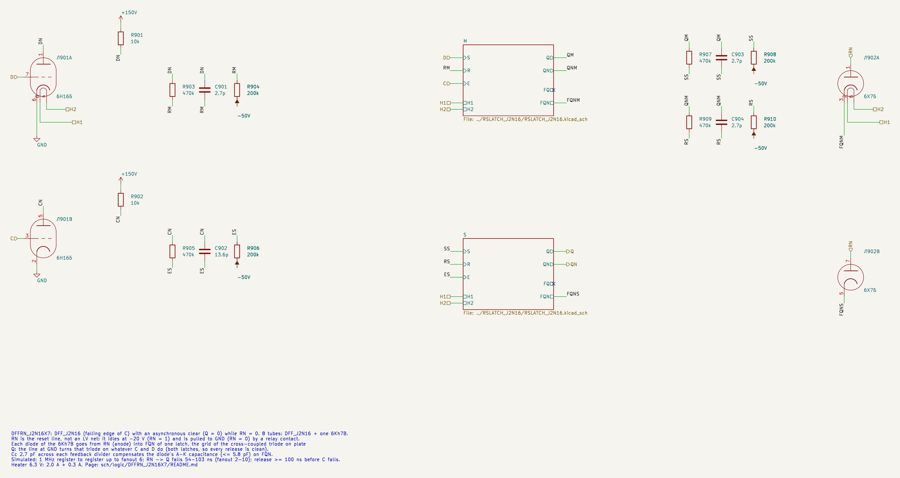
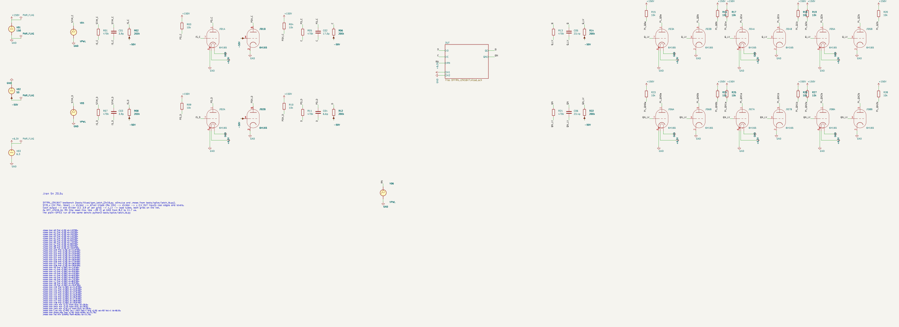
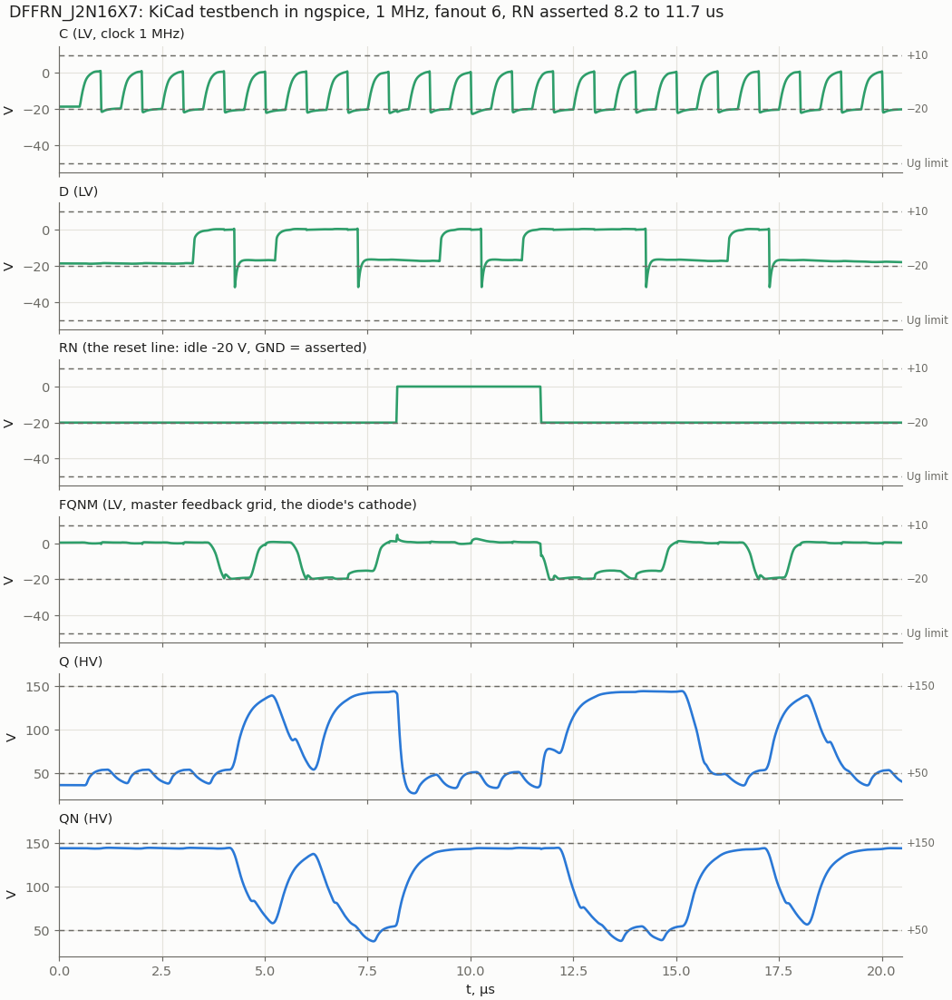

# DFFRN_J2N16X7: D flip-flop with asynchronous clear, 6Zh2B + 6N16B + 6Kh7B

Cell page. REQ-MOD-005 (D flip-flop board), REQ-MOD-012 (logic levels), REQ-MOD-004 (delays, fan-out, power; simulated, not measured), REQ-MOD-008 (`DFFSR_n` → tube cell). Method: `doc/cell_design_method.md`.

[DFF_J2N16](../DFF_J2N16/README.md) (falling edge of C) plus one 6Kh7B double diode for an asynchronous clear. This is the owner's idea of 2026-10-29: the reset line reaches the latches through a diode. The flip-flop itself (latches, inverters, timing, the choice of edge) is on the DFF_J2N16 page; this page holds what the clear adds. The preset twin is [DFFSN_J2N16X7](../DFFSN_J2N16X7/README.md).

| | DFFRN_J2N16X7 |
|---|---|
| Function | Q ← D at the falling edge of C; Q = 0 while RN = 0 |
| Tubes | 8: DFF_J2N16 (2 × RSLATCH + 1 × 6N16B) + 1 × 6Kh7B |
| Inputs | D, C (LV, as DFF_J2N16); RN, **the reset line** |
| Outputs (HV) | Q, QN |
| Reset line | RN = 1: idle at **−20 V** (owner); RN = 0: pulled to **GND** by a relay contact |
| Heater 6.3 V | 2.3 A (2.0 A + 0.3 A) |
| RN → Q (asserted, Q below 92 V), fanout 2 / 6 / 10 | 54 / 77 / 100 ns |
| Recovery: release RN before C falls | ≥ 100 ns (98 ns simulated, any fanout) |
| Register to register, 1 MHz | as DFF_J2N16: up to fanout 6 |
| Line current while asserted | up to 1.3 mA per flip-flop (peak) |

In synthesis, 34 of the 38 flops with an asynchronous reset are clear-on-`rst_n`; they map to this cell with RN on `rst_n` directly (no inverter). The other 4 preset, see DFFSN_J2N16X7.

## How the clear works

- **Not through the R input.** R of an RS latch is a pentode g1, gated by E on g3, so a reset there acts only while that latch is enabled.
- **Into the cross-coupled grid.** One diode of the 6Kh7B goes from RN (anode) to FQN of each latch: the grid of the triode on plate Q, normally fed from QN through 470k ‖ 3.9 pF / 200k. RN at GND pulls FQN to about 0 V, the triode conducts, and Q goes low whatever C, D, S, R and E are doing.
- **Both latches.** If only the slave were cleared, releasing RN while C is low would let the slave copy the master, which still holds the D of the last edge. With both cleared every release is clean:
  - released while C is low: the master is closed and holds 0;
  - released while C is high: the master follows D, and the next falling edge captures it.
- **Polarity.** The diode acts on a high line. RN = 0 (reset, the liberty's `clear: "RN'"`) is the line at GND, RN = 1 is −20 V. The line is not an LV net: a relay contact switches it between the −20 V rail and GND. So the active-low `rst_n` of the RTL maps onto RN with no inverter.

## Schematic

`DFFRN_J2N16X7.kicad_sch`: the DFF_J2N16 sheet with the 6Kh7B Л902 (unit A: RN → FQNM, unit B: RN → FQNS) and two Cc 2.7 pF (QNM → FQNM, QN → FQNS). The RSLATCH sheet now brings FQ and FQN out as pins; DLATCH2_J2N16 and DFF_J2N16 leave them open.

| Pin | Level | Connection |
|---|---|---|
| D, C | LV in | as DFF_J2N16 |
| RN | reset line | anodes of both diodes of the 6Kh7B (leads 1, 7) |
| Q, QN | HV out | slave plates |
| H1, H2 | heater | all four tubes |

## The compensation capacitor Cc

The diode's anode–cathode capacitance (≤ 5.8 pF, `sch/tubes/6Kh7B/README.md`) hangs on FQN from a static line. It loads the feedback divider and under-compensates it, so the latch's own feedback slows down. Without compensation the register-to-register run at 1 MHz fails (5–8 wrong bits at fanout 2–6). Cc in parallel with the divider's C1 (plate → FQN) restores it. The rule of the compensated divider gives Cc ≈ CAK · R2 / R1 = 5.8 · 200/470 = 2.5 pF.

`tools/spice/dffr_sweep.py normal`: two flops in a row at 1 MHz, the line idle, worst sampled levels at fanout 6:

| Cc | CAK 5.8 pF | CAK 3 pF | CAK 1.5 pF |
|---|---|---|---|
| 0 | fails (ERR 5–8) | — | — |
| 2.2 pF | clear OK; preset ERR1 at fanout 6 | — | — |
| **2.7 pF** | **OK: 131.5 / 67.3 V** | OK: 131.5 / 66.6 V | OK: 131.5 / 66.2 V |
| 3.3 pF | OK: 131.2 / 66.9 V | — | — |
| plain DFF_J2N16 | 132.7 / 67.3 V | | |

Chosen: 2.7 pF. It works over the whole capacitance range of the diode. The feedback grids stay above −29.5 V.

## Idle level: −20 V or −50 V

At −20 V (the owner's choice) the diode also clamps FQN where it would fall below the line: −24 V nodes stop at about −19.5 V. This helps the latch, but the line has to sink the clamp current. On average that is 40–55 µA per diode in normal operation, about 4 mA for 38 flip-flops (76 diodes). At −50 V the diodes never conduct (a few µA of displacement current), but the preset twin fails at fanout 6 with the same Cc. **Chosen: −20 V**, on a rail that can sink about 5 mA. There is no −20 V rail in the supply set yet (Open points).

## Results

### Assert, hold, release

`tools/spice/dffr_sweep.py async`, D = 1 (Q was 1), RN asserted with C high or C low, held 3 µs while C keeps toggling, released:

| Fanout | RN → Q < 92 V | Q while held | After release | Line current (peak) |
|---|---|---|---|---|
| 2 | 54–56 ns | 33.0–51.4 V | the next C fall captures D (144 V) | 1.34 mA |
| 6 | 77–80 ns | 32.6–51.4 V | same (143 V) | 1.34 mA |
| 10 | 100–103 ns | 32.4–51.2 V | same (140 V) | 1.33 mA |

### Recovery

`dffr_sweep.py recovery`: RN released `gap` before a falling edge of C, with D = 1. That edge captures D if gap ≥ 98 ns, at every fanout; with a shorter gap the flip-flop stays cleared one more cycle. The release comes from a relay, asynchronous to the clock, so flops may leave reset one cycle apart (Open points).

### KiCad testbench

`DFFRN_J2N16X7_tb.kicad_sch`: the DFF_J2N16 bench (16-bit pattern at 1 MHz, fanout 6) with RN at GND from 8.2 to 11.7 µs: asserted while C is low, released 0.3 µs before C falls. Every sampled bit is correct, Q held 0 through the reset. Worst sampled levels are 131.4 / 77.5 V (DFF_J2N16: 132.4 / 68.9 V). KiCad and plain SPICE (`tools/spice/latch_tb.py dffrn`) agree on all 43 values.

After the release, with C high, Q bumps to 78 V while the master takes D; it stays a valid "0" until C falls.

## Liberty

`DFFRN_J2N16X7` in `sch/logic/vtube_cells.lib` (2026-10-29), in place of the undesigned `DFFSR` / `DFFSR_n`:
- `ff { clocked_on: "C'"; next_state: D; clear: "RN'"; }`;
- area 8, J2B 4 + N16B 3 + X7B 1, heat 2300 mA;
- C, D as DFF_J2N16;
- RN `vtube_level : "RESET"`: `rtl/run/div_insert.py` puts no divider on it and reports an error if a cell, not a port, drives it.

`vtube_timing.json`, to the thresholds:
- C↓ → Q as DFF_J2N16 [665, 592] ns;
- RN → Q 80 ns (Q forced low), RN → QN 450 ns (QN rises through Ra);
- setup / hold of D 310 / 0 ns.

`rtl/run/vtube_sdf.py` and `vtube_setuphold` (ASYNC 3) switch the D checks off while RN = 0.

Synthesis (`run_tests.sh -s`, 2026-10-29): 34 cells (272 tubes), RN on `rst_n` in all three blocks, `equiv_opt` proven.

## Files and how to run

| File | What |
|---|---|
| `DFFRN_J2N16X7.kicad_sch` | the cell (two RSLATCH sub-sheets, 6Kh7B, Cc) |
| `DFFRN_J2N16X7_tb.kicad_pro/.kicad_sch` | testbench |
| `tools/kicad/gen_latch_j2n16.py` | generator of all latch-family sheets |
| `tools/spice/dffr_sweep.py` | `normal` / `async` / `recovery`; `--idle`, `--model leaky|nom`, `--cak`, `--comp` |
| `tools/spice/latch_tb.py dffrn` | the testbench in plain SPICE |
| `tools/spice/latch_plots.py` | the figures |
| `sch/libs/6Kh7B.sub` | the diode model (`6Kh7B`, and `6Kh7B2` for the two-unit symbol) |

## Open points

- **The −20 V rail** for the reset line's idle level: it must sink about 5 mA (76 diodes). Today's supplies are +150 V, −50 V and the heaters. The rail could come from a divider off −50 V that is stiff enough, or from a stabilizer tube. Owner's call. The −50 V idle needs no new rail but loses the clamp (DFFSN fails at fanout 6).
- **Reset release against the clock**: the relay releases asynchronously, and flops within 100 ns of a falling C edge leave reset one cycle late. Synchronize the release (one DFF at the source), or accept it for the panel reset.
- **Transients of the relay contact** (bounce) are not simulated; a bounce only repeats the clear.
- **Measure on tubes**: the diode capacitance and leakage (`sch/tubes/6Kh7B/README.md`), RN → Q.
