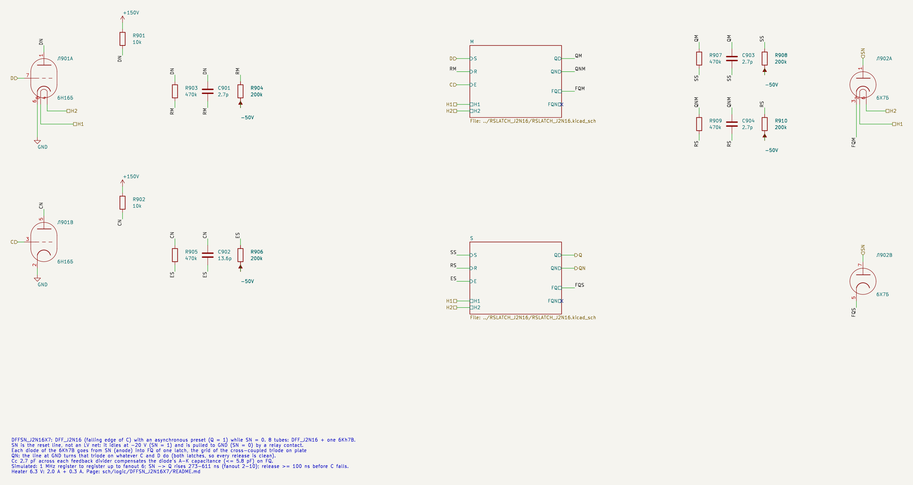
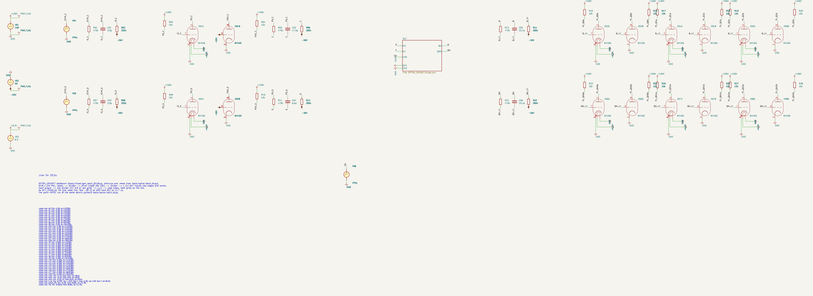
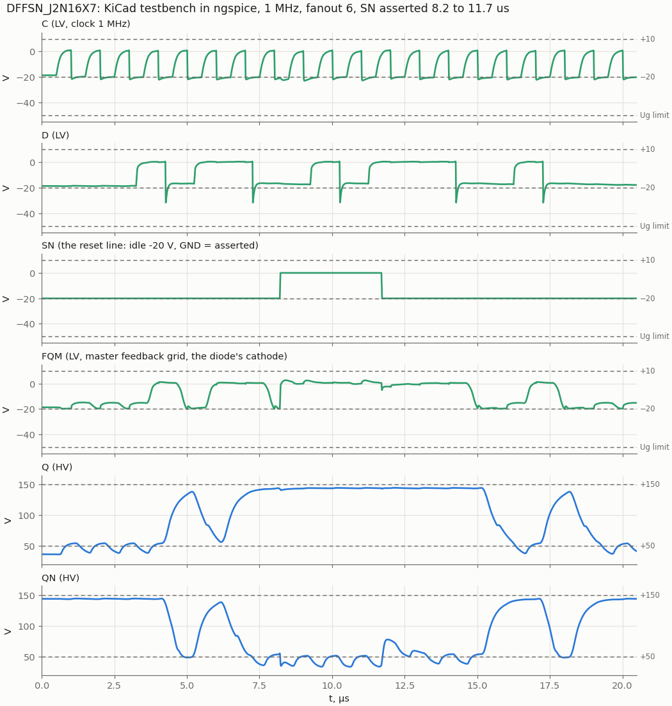

# DFFSN_J2N16X7: D flip-flop with asynchronous preset, 6Zh2B + 6N16B + 6Kh7B

Cell page. REQ-MOD-005, REQ-MOD-012, REQ-MOD-004 (simulated, not measured), REQ-MOD-008. The twin of [DFFRN_J2N16X7](../DFFRN_J2N16X7/README.md): the same DFF_J2N16 with one 6Kh7B, the diodes into the **other** cross-coupled grid. Everything about the reset line, the compensation capacitor and the idle level is on the DFFRN page.

| | DFFSN_J2N16X7 |
|---|---|
| Function | Q ← D at the falling edge of C; Q = 1 while SN = 0 |
| Tubes | 8: DFF_J2N16 + 1 × 6Kh7B |
| Inputs | D, C (LV); SN, the reset line (idle −20 V; GND = asserted) |
| Outputs (HV) | Q, QN |
| SN → Q (Q above 118 V), fanout 2 / 6 / 10 | 273–295 / 423–448 / 578–611 ns |
| Recovery: release SN before C falls | ≥ 100 ns (98 ns simulated) |
| Register to register, 1 MHz | up to fanout 6 (with Cc 2.7 pF and the −20 V idle) |

The diodes go from SN into FQ of both latches, the grid of the triode on plate QN. SN at GND turns that triode on, QN goes low, and Q rises through its Ra, so preset is slower than clear. Cc 2.7 pF sits across the feedback divider Q → FQ of each latch.

In synthesis the 4 flops that load 1 on reset (preset from `rst_n`) map here with SN on `rst_n` directly; before, they were `DFFSR_n` with S driven by `NOT(rst_n)`.

## Schematic

The 6Kh7B Л902 goes SN → FQM and SN → FQS; Cc 2.7 pF goes QM → FQM and Q → FQS.

## Results

- **Assert / hold / release** (`dffr_sweep.py async`, D = 0, Q was 0): Q rises above 118 V within the times in the table and is held 126–144.5 V while C toggles. After the release the next falling edge of C captures D. Line current up to 1.37 mA per flop.
- **KiCad testbench**: the DFF bench with SN at GND from 8.2 to 11.7 µs. Every sampled bit is correct, worst sampled levels 131.5 / 77.3 V. KiCad and plain SPICE (`latch_tb.py dffsn`) agree on all 43 values (0.3 % on a grid minimum).

## Liberty

`DFFSN_J2N16X7`:
- `ff { clocked_on: "C'"; next_state: D; preset: "SN'"; }`;
- area 8, J2B 4 + N16B 3 + X7B 1, heat 2300 mA;
- SN `vtube_level : "RESET"`.

Timing: SN → Q 450 ns, SN → QN 80 ns; C↓ → Q as DFF_J2N16. Synthesis: 4 cells (32 tubes).

## Files and open points

As DFFRN_J2N16X7: `tools/kicad/gen_latch_j2n16.py`, `tools/spice/dffr_sweep.py`, `latch_tb.py dffsn`, `latch_plots.py`; open points there.
