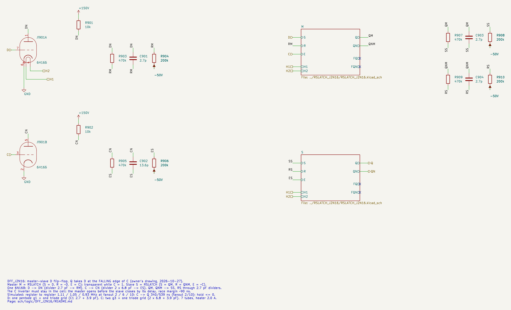

# DFF_J2N16: master-slave D flip-flop on 6Zh2B + 6N16B

Cell page. The falling-edge D flip-flop built from two [RSLATCH_J2N16](../RSLATCH_J2N16/README.md) sub-sheets (master and slave) plus one 6N16B for the D and clock inverters. The latch design (structure, part values, levels, limits, sensitivity) is on the RSLATCH page; this page holds only what the flip-flop adds. It is the liberty cell `DFF_J2N16` (applied 2026-10-29, TRS v0.20).

- Requirements: REQ-MOD-005 (D flip-flop board), REQ-MOD-012 (logic levels), REQ-MOD-004 (delays, fan-out, power; simulated, not measured), REQ-MOD-008 (`DFF` → tube cell).
- Method: `doc/cell_design_method.md`.
- Source: the owner's drawing of 2026-10-27: two RS latches plus inverters for D and the clock.

| | DFF_J2N16 |
|---|---|
| Function | Q ← D at the **falling** edge of C |
| Tubes | 2 × RSLATCH + 1 × 6N16B (D and C inverters) = 7 |
| Inputs (LV) | D (g1 + triode grid), C (two g3 + triode grid) |
| Outputs (HV) | Q, QN |
| Heater 6.3 V | 2.0 A (12.6 W) |
| Output levels | 1: 141.8…143.9 V; 0: 36…55 V (as RSLATCH) |
| Speed, fanout 2 / 6 / 10 | C↓→Q 340 / 441 / 539 ns; register to register 1.11 / 1.05 / 0.93 MHz |
| Timing limits, fanout 2 / 6 / 10 | hold ≤ 0; race margin ≈ 90 ns at C↑ |
| Lowest grid | −31.9 V (D) |

A 16-tube board takes two DFF_J2N16, with two tubes spare (owner, 2026-10-27).

## Schematic

`DFF_J2N16.kicad_sch`. Master M: S = D, R = ~D, E = C. Slave S: S = QM, R = QNM, E = ~C. The master outputs reach the slave inputs through their own 2.7 pF dividers:



The master outputs go through separate dividers instead of reusing the feedback dividers, because KiCad keeps one value per sheet file for all instances (`doc/cell_design_method.md` §4): the master and the slave must be the same RSLATCH sheet, `../RSLATCH_J2N16/RSLATCH_J2N16.kicad_sch`.

## Results

### Delay against fanout


| Grids on each output | DFF C↓→Q | DFF reg→reg |
|---|---|---|
| 2 | 340 ns | 1.11 MHz |
| 4 | 391 ns | 1.10 MHz |
| 6 | 441 ns | 1.05 MHz |
| 8 | 490 ns | 0.99 MHz |
| 10 | 539 ns | 0.93 MHz |

- Register to register (`dff_sweep.py shift`): two DFFs in a row on one clock, D of the first changing a quarter period after the edge. A sampled level passes only if it is valid for the next stage ("1" > 118 V, "0" < 92 V).
- The latch delays, the shortest E pulse and the setup time are on the RSLATCH page.

### Testbench (1 MHz, fanout 6)


`DFF_J2N16_tb.kicad_sch` runs a 16-bit pattern at 1 MHz, with D changing 0.25 µs after each falling edge of C. Every sampled bit is correct. The worst sampled levels, 30 ns before the next edge, are "1" ≥ 132 V and "0" ≤ 70 V, which leaves 22 V to the next stage's VIL. C↓→Q is 460 ns. KiCad and plain SPICE agree on all 45 values.

The waveforms show:

- the master following D while C is high;
- ES (= ~C after the inverter and its divider) opening the slave after C falls;
- Q settling within the period.

## The flip-flop: which edge

The owner's drawing puts the master on C and the slave on the inverted C, so Q changes at the falling edge of C. The old liberty `DFF` cell said `clocked_on: C` (rising edge). Both variants were simulated (`dff_sweep.py --edge neg|pos`). They use the same parts; only the clock wires to the two latches swap.

| | Falling edge (drawing) | Rising edge (master on ~C) |
|---|---|---|
| Register to register, fanout 2 / 6 / 10 | **1.11 / 1.05 / 0.93 MHz** | 0.99 / 0.77 / 0.58 MHz |
| C→Q, fanout 2 / 10 | 340 / 539 ns | 192 / 400 ns |
| Hold (D changing at the capturing edge) | **≤ 0** (passes with D switching together with C) | > 0: fails at 0 ns, passes at 40 ns |
| Overlap of the two latches | at the non-capturing edge C↑: the master opens at once, the slave closes after the inverter | at the capturing edge C↑: the slave opens at once, the master closes after the inverter |

Why the falling edge is faster:

- The slave has to latch the external load while its enable is open, and needs an E pulse of 333 ns at fanout 6.
- A direct C net is high for less than half a period, because the LV net rises slowly (the driver's plate charges through Ra) and falls fast.
- The slave behind the inverter gets a wider window.
- With the master on ~C, the same narrowing hits the slave on the direct C, and it runs out of window first.

**Owner's decision (2026-10-27): falling edge, as drawn.** For the RTL's rising-edge flip-flops, invert the clock once at the generator.

### Race margin at C↑

When C rises, the master opens immediately while the slave closes only after the inverter:

- ES crosses −5 V 64 ns after C crosses −5 V;
- the master's output reaches the slave grids (−5 V crossing) after 153 ns.

The margin is about 90 ns. An extra 200 pF on the inverter plate (`dff_sweep.py --cskew 200`) makes the new D race through to Q. **The C inverter must stay inside the cell and lightly loaded.** A shared inverter in the clock tree would add exactly this skew.

## Options evaluated

| Option | Result | Verdict |
|---|---|---|
| Rising-edge DFF (master on ~C) | 0.58–0.99 MHz, hold > 0 | rejected (owner chose the falling edge) |
| Clock inverter shared by many flip-flops (6.5 tubes per bit) | eats the 90 ns race margin at C↑ | rejected |
| Dual-rail D (D and ~D from the driving cell, 6 tubes per DFF) | saves the D inverter, but the liberty function cannot ask synthesis for a complement | left for later (see Open points) |

On iverilog: the failure that decided the flip-flop design is analog. The clock window shrinks on a slow LV rise, and the race margin depends on how far a grid sits below its clamp. A logic simulator with delays does not see either, while a plain-SPICE run of the whole flip-flop takes a few seconds. iverilog becomes useful once the cells are in the liberty file: the cell models in `sch/logic/vtube_cells.v` and the SDF delays from `vtube_timing.json` can then check setup, hold and the 1 MHz budget on synthesized netlists (`synth_sim.sh -t`).

## Liberty entry

`DFF_J2N16` in `sch/logic/vtube_cells.lib` (applied 2026-10-29, was the generic rising-edge `DFF`): `ff(IQ, IQN) { clocked_on: "C'"; next_state: D; }`, area 7, J2B 4 + N16B 3, heat 2000 mA. "fanout_load" is in units of a triode grid (C1 3.9 pF):

| Pin | vtube_grid | vtube_c1 | fanout_load |
|---|---|---|---|
| D | pentode_g1 (plus a triode grid) | 6.6 pF | 1.7 |
| C | pentode_g3 (two, plus the inverter's triode grid) | 17.5 pF | 4.5 |
| Q, QN | HV out, max_fanout 6 | | |

- **Timing** (`vtube_timing.json`, SPICE at fanout 6): C↓→Q 440 ns, setup 310 ns before C falls, hold 0. `vtube_cells.v` models `DFF_J2N16` on `negedge C`; `rtl/run/vtube_sdf.py` writes `negedge` IOPATHs and SETUPHOLD for it, and `vtube_setuphold` checks it with `NEGEDGE = 1`.
- **Clock inverter.** The RTL clocks on the rising edge. `dfflibmap` puts a `$_NOT_` in front of every falling-edge trigger, and `synt_dpc.tcl` merges them (`opt_merge`) into one `NOT_N16` per clock net and module. Without the merge, ABC kept one output per trigger and drove each through a `BUF_N16` (20 extra followers, 10 tubes, in the first run). In the machine the clock is inverted once at the generator, so these inverters stand for the generator's inverted line; they cost 0.5 tube each in the count (one per counter module: 4 in IpLine + ApLine, 2 tubes).
- With `max_fanout` 6 the flip-flop meets 1 MHz register to register without logic between the flops. Any logic between them needs a slower clock, or it has to be counted against the 1 µs period.
- `div_insert.py` counts a pin as one grid, so a D or C pin with two or three grids under-counts the net fanout.

## Files and how to run

| File | What |
|---|---|
| `DFF_J2N16.kicad_sch` | cell sheet (two RSLATCH sub-sheets) |
| `DFF_J2N16_tb.kicad_sch/.kicad_pro` | testbench |
| `tools/kicad/gen_latch_j2n16.py` | generator of the sheets of all three latch cells |
| `tools/spice/dff_sweep.py` | DLATCH / DFF / shift register, `--edge`, `--period`, `--cskew` |
| `tools/spice/latch_tb.py` | testbench definitions shared with KiCad, plain-SPICE reference |
| `tools/spice/latch_plots.py` | every figure on this page, and the numbers of the tables |

```
python3 tools/spice/dff_sweep.py shift --edge neg --period 1.0 2 6 10
tools/spice/sim_kicad.sh sch/logic/DFF_J2N16/DFF_J2N16_tb.kicad_sch
python3 tools/spice/latch_tb.py dff                     # the same bench in plain SPICE
python3 tools/spice/latch_plots.py                      # figures into sch/logic/<CELL>/img
```

To embed the cell: the inputs come from HV nets through the usual divider. The D pin is a pentode g1 plus a triode grid (C1 6.6 pF); the C pin is two g3 plus a triode grid (17.5 pF).

## Open points

- **Measure on hardware**: C↓→Q and the race margin at C↑ (REQ-MOD-004). The margin depends on the inverter and the 6Zh2B g3 cut-off, neither of which is calibrated.
- **Dual-rail data**: a DFF variant taking D and ~D (6 tubes) where the source is another flip-flop. This needs a synthesis-side rule; it is not in the liberty yet.
- **Asynchronous clear / preset through a 6Kh7B diode** (owner's idea, 2026-10-29; not simulated). Liberty `DFFSR_n` today counts 7 tubes, the same as the bare flip-flop. The synthesis of 2026-10-29 has 38 of them (266 tubes). 34 clear on `rst_n` with S tied to 0, and 4 preset from `NOT(rst_n)` with R tied to 1. No flop uses both, and all of them use the one reset signal. Analysis:
  - **Not through the R input.** R and S of RSLATCH are pentode g1, gated by E on g3. A reset there acts only while that latch is enabled (the master while C is high, the slave while C is low), so it is not asynchronous.
  - **Into the cross-coupled triode grid.** A diode from the reset line (anode) to FQN (cathode), the grid of the triode on plate Q, which normally comes from QN through 470k ‖ 3.9 pF / 200k. Reset high pulls FQN up, that triode conducts, and Q goes low whatever E, S and R are doing. QN then rises, unless its own pentode is on at that moment (S·E = 1, then both outputs are low while the reset holds). For preset, the diode goes into FQ instead.
  - **Both latches.** If only the slave is cleared, releasing the reset while C is low lets the slave copy the master, which still holds the D of the last falling edge. With the master cleared too, every release is correct: C low gives master 0 to the slave, C high means the master follows D and the next falling edge captures it. Two diodes per flop is exactly one 6Kh7B: `DFF_J2N16` + 1 × 6Kh7B = 8 tubes for a clear-only or preset-only flop, +38 tubes against today's count.
  - **Polarity.** A diode OR acts on a high level, so the cell clears on an active-high RST. `rst_n` is inverted once at its source, as the clock is at the generator. Liberty: two cells (`DFFR_J2N16X7` clear, `DFFS_J2N16X7` preset, names to be agreed) in place of `DFFSR_n`, with `clear: "R"` / `preset: "S"`. Synthesis then adds a `NOT(rst_n)` per module, which stands for the line driver, as with the clock.
  - **Levels** (DC check in ngspice with the 6Kh7B model, `sch/tubes/6Kh7B/README.md`, Result). A vacuum diode still conducts at 0 V: the initial current is up to 20 µA.
    - **Idle at −20 V works** (the owner's wish). A FQN at "0" moves by 51 mV. Where QN is 36 V and FQN would sit at −24.4 V, the diode clamps it at −19.3 V and takes 36 µA, and the node is still 17 V under the triode's switching point.
    - Idle at −50 V leaves the nodes untouched and is an existing rail. −20 V needs its own rail that can sink about 36 µA per diode.
    - **Reset level 0 V (GND), not +10 V.** FQN goes to −0.3 … +0.4 V and plate Q to 55–68 V, a valid "0". At +10 V the triode grid draws milliamps.
    - While reset is held the line carries 0.13–0.23 mA per diode: 10–18 mA for 38 flops. A relay contact switching the line between the idle rail and GND is enough (REQ-MOD-011; rst_n is static).
  - **What to check in SPICE before drawing it.**
    - The diode's A–K capacitance (5.8 pF on the scan, to be confirmed) hangs on FQN from a static line. It adds to the node and under-compensates the 3.9 pF feedback divider, so the latch gets slower; the feedback C1 may need to grow.
    - The release must not race with C.
    - The −50 V idle level against the cathode–heater limit (200 V): no problem.
    - A model of the 6Kh7B is needed first.
