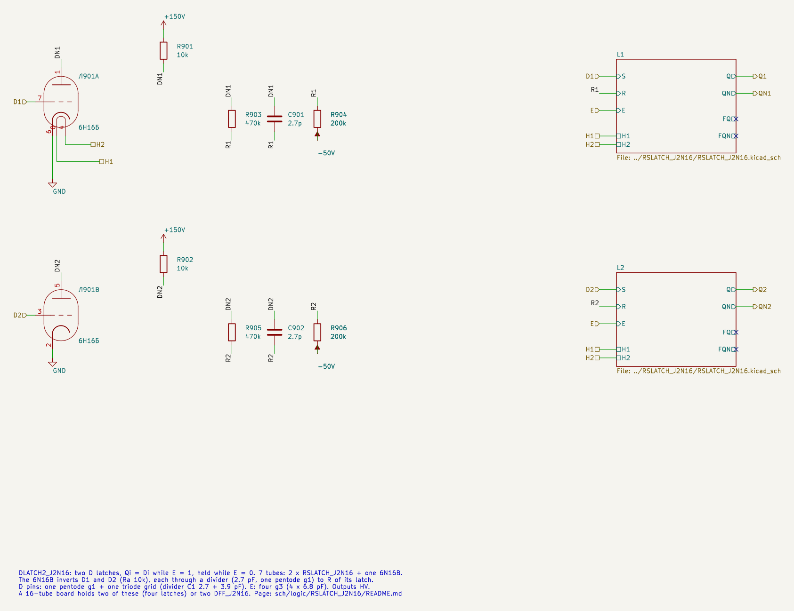

# DLATCH2_J2N16: two D latches on 6Zh2B + 6N16B

Cell page. Two D latches built from two [RSLATCH_J2N16](../RSLATCH_J2N16/README.md) sub-sheets plus one 6N16B for both D inverters. The latch design (structure, part values, levels, limits, sensitivity) is on the RSLATCH page; this page holds only what the D latch adds. One latch of it is the liberty cell `LATCH_J2N16` (applied 2026-10-29, TRS v0.20).

- Requirements: REQ-MOD-005 (D flip-flop board), REQ-MOD-012 (logic levels), REQ-MOD-004 (delays, fan-out, power; simulated, not measured), REQ-MOD-008 (`LATCH` → tube cell).
- Method: `doc/cell_design_method.md`.
- Source: the owner's drawing of 2026-10-27.

| | DLATCH2_J2N16 |
|---|---|
| Function | two latches: Qi = Di while E = 1, held while E = 0 |
| Tubes | 2 × RSLATCH + 1 × 6N16B (both D inverters) = 7 |
| Inputs (LV) | D1, D2 (g1 + triode grid), E (four g3) |
| Outputs (HV) | Q1, QN1, Q2, QN2 |
| Heater 6.3 V | 2.0 A (12.6 W) |
| Output levels | 1: 141.8…143.9 V; 0: 36…55 V (as RSLATCH) |
| Speed, fanout 2 / 6 / 10 | as RSLATCH, D falling +inverter |
| Timing limits, fanout 2 / 6 / 10 | as RSLATCH: E pulse ≥ 216 / 333 / 454 ns; setup 182 / 307 / 432 ns; hold ≤ 0 |
| Lowest grid | −31.6 V (D) |

A 16-tube board takes two DLATCH2_J2N16 (four latches), with two tubes spare (owner, 2026-10-27).

## Schematic

`DLATCH2_J2N16.kicad_sch`. The 6N16B inverts D1 and D2 with Ra 10k each, and each inverter feeds R of its latch through a 2.7 pF divider:



Both latches are instances of `../RSLATCH_J2N16/RSLATCH_J2N16.kicad_sch`.

## Testbench

`DLATCH2_J2N16_tb.kicad_sch` has one E for both latches, a 2 µs period, D2 = ~D1, fanout 6 on Q1/QN1 and 2 on Q2/QN2. All 19 sampled states of both latches are correct; levels 143.1…143.9 V / 54.6…55.1 V. E↑→Q1 is 321 ns. KiCad and plain SPICE agree on all 82 values.

Delays and timing limits against fanout: the RSLATCH table ([RSLATCH_J2N16](../RSLATCH_J2N16/README.md), "Delay and timing limits against fanout"); D falling adds the inverter.

## Options evaluated

| Option | Result | Verdict |
|---|---|---|
| D latch without the D inverter: R input from QN | with E high and D low both halves only see ~each other: the latch holds instead of resetting | does not work |
| D latch from four NAND2_J2 (no inverter) | 4 tubes against 3.5, and every arc is a slow NAND (166…396 ns per gate) | rejected |

## Liberty entry

`LATCH_J2N16` in `sch/logic/vtube_cells.lib` (applied 2026-10-29, was the generic `LATCH`): one latch of this cell, transparent while C (the E of the RS latch) is high. Area 3.5, J2B 2 + N16B 1.5 (half of the inverter tube), heat 1000 mA. "fanout_load" is in units of a triode grid (C1 3.9 pF):

| Pin | vtube_grid | vtube_c1 | fanout_load |
|---|---|---|---|
| D | pentode_g1 (plus the inverter's triode grid) | 6.6 pF | 1.7 |
| C | pentode_g3 (two) | 13.6 pF | 3.5 |
| Q, QN | HV out, max_fanout 6 | | |

`vtube_timing.json` (SPICE, fanout 6): D→Q 290 ns, C↑→Q 290 ns. `vtube_cells.v` has the model `LATCH_J2N16`. The setup of 0.31 µs before C falls is not checked in netlist simulation (no checker for latches). `div_insert.py` counts a pin as one grid, so a D or C pin with two or three grids under-counts the net fanout.

## Files and how to run

| File | What |
|---|---|
| `DLATCH2_J2N16.kicad_sch` | cell sheet (two RSLATCH sub-sheets) |
| `DLATCH2_J2N16_tb.kicad_sch/.kicad_pro` | testbench |
| `tools/kicad/gen_latch_j2n16.py` | generator of the sheets of all three latch cells |
| `tools/spice/dff_sweep.py` | DLATCH / DFF / shift register checks |
| `tools/spice/latch_tb.py` | testbench definitions shared with KiCad, plain-SPICE reference |
| `tools/spice/latch_plots.py` | the figure on this page |

```
tools/spice/sim_kicad.sh sch/logic/DLATCH2_J2N16/DLATCH2_J2N16_tb.kicad_sch
python3 tools/spice/latch_tb.py dlatch2                 # the same bench in plain SPICE
```

To embed the cell: the inputs come from HV nets through the usual divider. The D pin is a pentode g1 plus a triode grid (C1 6.6 pF); E is four g3 (6.8 pF each).

## Open points

- **Measure on hardware** (REQ-MOD-004), as RSLATCH.
