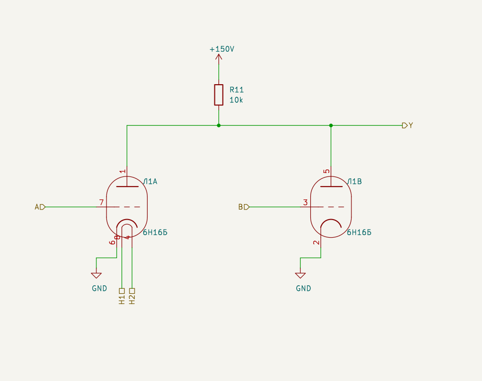
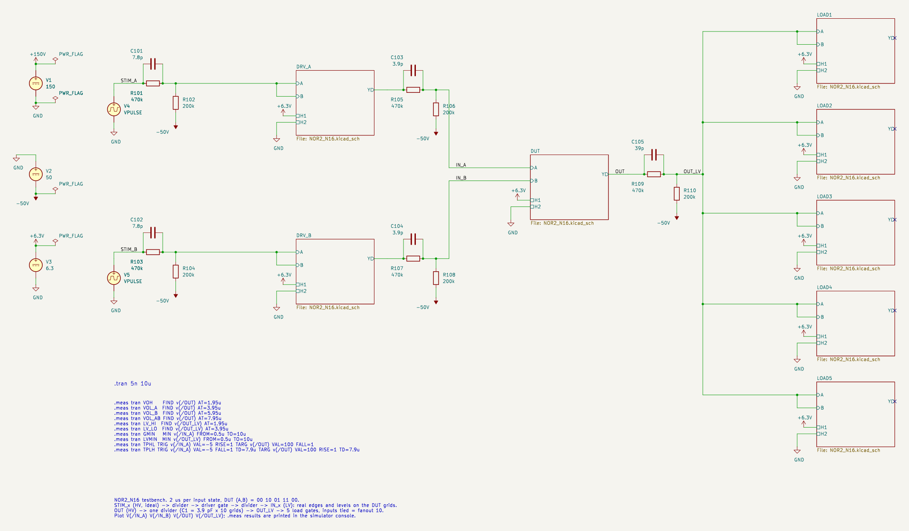
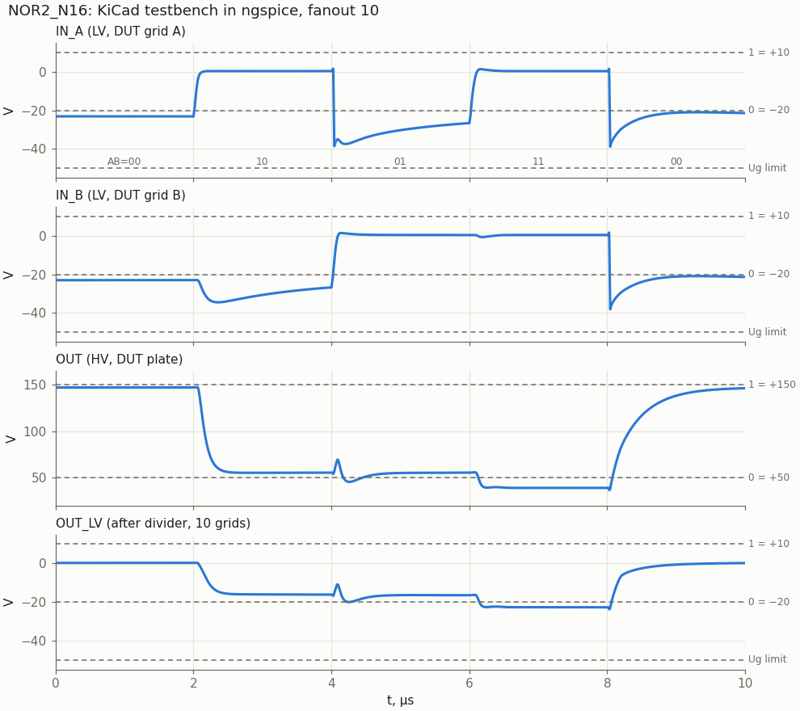
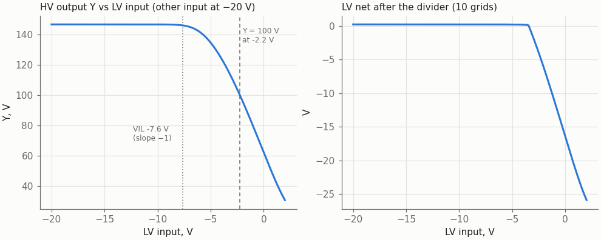
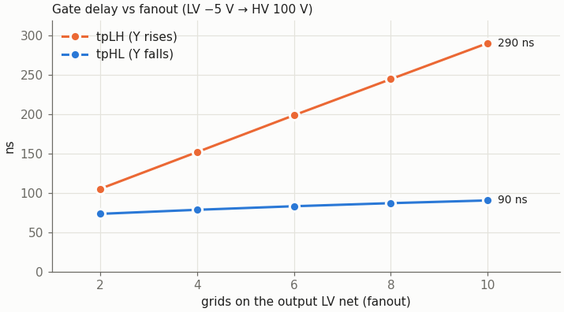

# NOR2_N16: two-input NOR on one 6N16B

Cell page. REQ-MOD-005 (NOR board), REQ-MOD-012 (logic levels), REQ-MOD-004 (delays, fan-out, power; simulated, not yet measured).

| | |
|---|---|
| Function | Y = ~(A \| B) |
| Tubes | one 6N16B (6Н16Б), both triodes |
| Inputs A, B | LV level, straight to the grids |
| Output Y | HV level, the common plate |
| Supplies | +150 V (plate); −50 V (dividers only); heater 6.3 V, 0.4 A |
| Parts | Ra 10 kΩ; per driven LV net a divider 470 kΩ ‖ C1 / 200 kΩ, C1 = 3.9 pF per grid |
| Output levels, fanout 10 | Y = 146 V (1); 55 V one input high, 39 V both (0) |
| Delay, fanout 2 … 10 | tpHL 73 … 90 ns, tpLH 105 … 290 ns |
| Grid, worst transient | −38.8 V (limit −50 V) |

## Logic levels

The owner set the levels on 2026-10-23. There are two families:

| Family | Where | 1 | 0 |
|---|---|---|---|
| HV | plate outputs | +150 V | +50 V |
| LV | grid inputs | +10 V | −20 V |

Elements are joined as follows:
- **HV → LV:** a resistive divider to −50 V with ratio 0.3, so +150 → +10 and +50 → −20. The speed-up capacitor C1 sits across the upper resistor.
- **LV → HV:** a tube buffer or inverter. This cell is one.

The LV "1" of +10 V is the open-circuit level of the divider. A driven grid clamps it at about +0.3 V with grid current, and the triode is fully on there.

## Schematic



| Pin | Level | Connection |
|---|---|---|
| A | LV in | triode A grid (pin 7) |
| B | LV in | triode B grid (pin 3) |
| Y | HV out | both plates (pins 1, 5) and Ra to +150 V |
| H1, H2 | heater | pins 8, 4; the module wires the heater chain |

The cathodes (pins 6, 2) go to GND. The cell needs no negative supply; −50 V is only used by the dividers.

### The HV → LV divider

The divider is not part of the cell. It belongs to the net: one divider per HV net that drives grids, and all grids on its LV side share it.

```
 HV net ──┬── R1 470k ──┬── LV net ── grids (N)
          └── C1 ───────┤
                       R2 200k
                        │
                      −50 V
```

- Ratio 200/670 = 0.2985: +150 V → +9.8 V, +50 V → −20.1 V.
- One divider per net keeps the DC load on the plate at a single 670 kΩ, whatever the fanout. A divider per input would add 670 kΩ per grid.
- **C1 = 3.9 pF × the number of grids on the LV net** (39 pF for 10 grids). The value is bounded on both sides:

| C1 per grid | Lowest grid voltage | tpHL, fanout 2 / 10 | Verdict |
|---|---|---|---|
| 2.7 pF | −24 V | 2.0 / 1.8 µs | under-compensated, the grid crawls down |
| 3.3 pF | −30 V | 88 / 104 ns | works, but sits 20 % from the cliff above |
| **3.9 pF** | **−38.6 V** | **73 / 90 ns** | chosen: survives ±10 % on C1 |
| 4.7 pF | −49.8 V | 63 / 80 ns | at the −50 V grid limit |
| 6.8 pF | below −50 V | — | beyond the limit |

The grid kick comes from grid clamping. While the LV net is high, its grids hold it near +0.3 V instead of +10 V, so C1 is charged about 10 V above the compensated value. When the driving plate falls, that surplus pushes the grid below −20 V; it then relaxes back to −20 V within ~2 µs (see IN_A in the waveforms). The worst case is a driver whose inputs are tied together, because its plate falls the furthest: 147 → 39 V.

## Results

### KiCad testbench



- **Stimulus:** each STIM source is an ideal HV pulse. It goes through a divider into a driver gate (the same cell, inputs tied), then through another divider to the DUT grid. The DUT therefore sees real edges and real LV levels.
- **Load:** OUT drives one divider (C1 = 39 pF), and its LV net feeds five load gates with both inputs tied, so fanout 10.
- **Sequence:** each input state lasts 2 µs, (A,B) = 00 10 01 11 00.

The run uses the netlist that `kicad-cli` exports:

| .meas | Value |
|---|---|
| VOH (00) | 146.9 V |
| VOL_A / VOL_B (one input high) | 55.3 / 55.3 V |
| VOL_AB (both) | 39.1 V |
| LV_HI on OUT_LV (clamped by 10 grids) | +0.24 V |
| LV_LO on OUT_LV, 1.9 µs after the edge | −16.2 V (settles to −21 V) |
| GMIN, DUT grid A | −38.8 V |
| TPHL, IN_A ↑ (−5 V) to OUT ↓ (100 V) | 99 ns |
| TPLH, inputs ↓ (−5 V) to OUT ↑ (100 V) | 292 ns |



What the waveforms show:
- **At 4 µs (10 → 01):** A falls while B rises, and OUT briefly rises to 70 V. This is a static hazard of the stimulus, since both inputs change together. 70 V is below the HV-domain VIL of 92 V, so the next gate does not switch.
- **At 2 µs:** when triode A turns on, the plate fall couples through Cga of triode B into grid B, which dips to −35 V (Miller feed-through). It stays above the grid limit, and a "0" grid only goes further into cut-off.
- **After a falling edge:** the LV "0" undershoots to about −38 V and relaxes back to −20 V. This is the clamp surplus in C1 described in the divider section.

### Static transfer



| | LV input | Same point on the HV net feeding the input |
|---|---|---|
| VIL (slope −1) | −7.6 V | 92 V |
| Switching point (Y = 100 V) | −2.2 V | 110 V |
| Grid clamped, full on | ≈ 0 V | ≈ 118 V |

Noise margins:

| Signal | Level | Threshold | Margin |
|---|---|---|---|
| HV "0" | 55 V | 92 V | 37 V |
| HV "1" | 146 V | 118 V | 28 V |
| LV "0" | −20 V | −7.6 V | 12 V |

The right panel shows the divider output with 10 grids: it stays clamped near 0 V until the plate falls below about 118 V.

A stiff +10 V source on a grid draws 4.8 mA of grid current (48 mW, under the 0.1 W limit). The LV input should still come from a divider: then the grid current is limited by the divider and the "1" level is set by the clamp.

### Fanout



| Grids on the LV net | VOH | tpHL | tpLH | LV → LV, gate + divider (fall / rise) |
|---|---|---|---|---|
| 2 | 146.9 V | 73 ns | 105 ns | 60 / 84 ns |
| 4 | 146.9 V | 78 ns | 152 ns | 65 / 123 ns |
| 6 | 146.8 V | 83 ns | 199 ns | 70 / 163 ns |
| 8 | 146.6 V | 87 ns | 245 ns | 73 / 204 ns |
| 10 | 146.1 V | 90 ns | 290 ns | 75 / 247 ns |

`tools/spice/nor2_sweep.py` produced this table (ideal HV pulse, divider, driver gate). The KiCad testbench gives 99/292 ns at fanout 10.

- **Static levels do not depend on fanout:** with one divider per net, the plate carries one 670 kΩ load at any fanout.
- **Rise time grows linearly with fanout:** Ra has to charge C1 of all the grids. At fanout 10 a rising edge takes 0.3 µs, a third of a 1 MHz clock period (OPEN-014).

## Datasheet limits

Source: https://frank.pocnet.net/sheets/113/6/6N16B.pdf

| Quantity | Limit | Worst case in the cell |
|---|---|---|
| Ua | 200 V (350 V cut off) | 147 V (off) |
| Pa per triode | 0.9 W | 0.52 W (one triode on: 55 V × 9.5 mA) |
| Ik | 14 mA | 9.5 mA |
| Ug | ≥ −50 V | −38.8 V transient, −21 V static |
| Grid-circuit resistance | 1 MΩ | 140 kΩ (470k ‖ 200k) |
| Pg | 0.1 W | 48 mW with a stiff +10 V source; microwatts from a divider |

Power per gate:
- **Plate supply:** 9.5 mA (one input high) or 11 mA (both) from +150 V while Y is low, which is 1.4–1.7 W; nothing while Y is high.
- **Divider:** 0.15–0.3 mA per net.
- **Heater:** 2.5 W.

## Anode-circuit options that were evaluated

tpLH is at fanout 10. C1 differed between runs, so compare the rows only within the same C1.

| Option | C1 per grid | VOL (one input) | tpLH | Decision |
|---|---|---|---|---|
| Ra 15 kΩ | 6.8 pF | 45 V | 654 ns | slow |
| Ra 12 kΩ | 10 pF | 51 V | 570 ns | — |
| Ra 10 kΩ | 6.8 pF | 55 V | 370 ns | — |
| **Ra 10 kΩ** | **3.9 pF** | **55 V** | **290 ns** | **chosen**: VOL near the +50 V nominal, Ik 9.5 mA |
| Ra 8.2 kΩ | 5.6 pF | 61 V | 262 ns | faster, but VOL drifts away from +50 V; Ik 10.9 mA, Pa 0.66 W |
| Ra 10 kΩ + peaking L 1 mH in series | 6.8 pF | 56 V | 295 ns (tpHL 69 → 42 ns) | rejected: ringing pushes the LV net to −56 V |
| Ra 10 kΩ + peaking L ≥ 2.2 mH | 6.8 pF | 120 V and more | — | rejected: the stage oscillates |

### Superseded attempts

These were tried before the owner clarified the two level families.

- **Single family, +200/−60 V:** each input carried its own divider. That made the cell input carry the divider and its speed-up capacitor; the −50 V grid limit capped that capacitor at 2.2 pF.
- **Single family, +150/−50 V, one level set for everything (1 ≥ +50, 0 ≤ +10):** a plate cannot reach +10 V, so the output needs a level shift.
  - Resistive shift: ±8 V margin at fanout 4, and slow.
  - Neon shift (55 V lamp from plate to Y): the lamp goes out on every falling plate edge, because its current would have to reverse, so Y falls to −25…−40 V and waits for re-strike.
  - Cathode follower: fast and fanout-independent, but costs 1.5 tubes per gate.

  The two-family scheme gets the same result with one tube and passive dividers.

## Model

`sch/libs/6N16B.sub` is a Koren model in ngspice syntax: MU 25.96, EX 1.79, KG1 557.56, KP 137.33, KVB 391.9. Compared with the original PSpice file:
- `PWRS` is replaced by `PWR(MAX(x,0),EX)`;
- the grid-current branch of triode B is moved from Ga to Gb;
- a 1 GΩ resistor sits across each plate–cathode pair.

The pin map is `1=Pa 7=Ga 6=Ka 5=Pb 3=Gb 2=Kb`; the heater (4, 8) is not mapped. It follows the datasheet pinout: symbol unit A is datasheet triode 2 (a1 g7 k6), unit B is triode 1 (a5 g3 k2). The symbol `6Н16Б` in `sch/libs/vacuum_tube.kicad_sym` uses this map; its plate pins are `open_collector` (so the wired plates pass ERC) and its cathodes `passive`.

Check against the datasheet, per triode:

| Point | Datasheet | Model |
|---|---|---|
| Ua 100 V, Ug −2 V | 6.3 ± 1.9 mA | 5.9 mA |
| S at that point | 5.0 ± 1.25 mA/V | 4.9 mA/V |
| Ug 0, Ua 60 V | 8.3 mA (digitized curve) | 8.05 mA |

The model sits inside the datasheet spread. The full comparison against the digitized curves (within 10 %) is in `doc/6n16b_datasheet.md`. Real tubes still have to be measured (REQ-MOD-004).

## Files and how to use

| File | |
|---|---|
| `sch/logic/NOR2_N16/NOR2_N16.kicad_sch` | the cell; embed it as a hierarchical sheet |
| `sch/logic/NOR2_N16/NOR2_N16_tb.kicad_pro`, `NOR2_N16_tb.kicad_sch` | testbench project |
| `sch/libs/6N16B.sub` | model |
| `tools/spice/sim_kicad.sh` | runs a KiCad testbench from the command line: exports the netlist and prints the `.meas` results |
| `tools/spice/nor2_sweep.py` | fanout sweep; it also takes Ra, R1, R2, C1 and L as parameters |
| `tools/spice/nor2_plots.py` | rebuilds every figure on this page into `img/` (schematics, waveforms, transfer, fanout) |
| `tools/spice/ngrun.py` | runs a deck through KiCad's `libngspice.so.0`; no ngspice binary needed |

- **KiCad simulator:** open `NOR2_N16_tb.kicad_pro` and choose Inspect → Simulator. The sheet holds `.tran 5n 10u` and the `.meas` lines. Plot `V(/IN_A)`, `V(/IN_B)`, `V(/OUT)` and `V(/OUT_LV)`.
- **Command line:** `tools/spice/sim_kicad.sh sch/logic/NOR2_N16/NOR2_N16_tb.kicad_sch`.
- **Embedding in a module:**
  - Add a hierarchical sheet with file `NOR2_N16.kicad_sch` and connect A, B, Y, H1 and H2.
  - Draw one divider per HV net that drives grids, with C1 = 3.9 pF per grid on that net.
  - Tie an unused input to the other input.
  - The model path is `${KIPRJMOD}/../../libs/6N16B.sub`, so the project must sit two directories below `sch/` (`sch/logic/<CELL>/`).
  - The power symbols `+150V`, `-50V` and `+6.3V` are embedded in the sheets; KiCad's stock `power` library does not have them, so the GUI warns about a missing library symbol.

## Timing in the liberty

`vtube_timing.json` (2026-10-29), fanout 6, to the next stage's thresholds (falling output to 92 V, rising to 118 V; owner, 2026-10-29; `tools/spice/threshold_delays.py`), [Y rise, Y fall]: A→Y, B→Y [327, 99] ns.

## Open points

- **Delays and the clock.** One gate plus its divider takes 60–250 ns, depending on fanout. At 1 MHz that leaves room for 3–4 levels with light fanout and 2 levels at fanout 10. The liberty has `max_fanout: 10` and no timing; this table is the first input for `vtube_timing.json` until hardware is measured (REQ-MOD-004, OPEN-014).
- **Dividers in the synthesis flow.** They are passive parts, not tubes, so they do not count against the tube budget, but each HV net that drives grids needs one. C1 depends on the fanout of the net, so the P&R / netlist flow has to size it per net.
- **Nets that only drive other HV loads** (for example a plate driving a dekatron guide) need no divider. Those interfaces are not covered here.
