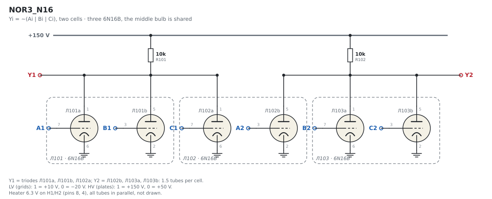
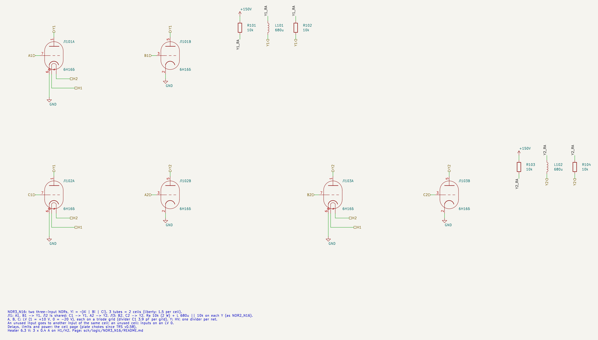
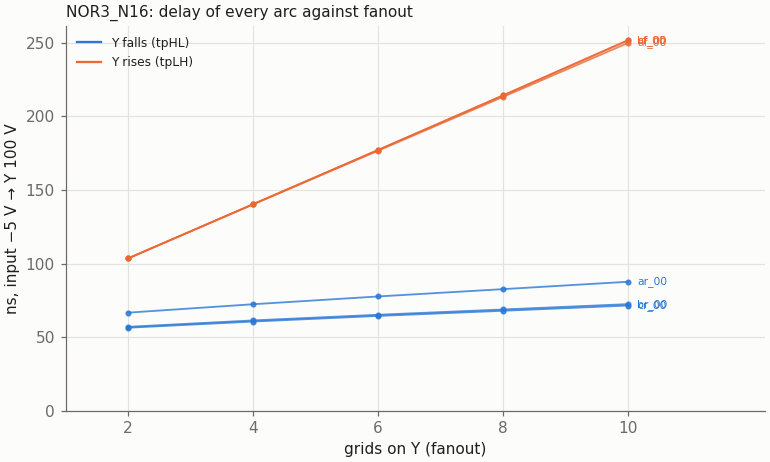
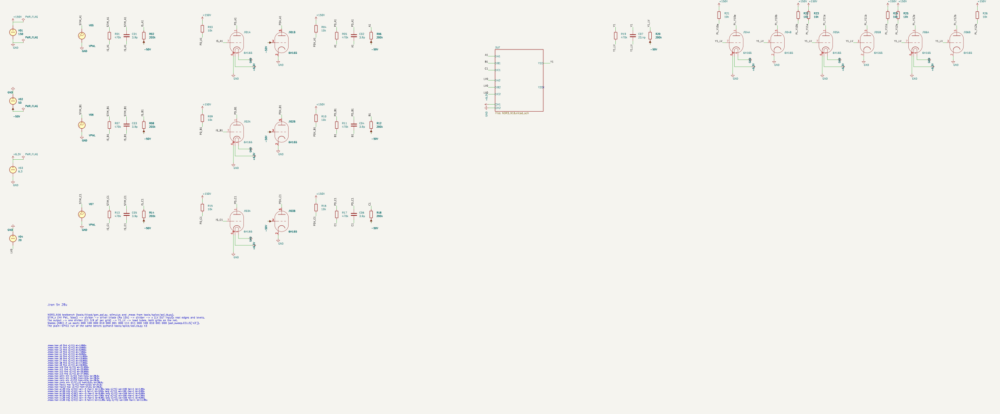
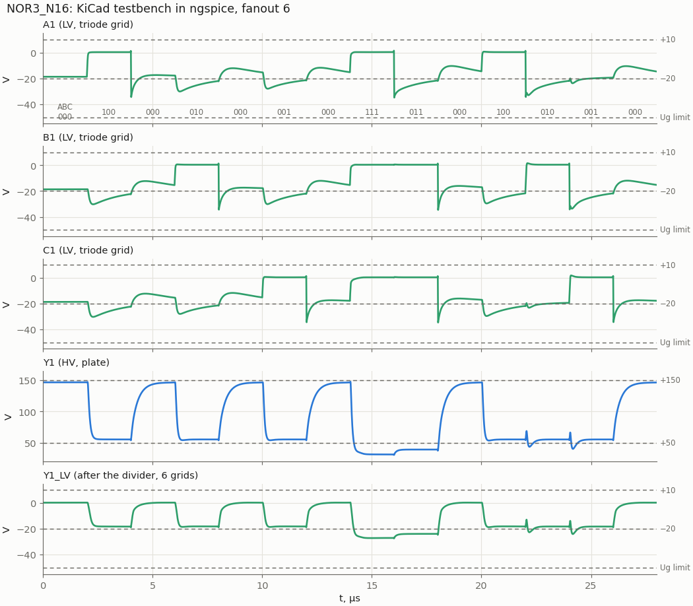
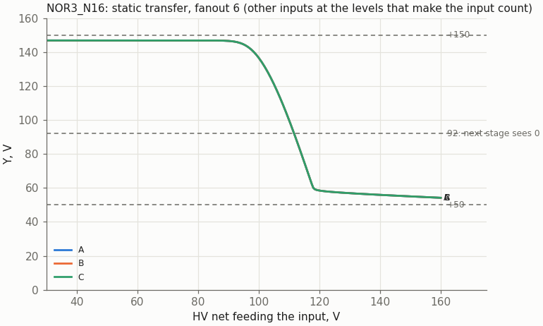

# NOR3_N16: two three-input NORs on three 6N16B

Cell page. REQ-MOD-003 (NOR3_N16 in the library), REQ-MOD-005 (boards), REQ-MOD-012 (logic levels), REQ-MOD-004 (delays, fan-out, power; simulated, not measured), REQ-MOD-009 (tube count: `doc/tube_count_1000.md` TC-O1). Method: `doc/cell_design_method.md`.

[NOR4_N16](../NOR4_N16/README.md) with three triodes on the plate instead of four. A three-input NOR uses one and a half 6N16B, so the sheet holds two cells on three tubes and the middle tube is shared (owner, 2026-11-01), as in [A1OOI_N16J2](../A1OOI_N16J2/README.md). Before this cell, synthesis had to spend a NOR4_N16 (2 tubes) on every three-input NOR. The levels, the divider rule, Ra and the 6N16B model are those of NOR2_N16.

| | NOR3_N16 (one cell) |
|---|---|
| Function | Y = ~(A + B + C) |
| Tubes | 1.5 × 6N16B (liberty: N16B 1.5); the sheet: two cells on three tubes |
| Inputs (LV) | A, B, C, one triode grid each |
| Output (HV) | Y, three plates, Ra 10k to +150 V |
| Supplies | +150 V; −50 V (dividers only); heater 6.3 V, 3 × 0.4 A per sheet |
| Divider C1 per grid on the driving nets | 3.9 pF |
| Output levels (static) | "1" 145.6–146.8 V; "0" 55.7 V (one input), 39.3 V (two), 31.5 V (all three) |
| Delay to 100 V, fanout 2 / 6 / 10 | Y falls 56–67 / 64–78 / 71–88 ns; Y rises 104 / 177 / 252 ns |
| Delay to the thresholds (92 V falling, 118 V rising), fanout 6 | 76–93 / 320 ns |
| Lowest grid | −34.8 V nominal, −42.0 V with all C1 +10 % (limit −50 V) |
| Crosstalk from the other cell | ≤ 1.8 V on Y |
| Worst static | Ik 10.3 mA, Pa 0.53 W per triode; Ra 1.40 W with all three on (a 2 W resistor) |

## Schematic

Overview schematic: the same netlist redrawn as one picture (generated by `tools/cellschem/build.py`; edit the drawing function there, not the SVG).



The KiCad sheet below has the same parts spread out and joined by net labels:



| Tube | Unit A (leads 1, 7, 6) | Unit B (leads 5, 3, 2) |
|---|---|---|
| Л101 | A1 → Y1 | B1 → Y1 |
| Л102 (shared) | C1 → Y1 | A2 → Y2 |
| Л103 | B2 → Y2 | C2 → Y2 |

| Pin | Level | Connection |
|---|---|---|
| A1, B1, C1 | LV in | cell 1 grids |
| A2, B2, C2 | LV in | cell 2 grids |
| Y1, Y2 | HV out | the cell's three plates, Ra 10k (R101, R102) to +150 V |
| H1, H2 | heater | all three tubes |

All three inputs of a cell are triode grids, so the cell has one grid type and no held-grid trap (method §2). Any "1" holds Y low, and the slow arc is the rising Y while Ra charges the output net. Which input sits on the shared tube doesn't matter for the logic. In the sweep it is C. The C arcs equal B to within 1 ns.

## Ra

`tools/spice/aoi_sweep.py n3` with a cases file of Ra values:

| Ra | VOL one input / all three | Y rises, fanout 2 / 6 / 10 | Y falls, fanout 10 | Hazard (fanout 2) |
|---|---|---|---|---|
| 8.2k | 60.6 / 35.0 V | 78 / 133 / 188 ns | 75–89 ns | 81.2 V |
| **10k** | **55.3 / 31.3 V** | **104 / 177 / 252 ns** | **71–88 ns** | **74.5 V** |
| 12k | 50.6 / 28.2 V | 133 / 229 / 326 ns | 68–86 ns | 68.5 V |

Chosen: 10k, the same as NOR2_N16 and NOR4_N16. VOL with one input sits on the +50 V nominal. 8.2k would move VOL to 61 V and the hazard to 81 V.

## Results

### Delay against fanout



| Grids on Y | Y falls (A, B, C rising alone) | Y rises (A, B, C falling alone) | "1" level |
|---|---|---|---|
| 2 | 56–67 ns | 104 ns | 146.8 V |
| 4 | 61–72 ns | 140 ns | 146.8 V |
| 6 | 64–78 ns | 177 ns | 146.6 V |
| 8 | 68–83 ns | 213–214 ns | 146.2 V |
| 10 | 71–88 ns | 250–252 ns | 145.6 V |

Input crossing −5 V to Y crossing 100 V. The A arc is the slow one on the falling Y, as in NOR4_N16: it is the first input the sequence switches from the reset state. One plate fewer than NOR4_N16 makes the rising Y 6–16 ns faster. For the liberty, every arc is measured to the next stage's thresholds at fanout 6: Y rises to 118 V in 320 ns and falls to 92 V in 76–93 ns (`tools/spice/threshold_delays.py NOR3_N16`).

### Hazards

Two inputs change together and Y should stay "0":
- A falls while B rises: Y rises to 74.5 / 68.7 / 65.6 V at fanout 2 / 6 / 10.
- B falls while C rises, with C on the shared tube: the glitch is smaller than the first one.

The worst case is 80.5 V, at MU +20 % and fanout 2. That is under the next stage's 92 V, and NOR4_N16 has a glitch of the same kind (78.5 V).

### Crosstalk between the two cells

`aoi_sweep.py --xtalk`: cell 1 is static, and the neighbour triode in the shared tube (A2) switches Y2 between 146.9 and 55.3 V. Y2 has its own divider and loads.

| Case | Y1 high (146.9 V), fanout 2 / 10 | Y1 low (55.3 V), fanout 2 |
|---|---|---|
| nominal, Ca1a2 0.5 pF | +1.2 / −1.4 V; +0.4 / −0.7 V | ±0.5 V |
| Ca1a2 0.65 pF (upper tolerance) | +1.6 / −1.8 V; +0.5 / −0.9 V | +0.6 / −0.7 V |

The coupling is negligible against the margins, the same as in A1OOI_N16J2.

### KiCad testbench



`NOR3_N16_tb.kicad_sch` drives cell 1 with the 14-state sequence of the sweep at fanout 6:
- each input alone, up and down;
- all three together (the lowest VOL);
- both hazards.

Cell 2 has its inputs on LV0 (−20 V) and Y2 open. Stimulus, loads and `.meas` come from `tools/spice/aoi_tb.py`. The KiCad netlist and the plain-SPICE bench agree on all 26 values to 0.12 %.



### Static transfer



One input is swept through its divider with the others low, fanout 6. Y crosses 100 V at 110 V on the input's HV net: 55 V above a driver's "0" and 37 V below its "1". These are the same as NOR2_N16 and NOR4_N16.

### Static operating points and limits

`tools/spice/aoi_static.py n3`:

| Inputs high | Y | Each conducting triode |
|---|---|---|
| none | 150 V | 0 |
| one | 55.7 V | Ik 9.43 mA, Pa 0.53 W |
| two | 39.3 V | 5.53 mA, 0.22 W |
| three | 31.5 V | 3.95 mA, 0.12 W |

Over MU −20 % and KG1 −25 %, the worst triode carries 10.3 mA (limit 14 mA) and dissipates 0.53 W (limit 0.9 W). Ra 10k dissipates 0.89 W with one input high and 1.40 W with all three, so it needs a 2 W resistor. A "0" of 31.5 V puts the next stage's grid at −25.6 V statically.

### Model spread

| Case | VOL | Hazard | Lowest grid | Y rises fanout 2 / 10 | Y falls fanout 10 |
|---|---|---|---|---|---|
| nominal | 31.3 … 55.3 V | 74.5 V | −34.8 V | 104 / 252 ns | 71–88 ns |
| MU −20 % | 26.2 … 47.0 V | 67.4 V | −34.8 V | 115 / 280 ns | 60–74 ns |
| MU +20 % | 36.0 … 62.6 V | 80.5 V | −34.8 V | 92 / 224 ns | 84–102 ns |
| KG1 −25 % | 26.6 … 48.2 V | 69.0 V | −34.8 V | 114 / 277 ns | 63–78 ns |
| KG1 +25 % | 35.4 … 61.2 V | 79.0 V | −34.8 V | 94 / 230 ns | 82–98 ns |
| all C1 +10 % | 31.3 … 55.3 V | 73.3 V | −42.0 V | 107 / 259 ns | 67–81 ns |
| all C1 −10 % | 31.3 … 55.3 V | 75.7 V | −30.0 V | 100 / 243 ns | 78–99 ns |

## Liberty

`NOR3_N16` in `sch/logic/vtube_cells.lib`:
- N16B 1.5, area 1.5, heater 600 mA;
- function `(A+B+C)'`, `max_fanout` 10;
- triode grids (C1 3.9 pF).

`vtube_timing.json`, fanout 6, to the thresholds, [Y rise, Y fall]: A→Y [320, 93], B→Y [320, 77], C→Y [320, 76] ns. The fanout ratios (2 / 6 / 10) come from the table above: rise 0.588 / 1 / 1.424, fall 0.859 / 1 / 1.128. `vtube_cells.v` and `vtube_cells.sp` have the matching models.

Synthesis decides how many cells it uses. They are counted at 1.5 tubes, so an odd count leaves half a sheet unused, i.e. one spare cell per board pair (a P&R question, as for A1OOI_N16J2).

Synthesis with the cell (2026-11-01, `doc/tube_count_1000.md` TC-O1): 96 cells (144 tubes) in the three blocks, and NOR4_N16 drops to 48. Over four seeds the three blocks go from 1128.8 to **1111.5 tubes (−17.3)**. `synth_sim.sh` (7/7), `run_tests.sh -t` / `-d` and the cocotb regression pass with it.

## Files and how to run

| File | What |
|---|---|
| `NOR3_N16.kicad_sch` | the sheet: two cells |
| `NOR3_N16_tb.kicad_pro/.kicad_sch` | testbench project |
| `tools/kicad/gen_aoi.py` | generated the sheets (shared with the AOI and NOR4 cells; regenerate into a scratch directory and copy only this cell) |
| `tools/spice/aoi_sweep.py n3`, `aoi_sweep.py --xtalk`, `aoi_static.py n3`, `aoi_tb.py n3`, `aoi_plots.py n3` | sweep, crosstalk, static points, bench, figures |
| `tools/spice/threshold_delays.py NOR3_N16` | the liberty delays |

```
python3 tools/spice/aoi_sweep.py n3
python3 tools/spice/aoi_sweep.py --xtalk
tools/spice/sim_kicad.sh sch/logic/NOR3_N16/NOR3_N16_tb.kicad_sch
```

To embed the cell:
- Each input comes from an HV net through the usual divider, with C1 = 3.9 pF per triode grid.
- An unused input goes to another input of the same cell. An unused cell gets its inputs on an LV "0".
- The project must sit two directories below `sch/`.

## Open points

- **Measure on tubes** (REQ-MOD-004).
