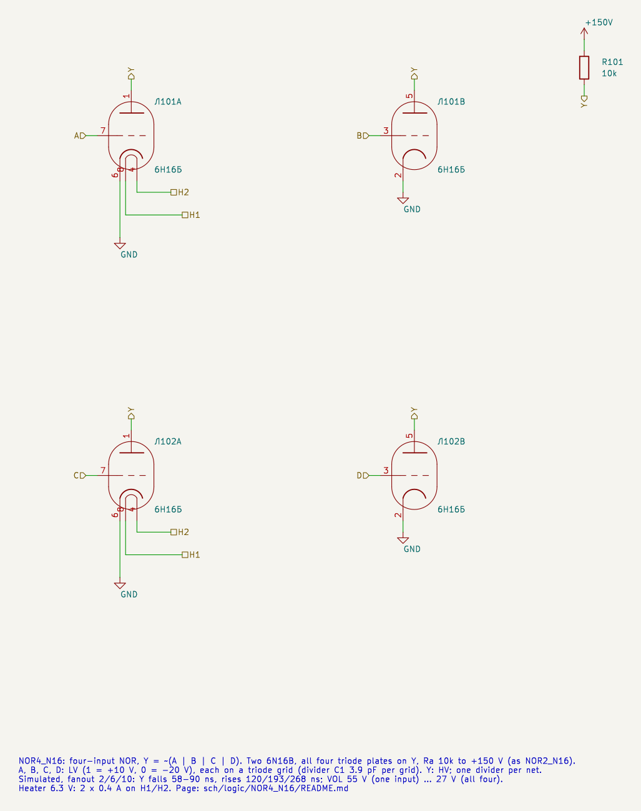
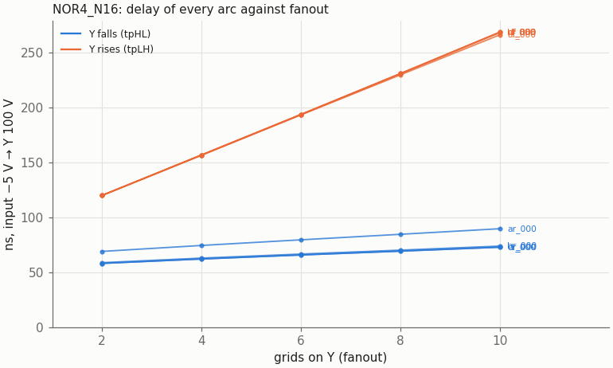
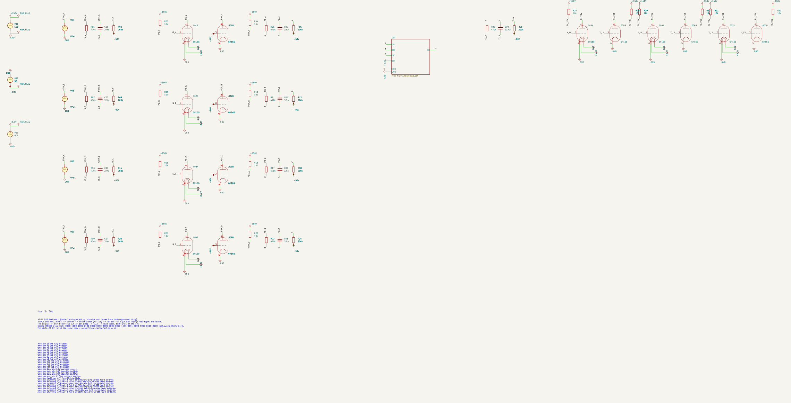
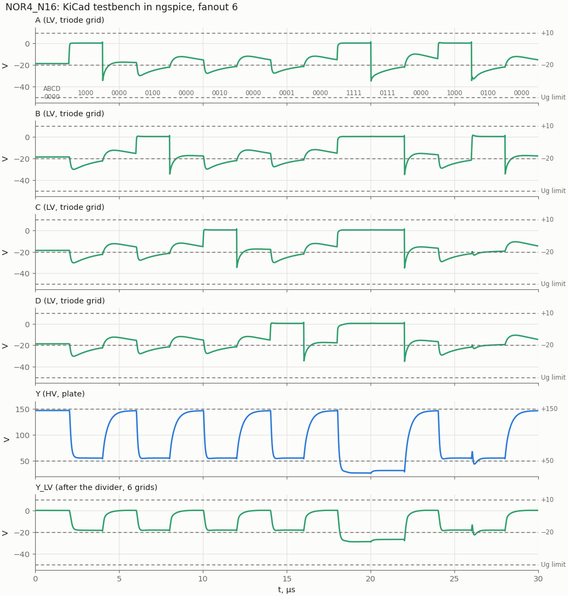
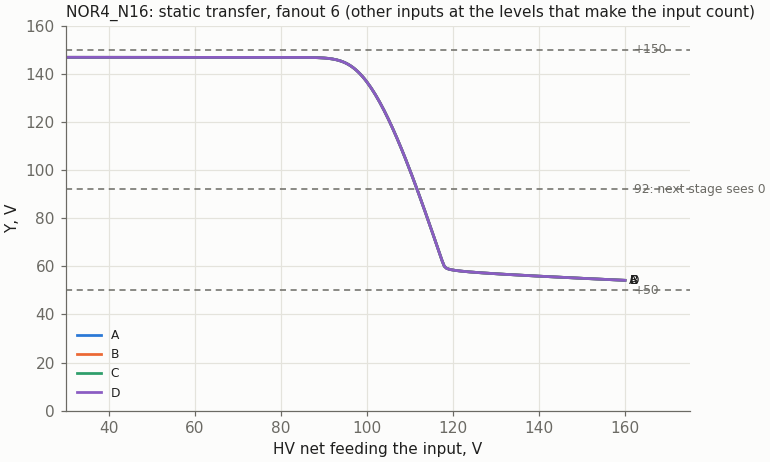

# NOR4_N16: four-input NOR on two 6N16B

Cell page. REQ-MOD-003 (NOR4_N16 in the library), REQ-MOD-005 (boards), REQ-MOD-012 (logic levels), REQ-MOD-004 (delays, fan-out, power; simulated, not measured). Method: `doc/cell_design_method.md`.

[NOR2_N16](../NOR2_N16/README.md) with four triodes on the plate instead of two: two 6N16B, every plate on Y, one Ra. The levels, the divider rule and the 6N16B model are those of NOR2_N16.

| | NOR4_N16 |
|---|---|
| Function | Y = ~(A + B + C + D) |
| Tubes | two 6N16B (liberty: N16B 2) |
| Inputs (LV) | A, B, C, D, one triode grid each |
| Output (HV) | Y, all four plates, Ra 10k to +150 V |
| Supplies | +150 V; −50 V (dividers only); heater 6.3 V, 2 × 0.4 A |
| Divider C1 per grid on the driving nets | 3.9 pF |
| Output levels (static) | "1" 145–147 V; "0" 55.7 V (one input), 39.3 (two), 31.5 (three), 26.7 V (all four) |
| Delay to 100 V, fanout 2 / 6 / 10 | Y falls 58–69 / 66–79 / 73–90 ns; Y rises 120 / 193 / 268 ns |
| Delay to the thresholds (92 V falling, 118 V rising), fanout 6 | 78–96 / 348 ns |
| Lowest grid | −35.0 V nominal, −42.2 V with all C1 +10 % (limit −50 V) |
| Worst static | Ik 10.3 mA, Pa 0.53 W per triode; Ra 1.52 W with all four on (a 2 W resistor) |

## Circuit and Ra

All four plates are tied to Y with one Ra to +150 V. A "1" on any grid holds Y low, so there is no held-grid trap as in the AND-type cells: the slow arc is the rising Y, Ra charging the output net.

`tools/spice/aoi_sweep.py n4` (the shared gate sweep: every input from a 6N16B triode driver with Ra 10k through its divider, triode loads):

| Ra | VOL one input / all four | Y rises, fanout 2 / 6 / 10 | Y falls, fanout 10 | Hazard (fanout 2) |
|---|---|---|---|---|
| 8.2k | 60.6 / 29.8 V | 90 / 145 / 200 ns | 76–91 ns | 79 V |
| **10k** | **55.3 / 26.6 V** | **120 / 193 / 268 ns** | **73–90 ns** | **72.5 V** |
| 12k | 50.7 / 23.9 V | 154 / 250 / 348 ns | 69–88 ns | 66.5 V |

Chosen: 10k, as NOR2_N16. VOL with one input sits on the +50 V nominal, and a gate drives one Ra. 8.2k would gain 70 ns on the rising edge at fanout 10, but VOL would move to 61 V.

## Schematic



| Pin | Level | Connection |
|---|---|---|
| A, B | LV in | grids of Л101 (leads 7, 3) |
| C, D | LV in | grids of Л102 (leads 7, 3) |
| Y | HV out | all four plates (leads 1, 5 of both tubes), Ra 10k to +150 V |
| H1, H2 | heater | both tubes |

## Results

### Delay against fanout



| Grids on Y | Y falls (A…D rising alone) | Y rises (A…D falling alone) | "1" level |
|---|---|---|---|
| 2 | 58–69 ns | 120 ns | 146.7 V |
| 6 | 66–79 ns | 193 ns | 146.4 V |
| 10 | 73–90 ns | 266–268 ns | 145.2 V |

Input crossing −5 V to Y crossing 100 V. The A arc is slower on the falling Y than B, C, D (69 against 58 ns at fanout 2). Its input is the first one the sequence switches, starting from the reset state. For the liberty, all arcs are measured to the next stage's thresholds: fanout 6, Y rise to 118 V 348 ns, Y fall to 92 V 78–96 ns.

### Hazard

A falls while B rises: Y should stay "0". It rises to 72.5 / 67.7 / 65.0 V at fanout 2 / 6 / 10, and to 78.5 V at MU +20 %, under the next stage's 92 V. NOR2_N16 has the same kind of glitch.

### KiCad testbench



`NOR4_N16_tb.kicad_sch` runs the 15-state sequence of the sweep at fanout 6:
- each input alone up and down;
- all four together (the lowest VOL);
- the hazard.

Stimulus, loads and `.meas` come from `tools/spice/aoi_tb.py`. KiCad and plain SPICE agree on all 29 values.



### Static transfer



One input swept through its divider, the others low, fanout 6. Y crosses 100 V at 110 V on the input's HV net: 55 V above a driver's "0", 37 V below its "1".

### Static operating points and limits

`tools/spice/aoi_static.py n4`:

| Inputs high | Y | Each conducting triode |
|---|---|---|
| none | 150 V | 0 |
| one | 55.7 V | Ik 9.43 mA, Pa 0.53 W |
| two | 39.3 V | 5.53 mA, 0.22 W |
| three | 31.5 V | 3.95 mA, 0.12 W |
| four | 26.7 V | 3.08 mA, 0.08 W |

Over MU −20 % and KG1 −25 % the worst triode is 10.3 mA (limit 14 mA) and 0.53 W (0.9 W). Ra 10k dissipates 0.89 W with one input high and 1.52 W with all four: a 2 W resistor. A "0" of 26.7 V puts the next stage's grid at −28 V statically.

### Model spread

| Case | VOL | Hazard | Lowest grid | Y rises fanout 2 / 10 | Y falls fanout 10 |
|---|---|---|---|---|---|
| nominal | 26.6 … 55.3 V | 72.5 V | −35.0 V | 120 / 268 ns | 73–90 ns |
| MU −20 % | 22.3 … 47.0 V | 65.6 V | −35.0 V | 134 / 299 ns | 61–75 ns |
| MU +20 % | 30.6 … 62.6 V | 78.5 V | −35.1 V | 107 / 239 ns | 86–105 ns |
| KG1 −25 % | 22.5 … 48.2 V | 66.8 V | −35.0 V | 132 / 296 ns | 63–80 ns |
| KG1 +25 % | 30.2 … 61.2 V | 77.2 V | −35.0 V | 109 / 245 ns | 83–101 ns |
| all C1 +10 % | 26.6 … 55.3 V | 71.3 V | −42.2 V | 123 / 276 ns | 68–83 ns |
| all C1 −10 % | 26.6 … 55.3 V | 73.8 V | −29.9 V | 116 / 259 ns | 79–101 ns |

## Liberty

`NOR4_N16` in `sch/logic/vtube_cells.lib`: N16B 2, function `(A+B+C+D)'`, `max_fanout` 10, triode grids by default (C1 3.9 pF). `vtube_timing.json`, fanout 6, to the thresholds, [Y rise, Y fall]: A→Y [348, 96], B/C/D→Y [348, 79] ns.

Synthesis (`run_tests.sh -s`, 2026-10-29): 45 cells, 90 tubes.

## Files and how to run

| File | What |
|---|---|
| `NOR4_N16.kicad_sch` | the cell |
| `NOR4_N16_tb.kicad_pro/.kicad_sch` | testbench project |
| `tools/kicad/gen_aoi.py` | generated the sheets (shared with the AOI cells) |
| `tools/spice/aoi_sweep.py n4`, `aoi_static.py n4`, `aoi_tb.py n4`, `aoi_plots.py` | sweep, static points, bench, figures |
| `tools/spice/threshold_delays.py NOR4_N16` | the liberty delays |

```
python3 tools/spice/aoi_sweep.py n4
tools/spice/sim_kicad.sh sch/logic/NOR4_N16/NOR4_N16_tb.kicad_sch
```

To embed the cell: each input comes from an HV net through the usual divider, C1 = 3.9 pF per triode grid. An unused input goes to another input of the cell. The project must sit two directories below `sch/`.

## Open points

- **Measure on tubes** (REQ-MOD-004).
- Two 6N16B make one cell. Other split options were not studied: NOR2 + NOR2 + AND would be more tubes; one cell per board pair is a P&R question.
