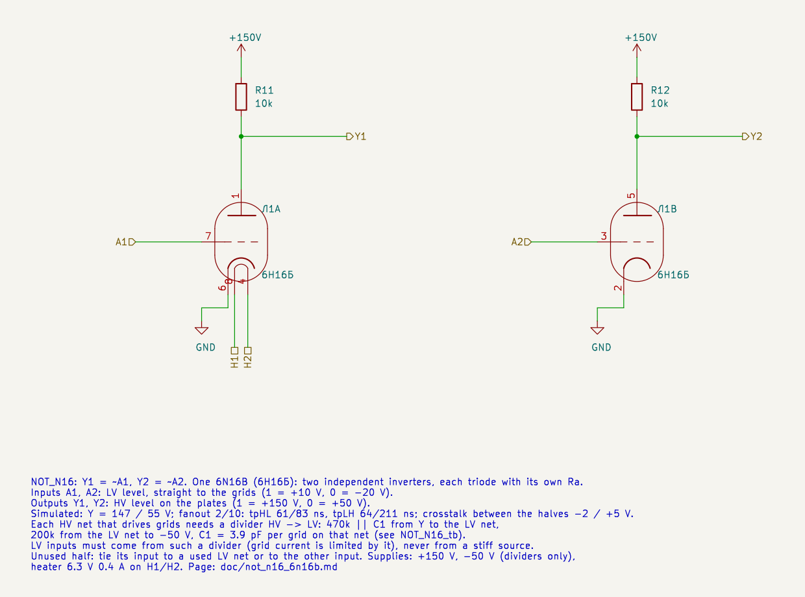
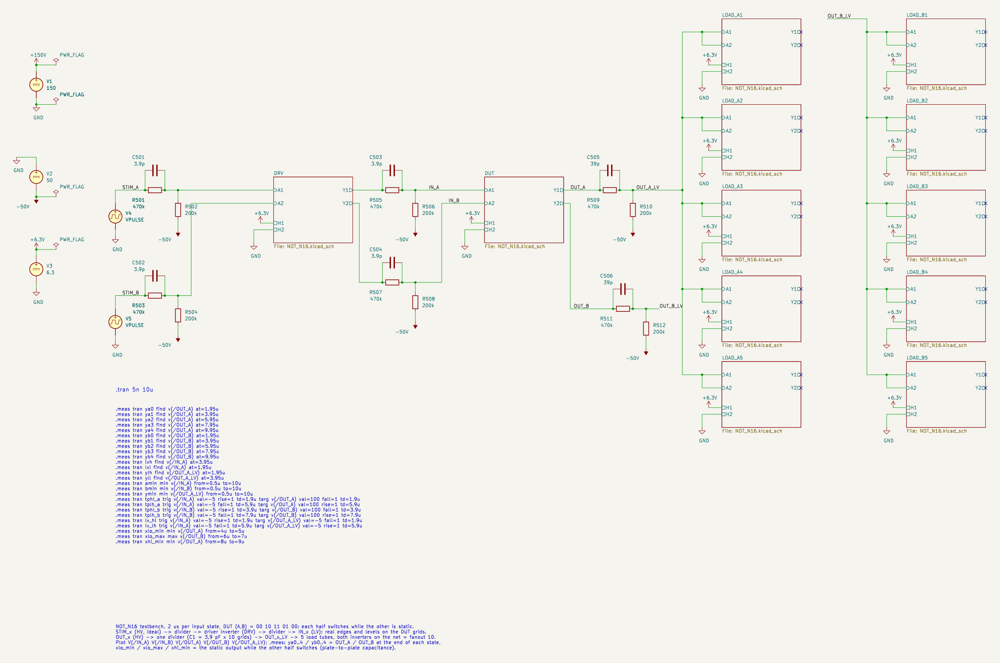
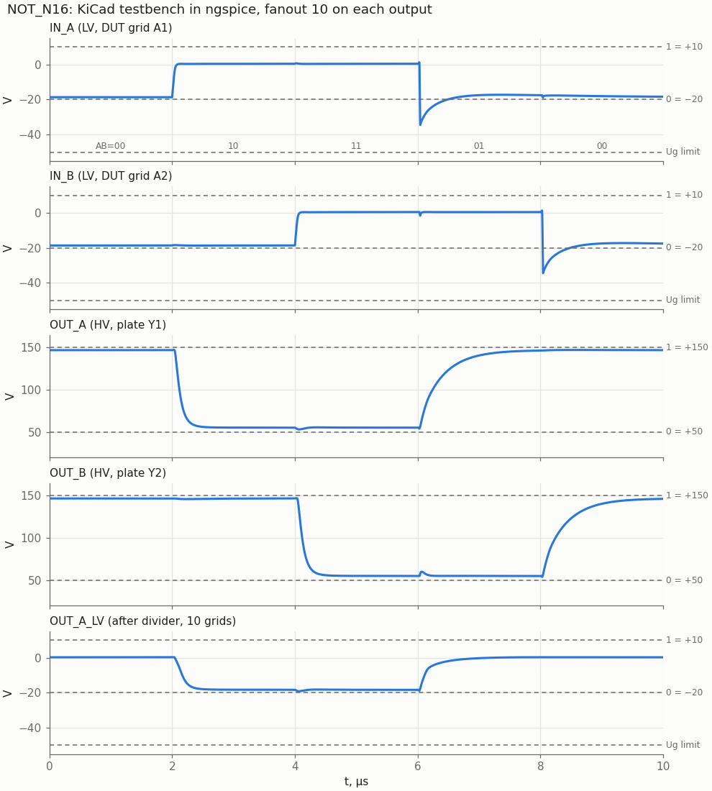
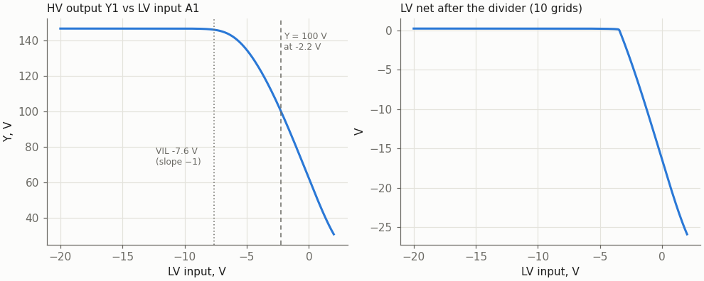
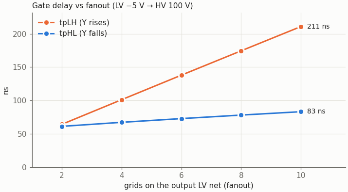

# NOT_N16: two inverters on one 6N16B

Cell page. REQ-MOD-003 (NOT_N16 in the library), REQ-MOD-005 (boards), REQ-MOD-012 (logic levels), REQ-MOD-004 (delays, fan-out, power; simulated, not yet measured).

| | |
|---|---|
| Function | Y1 = ~A1, Y2 = ~A2: two independent inverters |
| Tubes | one 6N16B (6Н16Б) per sheet, half a tube per inverter (liberty `NOT_N16`: N16B 0.5) |
| Inputs A1, A2 | LV level, straight to the grids |
| Outputs Y1, Y2 | HV level, each on its own plate |
| Supplies | +150 V (plates); −50 V (dividers only); heater 6.3 V, 0.4 A |
| Parts | Ra 10 kΩ per triode; per driven LV net a divider 470 kΩ ‖ C1 / 200 kΩ, C1 = 3.9 pF per grid |
| Output levels, fanout 10 | Y = 146.4…146.9 V (1); 55.3 V (0) |
| Delay, fanout 2 … 10 | tpHL 61 … 83 ns, tpLH 64 … 211 ns |
| Crosstalk between the halves | a low output moves −2 V / +5 V (fanout 10; +8 V at fanout 2) while the other half switches; a high one −0.5 V |
| Grid, worst transient | −34.5 V (limit −50 V) |

The cell is NOR2_N16 with the plates split: each triode gets its own Ra and its own output. One inverter of the cell behaves exactly like NOR2_N16 with one input high, so the levels, the transfer curve and the divider rule are the same. It is faster, because its plate carries one triode instead of two.

## Logic levels

The same two families as NOR2_N16 (owner, 2026-10-23, REQ-MOD-012):

| Family | Where | 1 | 0 |
|---|---|---|---|
| HV | plate outputs | +150 V | +50 V |
| LV | grid inputs | +10 V | −20 V |

- **HV → LV:** a resistive divider to −50 V with ratio 0.3, with the speed-up capacitor C1 across the upper resistor. It belongs to the net, not to the cell.
- **LV → HV:** a tube stage. Each half of this cell is one.

## Schematic

| Pin | Level | Connection |
|---|---|---|
| A1 | LV in | triode A grid (pin 7) |
| Y1 | HV out | triode A plate (pin 1) and R11 10 kΩ to +150 V |
| A2 | LV in | triode B grid (pin 3) |
| Y2 | HV out | triode B plate (pin 5) and R12 10 kΩ to +150 V |
| H1, H2 | heater | pins 8, 4; the module wires the heater chain |

The cathodes (pins 6, 2) go to GND. The cell needs no negative supply.

Why one sheet holds both halves: KiCad stores one symbol unit per sheet file for all instances, so a one-triode sheet cannot put its second instance on unit B. The liberty keeps `NOT_N16` as a half-tube cell; P&R packs two of them into one sheet instance. An unused half has its input tied to any LV net (or to the other input) and its output left open.

### The HV → LV divider

Unchanged from NOR2_N16 (`sch/logic/NOR2_N16/README.md`): one divider per HV net, R1 470 kΩ ‖ C1 from the plate to the LV net, R2 200 kΩ from the LV net to −50 V, **C1 = 3.9 pF × the number of grids on the net**.

The bounds were rechecked with an inverter as the driver. Its plate falls 147 → 55 V instead of 147 → 39 V for a NOR with both inputs high, so the grid kick is smaller, but the window is the same:

| C1 per grid | Lowest DUT grid | tpHL fanout 2 / 10 | LV → LV fall, fanout 2 | Verdict |
|---|---|---|---|---|
| 2.7 pF | −18.7 V | 126 / 155 ns | 530 ns | under-compensated, the LV net crawls down |
| 3.3 pF | −24.1 V | 78 / 102 ns | 97 ns | works, close to the crawl |
| **3.9 pF** | **−34.5 V** | **61 / 83 ns** | **52 ns** | **chosen**: the shared rule for all N16 cells |
| 4.7 pF | −49.2 V | 50 / 71 ns | 32 ns | at the −50 V grid limit |
| 5.6 pF | −62.6 V | 44 / 64 ns | 23 ns | beyond the limit |

A net may be driven by a NOR as well as by a NOT, so C1 keeps the NOR bound. 3.9 pF also leaves 15 V of margin to −50 V here.

## Results

### KiCad testbench

- **Stimulus:** STIM_A and STIM_B are ideal HV pulses. Each goes through a divider into one half of the driver tube DRV (itself a NOT_N16), then through another divider into one DUT grid. The DUT therefore sees real edges and real LV levels.
- **Load:** each DUT output drives one divider (C1 = 39 pF) whose LV net feeds five load tubes with both halves on the net: fanout 10 on each output.
- **Sequence:** 2 µs per state, (A,B) = 00 10 11 01 00. Every edge of one input happens while the other is static, so the quiet output shows the crosstalk through the plate-to-plate capacitance.

The `.meas` lines come from `not_sweep.meas_lines`, the same function the plain-SPICE sweep uses. The run on the netlist that `kicad-cli` exports:

| .meas | Value |
|---|---|
| VOH (ya0, yb0) | 146.9 V |
| VOL (ya1, yb2) | 55.3 V |
| LV in, DUT grid: low / high | −18.7 V / +0.40 V |
| OUT_A_LV, 10 grids: high / low 1.9 µs after the edge | +0.24 V / −18.3 V |
| Lowest DUT grid (amin, bmin) | −34.5 V |
| Lowest OUT_A_LV | −19.1 V |
| tpHL A / B, input ↑ (−5 V) to output ↓ (100 V) | 83 / 83 ns |
| tpLH A / B, input ↓ (−5 V) to output ↑ (100 V) | 211 / 211 ns |
| LV → LV, gate plus divider, fall / rise | 74 / 186 ns |
| OUT_A low while OUT_B falls (xlo_min, 4 µs) | 53.2 V |
| OUT_B low while OUT_A rises (xlo_max, 6 µs) | 60.3 V |
| OUT_A high while OUT_B rises (xhi_min, 8 µs) | 146.4 V |

The sweep below gives the same numbers at fanout 10 to within 0.1 %.

What the waveforms show:
- **Crosstalk at 4 µs and 6 µs:** when B's plate falls, OUT_A (low) dips 2 V; when A's plate rises, OUT_B (low) gets a +5 V spike of ~100 ns. The spike is larger at light fanout, where the rising plate is faster: +8.4 V at fanout 2, +10.6 V with Ca1a2 at its upper tolerance (0.65 pF). The worst case, 66 V, stays 26 V below the HV threshold (92 V). The coupling is the datasheet plate-to-plate capacitance Ca1a2 = 0.5 ± 0.15 pF.
- **After a falling edge:** the DUT grid undershoots to −34.5 V and relaxes back to −20 V within ~1 µs. This is the clamp surplus in C1 described on the NOR2_N16 page.
- **No static hazard:** an inverter has one input, so the NOR's 10 → 01 glitch does not exist here.

### Static transfer

The same triode as NOR2_N16 with one input high, so the same curve:

| | LV input | Same point on the HV net feeding the input |
|---|---|---|
| VIL (slope −1) | −7.6 V | 92 V |
| Switching point (Y = 100 V) | −2.2 V | 110 V |
| Grid clamped, full on | ≈ 0 V | ≈ 118 V |

Noise margins:

| Signal | Level | Threshold | Margin |
|---|---|---|---|
| HV "0" | 55 V | 92 V | 37 V |
| HV "1" | 146 V | 118 V | 28 V |
| LV "0" | −20 V | −7.6 V | 12 V |

### Fanout

| Grids on the LV net | VOH | tpHL | tpLH | LV → LV, gate + divider (fall / rise) | NOR2_N16 tpLH |
|---|---|---|---|---|---|
| 2 | 146.9 V | 61 ns | 64 ns | 52 / 50 ns | 105 ns |
| 4 | 146.9 V | 67 ns | 101 ns | 57 / 84 ns | 152 ns |
| 6 | 146.8 V | 73 ns | 138 ns | 63 / 118 ns | 199 ns |
| 8 | 146.7 V | 78 ns | 174 ns | 69 / 152 ns | 245 ns |
| 10 | 146.4 V | 83 ns | 211 ns | 74 / 186 ns | 290 ns |

- **Levels do not depend on fanout,** as for NOR2_N16.
- **tpLH is 27–39 % shorter than NOR2_N16:** the rising plate carries the capacitances of one triode instead of two (Cak, and Cga loaded by the Miller effect of the second triode's grid).
- At fanout 10 a rising edge takes 0.21 µs, a fifth of a 1 MHz clock period (OPEN-014).

### Model spread and Ra

Fanout 10, C1 = 3.9 pF per grid; model parameters changed one at a time:

| Case | VOL | tpHL | tpLH | Lowest DUT grid |
|---|---|---|---|---|
| nominal | 55.3 V | 83 ns | 211 ns | −34.5 V |
| KG1 −25 % (more current) | 48.1 V | 73 ns | 237 ns | −36.3 V |
| KG1 +25 % (less current) | 61.1 V | 93 ns | 189 ns | −33.0 V |
| MU −20 % | 47.0 V | 68 ns | 243 ns | −35.7 V |
| MU +20 % | 62.7 V | 98 ns | 181 ns | −33.5 V |

The worst VOL, 62.7 V, still leaves 29 V of margin to the 92 V threshold.

| Ra | VOL | tpLH fanout 2 / 10 | Ik (on) | Note |
|---|---|---|---|---|
| 6.8 kΩ | 65.7 V | 35 / 115 ns | 12.4 mA | fast, VOL 16 V above nominal |
| 8.2 kΩ | 60.5 V | 48 / 156 ns | 10.9 mA | |
| **10 kΩ** | **55.3 V** | **64 / 211 ns** | **9.5 mA** | **chosen**: same part and same "0" level as NOR2_N16 |
| 12 kΩ | 50.7 V | 83 / 276 ns | 8.3 mA | VOL on the nominal, 30 % slower |
| 15 kΩ | 45.4 V | 112 / 377 ns | 7.0 mA | slow |

Ra 10 kΩ keeps one resistor value and one "0" level across the N16 cells. If a path needs speed and its next stage has margin, Ra 8.2 kΩ is a drop-in variant; that is a liberty question for the owner.

## Datasheet limits

Source: https://frank.pocnet.net/sheets/113/6/6N16B.pdf

| Quantity | Limit | Worst case in the cell |
|---|---|---|
| Ua | 200 V (350 V cut off) | 147 V (off) |
| Pa per triode | 0.9 W | 0.52 W (55 V × 9.5 mA) |
| Ik | 14 mA | 9.5 mA |
| Ug | ≥ −50 V | −34.5 V transient, −20 V static |
| Grid-circuit resistance | 1 MΩ | 140 kΩ (470k ‖ 200k) |
| Pg | 0.1 W | microwatts from a divider; 48 mW from a stiff +10 V source |

Power per tube:
- **Plate supply:** 9.5 mA per half whose output is low, so 0, 1.4 or 2.8 W from +150 V.
- **Ra:** 0.9 W while its output is low. Use a 2 W resistor (the same holds for NOR2_N16).
- **Divider:** 0.15–0.3 mA per net.
- **Heater:** 2.5 W, the same as one NOR2_N16, for two inverters.

## Model

`sch/libs/6N16B.sub`, the Koren model from NOR2_N16 (checked against the datasheet in `sch/logic/NOR2_N16/README.md` and `doc/6n16b_datasheet.md`). For this cell it gained one element: `C7 Pa Pb {CPP}`, the plate-to-plate capacitance, CPP = 0.5 pF (datasheet Ca1a2 0.5 ± 0.15 pF). NOR2_N16 ties the plates, so its results do not change; the NOR2_N16 sweep was rerun and matches its page.

The model does not have the grid-to-other-plate capacitance; the datasheet does not give it, and the screen between the sections should keep it below Ca1a2.

## Files and how to use

| File | |
|---|---|
| `sch/logic/NOT_N16/NOT_N16.kicad_sch` | the cell (two inverters); embed it as a hierarchical sheet |
| `sch/logic/NOT_N16/NOT_N16_tb.kicad_pro`, `NOT_N16_tb.kicad_sch` | testbench project |
| `sch/libs/6N16B.sub` | model |
| `tools/kicad/gen_not_n16.py` | generated both sheets (the first time only; edit the drawn cell in KiCad) |
| `tools/spice/not_sweep.py` | fanout sweep; takes Ra, R1, R2, C1g and model overrides (`M="MU=20.8"`) |
| `tools/spice/not_plots.py` | rebuilds every figure on this page into `img/` |

- **KiCad simulator:** open `NOT_N16_tb.kicad_pro`, Inspect → Simulator. Plot `V(/IN_A)`, `V(/IN_B)`, `V(/OUT_A)`, `V(/OUT_B)`, `V(/OUT_A_LV)`.
- **Command line:** `tools/spice/sim_kicad.sh sch/logic/NOT_N16/NOT_N16_tb.kicad_sch`.
- **Embedding in a module:** add a sheet with file `NOT_N16.kicad_sch`, connect A1, Y1, A2, Y2, H1, H2. Draw one divider per HV net that drives grids, C1 = 3.9 pF per grid. Tie the input of an unused half to an LV net. The project must sit two directories below `sch/` (`sch/logic/<CELL>/`).

## Timing in the liberty

`vtube_timing.json` (2026-10-29), fanout 6, to the next stage's thresholds (falling output to 92 V, rising to 118 V; owner, 2026-10-29; `tools/spice/threshold_delays.py`), [Y rise, Y fall]: A→Y [253, 88] ns.

## Open points

- **Liberty.** `NOT_N16` is already listed as half a tube with `max_fanout: 10`. The delays above are the first input for `vtube_timing.json` (REQ-MOD-004, OPEN-014); the owner decides when they go in.
- **Ra 8.2 kΩ variant** for critical paths: not added; ask the owner.
- **Measurements on real tubes:** levels, delays and the crosstalk (REQ-MOD-004).
