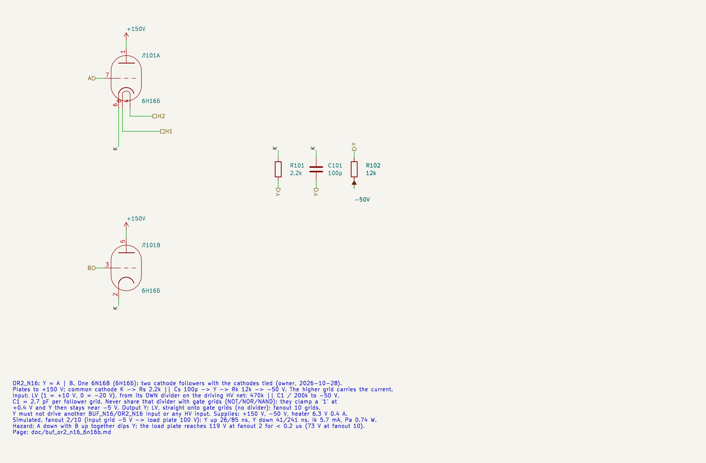
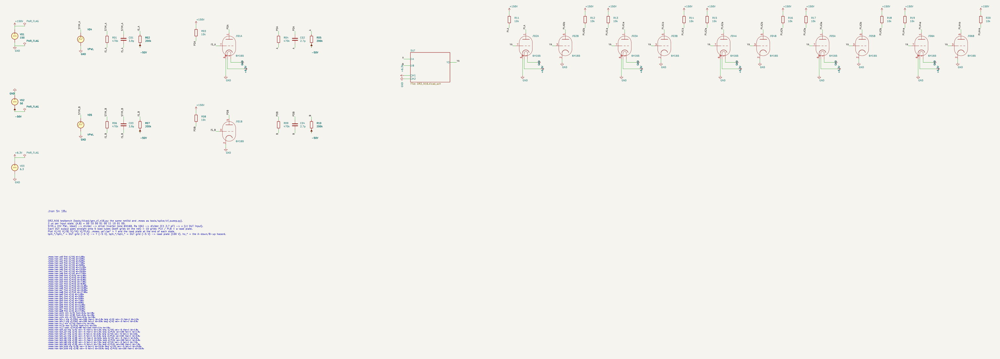
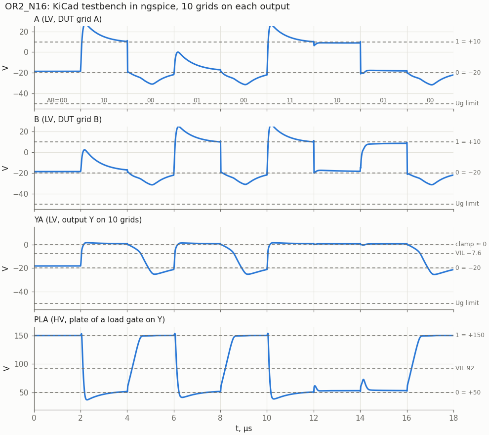

# OR2_N16: 2-input OR on one 6N16B (cathode followers)

Cell page. REQ-MOD-003 (OR2_N16 in the library), REQ-MOD-005 (boards), REQ-MOD-012 (logic levels), REQ-MOD-004 (delays, fan-out, power; simulated, not yet measured). Designed by `doc/cell_design_method.md`.

OR2_N16 is the cathode follower of [BUF_N16](../BUF_N16/README.md) with both triodes on one cathode load. The shared design is on the BUF_N16 page: how a follower joins the HV/LV scheme (its own input divider, output only to gate grids), the split cathode resistor, the input divider C1, the static transfer and noise margins, the datasheet limits and power, the options evaluated, the model and the open points. This page holds the OR2 results and the hazard.

| | OR2_N16 |
|---|---|
| Function | Y = A \| B |
| Tubes | one 6N16B (liberty `OR2_N16`: N16B 1) |
| Circuit | both plates to +150 V, cathodes tied, one Rs 2.2k ‖ Cs 100p and one Rk 12k to −50 V |
| Inputs | LV, from **their own** HV → LV divider (470k ‖ 2.7 pF / 200k) |
| Output | **LV**, straight onto the load grids, no divider |
| Supplies | +150 V, −50 V, heater 6.3 V 0.4 A |
| Output levels, fanout 2 … 10 | "1" +1.2 … +0.54 V; "0" −18.2 V (−22.0 V from a NOR driver with both inputs high) |
| Delay, input grid −5 V → load plate 100 V, fanout 2 … 10 | Y up 26 … 85 ns, Y down 41 … 241 ns |
| Ik, Pa (static, worst of the model spread) | 6.2 mA, 0.80 W per conducting triode |
| Grid, worst transient | −37.6 V nominal, −40.7 V at the model extremes (limit −50 V) |

## Schematic

| Pin | OR2_N16 |
|---|---|
| A | triode A grid (pin 7), LV in |
| B | triode B grid (pin 3), LV in |
| Y | tap of the common cathode load, LV out |
| H1, H2 | heater pins 8, 4 |

The plates (pins 1, 5) go straight to +150 V; the plate pins are passive in this sheet, so ERC accepts them on the supply. The part values and why the cathode resistor is split: BUF_N16 page.

## Results

### KiCad testbench

- **Stimulus and load** as in the BUF_N16 testbench: STIM_A and STIM_B are ideal HV PWL sources → divider (3.9 pF) → one driver 6N16B, a NOT per input (Ra 10k) → the follower's own divider (2.7 pF) → the DUT grids; Y goes straight onto 5 load tubes with both grids on the net (10 grids), each plate through 10k. PLA is the plate of one load gate.
- **Sequence,** 2 µs per state: (A, B) = 00 10 00 01 00 11 10 01 00: each input up and down alone, both up together, B down while A holds Y, and the hazard (A down, B up together).
- The `.meas` lines come from `cf_sweep.meas_lines`. The KiCad netlist results match the plain-SPICE sweep to 0.044 V and 0.04 ns on all 44 measurements.

### Static transfer and operating points

The transfer curve and the noise margins are those of BUF_N16 (`../BUF_N16/img/cf_n16_vtc.png`); the OR2 "0" is −18.2 V, so its LV "0" margin is 10.6 V.

Operating points (fanout 10, nominal; `tools/spice/cf_static.py`):

| State | Y | Cathode | Ik | Pa | Grid current per load |
|---|---|---|---|---|---|
| one input "1" | +0.54 V | +12.5 V | 5.4 mA | 0.74 W | 0.12 mA |
| both "1" | +0.60 V | +13.1 V | 5.7 mA (two triodes) | 0.39 W each | 0.15 mA |
| "0" | −18.2 V | −12.4 V | 2.7 mA | 0.21 W each | 0 |

### Fanout

| Grids on Y | Y up / down → load plate | LV → LV up / down | "1" level |
|---|---|---|---|
| 2 | 26 / 41 ns | 8 / 78 ns | +1.20 V |
| 4 | 37 / 94 ns | 13 / 174 ns | +0.84 V |
| 6 | 50 / 144 ns | 18 / 266 ns | +0.69 V |
| 8 | 66 / 193 ns | 24 / 357 ns | +0.60 V |
| 10 | 85 / 241 ns | 32 / 446 ns | +0.54 V |

"→ load plate" is input grid −5 V to the plate of a load gate at 100 V; "LV → LV" is input grid −5 V to Y −5 V. Why Y up is fast and Y down is set by Rk: BUF_N16 page.

### Model spread

C1 = 2.7 pF per grid; model parameters changed one at a time (cathode follower and loads together):

| Case | Grids | "0" | "1" | Load plate on "1" | Y up / down → load plate | Lowest DUT grid | Peak Ik (edge) |
|---|---|---|---|---|---|---|---|
| nominal | 2 / 10 | −18.2 V | +1.20 / +0.54 V | 42.4 / 53.4 V | 26 / 41, 85 / 241 ns | −37.6 V | 25 / 33 mA |
| KG1 −25 % (S+) | 2 / 10 | −19.7 V | +1.29 / +0.57 V | 33.8 / 45.6 V | 21 / 49, 74 / 278 ns | −40.5 V | 28 / 36 mA |
| KG1 +25 % (S−) | 2 / 10 | −17.0 V | +1.12 / +0.52 V | 49.8 / 59.8 V | 30 / 34, 97 / 210 ns | −35.2 V | 23 / 30 mA |
| MU −20 % | 2 / 10 | −18.9 V | +1.56 / +0.65 V | 31.9 / 43.9 V | 19 / 55, 66 / 303 ns | −40.7 V | 27 / 38 mA |
| MU +20 % | 2 / 10 | −17.3 V | +0.95 / +0.46 V | 52.6 / 62.0 V | 31 / 30, 106 / 190 ns | −34.8 V | 23 / 29 mA |

The worst "0", −17.0 V, leaves 9.4 V to the nominal load VIL. The worst load plate on a "1", 62.0 V, leaves 30 V to the 92 V threshold.

### Hazard

When A falls and B rises together, Y should stay "1". The falling grid A pulls the shared cathode down through its Cgk and through Cs. That cancels part of B's C1 step, and B's grid only reaches +1 V and then creeps up through its 140 kΩ divider (τ ≈ 0.9 µs). Since Y follows the grid, Y dips:

| Grids on Y | Lowest Y | Load plate peak | Back below 80 V after |
|---|---|---|---|
| 2 | −3.65 V | 119 V (104 … 130 V over the spread) | 189 ns (≤ 239 ns) |
| 4 | −1.80 V | 93 V | 182 ns |
| 6 | −1.14 V | 82 V | 158 ns |
| 10 | −0.60 V | 73 V (62 … 83 V) | — |

At low fanout the glitch crosses the next stage's threshold for about 0.1–0.2 µs. It settles well inside a 1 MHz clock, so it is harmless in synchronous logic, but it must not reach a latch enable or a clock. NOR2_N16 has the same kind of hazard (70 V). Rk 10k instead of 12k made this recovery 0.9–1.9 µs, which is why Rk is 12k.

**Synthesis (owner, 2026-10-30): `dont_use`.** ABC cannot see the LV level, so it chained followers (65 illegal grids). The followers stay in the library for hand-placed use, where the net rules are checked by hand. Synthesis no longer picks them (`doc/follower_chains.md`).

## Files and how to use

| File | |
|---|---|
| `OR2_N16.kicad_sch` | the cell; embed it as a hierarchical sheet |
| `OR2_N16_tb.kicad_pro/.kicad_sch` | testbench project |
| `tools/kicad/gen_cf_n16.py`, `tools/spice/cf_sweep.py`, `cf_static.py`, `cf_plots.py` | shared with BUF_N16 (see its page) |

- **KiCad simulator:** open `OR2_N16_tb.kicad_pro`, Inspect → Simulator. Plot `V(/A)`, `V(/B)`, `V(/YA)`, `V(/PLA)`.
- **Command line:** `tools/spice/sim_kicad.sh sch/logic/OR2_N16/OR2_N16_tb.kicad_sch`.
- **Embedding in a module:** as BUF_N16: each input gets its own divider from the driving HV net (C1 = 2.7 pF per follower grid); Y goes straight to gate grids only. The project must sit two directories below `sch/` (`sch/logic/<CELL>/`).

## Open points

The follower open points (net rules for synthesis and P&R, the HV "1" margin, liberty delays, measurements, loads other than 6N16B grids) are on the BUF_N16 page. Specific to OR2:

- **Hazard on real tubes**: measure the dip at A↓/B↑ together (REQ-MOD-004).
- Whether `OR2_N16` stays in the synthesis library under the follower net rules is the owner's call (BUF_N16 page, Open points).
