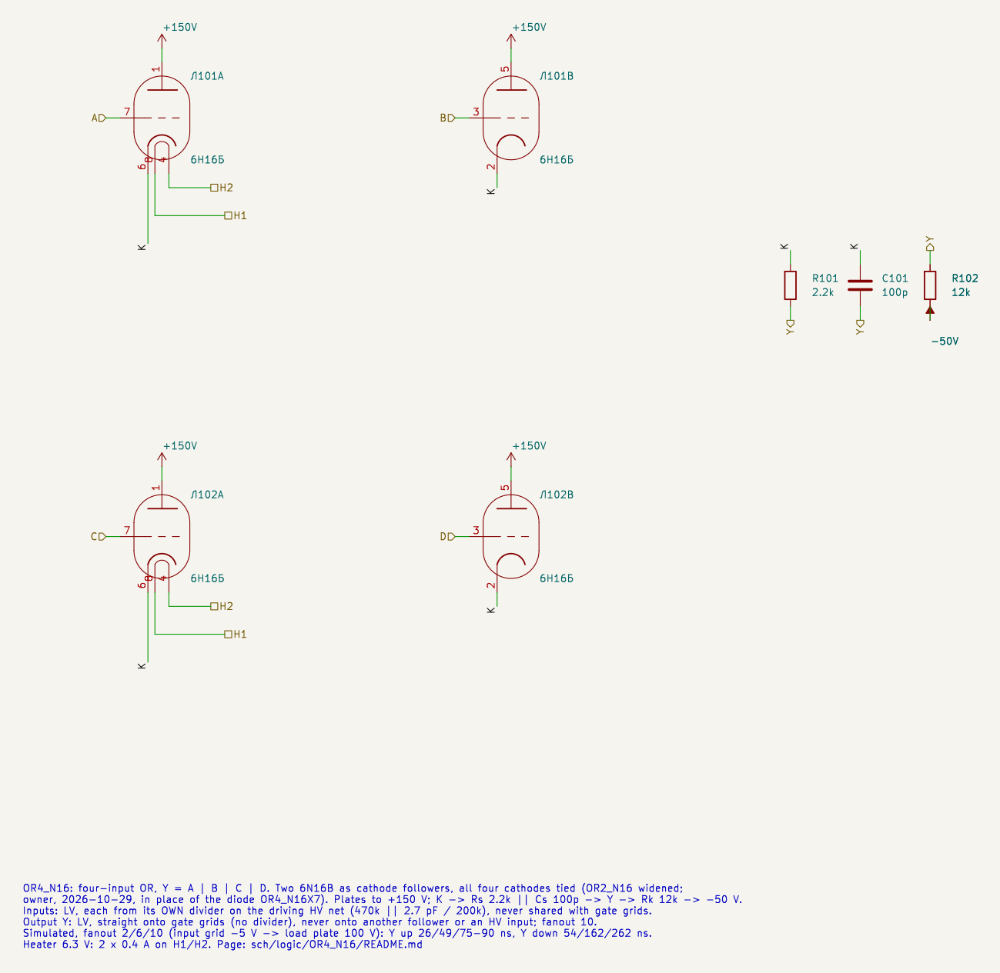
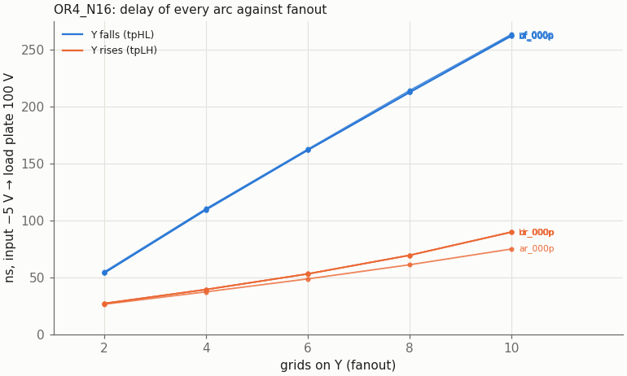
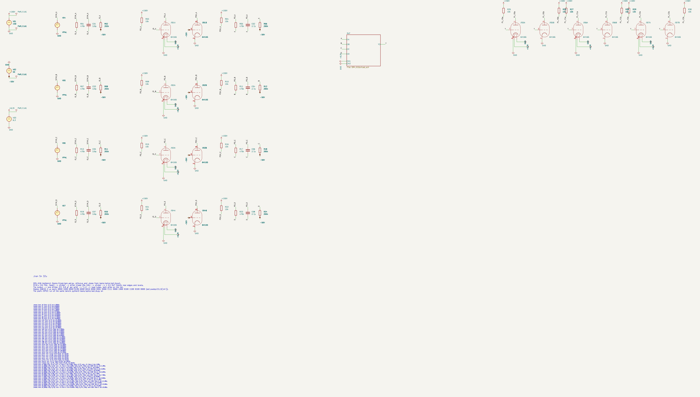
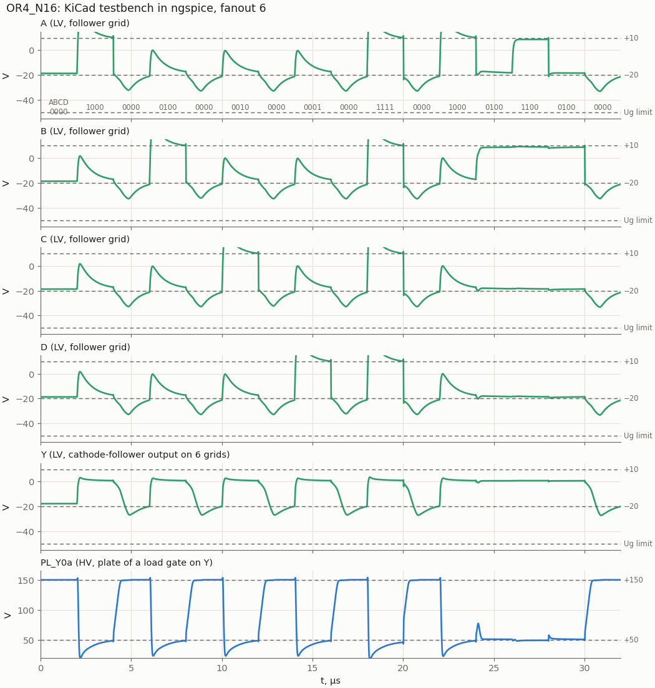
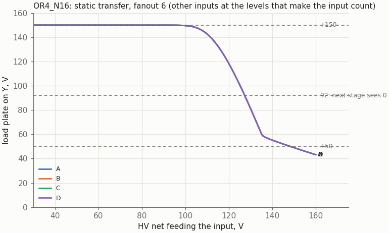

# OR4_N16: four-input OR on two 6N16B (cathode followers)

Cell page. REQ-MOD-003 (OR4 in the library), REQ-MOD-005 (boards), REQ-MOD-012 (logic levels), REQ-MOD-004 (delays, fan-out, power; simulated, not measured). Method: `doc/cell_design_method.md`.

[OR2_N16](../OR2_N16/README.md) widened to four triodes: two 6N16B as cathode followers with all four cathodes tied, one Rs ‖ Cs and one Rk. The owner chose it (2026-10-29) in place of the diode OR `OR4_N16X7`, after the comparison in `doc/or4_variants.md`: half a tube cheaper and 2–3 × faster on the rising edge. The follower family's design is on the [BUF_N16](../BUF_N16/README.md) page and holds here unchanged:
- each input on its own divider;
- the output drives only gate grids;
- the split cathode resistor;
- the model notes.

| | OR4_N16 |
|---|---|
| Function | Y = A + B + C + D |
| Tubes | two 6N16B (liberty: N16B 2) |
| Circuit | four plates to +150 V, cathodes tied on K; K → Rs 2.2k ‖ Cs 100p → Y → Rk 12k → −50 V |
| Inputs | LV, each from **its own** divider on the driving HV net (470k ‖ 2.7 pF / 200k) |
| Output | **LV**, straight onto the load grids, no divider |
| Supplies | +150 V, −50 V, heater 6.3 V 2 × 0.4 A |
| Output levels, fanout 2 … 10 | "1" +1.2 … +0.54 V (held by the load grids); "0" −17.7 V |
| Delay, input grid −5 V → load plate 100 V, fanout 2 / 6 / 10 | Y up 26 / 49–53 / 75–90 ns; Y down 54 / 162 / 262 ns |
| Delay LV → LV (input −5 V → Y −5 V), fanout 6 | up 18–20 ns, down 295 ns (the liberty values) |
| Ik, Pa (static, worst of the model spread) | 6.4 mA per cell; 0.80 W on a triode that carries it alone |
| Grid, worst transient | −36.4 V (limit −50 V) |

## Schematic



| Pin | Level | Connection |
|---|---|---|
| A, B | LV in | grids of Л101 (leads 7, 3) |
| C, D | LV in | grids of Л102 (leads 7, 3) |
| Y | LV out | tap of the common cathode load |
| H1, H2 | heater | both tubes |

The plates go straight to +150 V. The sheet marks the plate pins passive so that ERC accepts them on the supply, as on the BUF/OR2 sheets.

## Results

`tools/spice/aoi_sweep.py o4`, the shared gate sweep. Each input comes from a 6N16B NOT driver (Ra 10k) through its own follower divider (2.7 pF); Y goes straight onto the load triodes. 16 states:
- each input alone up and down;
- all four together;
- the hazard A↓ / B↑;
- B holding Y while A falls.

### Delay against fanout



| Grids on Y | Y up → load plate | Y down → load plate | LV → LV up / down | "1" level |
|---|---|---|---|---|
| 2 | 26–27 ns | 54–55 ns | 9 / 100–101 ns | +1.20 … +1.89 V |
| 6 | 49–53 ns | 162 ns | 18–20 / 295–296 ns | +0.69 … +0.99 V |
| 10 | 75–90 ns | 262–263 ns | 27–34 / 479–480 ns | +0.54 … +0.74 V |

As with OR2_N16, Y up is fast (the follower sources the current) and Y down is set by Rk. The four cathodes add capacitance on K, so the falling edge is slower than OR2's (241 ns at fanout 10).

Against the comparison of `doc/or4_variants.md`: the numbers there run from the driver plate and include the input divider. Here they run from the DUT grid.

### KiCad testbench



`OR4_N16_tb.kicad_sch` runs the 16-state sequence at fanout 6, with stimulus, loads and `.meas` from `tools/spice/aoi_tb.py`. KiCad and plain SPICE agree on all 55 values.



When one follower turns on, the common cathode rises about 30 V, and the grids of the three cut-off triodes follow it through Cgk to near 0 V. On the falling edge they kick to −33 V. Their own dividers pull them back. OR2_N16 shows the same with one partner; the grid limit is not reached (−36 V worst).

### Static transfer



One input swept on its HV net, the others low, fanout 6: the load plate crosses 100 V at 125 V on the input net, as for BUF_N16 (125.5 V). So the HV "1" margin of a follower input is about 20 V. That is the open point of the follower family on the BUF_N16 page.

### Static operating points

| Inputs high | Y | Cathode | Cell current | Pa |
|---|---|---|---|---|
| none | −17.8 V | −11.8 V | 2.7 mA | 0.11 W per triode |
| one | +0.54 V | +12.4 V | 5.4 mA | 0.74 W on the conducting triode |
| two | +0.60 V | +13.1 V | 5.7 mA | 0.39 W each |
| four | +0.65 V | +13.7 V | 5.9 mA | 0.20 W each |

At MU −20 %: 6.4 mA, 0.80 W on a single conducting triode (limit 0.9 W). This is the same worst case as OR2_N16 and BUF_N16.

### Hazard

A falls while B rises: Y should stay "1". It dips to −2.7 V at fanout 2, and the load plate rises to 106 V (114 V with C1 −10 %): above the next stage's 92 V for about 0.1 µs. At fanout 6 the peak is 77 V, at fanout 10 70 V. OR2_N16 reaches 119 V at fanout 2. Harmless in synchronous logic; never use such a net as a clock or an enable.

### Model spread

| Case | "0" (worst) | Load plate on "1" | Hazard plate, fanout 2 | Lowest grid | Y down → load plate, fanout 10 |
|---|---|---|---|---|---|
| nominal | −17.7 V | ≤ 53.3 V | 106 V | −36.1 V | 262 ns |
| MU −20 % | −16.5 V | ≤ 51.6 V | 99 V | −36.0 V | 273 ns |
| MU +20 % | −18.6 V | ≤ 54.6 V | 111 V | −36.2 V | 255 ns |
| KG1 −25 % | −17.6 V | ≤ 52.9 V | 105 V | −36.1 V | 265 ns |
| KG1 +25 % | −17.9 V | ≤ 53.7 V | 107 V | −36.1 V | 259 ns |
| C1 +10 % | −17.7 V | ≤ 53.4 V | 100 V | −36.4 V | 264 ns |
| C1 −10 % | −17.7 V | ≤ 53.5 V | 114 V | −36.3 V | 260 ns |

The worst "0", −16.5 V, leaves 8.9 V to the load's VIL (−7.6 V). OR2_N16's worst case is −17.0 V, 9.4 V.

## Liberty

`OR4_N16` in `sch/logic/vtube_cells.lib` (2026-10-29), in place of `OR4_N16X7`:
- area 2, N16B 2, heat 800 mA;
- A–D `vtube_grid "follower"`, `vtube_c1` 2.7 pF;
- Y `vtube_level "LV"`, `max_fanout` 10.

`vtube_timing.json`: [Y rise, Y fall] LV → LV [20, 296] ns at fanout 6. This is where the next gate's arc starts; BUF_N16 [15, 245] and OR2_N16 [18, 266] were filled the same way.

Synthesis (`run_tests.sh -s`, 2026-10-29): **54 cells, 108 tubes**; total 1379.5 tubes (−21 against the diode OR4). ABC now takes OR4 where it took OR2 + NOR, and `NAND4_N16X7` is gone. The follower → follower chains reported by `div_insert.py` grew to 65 over the three blocks (MachineCtrl 10 → 23). That is the open point of the follower family (BUF_N16 page, `doc/hv_lv_dividers.md`).

## Files and how to run

| File | What |
|---|---|
| `OR4_N16.kicad_sch` | the cell |
| `OR4_N16_tb.kicad_pro/.kicad_sch` | testbench project |
| `tools/kicad/gen_aoi.py` | generated the sheets (with the AOI and NOR4 cells) |
| `tools/spice/aoi_sweep.py o4`, `aoi_tb.py o4`, `aoi_plots.py` | sweep, bench, figures |
| `tools/spice/or4_compare.py` | the comparison against the diode OR |

```
python3 tools/spice/aoi_sweep.py o4
tools/spice/sim_kicad.sh sch/logic/OR4_N16/OR4_N16_tb.kicad_sch
```

To embed the cell: each input gets its own divider from the driving HV net (470k ‖ 2.7 pF / 200k to −50 V). Y goes only to gate grids. An unused input goes to another input of the cell. The project must sit two directories below `sch/`.

## Open points

- **Follower → follower chains** in synthesis (65 now). ABC does not know the levels; it needs `dont_use`, a legalization pass, or an LV net class in the flow. Owner's call (`doc/hv_lv_dividers.md`).
- **Hazard** above 92 V at fanout 2, as OR2_N16.
- **Measure on tubes** (REQ-MOD-004).
